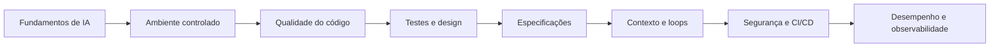

# Engenharia de Software com Programação Assistida por IA

Curso teórico-prático sobre como projetar, implementar, testar e evoluir software com o apoio de agentes de IA, sem abrir mão dos fundamentos de engenharia de software.

O material usa **Java 21 e Spring Boot 3** como base dos exemplos e acompanha a evolução de uma API de catálogo de produtos. Ao longo de 14 módulos, o curso vai dos fundamentos de inteligência artificial a Clean Code, TDD, SOLID, padrões de projeto, desenvolvimento orientado por especificações, segurança, CI/CD, desempenho e observabilidade.

> **Princípio central:** a IA propõe, ferramentas verificam e pessoas decidem.

## Navegação rápida

- [Material completo do curso](tutorial/README.md)
- [Módulo 0 — Fundamentos de IA](tutorial/modulo-0-fundamentos-de-ia.md)
- [Módulo 1 — Preparação do ambiente](tutorial/modulo-1-ambiente.md)
- [Aplicação Spring Boot de referência](catalogo-referencia/README.md)
- [Validação de segurança do material](tutorial/PR-SECURITY-VALIDATION.md)

## Objetivos de aprendizagem

Ao concluir a trilha, espera-se que o estudante seja capaz de:

- explicar, em nível introdutório, como LLMs e agentes de programação funcionam e por que podem errar;
- preparar um repositório para colaboração segura e previsível com agentes de IA;
- escrever e revisar código legível, coeso e com baixo acoplamento;
- desenvolver funcionalidades usando TDD e interpretar métricas de cobertura e mutação;
- aplicar SOLID e padrões de projeto com critério, evitando abstrações prematuras;
- transformar requisitos em especificações versionadas e rastreáveis;
- administrar contexto, memória, loops e condições de parada de agentes;
- criar portões automatizados de qualidade e segurança;
- usar agentes em CI/CD com permissões mínimas e revisão humana;
- medir desempenho e investigar o comportamento do sistema por meio de observabilidade.

## Para quem é este curso

O curso foi preparado principalmente para estudantes de computação e pessoas em início de carreira no desenvolvimento de software. É útil também para desenvolvedores experientes que desejam estruturar o uso de IA no fluxo de engenharia.

É recomendável conhecer os fundamentos de programação, como variáveis, métodos, classes e coleções. Experiência prévia com IA, Spring Boot, testes automatizados ou ferramentas de especificação não é obrigatória: os assuntos são apresentados progressivamente.

## Estrutura do diretório

```text
.
├── README.md                     # visão geral e ponto de entrada do curso
├── tutorial/
│   ├── README.md                 # guia completo, ementa e carga horária
│   ├── modulo-0-....md           # fundamentos de IA
│   ├── modulo-1-....md           # ambiente de desenvolvimento
│   ├── ...
│   ├── modulo-13-....md          # desempenho e observabilidade
│   └── PR-SECURITY-VALIDATION.md # registro de validação de segurança
└── catalogo-referencia/
    ├── src/main/                 # aplicação Java/Spring Boot
    ├── src/test/                 # testes unitários e de integração
    ├── openspec/                 # especificação e mudança arquivada
    ├── .agents/skills/           # skills geradas pelo OpenSpec
    ├── .github/workflows/        # portão de validação no CI
    ├── scripts/                  # verificação de rastreabilidade
    ├── pom.xml                   # configuração Maven
    └── README.md                 # instruções específicas da aplicação
```

O diretório `tutorial/` contém o conteúdo didático. O diretório `catalogo-referencia/` contém o estado executável do projeto ao final do Módulo 7 e serve para comparação, experimentação e validação dos conceitos.

## Trilha de aprendizagem

Os módulos foram planejados para leitura na ordem numérica. Cada etapa acrescenta conceitos e mecanismos de controle que serão usados nas etapas seguintes.

| Módulo | Tema | Resultado esperado |
| ---: | --- | --- |
| [0](tutorial/modulo-0-fundamentos-de-ia.md) | Fundamentos de IA | Entender ML, redes neurais, Transformers, LLMs e agentes |
| [1](tutorial/modulo-1-ambiente.md) | Ambiente | Preparar Git, agente, contexto, rules, skills e CI |
| [2](tutorial/modulo-2-clean-code.md) | Clean Code | Reconhecer code smells e produzir código fácil de entender e mudar |
| [3](tutorial/modulo-3-tdd-e-cobertura.md) | TDD e cobertura | Trabalhar no ciclo red–green–refactor e criar portões de teste |
| [4](tutorial/modulo-4-solid.md) | SOLID | Organizar responsabilidades, abstrações e dependências |
| [5](tutorial/modulo-5-design-e-revisao.md) | Design e revisão | Projetar módulos profundos e revisar código com critérios explícitos |
| [6](tutorial/modulo-6-padroes-de-projeto.md) | Padrões de projeto | Selecionar padrões GoF sem cair em excesso de abstração |
| [7](tutorial/modulo-7-openspec.md) | OpenSpec | Executar o ciclo propor → aplicar → validar → arquivar |
| [8](tutorial/modulo-8-spec-kit.md) | Spec Kit | Trabalhar com constituição, especificação, plano e tarefas |
| [9](tutorial/modulo-9-context-engineering.md) | Context Engineering | Controlar o que o agente vê e preservar seu orçamento de atenção |
| [10](tutorial/modulo-10-loop-engineering.md) | Loop Engineering | Projetar ciclos autônomos com estado e condições de parada |
| [11](tutorial/modulo-11-seguranca.md) | Segurança | Combinar modelagem de ameaças, SAST, SCA, DAST e gestão de segredos |
| [12](tutorial/modulo-12-agentes-ci-cd.md) | Agentes no CI/CD | Usar agentes sem conceder escrita ou expor credenciais desnecessárias |
| [13](tutorial/modulo-13-desempenho-observabilidade.md) | Desempenho e observabilidade | Medir, correlacionar sinais e validar mudanças sob carga |

### Progressão conceitual



## Como usar o material

### Estudo individual

1. Comece pelo [guia do tutorial](tutorial/README.md) e siga os módulos em ordem.
2. Reproduza os exemplos no seu próprio repositório em vez de apenas copiar os trechos.
3. Em cada prática, peça ao agente mudanças pequenas e verificáveis.
4. Execute os testes e demais portões determinísticos antes de aceitar uma resposta do agente.
5. Compare o resultado do Módulo 7 com o [`catalogo-referencia`](catalogo-referencia/README.md).
6. Termine cada módulo usando seu checklist e registrando as decisões importantes no Git.

### Uso em sala de aula

Uma aula pode ser organizada em quatro momentos:

1. apresentação dos conceitos e dos limites da técnica;
2. análise coletiva de um exemplo ou anti-exemplo;
3. prática guiada com o projeto do catálogo;
4. validação por testes, revisão entre pares e discussão das decisões.

O [README do tutorial](tutorial/README.md#6-sugestão-de-carga-horária) traz uma sugestão de carga horária por módulo. O percurso completo pode ser adaptado: os módulos 0 a 7 formam o núcleo de engenharia; os módulos 8 a 13 aprofundam especificação, operação de agentes e produção.

## Pré-requisitos e ferramentas

### Para ler o curso

Basta um editor de Markdown. Um visualizador compatível com Mermaid é recomendado para renderizar os diagramas.

### Para executar a aplicação de referência

- JDK 21;
- Git;
- Python 3 para a checagem de rastreabilidade;
- Node.js/npm apenas para instalar e executar o OpenSpec;
- Docker somente nas práticas dos módulos que sobem serviços auxiliares, ferramentas de segurança ou infraestrutura de observabilidade.

O projeto inclui Maven Wrapper, portanto não exige uma instalação global do Maven. Em Windows, substitua `./mvnw` por `mvnw.cmd`.

### Ferramentas usadas nas práticas

O curso demonstra o agente `oh-my-pi` (`omp`), o instalador `npx skills`, OpenSpec e Spec Kit. Os princípios não dependem dessas ferramentas: arquivos de contexto, especificações e comandos determinísticos podem ser adaptados a outros agentes e ambientes.

As versões efetivamente usadas para preparar o conteúdo estão registradas no [guia do tutorial](tutorial/README.md#43-o-que-significa-saída-real). Como CLIs e modelos evoluem rapidamente, confira a documentação da versão instalada quando a saída local for diferente da mostrada no material.

## Início rápido

Clone ou abra este diretório e leia o índice principal:

```bash
cd desenvolvimento-assistido-IA
```

Para validar a aplicação de referência:

```bash
cd catalogo-referencia
./mvnw verify
python3 scripts/check_traceability.py
```

Para validar também as especificações OpenSpec:

```bash
npx @fission-ai/openspec@1.13.2 validate --all --strict
```

Para iniciar a API com o banco H2 em memória:

```bash
./mvnw spring-boot:run
```

A aplicação ficará disponível em `http://localhost:8080/api/products`.

## Aplicação de referência

O projeto de exemplo implementa uma API REST de catálogo de produtos com:

- criação de produtos com validação e garantia de SKU único;
- consulta por identificador;
- listagem ordenada por nome;
- atualização de nome, preço e estoque, mantendo o SKU imutável;
- exclusão de produtos;
- respostas de erro em `application/problem+json`;
- persistência com Spring Data JPA;
- migração de banco com Flyway;
- H2 para desenvolvimento e testes;
- PostgreSQL por meio do perfil `prod`;
- testes por camada e testes de integração;
- rastreabilidade entre cenários da especificação e testes;
- validação automatizada no GitHub Actions.

### Endpoints

| Método | Caminho | Operação | Resposta principal |
| --- | --- | --- | --- |
| `POST` | `/api/products` | Cadastrar produto | `201 Created` |
| `GET` | `/api/products/{id}` | Consultar por ID | `200 OK` |
| `GET` | `/api/products` | Listar produtos | `200 OK` |
| `PUT` | `/api/products/{id}` | Atualizar produto | `200 OK` |
| `DELETE` | `/api/products/{id}` | Excluir produto | `204 No Content` |

Exemplo de cadastro:

```bash
curl --request POST http://localhost:8080/api/products \
  --header 'Content-Type: application/json' \
  --data '{
    "name": "Caneta azul",
    "sku": "CAN-001",
    "price": 2.50,
    "stock": 100
  }'
```

Consulte a [especificação vigente](catalogo-referencia/openspec/specs/product-catalog/spec.md) para os requisitos e cenários completos.

## Estratégia de verificação

O repositório de referência separa as verificações em camadas:

| Verificação | Comando | O que comprova |
| --- | --- | --- |
| Compilação e testes | `./mvnw verify` | Código compila e testes unitários e de integração passam |
| Rastreabilidade | `python3 scripts/check_traceability.py` | Cada cenário da especificação possui teste associado |
| Consistência das specs | `npx @fission-ai/openspec@1.13.2 validate --all --strict` | Artefatos OpenSpec seguem a estrutura esperada |
| CI | `.github/workflows/openspec.yml` | As verificações anteriores são repetidas em pull requests |

No estado documentado da aplicação, a suíte possui 10 testes, os 8 cenários da especificação têm prova e a especificação passa na validação estrita. O [README da aplicação](catalogo-referencia/README.md) registra o ambiente e a data dessa execução.

## Forma de trabalho com IA

O curso combina quatro mecanismos complementares:

- **contexto:** informa ao agente a arquitetura, os comandos e as convenções do projeto;
- **rules:** tornam restrições importantes explícitas e verificáveis;
- **skills:** carregam procedimentos especializados apenas quando necessários;
- **ferramentas determinísticas:** compilador, testes, linters, scanners e CI produzem evidências independentes da resposta do modelo.

Uma mudança típica percorre este fluxo:

```text
necessidade → especificação → plano → implementação → testes → portões → revisão humana
```

O agente ajuda a explorar alternativas e executar trabalho mecânico. A especificação define o comportamento esperado; os portões detectam regressões; a revisão humana assume as decisões de produto, arquitetura, risco e aceite.

## Banco de dados de produção

O perfil padrão usa H2 em memória e não exige configuração. Para executar com PostgreSQL, ative o perfil `prod` e forneça as variáveis esperadas por `application.yml`:

```bash
export SPRING_PROFILES_ACTIVE=prod
export DB_URL='jdbc:postgresql://localhost:5432/catalogo'
export DB_USER='catalogo'
export DB_PASSWORD='troque-esta-senha'
./mvnw spring-boot:run
```

O Flyway cria e versiona o esquema. O Hibernate está configurado com `ddl-auto: validate`, portanto valida o mapeamento sem substituir o mecanismo de migração.

## Solução de problemas

- **`JAVA_HOME` ou versão incompatível:** confirme com `java -version`; o projeto requer Java 21.
- **Permissão negada ao executar o wrapper:** em sistemas Unix, restaure a permissão com `chmod +x catalogo-referencia/mvnw`.
- **A aplicação não inicia no perfil `prod`:** confira se PostgreSQL está acessível e se `DB_URL`, `DB_USER` e `DB_PASSWORD` foram definidos.
- **OpenSpec não encontrado:** use o comando com `npx` mostrado acima ou siga a instalação do [Módulo 7](tutorial/modulo-7-openspec.md#6-instalação-e-inicialização).
- **Saída de uma ferramenta diferente da apostila:** compare a versão instalada com as versões registradas no material.

## Próximos passos

Se esta é sua primeira visita, siga para o [Módulo 0 — Fundamentos de IA](tutorial/modulo-0-fundamentos-de-ia.md). Se já conhece os fundamentos de LLMs e agentes, comece pelo [Módulo 1 — Ambiente](tutorial/modulo-1-ambiente.md), que prepara a base usada nas práticas seguintes.

Para detalhes pedagógicos, referências bibliográficas, catálogo de skills e carga horária, consulte o [guia completo do curso](tutorial/README.md).
