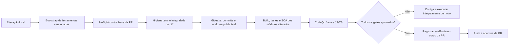

# Estrutura de validação de segurança para Pull Requests

Este documento descreve uma implementação local, bloqueante e reproduzível para impedir a abertura de PRs com segredos, dependências vulneráveis, achados SAST ou regressões básicas de qualidade. É uma referência para adaptar ao stack do projeto; nomes de módulos, comandos de build e limiares devem ser ajustados.

## Decisão central

O gate de PR roda **localmente antes de `git push` e da abertura da PR**. A PR só pode ser criada após o script integral retornar sucesso. Workflows remotos continuam úteis para auditoria periódica, mas não substituem o preflight local.



## Propriedades obrigatórias

- **Fail-closed:** ferramenta ausente, base inválida, relatório ausente, configuração inválida ou erro de infraestrutura falha o preflight.
- **Base explícita:** calcular o merge-base entre `HEAD` e a base da PR (por exemplo, `origin/main`). Nunca analisar apenas o estado atual.
- **Escopo completo de publicação:** considerar commits, alterações staged, unstaged e arquivos novos não ignorados.
- **Regras e exceções versionadas:** configurações de Gitleaks, CodeQL, suppressions e exceções de SCA passam pela revisão normal da PR.
- **Exceções temporárias e auditáveis:** motivo verificável, responsável e data de revisão; exceção vencida volta a bloquear automaticamente.
- **Sem bypass:** não aceitar `--skip`, sucesso parcial, arquivo SARIF ausente ou desabilitação silenciosa de regra para abrir PR.

## Estrutura de arquivos sugerida

```text
.
├── tools/
│   ├── setup-local-pr-tools.sh             # instala/valida versões das ferramentas
│   └── run-local-pr-gates.sh               # único ponto de entrada do preflight
├── security/
│   ├── check-env-hygiene.sh                # .env e exemplos sem segredo
│   ├── frontend-sca-audit.py               # auditoria de dependências JS/TS
│   ├── backend-sca-report.py               # OWASP Dependency-Check + relatório
│   └── codeql-sarif-gate.py                # decisão sobre SARIF CodeQL
├── security-policy/
│   ├── gitleaks.toml                       # regras e allowlist restrita de segredos
│   ├── codeql-config.yml                   # suites e paths ignorados
│   ├── codeql-baseline.json                # achados preexistentes, com validade
│   ├── frontend-audit-exceptions.json       # exceções datadas do audit JS/TS
│   └── dependency-check-suppressions.xml    # suppressions justificadas do backend
├── .github/
│   ├── pull_request_template.md
│   └── workflows/
│       ├── security-secrets.yml             # varredura periódica do histórico inteiro
│       ├── security-sca.yml                 # auditoria periódica de CVEs
│       └── security-sast.yml                # CodeQL periódico/manual
└── AGENTS.md ou CONTRIBUTING.md              # política de revisão humana
```

`security/` e `security-policy/` podem usar qualquer nome. O importante é separar o orquestrador, os verificadores e as políticas auditáveis.

## 1. Bootstrap determinístico das ferramentas

Criar `tools/setup-local-pr-tools.sh`, executado uma vez por máquina e novamente quando a versão mudar.

| Ferramenta | Uso | Regra |
|---|---|---|
| Git | calcular base, diff e arquivos publicáveis | obrigatório |
| Gitleaks | detectar segredos | versão fixada |
| CodeQL CLI + queries Java e JS/TS | SAST | versão fixada e queries instaladas |
| Java LTS | build/teste backend e banco CodeQL Java | versão fixada |
| Node LTS + Corepack | frontends | instalação imutável pelo lockfile |
| Python | scripts de gate | versão fixada |
| NVD API key | atualização estável do Dependency-Check | lida de variável/arquivo local; nunca versionada |

O bootstrap deve falhar se uma ferramenta estiver ausente, se a versão não corresponder à política ou se o bundle CodeQL não trouxer as queries requeridas. Guarde binários locais fora do Git, por exemplo em `.tools/`.

## 2. Orquestrador único do preflight

O desenvolvedor deve executar apenas:

```bash
./tools/setup-local-pr-tools.sh
./tools/run-local-pr-gates.sh origin/main
```

Contrato de `run-local-pr-gates.sh`:

1. habilitar `set -euo pipefail`;
2. confirmar que está dentro de um repositório Git;
3. validar a referência-base e calcular `BASE_SHA=$(git merge-base HEAD "$BASE_REF")`;
4. criar diretório temporário e removê-lo com `trap`;
5. coletar arquivos mudados da faixa `BASE_SHA..HEAD`, do worktree staged/unstaged e de arquivos não ignorados;
6. executar os gates globais; depois, apenas os gates dos módulos alterados;
7. executar SAST CodeQL para todas as linguagens suportadas, independentemente do escopo;
8. imprimir uma única linha de evidência ao final, por exemplo:

```text
EVIDÊNCIA: base=<sha> head=<sha> gates=ci,sca,secrets,sast resultado=APROVADO
```

Essa linha entra no corpo da PR. Se qualquer comando retornar erro, não imprimir evidência de aprovação.

## 3. Gates globais — sempre executados

### 3.1 Higiene de `.env`

O script deve:

- reprovar qualquer `.env` real rastreado no Git;
- permitir apenas templates explicitamente reconhecidos, como `.env.example`, e manifests declaradamente sem credenciais;
- examinar os templates contra padrões de chave privada, token JWT, credencial cloud e strings de alta entropia;
- manter uma lista mínima de placeholders permitidos (`<valor>`, `${VAR}`, `changeme` etc.).

Não permita `.env` de produção no repositório, mesmo criptografado, salvo se houver uma política operacional específica e revisão de segurança.

### 3.2 Integridade do diff

Execute:

```bash
git diff --check "$BASE_SHA"
```

Isso bloqueia espaços em branco inválidos e marcadores de conflito que podem corromper patch, configuração ou segredo removido parcialmente.

### 3.3 Detecção de segredos

São necessárias **duas varreduras**:

```bash
# 1. O que será introduzido pelos commits da PR.
gitleaks detect --source . --config security-policy/gitleaks.toml \
  --log-opts="$BASE_SHA..HEAD" -v

# 2. Tudo que o Git pode incluir no próximo commit.
git ls-files -co --exclude-standard -z
# Copiar somente arquivos regulares retornados para um diretório temporário.
gitleaks dir <diretorio-temporario> --config security-policy/gitleaks.toml -v
```

A segunda varredura é indispensável: ela cobre segredo colocado em arquivo staged, unstaged ou novo não ignorado, que ainda não aparece em `BASE_SHA..HEAD`. Não escaneie `node_modules`, `target`, caches ou artefatos locais; eles não são publicáveis e podem ocultar resultado relevante no ruído.

A allowlist do Gitleaks deve usar paths/regexs precisos e ter justificativa por entrada. Nunca crie uma regra genérica para suprimir toda uma família de segredos.

## 4. Gates condicionais por módulo

A seleção deve considerar também alterações não commitadas. Um modo `--all` pode forçar todos os módulos para auditoria ou depuração, mas não deve substituir a execução normal.

### 4.1 Backend Java

Quando backend, `pom.xml` ou testes do backend mudarem:

```bash
cd api
./mvnw -B -ntp verify
```

Use banco de teste isolado quando o projeto possuir integração com banco. `verify` deve executar testes relevantes e plugins de qualidade definidos no build.

### 4.2 Frontends JavaScript/TypeScript

Para cada frontend alterado:

```bash
corepack yarn install --immutable
corepack yarn lint
python3 security/frontend-sca-audit.py <modulo>
corepack yarn build
```

A instalação imutável prova que o lockfile é suficiente e evita que o preflight aprove dependência não registrada.

#### Política de SCA do frontend

O auditor deve executar `yarn npm audit` sobre o lockfile real e distinguir o ambiente da dependência:

| Ambiente | Severidade que bloqueia |
|---|---|
| Produção/runtime | `high` e `critical` |
| Desenvolvimento/build-only | `critical` |

A diferença só é válida se as dependências de desenvolvimento realmente não chegarem ao artefato de produção. Relate as demais vulnerabilidades, mesmo quando não bloqueantes.

As exceções devem conter, no mínimo: pacote, advisory (quando aplicável), ambiente, motivo, responsável, data de inclusão e `review-by`. Ao vencer `review-by`, a exceção deixa de valer.

### 4.3 Serviços Python

Quando um serviço Python mudar:

```bash
python -m venv <tmp-venv>
<tmp-venv>/bin/pip install -r requirements.txt
<tmp-venv>/bin/python -m compileall -q .
<tmp-venv>/bin/python -m unittest discover -s tests -v
```

Inclua lint como gate bloqueante se o projeto já tiver linter confiável. Não use `|| true` em validação de segurança ou qualidade que se declare bloqueante.

## 5. SCA do backend

Quando `pom.xml`, código/dependências do backend, configuração de suppressions ou workflow SCA mudar, execute OWASP Dependency-Check:

```bash
cd api
./mvnw -q org.owasp:dependency-check-maven:check
```

Configuração mínima:

- atualizar a base NVD usando chave mantida fora do repositório;
- falhar se o arquivo de suppressions esperado não existir;
- bloquear CVEs aplicáveis no limiar definido pelo projeto — `CVSS >= 7.0` é um ponto de partida razoável para alto/crítico;
- preservar relatório HTML/JSON para diagnóstico;
- separar **CVE aplicável** de mero atraso de versão: `versions:display-dependency-updates` é informativo e não deve ser vendido como vulnerabilidade.

Suppressions do Dependency-Check exigem identificação da vulnerabilidade, justificativa verificável, responsável e data de revisão. Não use suppression para esconder uma CVE sem plano de correção.

## 6. SAST com CodeQL

Executar sempre Java e JavaScript/TypeScript. Alteração pequena de configuração, infraestrutura ou fonte compartilhada pode afetar a superfície analisada mesmo sem mudar um módulo explícito.

### 6.1 Configuração

`security-policy/codeql-config.yml` deve habilitar:

```yaml
queries:
  - uses: security-extended
  - uses: security-and-quality

paths-ignore:
  - '**/node_modules/**'
  - '**/target/**'
  - '**/dist/**'
```

Ignore apenas código gerado, dependências instaladas ou artefatos sem superfície de aplicação. Cada exceção de path deve explicar por que não é código executável ou por que não faz parte do produto.

### 6.2 Execução

Para Java, faça build limpo dentro da criação do banco CodeQL; sem `clean`, bytecode prévio pode impedir o extrator de observar uma compilação real.

```bash
codeql database create <db-java> \
  --source-root=. --language=java \
  --codescanning-config=security-policy/codeql-config.yml \
  --command='./api/mvnw -q -f api/pom.xml -DskipTests clean package'

codeql database analyze <db-java> \
  'codeql/java-queries:codeql-suites/java-security-extended.qls' \
  'codeql/java-queries:codeql-suites/java-security-and-quality.qls' \
  --format=sarif-latest --output=<results-java>/report.sarif --threads=0
```

Para JS/TS, criar o banco sem comando de build se a análise estática já cobrir o projeto. Analisar com as suites `javascript-security-extended` e `javascript-security-and-quality` equivalentes.

### 6.3 Gate sobre SARIF

`codeql-sarif-gate.py` deve:

1. falhar se não houver SARIF, se o JSON for inválido ou se a baseline estiver inválida/vencida;
2. ler `security-severity` de cada resultado;
3. considerar bloqueante qualquer achado com severidade igual ou acima do limiar — `7.0` como padrão inicial;
4. comparar `(rule, fingerprint)` contra baseline versionada;
5. permitir somente achados preexistentes da baseline ainda válida;
6. falhar para qualquer fingerprint alto novo;
7. listar a localização, regra, severidade e mensagem de cada achado novo.

A baseline não remove achados do relatório: ela só diferencia dívida conhecida de regressão nova. Deve ter versão, responsável, `reviewBy` e fingerprints específicos; uma baseline vencida falha o gate.

## 7. Revisão humana obrigatória

Automação não substitui revisão do diff. A política do repositório deve bloquear PR que introduza ou agrave:

- consulta, cache, fila, arquivo ou endpoint sem isolamento pelo tenant autenticado;
- endpoint que verifica apenas papel, sem validar propriedade e tenant do recurso — risco de IDOR;
- dados pessoais ou de saúde desnecessários em resposta, log ou mensagem de erro; ausência de auditoria em operação sensível; exclusão física onde o domínio exige histórico;
- segredo em código ou `.env` versionado, senha padrão de produção, container executando como root ou remoção de cabeçalho de segurança;
- SQL injection, path traversal, XSS, SSRF, desserialização insegura ou credencial versionada;
- requisito de segurança obrigatório sem teste de comportamento, erro ou fronteira de autorização correspondente.

Para cada achado, registrar arquivo/linha, impacto concreto e correção segura. Preferências de estilo não devem competir com riscos reais.

## 8. Workflows remotos de auditoria

Mesmo com preflight local bloqueante, manter três workflows remotos para detectar deriva sem PR nova:

| Workflow | Frequência sugerida | Escopo |
|---|---|---|
| `security-secrets.yml` | semanal + manual | histórico Git completo com `fetch-depth: 0` |
| `security-sca.yml` | semanal + manual | Dependency-Check e relatório de CVEs do backend |
| `security-sast.yml` | semanal + manual | CodeQL Java e JS/TS, SARIF preservado como artefato |

Esses workflows podem ter trigger manual e agendado. Se não houver `pull_request`/`push`, declare explicitamente que o gate de PR é local; caso contrário, a equipe pode assumir incorretamente que o GitHub bloqueia a PR.

## 9. Corpo da PR e rastreabilidade

O template deve conter:

```markdown
## O que mudou

## Issue relacionada
Closes #<numero> <!-- somente quando houver issue real -->

## Test plan
- [ ] <cenário exercitado>

## Evidência do preflight
<!-- cole a linha EVIDÊNCIA emitida por tools/run-local-pr-gates.sh -->
```

Fluxo de publicação:

1. implementar e testar a alteração;
2. executar o preflight integral contra a base;
3. corrigir qualquer falha;
4. reexecutar o preflight integral após cada correção;
5. criar o commit de correção;
6. garantir que não existam mudanças do escopo sem commit;
7. inserir a evidência no corpo da PR;
8. somente então fazer push e abrir a PR.

## 10. Matriz de aceitação

| Situação | Resultado esperado |
|---|---|
| Gitleaks/CodeQL ausente | falha antes dos gates |
| Base da PR não existe localmente | falha |
| `.env` real rastreado | falha |
| Segredo em arquivo novo não ignorado | falha na varredura do worktree |
| Vulnerabilidade `high` em dependência runtime do frontend | falha |
| Vulnerabilidade `high` somente em devDependency | reportada; política pode não bloquear |
| Vulnerabilidade `critical` em devDependency | falha |
| CVE backend acima do limiar | falha |
| SARIF inexistente, inválido ou baseline vencida | falha |
| CodeQL alto/crítico novo | falha |
| Achado CodeQL listado na baseline ainda válida | reportado, mas não bloqueia |
| Alteração apenas frontend | executa gates globais, o frontend alterado e CodeQL completo |
| Alteração apenas backend | executa gates globais, `verify`, SCA backend e CodeQL completo |
| Nenhuma alteração em módulo | executa gates globais e CodeQL completo |

## 11. Ordem de implementação para outro projeto

1. Criar o bootstrap de ferramentas e o orquestrador fail-closed.
2. Implementar higiene de `.env` e Gitleaks em commits + worktree publicável.
3. Adicionar build/testes dos módulos alterados.
4. Adicionar SCA do ecossistema usado pelo projeto e política de exceções temporárias.
5. Adicionar CodeQL, gate SARIF e baseline com expiração.
6. Documentar a revisão humana de autorização, isolamento e privacidade.
7. Criar workflows remotos semanais/manuais como auditoria complementar.
8. Exigir evidência do preflight no template e no processo de abertura da PR.

A regra operacional final é simples: **sem execução integral aprovada e evidência registrada, não existe PR publicável.**
