# Engenharia de Software com Programação Assistida por IA

> Curso prático para quem está começando: como escrever software de qualidade quando um **agente de IA** escreve boa parte do código, usando **skills**, **rules** e verificação automática.
>
> Linguagem dos exemplos: **Java 21 + Spring Boot 3**. Agente usado nas práticas: **oh-my-pi (`omp`)**. Os conceitos valem para qualquer linguagem e qualquer agente.

---

## Menu do curso

| Módulo | Conteúdo | Pergunta que responde | Pré-requisito |
| --- | --- | --- | --- |
| **[0 — Fundamentos de IA](modulo-0-fundamentos-de-ia.md)** | Divisões da IA, aprendizado de máquina, redes neurais, Transformers, atenção, como LLMs são treinados e geram texto, do LLM ao agente | O que é, afinal, a IA que vai escrever código comigo, e por que ela acerta e erra? | — |
| **[1 — Ambiente](modulo-1-ambiente.md)** | Contexto, skills, rules, Git, `omp`, `.agents/`, segurança, CI | Como preparo um ambiente em que a IA trabalha a meu favor, com segurança? | 0 |
| **[2 — Clean Code](modulo-2-clean-code.md)** | Nomes, funções, comentários, erros, coesão e acoplamento, code smells, refatoração | Como escrever código que outra pessoa (ou a IA) entende e consegue mudar? | 1 |
| **[3 — TDD e cobertura](modulo-3-tdd-e-cobertura.md)** | Red → green → refactor, bons testes, dublês, cobertura mínima de 80%, teste de mutação | Como garantir que o código faz o que deveria, antes e depois de cada mudança? | 2 |
| **[4 — SOLID](modulo-4-solid.md)** | Os cinco princípios, contratos, inversão de dependência, testes de contrato | Como organizar as dependências para que o sistema continue fácil de mudar? | 2, 3 |
| **[5 — Design de módulos e revisão](modulo-5-design-e-revisao.md)** | Módulos profundos, seams, teste da exclusão, revisão em dois eixos, 12 cheiros de Fowler | Como evitar complexidade desnecessária e revisar código com critério? | 4 |
| **[6 — Padrões de projeto](modulo-6-padroes-de-projeto.md)** | Os 23 padrões GoF, quando usar e quando não usar, forma idiomática no Spring | Que soluções testadas existem para problemas recorrentes, e quando elas atrapalham? | 4, 5 |
| **[7 — Spec-Driven Development com OpenSpec](modulo-7-openspec.md)** | Especificações versionadas, deltas, ciclo propor → aplicar → arquivar | Como dizer à IA **o que** construir antes de ela construir? | 3 a 6 |
| **[8 — Spec Kit](modulo-8-spec-kit.md)** | Constituição, especificação, plano, tarefas; comparação com OpenSpec | Qual abordagem de SDD usar em cada tipo de projeto? | 7 |
| **[9 — Context Engineering](modulo-9-context-engineering.md)** | Anatomia do contexto, orçamento de atenção, escrever/selecionar/comprimir/isolar, sessões longas, subagentes, modos de falha, orçamento no CI | O que a IA vê em cada passo, e como manter esse contexto enxuto, atual e sem conflitos? | 1, 7 |
| **[10 — Loop Engineering](modulo-10-loop-engineering.md)** | Níveis de loop, condições de parada, estado versionado, contrapressão, verificador separado, orçamento, `/loop` do `omp` com OpenSpec como estado | Como deixar o agente trabalhar em ciclos sozinho sem perder o controle nem ser enganado pela própria métrica? | 3, 7, 9 |
| **[11 — Segurança de aplicação](modulo-11-seguranca.md)** | Ameaças (STRIDE), SAST, segredos, bytecode, SBOM/SCA, DAST, portão único e triagem por qualquer agente | Como impedir que código plausível e inseguro chegue à produção? | 1, 3, 7, 9 |
| **[12 — Agentes no CI/CD](modulo-12-agentes-ci-cd.md)** | Triagem, revisão e notas de versão com agente; vetores de ataque; agente sem caneta; executor neutro para qualquer agente; zizmor e actionlint | Como levar o agente para o CI sem que um texto de estranho vire comando com credenciais? | 1, 5, 10, 11 |
| **[13 — Desempenho e observabilidade](modulo-13-desempenho-observabilidade.md)** | Três sinais correlacionados, RED e SLOs; Actuator, Micrometer e OpenTelemetry; k6 como portão; medir, mudar, medir; loop de observabilidade com estado | Como saber se o código gerado aguenta carga e descobrir onde o tempo vai, sem adivinhar? | 7, 10, 11, 12 |

**Ordem recomendada:** siga a numeração. O Módulo 0 dá a base teórica (o que é a IA e como um LLM funciona por dentro); o Módulo 1 prepara o ambiente. Depois, a lógica é ir do menor para o maior: da linha de código (Clean Code) à verificação (TDD), à organização das classes (SOLID), à forma dos módulos e à revisão, às soluções reutilizáveis (padrões) e à feature inteira guiada por especificação (SDD). O Módulo 9 fecha o curso olhando para tudo o que foi montado do ponto de vista do modelo: quanto contexto o `.agents/` coloca na janela, quando, e como mantê-lo enxuto. Ele vem no fim de propósito: o princípio (contexto curto, uma fonte por assunto) já é apresentado no Módulo 1 e seguido em todos os módulos, mas medir, enxugar e gerenciar sessões longas só faz sentido com o kit completo em mãos. O Módulo 10 dá o último passo: com contexto enxuto, specs e testes como contrapressão, o agente passa a trabalhar em ciclos, com parada verificável e revisão humana no fim. O Módulo 5 vem **antes** dos padrões de propósito: ele ensina os "freios" contra o excesso, e os padrões são onde o excesso mais aparece.

```mermaid
flowchart LR
    M0[0 Fundamentos de IA] --> M1[1 Ambiente] --> M2[2 Clean Code] --> M3[3 TDD] --> M4[4 SOLID] --> M5[5 Design e revisão] --> M6[6 Padrões] --> M7[7 OpenSpec] --> M8[8 Spec Kit] --> M9[9 Context Engineering] --> M10[10 Loop Engineering] --> M11[11 Segurança] --> M12[12 Agentes no CI/CD] --> M13[13 Desempenho e observabilidade]
```

---

## 1. Por que este curso existe

Agentes de IA já escrevem, testam e refatoram código. Isso muda o trabalho de quem programa: digitar código deixou de ser o gargalo. O gargalo passou a ser **decidir o que construir, garantir que foi construído certo e manter o sistema fácil de mudar**.

Os fundamentos da engenharia de software (código limpo, testes, princípios de design, padrões, especificação) ficaram **mais** importantes, não menos, por três motivos:

1. **A IA acelera tanto o código bom quanto o ruim.** Sem critérios, ela produz rapidamente duplicação, abstrações desnecessárias e código difícil de manter.
2. **Os fundamentos viram instruções.** Um nome de padrão ("use Strategy"), uma regra ("injeção por construtor"), um cenário de teste: cada conceito deste curso é também uma forma **precisa** de dizer à IA o que você quer.
3. **Quem não entende o que a IA produziu não consegue revisar.** A decisão continua sendo humana.

## 2. Para quem é

- Estudantes de computação e desenvolvedores iniciantes.
- Quem já programa um pouco em Java (classes, métodos, listas) e quer aprender engenharia de software de verdade.
- Não é preciso experiência com IA, Spring, Git ou testes: o Módulo 0 explica a IA desde a base, o Módulo 1 monta o ambiente, e cada módulo parte do básico e explica cada termo.
- O Módulo 0 foi escrito para o nível de graduação: traz fórmulas essenciais (neurônio, atenção, entropia cruzada) sempre acompanhadas de explicação em palavras e de exemplos numéricos executados.

## 3. Conceitos gerais que atravessam o curso

### 3.1 Sobre a IA

Resumo abaixo; o [Módulo 0](modulo-0-fundamentos-de-ia.md) aprofunda cada conceito, das divisões da IA até a arquitetura Transformer.

| Conceito | O que significa |
| --- | --- |
| **Modelo de linguagem (LLM)** | Programa treinado com muito texto para prever o texto seguinte. Gera respostas, código, explicações |
| **Agente de programação** | Um LLM com ferramentas: lê e edita arquivos, roda comandos e testes, observa o resultado e decide o próximo passo |
| **Janela de contexto** | Tudo o que o modelo "vê" num momento: a conversa, os arquivos lidos, as instruções. É limitada, por isso instruções precisam ser enxutas e bem organizadas |
| **Alucinação** | Quando o modelo afirma com confiança algo falso. Motivo pelo qual tudo o que puder ser verificado por ferramenta deve ser |
| **Determinístico x probabilístico** | Um compilador ou um teste sempre dá o mesmo resultado (determinístico); um modelo pode responder diferente a cada vez (probabilístico) |
| **Subagente** | Outro agente, com contexto próprio, disparado para uma parte da tarefa, às vezes em paralelo |
| **Token** | Pedaço de texto (palavra, parte de palavra, símbolo) que o modelo processa; contexto e custo são medidos em tokens |
| **Transformer / atenção** | A arquitetura de rede por trás dos LLMs; a atenção permite que cada token "consulte" os demais |

### 3.2 Sobre como controlamos a IA

| Conceito | O que é | Analogia |
| --- | --- | --- |
| **Arquivo de contexto** (`AGENTS.md`) | Descrição do projeto lida no início de toda sessão | Manual de boas-vindas |
| **Rule** | Regra curta e obrigatória; pode estar sempre ativa, ser lida sob demanda ou disparar quando o agente escreve algo proibido | Placas de segurança da obra |
| **Skill** | Pasta com instruções para uma tarefa, carregada quando a tarefa pede | Procedimento operacional padrão |
| **Ferramenta determinística** | Testes, compilador, linter, formatador, CI | Inspetor de qualidade |
| **`.agents/`** | Pasta neutra onde ficam contexto, rules e skills do projeto, versionada no Git | A pasta de normas da empresa |

A filosofia de todo o curso cabe numa frase: **a IA propõe, ferramentas verificam, pessoas decidem.**

### 3.3 Sobre engenharia de software

| Conceito | O que significa | Onde é aprofundado |
| --- | --- | --- |
| **Código limpo** | Código fácil de entender e de mudar por alguém que não é o autor | Módulo 2 |
| **Dívida técnica** | O custo futuro de atalhos tomados hoje | Módulo 2 |
| **Refatoração** | Mudar a estrutura do código sem mudar o comportamento | Módulos 2, 4, 5 |
| **Teste automatizado** | Código que verifica código, rodando sozinho | Módulo 3 |
| **Cobertura** | Quanto do código os testes executam (não o quanto verificam) | Módulo 3 |
| **Acoplamento e coesão** | Quanto as partes dependem umas das outras / quanto cada parte trata de um só assunto | Módulos 2, 4 |
| **Abstração e contrato** | Descrever o que algo faz sem dizer como; as promessas que isso implica | Módulos 4, 5 |
| **Módulo profundo** | Muito comportamento atrás de uma interface pequena | Módulo 5 |
| **Padrão de projeto** | Solução com nome para um problema de design recorrente | Módulo 6 |
| **Especificação** | Descrição do comportamento esperado, escrita antes do código | Módulos 7, 8 |
| **Engenharia de contexto** | Decidir o que entra na janela do modelo, em que ordem e quando | Módulo 9 |
| **Loop engineering** | Projetar o sistema que dá os pedidos ao agente em ciclos, com parada verificável, estado e escalonamento | Módulo 10 |

## 4. Como o curso funciona

### 4.1 Um projeto do começo ao fim

Todos os módulos usam o mesmo domínio: uma **API de catálogo de produtos e pedidos** (produtos, pedidos, frete, pagamento). A proposta é que o aluno mantenha **um único repositório** que cresce a cada módulo: o código fica mais limpo, ganha testes com cobertura mínima de 80%, é reorganizado com SOLID, ganha padrões onde fazem sentido e, no fim, passa a evoluir por especificações.

Um repositório de referência com o estado do projeto ao fim do [Módulo 7](modulo-7-openspec.md), compilado e com todos os testes passando, está em [`catalogo-referencia`](../catalogo-referencia/README.md).

Junto com o código, cresce a pasta `.agents/`: cada módulo acrescenta skills e rules. Ao final, o aluno tem um **ambiente de IA completo e coerente**, feito por ele, que pode levar para outros projetos. A tabela de como o `.agents/` cresce está no [Módulo 1, seção 13.6](modulo-1-ambiente.md#136-como-o-agents-cresce-a-cada-módulo).

### 4.2 A estrutura de cada módulo

| Parte | Conteúdo |
| --- | --- |
| **Parte I — Teoria** | Conceitos com analogias, exemplos em Java antes e depois, fundamentação em livros e pesquisas, críticas e limites |
| **Parte II — O que muda com IA** | Erros típicos de código gerado por IA naquele tema e como preveni-los |
| **Parte III — Prática** | A skill escolhida no [skills.sh](https://www.skills.sh) (com a comparação entre candidatas e a justificativa), instalação em `.agents/`, rules, roteiro de exercícios com o `omp` e verificação no CI |

### 4.3 O que significa "saída real"

Os comandos marcados como **saída real** foram executados de verdade ao preparar o material (em 26/09/2026; as dos Módulos 9 a 13, em 27/09/2026). Quando algo **não** foi executado, o texto diz isso explicitamente. Ferramentas evoluem: se a sua saída for diferente, confira a versão.

| Ferramenta | Versão testada |
| --- | --- |
| oh-my-pi (`omp`) | 18.3.2 (exige Bun ≥ 1.3.14) |
| Instalador de skills (`npx skills`) | versão do dia no npm |
| OpenSpec | 1.13.2 |
| Spec Kit (`specify`) | 1.0.12 |
| coverage.py / pytest-cov (exemplo de cobertura) | 7.16.1 / 7.1.0 |
| Vitest (exemplo de cobertura) | 5.0.2 |
| mutmut (teste de mutação) | 3.8.0 |
| Python / NumPy (laboratórios do Módulo 0) | 3.11 / 2.4 |

Os exemplos em Java foram **compilados** em 27/09/2026 com OpenJDK 21.0.10, Maven 3.9.13 e Spring Boot 3.5.6. A implementação completa do [Módulo 7, seção 11](modulo-7-openspec.md#11-implementação-completa-do-exemplo) compila e seus 7 testes passam. Os trechos dos Módulos 2, 4, 5 e 6 foram compilados um a um: os que não compilam sozinhos são fragmentos de propósito (usam classes de outros exemplos, omitem corpos com `...` ou mostram só a assinatura, ou o "antes e depois" no mesmo bloco). Ao reproduzir, rode `./mvnw verify`.

### 4.4 Como estudar cada módulo

1. Leia a Parte I com calma; faça os exemplos "antes e depois" no seu projeto.
2. Leia a Parte II e procure esses erros no código que a IA já gerou para você.
3. Faça a Parte III: instale as skills, crie as rules, **teste as rules** com `omp ttsr test` e siga o roteiro.
4. Feche com o checklist do módulo e um commit.

## 5. Skills usadas no curso

| Skill | Origem | Módulos |
| --- | --- | --- |
| `clean-code` | sickn33/agentic-awesome-skills | 2 |
| `code-simplifier` | aktsmm/agent-skills (licença não comercial) | 2 |
| `code-review`, `codebase-design`, `domain-modeling`, `improve-codebase-architecture`, `grilling` | mattpocock/skills | 2, 4, 5, 6 |
| `find-skills` | vercel-labs/skills | 2 |
| `tdd` | mattpocock/skills | 3, 4, 6 |
| `solid` | ramziddin/solid-skills | 4 |
| `gof-patterns` | grndlvl/software-patterns | 6 |
| `design-pattern-review` | sirius-zuo/design-pattern-skill | 6 |
| Skills do OpenSpec | Fission-AI/OpenSpec (geradas pelo `openspec init`) | 7 |
| Comandos do Spec Kit | github/spec-kit (gerados pelo `specify init`) | 8 |
| `context-engineering` | addyosmani/agent-skills | 9 |
| `harness-creator` | walkinglabs/learn-harness-engineering | 10 |
| `security-and-hardening` | addyosmani/agent-skills | 11 |
| `agentic-actions-auditor` | trailofbits/skills | 12 |
| `observability-and-instrumentation` | addyosmani/agent-skills | 13 |

> **Atenção de segurança:** a `code-review` tem falha no Snyk e aviso no Gen Agent Trust Hub no skills.sh. Antes de usá-la, configure as duas rules de segurança do [Módulo 1, seção 13](modulo-1-ambiente.md#13-o-kit-inicial-do-curso-e-como-ele-cresce). A análise completa está no [Módulo 5, seção 16](modulo-5-design-e-revisao.md#16-ficha-técnica-e-dependências-das-skills).

## 6. Sugestão de carga horária

Estimativa para aulas presenciais com prática em laboratório. Ajuste ao ritmo da turma.

| Módulo | Aulas sugeridas | Observação |
| --- | --- | --- |
| 0 | 2 a 3 | Teórico; os três laboratórios em Python (BPE, atenção, temperatura) rendem uma aula prática |
| 1 | 1 a 2 | Mais tempo se a turma não conhece terminal e Git |
| 2 | 3 | Teoria extensa; o exemplo "antes e depois" rende uma aula prática |
| 3 | 3 | Inclui a prática de cobertura e mutação |
| 4 | 3 | Um princípio por meia aula + o roteiro do service-deus |
| 5 | 2 | Teoria curta e densa; roteiro em quatro missões |
| 6 | 3 a 4 | Foque nos cerca de 10 padrões mais usados (seção 5.1 do módulo); o resto é consulta |
| 7 | 3 | Ciclo completo com uma mudança real no projeto |
| 8 | 1 a 2 | Pode ser atividade comparativa ou optativa |
| 9 | 2 | Uma aula de teoria; as quatro missões (medir, enxugar, sessão, diagnóstico) rendem uma aula prática |
| 10 | 2 a 3 | Teoria em uma aula; condição de parada e sabotagem controlada (Missões 2 e 4) sem modelo; o loop supervisionado (Missão 3) consome créditos do provedor |
| 11 | 3 | Teoria e ameaças em uma aula; portão de segurança e sabotagem controlada em duas; precisa de Docker |
| 12 | 2 | A injeção local e a validação dos workflows rodam sem modelo; publicar no GitHub é opcional |
| 13 | 2 a 3 | Instrumentação e *backend* local em uma aula; carga, paginação e loop de observabilidade em outra; precisa de Docker; a análise pelo agente é opcional |

## 7. Referências gerais

- S. Russell e P. Norvig. *Artificial Intelligence: A Modern Approach*. 4ª ed., Pearson, 2020.
- A. Vaswani et al. "Attention Is All You Need". NeurIPS 2017.
- Robert C. Martin. *Clean Code*. Prentice Hall, 2008.
- Kent Beck. *Test-Driven Development: By Example*. Addison-Wesley, 2002.
- Martin Fowler. *Refactoring*. 2ª ed., Addison-Wesley, 2018.
- John Ousterhout. *A Philosophy of Software Design*. Yaknyam Press, 2018.
- E. Gamma, R. Helm, R. Johnson, J. Vlissides. *Design Patterns*. Addison-Wesley, 1994.
- Robert C. Martin. *Clean Architecture*. Prentice Hall, 2017.
- [skills.sh](https://www.skills.sh), [oh-my-pi](https://github.com/can1357/oh-my-pi), [OpenSpec](https://github.com/Fission-AI/OpenSpec), [Spec Kit](https://github.com/github/spec-kit)

Cada módulo traz suas referências específicas.

---

**Comece por aqui:** [Módulo 0 — Fundamentos de IA →](modulo-0-fundamentos-de-ia.md)
