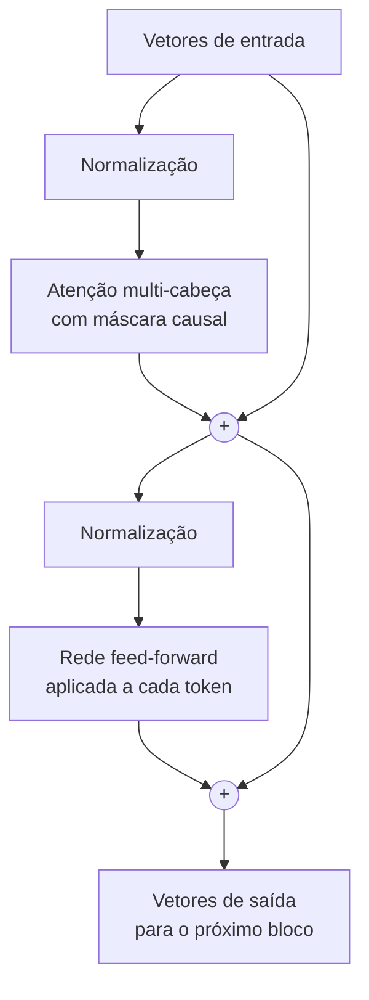
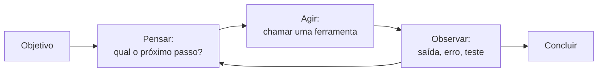

# Módulo 0 — Fundamentos de IA: da Inteligência Artificial aos LLMs e Transformers

[Índice do curso](README.md) · [Módulo 1 — Ambiente →](modulo-1-ambiente.md)

> **Objetivo do módulo:** entender o que é Inteligência Artificial, como ela se divide e se subdivide até chegar aos **modelos de linguagem de grande escala (LLMs)**, e como funciona por dentro a arquitetura que tornou esses modelos possíveis, o **Transformer**. Ao final, você saberá explicar por que um agente de programação acerta, por que erra, e por que o restante do curso insiste em contexto, verificação e revisão humana.
>
> **Nível:** graduação. Não é preciso saber cálculo avançado; as poucas fórmulas vêm acompanhadas de explicação em palavras e de um exemplo numérico executado.
>
> **Pré-requisitos:** nenhum.
>
> As três demonstrações em Python deste módulo (BPE, atenção e temperatura) foram executadas ao preparar o material (Python 3.11, NumPy 2.4); as contagens de *tokens* foram obtidas com `omp toks` (oh-my-pi 18.3.2) em 26/09/2026.

---

## Sumário

**Parte I — O mapa da Inteligência Artificial**

1. [O que é Inteligência Artificial](#1-o-que-é-inteligência-artificial)
2. [Uma breve história em ondas](#2-uma-breve-história-em-ondas)
3. [As grandes divisões da IA](#3-as-grandes-divisões-da-ia)
4. [Aprendizado de máquina e seus paradigmas](#4-aprendizado-de-máquina-e-seus-paradigmas)
5. [Redes neurais e aprendizado profundo](#5-redes-neurais-e-aprendizado-profundo)
6. [Arquiteturas de redes profundas](#6-arquiteturas-de-redes-profundas)
7. [IA generativa, modelos de fundação e LLMs](#7-ia-generativa-modelos-de-fundação-e-llms)

**Parte II — Transformers e LLMs por dentro**

8. [Da palavra ao número: tokens e embeddings](#8-da-palavra-ao-número-tokens-e-embeddings)
9. [Atenção: a ideia central](#9-atenção-a-ideia-central)
10. [A arquitetura Transformer completa](#10-a-arquitetura-transformer-completa)
11. [Como um LLM é treinado](#11-como-um-llm-é-treinado)
12. [Como um LLM gera texto (inferência)](#12-como-um-llm-gera-texto-inferência)
13. [Capacidades, limitações e por que os LLMs "alucinam"](#13-capacidades-limitações-e-por-que-os-llms-alucinam)

**Parte III — Do LLM ao agente de programação**

14. [Técnicas de uso: prompt, contexto, RAG e raciocínio](#14-técnicas-de-uso-prompt-contexto-rag-e-raciocínio)
15. [Do LLM ao agente](#15-do-llm-ao-agente)
16. [Riscos, ética e responsabilidade](#16-riscos-ética-e-responsabilidade)
17. [O que isso muda na forma de programar](#17-o-que-isso-muda-na-forma-de-programar)
18. [Exercícios, glossário e referências](#18-exercícios-glossário-e-referências)

---

# Parte I — O mapa da Inteligência Artificial

## 1. O que é Inteligência Artificial

### 1.1 Definições

Não existe uma definição única. Russell e Norvig, no livro-texto mais usado no mundo (*Artificial Intelligence: A Modern Approach*), organizam as definições em duas perguntas:

| | Comportar-se como humanos | Comportar-se racionalmente |
| --- | --- | --- |
| **Pensar** | Modelar a cognição humana (ciência cognitiva) | Raciocinar segundo as leis da lógica |
| **Agir** | Passar por humano (o teste de Turing) | **Agente racional**: agir para obter o melhor resultado esperado |

A visão dominante hoje, adotada pelos autores, é a do **agente racional**: um sistema que **percebe** o ambiente e **age** sobre ele para atingir objetivos. Guarde essa palavra, *agente*: ela volta no fim do módulo, quando o LLM ganha ferramentas.

Uma definição operacional útil: **IA é o campo que estuda como fazer computadores realizarem tarefas que, quando feitas por pessoas, exigem inteligência**: entender linguagem, reconhecer imagens, planejar, aprender com a experiência, tomar decisões.

### 1.2 IA estreita x IA geral

| Tipo | O que é | Situação |
| --- | --- | --- |
| **IA estreita** (*narrow AI*) | Muito boa em uma tarefa ou em uma família de tarefas | Tudo o que existe hoje em produção: filtros de spam, reconhecimento de voz, recomendação, LLMs |
| **IA geral** (*AGI*) | Competência humana ou superior em praticamente qualquer tarefa intelectual | Hipotética; objeto de debate científico sobre se, quando e como seria alcançada |

LLMs são **estreitos no mecanismo** (preveem o próximo pedaço de texto) mas **amplos nas tarefas** que esse mecanismo resolve, o que alimenta boa parte do debate atual.

### 1.3 O teste de Turing

Em 1950, Alan Turing publicou *Computing Machinery and Intelligence* e trocou a pergunta "máquinas podem pensar?" por outra, testável: um avaliador, conversando por texto, consegue distinguir a máquina de uma pessoa? O teste é historicamente importante, mas hoje é considerado insuficiente: produzir texto convincente não prova compreensão, e os LLMs mostram isso na prática.

## 2. Uma breve história em ondas

| Período | Marco | Ideia |
| --- | --- | --- |
| **1943** | McCulloch e Pitts: modelo matemático do neurônio | O cérebro pode ser descrito como uma rede de unidades lógicas |
| **1950** | Turing: *Computing Machinery and Intelligence* | O "jogo da imitação" |
| **1956** | Conferência de Dartmouth (McCarthy, Minsky, Shannon, Rochester) | Nasce o nome "Inteligência Artificial" |
| **1958** | Rosenblatt: o **perceptron** | Um neurônio artificial que **aprende** pesos a partir de exemplos |
| **1969** | Minsky e Papert: *Perceptrons* | Mostram limites do perceptron de uma camada (não resolve o XOR); o interesse cai |
| **Anos 1970** | Primeiro "inverno da IA" | Promessas não cumpridas, cortes de financiamento |
| **Anos 1980** | **Sistemas especialistas** (regras "se… então" escritas por especialistas) | Sucesso comercial limitado; difíceis de manter; segundo inverno no fim da década |
| **1986** | Rumelhart, Hinton e Williams popularizam o **backpropagation** | Treinar redes com várias camadas se torna viável |
| **1989–1998** | LeCun: redes convolucionais (LeNet) para dígitos manuscritos | Visão computacional com aprendizado |
| **1997** | Hochreiter e Schmidhuber: **LSTM** | Redes recorrentes com memória de longo prazo |
| **2012** | **AlexNet** vence o ImageNet com larga vantagem | Início da era do **aprendizado profundo**: dados + GPUs + redes grandes |
| **2013** | Mikolov et al.: **word2vec** | Palavras viram vetores que capturam significado |
| **2014** | Bahdanau, Cho e Bengio: **atenção** em tradução automática | O modelo aprende "para onde olhar" |
| **2017** | Vaswani et al.: *Attention Is All You Need* | O **Transformer**: só atenção, sem recorrência, altamente paralelizável |
| **2018** | BERT (Google) e GPT (OpenAI) | Pré-treinar em muito texto e adaptar a tarefas |
| **2020** | GPT-3 (175 bilhões de parâmetros); leis de escala (Kaplan et al.) | Aprendizado "em contexto" com poucos exemplos no prompt |
| **2022** | InstructGPT (RLHF) e o lançamento do ChatGPT | LLMs alinhados a instruções chegam ao grande público |
| **2023 em diante** | Modelos multimodais, uso de ferramentas, agentes; modelos de raciocínio (a partir de 2024) | Do chat ao agente que executa tarefas |

Duas lições da história que valem para o curso:

1. **Ondas de entusiasmo e desilusão se repetem.** Promessas exageradas levaram a dois "invernos". Avaliar a IA com rigor, sem euforia nem descrédito, é parte do trabalho de um profissional.
2. **O que mudou tudo não foi uma ideia isolada, mas a combinação** de algoritmos (backpropagation, atenção), **dados** (a web) e **computação** (GPUs).

## 3. As grandes divisões da IA

### 3.1 Duas tradições: simbólica e conexionista

| | IA simbólica (clássica) | IA conexionista (aprendizado) |
| --- | --- | --- |
| **Ideia** | Inteligência é manipular símbolos com regras explícitas | Inteligência emerge de muitas unidades simples ajustadas por exemplos |
| **Como o conhecimento entra** | Escrito por pessoas (regras, lógica, ontologias) | Aprendido a partir de dados |
| **Exemplos** | Sistemas especialistas, provadores de teoremas, planejadores, motores de regras | Redes neurais, aprendizado profundo, LLMs |
| **Pontos fortes** | Explicável, preciso, verificável | Lida com dados ruidosos e percepção (imagem, fala, texto) |
| **Pontos fracos** | Frágil fora das regras previstas; caro de manter | Opaco ("caixa-preta"), precisa de muitos dados, erra de forma pouco previsível |

Hoje as duas tradições se combinam (IA **neurossimbólica**). Um agente de programação é um exemplo cotidiano: o LLM (conexionista) propõe o código, e o compilador, os testes e o linter (simbólicos, determinísticos) verificam. Essa combinação é a filosofia do curso: **a IA propõe, ferramentas verificam, pessoas decidem**.

### 3.2 A árvore de subdivisões

```mermaid
flowchart TD
    IA[Inteligência Artificial] --> SIM[IA simbólica<br/>busca, lógica, planejamento,<br/>sistemas especialistas]
    IA --> ML[Aprendizado de Máquina]
    IA --> OUT[Outras áreas<br/>robótica, computação evolutiva,<br/>lógica fuzzy]
    ML --> CLASS[ML clássico<br/>regressão, árvores de decisão,<br/>SVM, k-means]
    ML --> DL[Aprendizado Profundo<br/>redes neurais com muitas camadas]
    DL --> CNN[CNNs<br/>imagens]
    DL --> RNN[RNNs / LSTMs<br/>sequências]
    DL --> TR[Transformers<br/>atenção]
    TR --> FM[Modelos de fundação<br/>pré-treinados em larga escala]
    FM --> LLM[LLMs<br/>modelos de linguagem de grande escala]
    FM --> MM[Multimodais e<br/>geradores de imagem]
```



Como ler: cada nível **está contido** no anterior. Todo LLM é um Transformer; todo Transformer é aprendizado profundo; todo aprendizado profundo é aprendizado de máquina; todo aprendizado de máquina é IA. O inverso não vale: nem toda IA aprende com dados, e nem todo aprendizado de máquina usa redes neurais.

### 3.3 Áreas de aplicação (atravessam a árvore)

Além da divisão por **técnica**, a IA também se divide por **problema**. Cada área usa técnicas de vários ramos:

| Área | Problema | Técnicas típicas hoje |
| --- | --- | --- |
| **Processamento de Linguagem Natural (PLN)** | Entender e gerar texto | Transformers, LLMs |
| **Visão computacional** | Entender imagens e vídeos | CNNs, Transformers de visão |
| **Fala** | Reconhecer e sintetizar voz | Redes profundas, Transformers |
| **Busca e planejamento** | Encontrar sequências de ações | Algoritmos de busca (A*), planejadores |
| **Representação do conhecimento e raciocínio** | Guardar fatos e inferir novos | Lógica, ontologias, grafos de conhecimento |
| **Sistemas de recomendação** | Sugerir itens relevantes | Fatoração de matrizes, redes profundas |
| **Robótica** | Perceber e agir no mundo físico | Controle, visão, aprendizado por reforço |

## 4. Aprendizado de máquina e seus paradigmas

### 4.1 A mudança de paradigma

Na programação tradicional, **você escreve as regras**. No aprendizado de máquina, **você dá exemplos e o algoritmo encontra as regras**.

```text
Programação tradicional:   dados + regras      →  respostas
Aprendizado de máquina:    dados + respostas   →  regras (o "modelo")
```

**Exemplo no domínio do curso:** para detectar pedidos fraudulentos, a programação tradicional escreveria regras ("valor acima de R$ 5.000 e cliente novo → suspeito"). O aprendizado de máquina recebe milhares de pedidos já rotulados como "fraude" ou "legítimo" e aprende sozinho as combinações de características que separam os dois grupos, inclusive combinações que nenhuma pessoa teria pensado em escrever.

Tom Mitchell deu a definição clássica: um programa **aprende** com a experiência E, em relação a uma tarefa T e a uma medida de desempenho P, se o seu desempenho em T, medido por P, melhora com E.

### 4.2 Os paradigmas de aprendizado

| Paradigma | O que o algoritmo recebe | O que aprende | Exemplo |
| --- | --- | --- | --- |
| **Supervisionado** | Exemplos com a resposta certa (rótulos) | Mapear entrada → resposta | Classificar pedido como fraude/legítimo; prever o prazo de entrega |
| **Não supervisionado** | Exemplos **sem** rótulo | Estrutura escondida nos dados | Agrupar clientes por comportamento de compra |
| **Por reforço** | Recompensas e punições por ações num ambiente | Uma política de ações que maximiza a recompensa | Jogar xadrez, controlar um robô, ajustar um LLM com feedback humano |
| **Autossupervisionado** | Dados brutos; o **próprio dado gera o rótulo** | Representações gerais | **Prever a próxima palavra de um texto**: o rótulo é a palavra que de fato vem depois |

O paradigma **autossupervisionado** é a chave dos LLMs: qualquer texto da internet vira dado de treino sem que ninguém precise rotular nada, porque a "resposta certa" é simplesmente o trecho seguinte.

### 4.3 Conceitos que aparecem em todo o ML

| Conceito | Significado | Analogia |
| --- | --- | --- |
| **Modelo** | A função aprendida, com seus **parâmetros** (pesos) | A "fórmula" que o algoritmo descobriu |
| **Treino / validação / teste** | Dados para aprender / para ajustar escolhas / para medir o desempenho final, nunca vistos antes | Exercícios / simulado / prova |
| **Função de perda** (*loss*) | Mede o quanto o modelo erra | A nota ao contrário: quanto menor, melhor |
| **Sobreajuste** (*overfitting*) | O modelo decora o treino e vai mal em dados novos | O aluno que decorou as respostas da lista e não sabe resolver a prova |
| **Subajuste** (*underfitting*) | O modelo é simples demais até para o treino | Estudar só o índice do livro |
| **Generalização** | Acertar em dados que o modelo nunca viu | O objetivo real de todo o processo |

## 5. Redes neurais e aprendizado profundo

### 5.1 O neurônio artificial

Um neurônio artificial recebe números de entrada, multiplica cada um por um **peso**, soma tudo com um **viés** e aplica uma **função de ativação**:

$$
y = f\left(\sum_{i} w_i x_i + b\right)
$$

- $x_i$: as entradas (por exemplo, valor do pedido, idade da conta).
- $w_i$: os pesos, o quanto cada entrada importa. **São eles que o treino ajusta.**
- $b$: o viés, um deslocamento.
- $f$: a ativação, uma função não linear (por exemplo, ReLU: $f(z) = \max(0, z)$).

Sem a ativação não linear, empilhar camadas seria inútil: a composição de funções lineares continua linear. A não linearidade é o que permite à rede aprender relações complexas.

### 5.2 Redes em camadas

Neurônios são organizados em **camadas**: uma de entrada, uma ou mais **ocultas** e uma de saída. Cada camada transforma a representação recebida em outra, um pouco mais abstrata. Em visão computacional, isso é bem conhecido: as primeiras camadas detectam bordas; as intermediárias, formas; as últimas, objetos inteiros.

**Aprendizado profundo** (*deep learning*) é simplesmente o uso de redes com **muitas** camadas.

### 5.3 Como a rede aprende: gradiente descendente e backpropagation

1. **Passo para a frente:** a rede calcula a saída para um exemplo.
2. **Perda:** compara com a resposta certa e calcula o erro.
3. **Backpropagation:** usando a regra da cadeia do cálculo, calcula como cada peso contribuiu para o erro (o **gradiente**).
4. **Gradiente descendente:** ajusta cada peso um pouco na direção que diminui o erro. O tamanho do passo é a **taxa de aprendizado**.
5. Repete para milhões ou bilhões de exemplos.

**Analogia:** descer uma montanha no nevoeiro. Você não vê o vale, mas sente a inclinação sob os pés (o gradiente) e dá um passo para baixo. Repetindo muitas vezes, chega a um vale (um mínimo da função de perda).

### 5.4 Por que o aprendizado profundo explodiu a partir de 2012

| Ingrediente | O que mudou |
| --- | --- |
| **Dados** | A web e a digitalização criaram bases enormes (ImageNet, textos, código) |
| **Computação** | GPUs, feitas para jogos, fazem exatamente o tipo de conta que redes precisam: multiplicação de matrizes em paralelo |
| **Algoritmos** | Ativação ReLU, melhores inicializações, *dropout*, normalização, otimizadores como Adam |
| **Software** | Bibliotecas (TensorFlow, PyTorch) que calculam gradientes automaticamente |

## 6. Arquiteturas de redes profundas

Cada arquitetura embute uma **suposição** sobre a estrutura dos dados (o chamado viés indutivo).

| Arquitetura | Suposição | Bom para | Limitação |
| --- | --- | --- | --- |
| **MLP** (perceptron multicamadas) | Nenhuma estrutura especial | Dados tabulares | Não aproveita estrutura espacial ou temporal |
| **CNN** (rede convolucional) | Padrões locais se repetem em qualquer lugar da imagem | Imagens, vídeo, sinais | Relações de longa distância exigem muitas camadas |
| **RNN / LSTM** (recorrente) | Os dados chegam em sequência; um "estado" carrega o passado | Texto, fala, séries temporais (antes de 2017) | Processa um elemento por vez (lento, difícil de paralelizar) e "esquece" o início de sequências longas |
| **Transformer** | Qualquer elemento pode se relacionar com qualquer outro; o modelo aprende quais relações importam | Texto, código, e hoje também imagens, áudio, proteínas | Custo cresce com o **quadrado** do tamanho da sequência |

### 6.1 O problema que o Transformer resolveu

Uma RNN lê "O pedido que o cliente de Jales fez na segunda-feira passada pela manhã **chegou**" palavra por palavra, carregando um estado. Quando chega em "chegou", a informação sobre "pedido" (o sujeito) precisou atravessar dez passos e pode ter se diluído. Além disso, cada palavra depende do processamento da anterior, então não dá para processar a frase em paralelo.

O Transformer olha **todas as palavras ao mesmo tempo** e deixa cada uma "consultar" diretamente as outras. "chegou" pode olhar para "pedido" em um passo só, não importa a distância. E como tudo é calculado de uma vez, o treino se paraleliza muito bem em GPUs. Essas duas propriedades permitiram treinar modelos muito maiores com muito mais dados.

## 7. IA generativa, modelos de fundação e LLMs

### 7.1 Discriminativo x generativo

| Tipo | Pergunta que responde | Exemplo |
| --- | --- | --- |
| **Discriminativo** | "A que classe isto pertence?" | Este pedido é fraude? Esta imagem tem um gato? |
| **Generativo** | "Como seria um novo exemplo plausível?" | Escreva um e-mail; gere uma imagem; complete este código |

**IA generativa** é o conjunto de modelos que **produzem** conteúdo novo: texto (LLMs), imagens (modelos de difusão), áudio, vídeo, código.

### 7.2 Modelos de fundação

O termo **modelo de fundação** (*foundation model*) foi proposto por pesquisadores de Stanford em 2021 para modelos **pré-treinados em dados amplos, em larga escala**, que servem de base para adaptar a muitas tarefas diferentes. A ideia central é a **transferência**: em vez de treinar um modelo do zero para cada problema, adapta-se um modelo geral.

### 7.3 O que é um LLM

Um **LLM** (*Large Language Model*) é um modelo de fundação treinado sobre grandes quantidades de texto (e, em geral, código) para **prever o próximo *token*** de uma sequência. "Grande" se refere a duas coisas:

- **Parâmetros:** de bilhões a centenas de bilhões (ou mais) de pesos ajustáveis.
- **Dados:** trilhões de *tokens* de treino.

A frase que resume o mecanismo: **um LLM é um completador de texto extremamente sofisticado.** Tudo o que ele faz (responder, traduzir, escrever código, "raciocinar") é produzido gerando, um *token* de cada vez, a continuação mais adequada ao contexto recebido. As seções seguintes mostram como.

---

# Parte II — Transformers e LLMs por dentro

## 8. Da palavra ao número: tokens e embeddings

Redes neurais só fazem contas com números. O primeiro problema de um modelo de linguagem é transformar texto em números, e isso acontece em duas etapas.

### 8.1 Tokens

O texto é cortado em **tokens**: pedaços que podem ser uma palavra inteira, parte de uma palavra, um sinal de pontuação ou um espaço. Cada token do **vocabulário** (tipicamente dezenas a centenas de milhares de tokens) tem um número de identificação.

Por que pedaços e não palavras inteiras? Porque um vocabulário de palavras inteiras seria enorme e ainda assim não cobriria nomes próprios, erros de digitação, código e palavras novas. Com pedaços, qualquer texto pode ser representado: palavras comuns viram um token; palavras raras viram vários.

### 8.2 Como o vocabulário é aprendido: BPE

O algoritmo mais usado é o **BPE** (*Byte Pair Encoding*). Criado originalmente para compressão de dados (Gage, 1994), foi adaptado para modelos de linguagem por Sennrich, Haddow e Birch (2016). A ideia:

1. Comece com os caracteres individuais.
2. Conte qual **par** de símbolos vizinhos aparece mais no corpus.
3. Junte esse par num símbolo novo.
4. Repita até atingir o tamanho de vocabulário desejado.

Implementação didática (execute você mesmo):

```python
from collections import Counter
corpus = {"frete": 5, "fretes": 3, "pedido": 6, "pedidos": 4, "pedir": 2}   # palavra: frequência
vocab = {tuple(p) + ("</w>",): c for p, c in corpus.items()}                 # </w> marca fim de palavra

def pares(v):
    c = Counter()
    for w, f in v.items():
        for a, b in zip(w, w[1:]): c[(a, b)] += f
    return c

def junta(par, v):
    out = {}
    for w, f in v.items():
        i, nw = 0, []
        while i < len(w):
            if i < len(w) - 1 and (w[i], w[i+1]) == par: nw.append(w[i] + w[i+1]); i += 2
            else: nw.append(w[i]); i += 1
        out[tuple(nw)] = f
    return out

for passo in range(1, 10):
    p = pares(vocab); melhor, freq = p.most_common(1)[0]
    vocab = junta(melhor, vocab)
    print(f"passo {passo}: junta {melhor[0]!r} + {melhor[1]!r} (aparece {freq}x)")
print()
for w, f in vocab.items(): print(f"{f}x  {' | '.join(w)}")
```

Saída real:

```text
passo 1: junta 'p' + 'e' (aparece 12x)
passo 2: junta 'pe' + 'd' (aparece 12x)
passo 3: junta 'ped' + 'i' (aparece 12x)
passo 4: junta 'pedi' + 'd' (aparece 10x)
passo 5: junta 'pedid' + 'o' (aparece 10x)
passo 6: junta 'f' + 'r' (aparece 8x)
passo 7: junta 'fr' + 'e' (aparece 8x)
passo 8: junta 'fre' + 't' (aparece 8x)
passo 9: junta 'fret' + 'e' (aparece 8x)

5x  frete | </w>
3x  frete | s | </w>
6x  pedido | </w>
4x  pedido | s | </w>
2x  pedi | r | </w>
```

Repare no que o algoritmo descobriu sozinho, só contando frequências: `pedido` e `frete` viraram tokens inteiros, e o plural apareceu como um pedaço separado (`pedido | s`, `frete | s`). O BPE não sabe gramática; a estrutura emerge da estatística. É exatamente assim, em escala de trilhões de caracteres, que os tokenizadores dos LLMs são construídos.

### 8.3 Tokens na prática: a língua importa

A mesma frase, contada pelos tokenizadores reais embutidos no `omp` (saída real de `omp toks`, trecho):

```text
$ omp toks "O pedido acima de trezentos reais tem frete grátis."
encoding          models                    tokens  chars/tok
o200k_base        GPT-4o · o1 · GPT-5+          13       3.92
cl100k_base       GPT-3.5 · GPT-4               15       3.40
claude-v3         Claude 3 … Opus 4.6           18       2.83

$ omp toks "Orders over three hundred reais get free shipping."
encoding          models                    tokens  chars/tok
o200k_base        GPT-4o · o1 · GPT-5+           9       5.56
cl100k_base       GPT-3.5 · GPT-4               10       5.00
claude-v3         Claude 3 … Opus 4.6           10       5.00
```

| Observação | Consequência |
| --- | --- |
| A frase em português gastou **13** tokens contra **9** em inglês (no mesmo tokenizador) | Línguas menos presentes nos dados de treino do tokenizador são fatiadas em pedaços menores: **mais tokens, mais custo e menos texto cabendo no contexto** |
| Cada família de modelos tem seu próprio tokenizador | O mesmo texto "custa" diferente em cada modelo; limites de contexto não são comparáveis diretamente |
| Um trecho de 3 linhas de Java deu entre 31 e 69 tokens conforme o tokenizador | Código também é texto; nomes longos e símbolos consomem tokens |

**Regra prática:** em média, um token corresponde a algo entre 2,5 e 5 caracteres, dependendo da língua e do tokenizador. Preços de API e janelas de contexto são medidos em tokens, não em palavras.

### 8.4 Embeddings: tokens viram vetores

Cada token é convertido num **vetor de números** (o *embedding*), com centenas ou milhares de dimensões. Esses vetores **são aprendidos** durante o treino, e acabam organizados de forma que tokens com usos parecidos fiquem **próximos** no espaço.

O exemplo clássico vem do word2vec (Mikolov et al., 2013): com vetores de palavras treinados em muito texto, a operação `vetor("rei") − vetor("homem") + vetor("mulher")` resulta num vetor muito próximo de `vetor("rainha")`. Relações de significado viram **direções** no espaço.

**Analogia:** um mapa em que cidades parecidas ficam perto. Só que, em vez de duas dimensões (latitude e longitude), são milhares, e cada uma captura algum aspecto do uso das palavras.

### 8.5 Posição

A atenção (próxima seção) trata os tokens como um **conjunto**: sem ajuda, "o cliente cancelou o pedido" e "o pedido cancelou o cliente" teriam a mesma representação. Por isso se acrescenta informação de **posição**:

| Técnica | Como funciona | Onde aparece |
| --- | --- | --- |
| Senoidal | Soma ao embedding ondas de seno e cosseno de frequências diferentes | Transformer original (2017) |
| Aprendida | Um vetor treinável para cada posição | GPT-2, BERT |
| **RoPE** (*Rotary Position Embedding*, Su et al., 2021) | Gira os vetores de consulta e chave num ângulo proporcional à posição, de modo que a atenção dependa da **distância relativa** | Muitos LLMs abertos modernos |

## 9. Atenção: a ideia central

### 9.1 A intuição

Considere: *"O pedido que o cliente fez ontem **chegou** atrasado, e **ele** reclamou."* Para entender "chegou", o modelo precisa relacioná-lo a "pedido". Para entender "ele", precisa decidir se é "pedido" ou "cliente". **Atenção** é o mecanismo pelo qual cada token decide **em quais outros tokens prestar atenção**, e quanto, para construir sua própria representação no contexto.

### 9.2 Consulta, chave e valor

Cada token gera três vetores, por meio de três matrizes de pesos aprendidas:

| Vetor | Pergunta que representa | Analogia da biblioteca |
| --- | --- | --- |
| **Consulta** (*Query*, Q) | "O que eu estou procurando?" | O que você digita no catálogo |
| **Chave** (*Key*, K) | "Que tipo de informação eu ofereço?" | A etiqueta na lombada de cada livro |
| **Valor** (*Value*, V) | "Qual é o conteúdo que eu passo adiante?" | O conteúdo do livro |

O token compara sua consulta com as chaves de todos os tokens (produto escalar: quanto mais alinhados, maior a pontuação), transforma as pontuações em pesos que somam 1 (softmax) e faz uma média ponderada dos valores.

### 9.3 A fórmula

A atenção de "produto escalar escalonado" do artigo original (Vaswani et al., 2017):

$$
\text{Atenção}(Q, K, V) = \text{softmax}\left(\frac{QK^{\top}}{\sqrt{d_k}}\right) V
$$

Em palavras:

1. $QK^{\top}$: pontuação de compatibilidade entre cada consulta e cada chave.
2. $\div \sqrt{d_k}$: divide pela raiz da dimensão dos vetores para que as pontuações não fiquem grandes demais (o que deixaria o softmax "saturado", com um peso perto de 1 e o resto perto de 0, e prejudicaria o treino).
3. softmax, linha a linha: transforma pontuações em pesos positivos que somam 1.
4. $\times V$: cada token recebe a média dos valores, ponderada pelos pesos.

### 9.4 A máscara causal

Um modelo que gera texto da esquerda para a direita **não pode olhar o futuro** durante o treino, senão "colaria" a resposta. Por isso aplica-se uma **máscara causal**: antes do softmax, as posições futuras recebem $-\infty$, o que zera seus pesos.

### 9.5 Exemplo numérico executado

Três tokens ("o", "pedido", "chegou") com vetores de dimensão 4. As matrizes de pesos são aleatórias (com semente fixa), então os números **não** têm significado linguístico: o objetivo é ver a mecânica.

```python
import numpy as np
np.set_printoptions(precision=2, suppress=True)
rng = np.random.default_rng(7)
tokens = ["o", "pedido", "chegou"]
d_model, d_k = 4, 4
X  = rng.normal(size=(3, d_model))             # embeddings (+ posição) dos 3 tokens
Wq, Wk, Wv = (rng.normal(size=(d_model, d_k)) for _ in range(3))
Q, K, V = X @ Wq, X @ Wk, X @ Wv
S = Q @ K.T / np.sqrt(d_k)                     # pontuações de compatibilidade
mask = np.triu(np.ones((3, 3), bool), k=1)     # máscara causal: não olhar o futuro
S_m = np.where(mask, -np.inf, S)
A = np.exp(S_m - S_m.max(axis=1, keepdims=True)); A = A / A.sum(axis=1, keepdims=True)
print("pontuações QK^T/sqrt(d_k):\n", S)
print("\ncom máscara causal (-inf acima da diagonal):\n", S_m)
print("\npesos de atenção (softmax por linha):")
for t, row in zip(tokens, A): print(f"  {t:>7}: " + "  ".join(f"{x:.2f}" for x in row), f"  (soma = {row.sum():.2f})")
print("\nsaída = pesos @ V (novo vetor de cada token):\n", A @ V)
```

Saída real:

```text
pontuações QK^T/sqrt(d_k):
 [[ 1.56 -2.02 -0.6 ]
 [-1.68  2.78  1.31]
 [-0.45  0.76  0.47]]

com máscara causal (-inf acima da diagonal):
 [[ 1.56  -inf  -inf]
 [-1.68  2.78  -inf]
 [-0.45  0.76  0.47]]

pesos de atenção (softmax por linha):
        o: 1.00  0.00  0.00   (soma = 1.00)
   pedido: 0.01  0.99  0.00   (soma = 1.00)
   chegou: 0.15  0.49  0.37   (soma = 1.00)

saída = pesos @ V (novo vetor de cada token):
 [[-0.15 -0.16 -1.    0.06]
 [-0.07 -0.35  0.75  0.27]
 [-0.15 -0.18  0.06  0.43]]
```

Como ler:

- **"o"** só pode olhar para si mesmo (é o primeiro): peso 1,00.
- **"pedido"** pode olhar para "o" e para si; aqui concentrou 0,99 em si mesmo.
- **"chegou"** distribui a atenção entre os três (0,15; 0,49; 0,37): a maior parte vai para "pedido". Num modelo treinado, pesos assim são aprendidos porque ajudam a prever o texto.
- As entradas acima da diagonal viraram $-\infty$ e, depois do softmax, peso zero: a máscara causal funcionando.
- A saída é um **novo vetor para cada token**, que agora carrega informação dos tokens em que ele prestou atenção.

### 9.6 Múltiplas cabeças (*multi-head attention*)

Uma única atenção captura um tipo de relação por vez. O Transformer roda **várias atenções em paralelo** (as "cabeças"), cada uma com suas próprias matrizes Q, K e V, e concatena os resultados. No artigo original: 8 cabeças, com vetores de dimensão 64 cada, num modelo de dimensão 512. Pesquisas de interpretabilidade encontram cabeças especializadas em relações diferentes, como seguir concordância sintática ou copiar padrões que já apareceram no contexto.

### 9.7 O custo

Cada token compara sua consulta com as chaves de **todos** os outros: para uma sequência de $n$ tokens, são $n^2$ comparações. Dobrar o contexto quadruplica esse custo. Por isso janelas de contexto grandes são caras, e existe muita pesquisa em atenção eficiente (por exemplo, FlashAttention, de Dao et al., 2022, que reorganiza o cálculo para usar melhor a memória da GPU).

## 10. A arquitetura Transformer completa

### 10.1 O bloco Transformer

Um bloco combina quatro peças, e um modelo empilha dezenas desses blocos:



| Peça | Papel |
| --- | --- |
| **Atenção multi-cabeça** | Troca de informação **entre** tokens |
| **Rede feed-forward** (FFN) | Processamento **dentro** de cada token: duas camadas lineares com uma ativação entre elas (no original, dimensão interna 4× maior: 2048 para um modelo de 512). É onde fica a maior parte dos parâmetros, e onde se acredita que muito do "conhecimento" memorizado reside |
| **Conexões residuais** (o "+") | Somam a entrada à saída de cada sub-camada. Permitem treinar redes muito profundas, porque o gradiente tem um "atalho" para fluir |
| **Normalização** | Mantém a escala dos valores estável. O original normalizava depois de cada sub-camada; modelos modernos costumam normalizar antes (*pre-norm*), o que torna o treino mais estável |

### 10.2 As três famílias

O artigo de 2017 propôs um **codificador** e um **decodificador**, para tradução. Depois, cada metade virou uma família:

| Família | Atenção | Tarefa típica de treino | Exemplos | Bom para |
| --- | --- | --- | --- | --- |
| **Só codificador** | Bidirecional (cada token vê todos) | Adivinhar palavras mascaradas no meio do texto | BERT | Classificação, busca semântica, extração |
| **Codificador-decodificador** | Bidirecional no codificador, causal no decodificador | Transformar uma sequência em outra | Transformer original, T5 | Tradução, resumo |
| **Só decodificador** | Causal (só olha para trás) | **Prever o próximo token** | Família GPT e a maioria dos LLMs de chat e de código | Geração de texto e código |

Os LLMs usados por agentes de programação são, em sua grande maioria, **só decodificador**.

### 10.3 O caminho completo de um token

1. O texto é **tokenizado**.
2. Cada token vira um **embedding**; a informação de **posição** é incorporada.
3. Os vetores passam por **N blocos** (atenção → FFN), ganhando contexto a cada bloco.
4. O vetor da **última posição** é projetado para o tamanho do vocabulário, produzindo uma pontuação (*logit*) para cada token possível.
5. Um **softmax** transforma os logits em probabilidades para o próximo token.

### 10.4 Onde estão os parâmetros

Os "bilhões de parâmetros" de um LLM são os números dentro das matrizes: a tabela de embeddings, as matrizes Q, K, V e de saída de cada cabeça em cada bloco, as duas camadas de cada FFN e as normalizações. Uma variante moderna comum é a **mistura de especialistas** (*Mixture of Experts*, MoE; Shazeer et al., 2017): em vez de uma FFN, o bloco tem várias, e um roteador escolhe poucas para cada token. O modelo fica com muitos parâmetros no total, mas usa só uma parte deles por token.

## 11. Como um LLM é treinado

O treino de um LLM de chat moderno acontece, em geral, em fases.

### 11.1 Pré-treino: prever o próximo token

O modelo lê quantidades enormes de texto (páginas web, livros, artigos, código) e, a cada posição, tenta prever o token seguinte. A função de perda é a **entropia cruzada**: penaliza o modelo pela baixa probabilidade que ele deu ao token que de fato veio.

$$
\mathcal{L} = -\sum_{t} \log p_\theta(x_t \mid x_{<t})
$$

Em palavras: para cada posição $t$, olhe a probabilidade que o modelo (com parâmetros $\theta$) deu ao token correto $x_t$, sabendo os anteriores $x_{<t}$. Quanto maior essa probabilidade, menor a perda.

Parece uma tarefa modesta, mas para prever bem o próximo token em textos variados o modelo é pressionado a aprender gramática, fatos, estilos, raciocínios comuns e a estrutura de linguagens de programação. É uma **compressão estatística** de tudo o que leu.

### 11.2 Leis de escala

Kaplan et al. (2020) mostraram que a perda diminui de forma previsível (uma lei de potência) quando aumentam parâmetros, dados e computação. Hoffmann et al. (2022, o estudo "Chinchilla") refinaram a conclusão: para um orçamento fixo de computação, modelos e dados devem crescer juntos, e muitos modelos da época eram grandes demais para a quantidade de dados usada. A regra aproximada que ficou conhecida: cerca de **20 tokens de treino por parâmetro** para um treino "ótimo em computação".

### 11.3 Pós-treino: de completador a assistente

Um modelo só pré-treinado **completa** texto; se você escreve uma pergunta, ele pode continuar com mais perguntas. Para virar um assistente útil, passa por mais etapas:

| Etapa | O que é | Referência |
| --- | --- | --- |
| **Ajuste fino supervisionado** (SFT) | Treino com exemplos de instrução → resposta ideal, escritos ou revisados por pessoas | InstructGPT (Ouyang et al., 2022) |
| **RLHF** (*Reinforcement Learning from Human Feedback*) | Pessoas comparam respostas; treina-se um **modelo de recompensa** que imita essas preferências; o LLM é ajustado por aprendizado por reforço para maximizar a recompensa | Ouyang et al., 2022 |
| **DPO** (*Direct Preference Optimization*) | Usa as mesmas comparações de preferência, mas ajusta o modelo diretamente, sem treinar um modelo de recompensa separado | Rafailov et al., 2023 |
| **IA Constitucional** | Parte do feedback vem do próprio modelo, avaliando respostas segundo um conjunto de princípios escritos | Bai et al., 2022 (Anthropic) |
| **Treino para raciocínio e ferramentas** | Aprendizado por reforço em tarefas verificáveis (matemática, código com testes), uso de ferramentas | Modelos "de raciocínio", a partir de 2024 |

Repare no último item: **tarefas verificáveis**, como código com testes, são justamente onde o treino por reforço funciona melhor. É uma das razões pelas quais os LLMs evoluíram tão rápido em programação, e por que testes (Módulo 3) são uma forma tão eficaz de guiar um agente.

## 12. Como um LLM gera texto (inferência)

### 12.1 Um token de cada vez

A geração é **autorregressiva**: o modelo calcula a distribuição de probabilidade do próximo token, escolhe um, acrescenta-o à sequência e repete. Uma resposta de 500 tokens exige 500 passos desse ciclo.

Para não recalcular tudo a cada passo, os modelos guardam as chaves e os valores já calculados dos tokens anteriores (o **cache KV**). É por isso que o custo cresce com o tamanho do contexto e que respostas longas levam tempo.

### 12.2 Como escolher o próximo token

| Estratégia | Como funciona | Efeito |
| --- | --- | --- |
| **Gulosa** (*greedy*) | Sempre o token mais provável | Determinística, mas tende a repetições |
| **Temperatura** ($T$) | Divide os logits por $T$ antes do softmax | $T < 1$ concentra a probabilidade (mais previsível); $T > 1$ espalha (mais variado) |
| **Top-k** | Sorteia só entre os $k$ mais prováveis | Corta caudas absurdas |
| **Top-p** (*nucleus sampling*) | Sorteia entre os mais prováveis até somar probabilidade $p$ | Adapta o corte ao contexto (Holtzman et al., 2020) |

Demonstração executada: logits hipotéticos para a palavra seguinte a "O frete é".

```python
import numpy as np
cands = ["grátis", "calculado", "caro", "azul"]
logits = np.array([3.0, 2.2, 1.5, -1.0])       # saídas do modelo após "O frete é"
for T in (0.2, 1.0, 2.0):
    p = np.exp(logits / T); p /= p.sum()
    print(f"T = {T}: " + "  ".join(f"{c} {x:.1%}" for c, x in zip(cands, p)))
```

Saída real:

```text
T = 0.2: grátis 98.1%  calculado 1.8%  caro 0.1%  azul 0.0%
T = 1.0: grátis 59.1%  calculado 26.6%  caro 13.2%  azul 1.1%
T = 2.0: grátis 43.9%  calculado 29.4%  caro 20.7%  azul 5.9%
```

Com $T = 0{,}2$ o modelo quase sempre diz "grátis"; com $T = 2$, até "azul" (que não faz sentido) ganha quase 6% de chance. **Para código, costuma-se preferir temperatura baixa**: queremos a continuação mais provável e consistente, não criatividade.

### 12.3 A janela de contexto

O modelo só "vê" o que está na **janela de contexto**: as instruções do sistema, a conversa, os arquivos lidos e a própria resposta em construção, tudo medido em tokens. Três consequências:

1. **O que não está no contexto não existe para o modelo** (além do que ele memorizou no treino).
2. **Mais contexto não é sempre melhor:** Liu et al. (2024) mostraram que modelos aproveitam pior informações colocadas no **meio** de contextos longos do que no início ou no fim ("*lost in the middle*").
3. **Contexto custa:** cada token é cobrado e aumenta o tempo de resposta.

É por isso que o Módulo 1 organiza as instruções do agente em camadas: pouco texto sempre presente, muito conhecimento carregado só quando necessário.

## 13. Capacidades, limitações e por que os LLMs "alucinam"

### 13.1 O que surpreendeu

- **Aprendizado em contexto** (*in-context learning*): com alguns exemplos no próprio prompt, o modelo executa uma tarefa nova sem nenhum treino adicional (demonstrado em escala no GPT-3, Brown et al., 2020).
- **Generalidade:** o mesmo modelo traduz, resume, explica, escreve código e testes.
- **Programação:** código é texto altamente estruturado e abundante na web, com verificação automática possível (compila? passa nos testes?). Uma combinação ideal para LLMs.

### 13.2 Limitações estruturais

| Limitação | Por que acontece | Como o curso lida com ela |
| --- | --- | --- |
| **Alucinação** (afirmar com confiança algo falso) | O treino recompensa continuações **plausíveis**, não **verdadeiras**; não há, no mecanismo básico, uma etapa de checagem de fatos. Análises recentes argumentam que treino e avaliação que premiam "chutar" em vez de admitir incerteza reforçam o problema (Kalai et al., 2025) | Testes, compilador e linters verificam; revisão humana decide |
| **Data de corte do conhecimento** | O modelo só sabe o que estava nos dados até o fim do treino | Documentação e código do projeto no contexto; busca quando disponível |
| **Não conhece o seu projeto** | Seu código e suas convenções não estavam no treino | `AGENTS.md`, rules e skills (Módulo 1) |
| **Não determinismo** | Amostragem e detalhes de execução fazem a mesma pergunta ter respostas diferentes | Verificação automática em vez de confiança |
| **Contexto limitado e desigual** | Janela finita; perda de atenção no meio | Instruções enxutas e carregadas sob demanda |
| **Raciocínio frágil** | Acerta problemas parecidos com os vistos no treino e pode errar variações simples | Dividir o problema, testes de casos de borda, revisão |
| **Vieses** | O modelo reproduz padrões dos dados de treino | Revisão crítica, diversidade de exemplos |

**Resumo em uma frase:** um LLM é excelente em produzir o que **parece certo**; cabe a ferramentas e pessoas verificar o que **é** certo.

---

# Parte III — Do LLM ao agente de programação

## 14. Técnicas de uso: prompt, contexto, RAG e raciocínio

| Técnica | O que é | Exemplo |
| --- | --- | --- |
| **Prompt zero-shot** | Instrução direta, sem exemplos | "Escreva um teste JUnit para `calcularFrete`." |
| **Few-shot** | Instrução com alguns exemplos do formato desejado | Dois testes do projeto como modelo, depois o pedido |
| **Cadeia de pensamento** (*chain-of-thought*) | Pedir (ou treinar) o modelo a escrever passos intermediários antes da resposta | Wei et al. (2022) mostraram ganhos em raciocínio; modelos "de raciocínio" fazem isso internamente, gastando mais computação na hora de responder |
| **Engenharia de contexto** | Escolher **o que** entra no contexto, em que ordem e quando | `AGENTS.md`, rules, skills carregadas sob demanda (Módulo 1) |
| **RAG** (*Retrieval-Augmented Generation*) | Buscar documentos relevantes (em geral por similaridade de embeddings) e colocá-los no contexto antes de gerar | Lewis et al. (2020). No agente: ler os arquivos certos do projeto antes de editar |
| **Especificação** | Descrever o comportamento esperado antes de pedir o código | Spec-Driven Development (Módulos 7 e 8) |

## 15. Do LLM ao agente

### 15.1 Chamada de ferramentas

Um LLM puro só produz texto. Modelos modernos são treinados para produzir, quando apropriado, um texto **estruturado** que pede o uso de uma ferramenta, por exemplo `{"ferramenta": "executar", "comando": "./mvnw test"}`. O programa em volta do modelo (o *harness*) executa a ferramenta de verdade e devolve o resultado ao modelo, que continua a partir dali. Trabalhos como Toolformer (Schick et al., 2023) mostraram que modelos podem aprender quando e como chamar ferramentas.

### 15.2 O ciclo do agente

O padrão **ReAct** (*Reasoning + Acting*, Yao et al., 2023) descreve o ciclo que agentes de programação seguem:



É exatamente a definição de **agente racional** da seção 1.1: perceber (observar), decidir (pensar) e agir (ferramentas), em direção a um objetivo.

### 15.3 Anatomia de um agente de programação

| Componente | O que é | No curso |
| --- | --- | --- |
| **Modelo** | O LLM que decide | Qualquer provedor configurado no `omp` |
| **Harness** | O programa que conversa com o modelo e executa as ferramentas | oh-my-pi (`omp`) |
| **Ferramentas** | Ler, editar, executar comandos, buscar | Nativas do `omp` |
| **Contexto** | Instruções do sistema, arquivos de contexto, rules, skills | `.agents/` (Módulo 1) |
| **Subagentes** | Outros agentes, com contexto próprio, para partes da tarefa | Ferramenta `task` do `omp` (Módulo 5) |
| **Verificação** | Testes, compilador, linters, CI | Todos os módulos |
| **Humano** | Define objetivos, aprova, revisa, decide | Você |

## 16. Riscos, ética e responsabilidade

| Tema | Risco | Postura esperada |
| --- | --- | --- |
| **Segurança** | Injeção de prompt: textos maliciosos em arquivos, issues ou páginas que o agente lê podem desviar seu comportamento (Greshake et al., 2023; primeiro item do OWASP Top 10 para LLMs) | Tratar conteúdo lido como dado, não como instrução; aprovação humana para ações sensíveis (Módulo 1) |
| **Privacidade e LGPD** | Enviar dados pessoais (e, com mais rigor, dados sensíveis como os de saúde) a serviços de terceiros sem base legal | Não colar dados reais de pessoas em prompts; usar dados fictícios; conhecer a Lei nº 13.709/2018 (LGPD) e as políticas da instituição |
| **Propriedade intelectual e licenças** | Código gerado pode reproduzir trechos com licenças incompatíveis | Revisão, ferramentas de verificação de licença, atenção a trechos longos idênticos |
| **Vieses** | Reprodução de estereótipos e desigualdades dos dados | Avaliação crítica, especialmente em sistemas que afetam pessoas |
| **Dependência e aprendizagem** | Aceitar código sem entender; perda de habilidades | Explicar o que a IA fez; o curso exige entender antes de aceitar |
| **Integridade acadêmica** | Entregar trabalho de IA como próprio | Seguir as regras da disciplina; declarar o uso |
| **Custo ambiental** | Treino e uso consomem muita energia | Usar com propósito; preferir modelos adequados ao tamanho da tarefa |

## 17. O que isso muda na forma de programar

A tabela abaixo conecta o que você aprendeu aqui com cada módulo do curso:

| Fato sobre LLMs (este módulo) | Consequência prática | Módulo |
| --- | --- | --- |
| O modelo só sabe o que está no contexto; o contexto é limitado | Organizar instruções em camadas: `AGENTS.md`, rules, skills | [1 — Ambiente](modulo-1-ambiente.md) |
| O modelo imita padrões dos dados; código ruim gera código ruim | Nomes claros, funções pequenas, código legível para humanos e para a IA | [2 — Clean Code](modulo-2-clean-code.md) |
| O modelo produz o plausível, não o verdadeiro; o treino por reforço funciona melhor com verificação | Testes antes do código e cobertura mínima | [3 — TDD e cobertura](modulo-3-tdd-e-cobertura.md) |
| O modelo tende ao caminho mais curto (acrescentar ao arquivo aberto) | Princípios para organizar dependências | [4 — SOLID](modulo-4-solid.md) |
| O modelo tende também ao excesso (abstrações desnecessárias) | Módulos profundos, revisão em dois eixos | [5 — Design e revisão](modulo-5-design-e-revisao.md) |
| Nomes de padrões são "comandos" densos em informação | Usar o vocabulário de padrões para instruir com precisão, e saber quando não usar | [6 — Padrões de projeto](modulo-6-padroes-de-projeto.md) |
| O prompt é efêmero; a especificação persiste | Especificar antes de gerar | [7 — OpenSpec](modulo-7-openspec.md), [8 — Spec Kit](modulo-8-spec-kit.md) |
| A atenção é finita e se degrada com contextos longos | Medir e enxugar o contexto; carregar sob demanda; sessão nova na fronteira de tarefa | [9 — Context Engineering](modulo-9-context-engineering.md) |
| O ciclo do agente (seção 15.2) pode ser repetido por um sistema, não só por você | Loops com parada verificável, estado em arquivo e verificação separada | [10 — Loop Engineering](modulo-10-loop-engineering.md) |
| O modelo produz o plausível, inclusive código inseguro, e obedece a texto que lê | Portão de segurança em camadas; agente no CI só lê e escreve texto | [11 — Segurança](modulo-11-seguranca.md), [12 — Agentes no CI/CD](modulo-12-agentes-ci-cd.md) |
| O modelo otimiza para o que se vê na hora: poucos dados, nenhuma carga | Objetivos escritos, telemetria correlacionada e medição antes e depois de cada mudança | [13 — Desempenho e observabilidade](modulo-13-desempenho-observabilidade.md) |

## 18. Exercícios, glossário e referências

### 18.1 Exercícios conceituais

1. Posicione na árvore da seção 3.2: um filtro de spam por regras escritas à mão; um classificador de imagens médicas com CNN; um assistente de código. Justifique.
2. Explique, com suas palavras, por que o paradigma autossupervisionado tornou possível treinar com a web inteira.
3. Por que uma RNN tem dificuldade com dependências longas, e como a atenção resolve isso? Qual o custo dessa solução?
4. Na fórmula da atenção, o que aconteceria sem a divisão por $\sqrt{d_k}$ quando $d_k$ é grande?
5. Por que um modelo só decodificador precisa de máscara causal e um modelo como o BERT não?
6. Um colega afirma que "o LLM entende o código". Discuta a afirmação usando os conceitos de pré-treino e alucinação.
7. Por que a mesma instrução em português pode custar mais do que em inglês? Que impacto isso tem no uso de agentes?

### 18.2 Laboratório

1. Execute o `bpe.py` da seção 8.2. Acrescente ao corpus `{"entrega": 4, "entregas": 2, "entregar": 3}` e rode 15 passos. Quais tokens surgem? O radical `entreg` aparece?
2. Execute o `atencao.py` da seção 9.5 trocando a semente (`default_rng(7)`) e depois removendo a máscara causal. Descreva o que muda nos pesos.
3. Execute o `temperatura.py` com $T = 0{,}01$ e $T = 10$. Relacione com a escolha de temperatura para geração de código.
4. Com o `omp` instalado (Módulo 1), rode `omp toks` num arquivo Java do seu projeto e numa tradução do mesmo comentário para inglês. Compare.

### 18.3 Glossário

| Termo | Significado |
| --- | --- |
| **Agente** | Sistema que percebe o ambiente e age para atingir objetivos; no curso, um LLM com ferramentas |
| **Atenção** | Mecanismo em que cada token pondera a relevância dos outros para construir sua representação |
| **Autorregressivo** | Que gera um elemento de cada vez, usando os anteriores como entrada |
| **Backpropagation** | Algoritmo que calcula como cada peso contribuiu para o erro |
| **BPE** | Algoritmo que constrói o vocabulário juntando os pares de símbolos mais frequentes |
| **Cache KV** | Armazenamento das chaves e valores já calculados, para acelerar a geração |
| **Embedding** | Vetor de números que representa um token (ou texto) num espaço onde proximidade indica semelhança |
| **Entropia cruzada** | Função de perda que penaliza baixa probabilidade para a resposta certa |
| **Janela de contexto** | Quantidade máxima de tokens que o modelo considera de uma vez |
| **LLM** | Modelo de linguagem de grande escala, treinado para prever o próximo token |
| **Logit** | Pontuação bruta que o modelo dá a cada token antes do softmax |
| **Modelo de fundação** | Modelo pré-treinado em dados amplos, adaptável a muitas tarefas |
| **Parâmetro** | Cada número ajustável (peso) do modelo |
| **RAG** | Geração aumentada por recuperação: buscar documentos e colocá-los no contexto |
| **RLHF** | Ajuste por aprendizado por reforço a partir de preferências humanas |
| **Softmax** | Função que transforma pontuações em probabilidades que somam 1 |
| **Temperatura** | Parâmetro que controla o quanto a amostragem é previsível ou variada |
| **Token** | Pedaço de texto (palavra, parte de palavra, símbolo) que o modelo processa |
| **Transformer** | Arquitetura de rede baseada em atenção, base dos LLMs |

### 18.4 Referências

**Livros**

- S. Russell e P. Norvig. *Artificial Intelligence: A Modern Approach*. 4ª ed., Pearson, 2020 (há edição em português: *Inteligência Artificial*).
- I. Goodfellow, Y. Bengio e A. Courville. *Deep Learning*. MIT Press, 2016 (disponível gratuitamente em deeplearningbook.org).
- T. Mitchell. *Machine Learning*. McGraw-Hill, 1997.
- D. Jurafsky e J. H. Martin. *Speech and Language Processing*. 3ª ed. (rascunho disponível gratuitamente online).

**Artigos fundamentais**

- A. M. Turing. "Computing Machinery and Intelligence". *Mind*, 1950.
- W. McCulloch e W. Pitts. "A Logical Calculus of the Ideas Immanent in Nervous Activity". 1943.
- F. Rosenblatt. "The Perceptron". *Psychological Review*, 1958.
- D. Rumelhart, G. Hinton e R. Williams. "Learning representations by back-propagating errors". *Nature*, 1986.
- S. Hochreiter e J. Schmidhuber. "Long Short-Term Memory". *Neural Computation*, 1997.
- A. Krizhevsky, I. Sutskever e G. Hinton. "ImageNet Classification with Deep Convolutional Neural Networks". NeurIPS 2012.
- T. Mikolov et al. "Efficient Estimation of Word Representations in Vector Space". 2013.
- D. Bahdanau, K. Cho e Y. Bengio. "Neural Machine Translation by Jointly Learning to Align and Translate". ICLR 2015.
- R. Sennrich, B. Haddow e A. Birch. "Neural Machine Translation of Rare Words with Subword Units". ACL 2016.
- **A. Vaswani et al. "Attention Is All You Need". NeurIPS 2017.**
- N. Shazeer et al. "Outrageously Large Neural Networks: The Sparsely-Gated Mixture-of-Experts Layer". ICLR 2017.
- J. Devlin et al. "BERT: Pre-training of Deep Bidirectional Transformers for Language Understanding". NAACL 2019.
- A. Radford et al. "Improving Language Understanding by Generative Pre-Training". OpenAI, 2018.
- T. Brown et al. "Language Models are Few-Shot Learners". NeurIPS 2020.
- J. Kaplan et al. "Scaling Laws for Neural Language Models". 2020.
- P. Lewis et al. "Retrieval-Augmented Generation for Knowledge-Intensive NLP Tasks". NeurIPS 2020.
- A. Holtzman et al. "The Curious Case of Neural Text Degeneration". ICLR 2020.
- R. Bommasani et al. "On the Opportunities and Risks of Foundation Models". Stanford, 2021.
- J. Su et al. "RoFormer: Enhanced Transformer with Rotary Position Embedding". 2021.
- J. Hoffmann et al. "Training Compute-Optimal Large Language Models". 2022.
- L. Ouyang et al. "Training language models to follow instructions with human feedback". NeurIPS 2022.
- Y. Bai et al. "Constitutional AI: Harmlessness from AI Feedback". Anthropic, 2022.
- J. Wei et al. "Chain-of-Thought Prompting Elicits Reasoning in Large Language Models". NeurIPS 2022.
- T. Dao et al. "FlashAttention: Fast and Memory-Efficient Exact Attention with IO-Awareness". NeurIPS 2022.
- S. Yao et al. "ReAct: Synergizing Reasoning and Acting in Language Models". ICLR 2023.
- T. Schick et al. "Toolformer: Language Models Can Teach Themselves to Use Tools". NeurIPS 2023.
- R. Rafailov et al. "Direct Preference Optimization: Your Language Model is Secretly a Reward Model". NeurIPS 2023.
- K. Greshake et al. "Not what you've signed up for: Compromising Real-World LLM-Integrated Applications with Indirect Prompt Injection". AISec 2023.
- N. F. Liu et al. "Lost in the Middle: How Language Models Use Long Contexts". *TACL*, 2024.
- A. T. Kalai et al. "Why Language Models Hallucinate". 2025.

**Para visualizar**

- J. Alammar. "The Illustrated Transformer" (jalammar.github.io).
- Brasil. Lei nº 13.709/2018 — Lei Geral de Proteção de Dados Pessoais (LGPD).

---

[Índice do curso](README.md) · [Módulo 1 — Ambiente →](modulo-1-ambiente.md)
