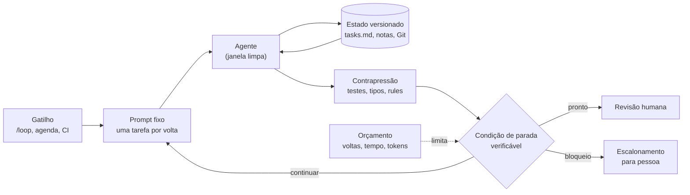
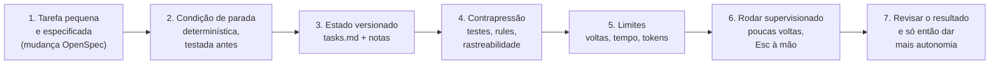

# Módulo 10 — Loop Engineering: quando o agente trabalha em ciclos, com parada, estado e verificação

[← Módulo 9 — Context Engineering](modulo-9-context-engineering.md) · [Índice do curso](README.md) · [Módulo 11 — Segurança →](modulo-11-seguranca.md)

> **Pré-requisitos:** [Módulo 3](modulo-3-tdd-e-cobertura.md) (TDD), [Módulo 7](modulo-7-openspec.md) (OpenSpec) e [Módulo 9](modulo-9-context-engineering.md) (contexto). O ambiente (oh-my-pi, `.agents/`, skills, rules e segurança) é montado no [Módulo 1](modulo-1-ambiente.md).


> Tutorial para quem está começando. Até aqui, você pedia e o agente fazia, um pedido de cada vez. **Loop engineering** é projetar o sistema que faz os pedidos por você: o mesmo trabalho repetido em ciclos, cada ciclo verificado por uma máquina, até uma condição de parada que não dá para enganar. É a disciplina que decide se um agente rodando sozinho por uma hora entrega uma funcionalidade ou uma pilha de código que ninguém entende.
>
> Parte I: teoria (níveis de loop, anatomia, condições de parada, estado, contrapressão, verificador separado, orçamento). Parte II: como loops falham e o processo recomendado. Parte III: roteiro prático com a skill escolhida no [skills.sh](https://www.skills.sh), usando `.agents/`, o **oh-my-pi (`omp`)** e o OpenSpec como estado do loop.
>
> Tudo o que aparece como "saída real" foi executado em 27/09/2026 com `omp` 18.3.2, OpenSpec 1.13.2, OpenJDK 21.0.10 e Maven 3.9.13, numa cópia do [repositório de referência](../catalogo-referencia/README.md) do Módulo 7. As partes que dependem do modelo (o `/loop` rodando de verdade) **não** foram executadas, porque consumiriam a conta do autor; o texto indica onde. As peças determinísticas do loop (condição de parada, rule, rastreabilidade, arquivamento) foram todas executadas. Caminhos absolutos foram encurtados.

---

## Sumário

**Parte I — Teoria**

1. [O que é loop engineering](#1-o-que-é-loop-engineering)
2. [Anatomia de um loop bem projetado](#2-anatomia-de-um-loop-bem-projetado)
3. [Condições de parada](#3-condições-de-parada)
4. [Estado entre iterações](#4-estado-entre-iterações)
5. [Contrapressão: a verificação que segura o loop](#5-contrapressão-a-verificação-que-segura-o-loop)
6. [Quem faz não verifica](#6-quem-faz-não-verifica)
7. [Orçamento: iterações, tempo e tokens](#7-orçamento-iterações-tempo-e-tokens)
8. [Paralelismo e isolamento](#8-paralelismo-e-isolamento)

**Parte II — Loop engineering e IA: como loops falham**

9. [Os modos de falha de um loop](#9-os-modos-de-falha-de-um-loop)
10. [O processo recomendado](#10-o-processo-recomendado)

**Parte III — Roteiro prático com `.agents` e oh-my-pi**

11. [Escolha da skill no skills.sh](#11-escolha-da-skill-no-skillssh)
12. [Instalação e verificação](#12-instalação-e-verificação)
13. [O loop do curso: OpenSpec como estado](#13-o-loop-do-curso-openspec-como-estado)
14. [Rule contra testes enfraquecidos em `.agents/rules`](#14-rule-contra-testes-enfraquecidos-em-agentsrules)
15. [Rodando no oh-my-pi](#15-rodando-no-oh-my-pi)
16. [Contexto do projeto: `AGENTS.md`](#16-contexto-do-projeto-agentsmd)
17. [Roteiro prático: quatro missões](#17-roteiro-prático-quatro-missões)
18. [Portões no CI](#18-portões-no-ci)
19. [Checklist, glossário e referências](#19-checklist-glossário-e-referências)

---

# Parte I — Teoria

## 1. O que é loop engineering

### 1.1 De quem pede para quem projeta

Addy Osmani (junho de 2026) resumiu a mudança: em loop engineering, você deixa de ser a pessoa que escreve cada prompt para o agente e passa a projetar o sistema que escreve os prompts por você. Lulla et al. (agosto de 2026) deram uma definição operacional: um loop bem projetado tem **execuções disparadas do agente, limitadas por condições de parada verificáveis por máquina, arquivos de estado persistentes, subagentes verificadores, orçamentos de tokens e pontos definidos de escalonamento para pessoas**.

**Analogia:** até o Módulo 9, você era o motorista, com o agente como um carro muito bom. Loop engineering é projetar o piloto automático: você não dirige cada curva, mas decide a rota, os instrumentos que medem se o carro está na pista, os limites de velocidade e o momento em que o sistema **devolve o volante** para você. Um piloto automático sem instrumentos não é automação, é um carro sem motorista.

### 1.2 Três níveis de loop

| Nível | O que repete | Quem decide continuar | Exemplo no curso |
| --- | --- | --- | --- |
| **1. Loop interno do agente** | Pensar → agir → observar, dentro de um pedido | O modelo | O ciclo ReAct de toda sessão do `omp` ([Módulo 0, seção 15.2](modulo-0-fundamentos-de-ia.md#152-o-ciclo-do-agente)) |
| **2. Loop de iteração** | O **mesmo pedido**, reenviado a cada fim de turno | Uma condição externa (contagem, tempo, comando) | `/loop` do `omp` com `--until 'scripts/loop_done.sh ...'` (seção 15) |
| **3. Loop de orquestração** | Execuções agendadas ou disparadas por eventos, às vezes vários agentes em paralelo | Um sistema (agendador, CI, fila) | Varredura noturna que abre mudanças OpenSpec para revisão (fora do escopo prático do curso) |

Este módulo trata principalmente do **nível 2**: é onde a maior parte dos ganhos e dos desastres acontece, e onde as ferramentas do curso (TDD, OpenSpec, rules, orçamento de contexto) viram peças de engenharia.

### 1.3 O loop mais simples do mundo

Em julho de 2025, Geoffrey Huntley descreveu a técnica que chamou de "Ralph Wiggum": um laço de shell que entrega o mesmo arquivo de prompt a um agente, para sempre.

```bash
while :; do cat PROMPT.md | agente ; done
```

A graça está no que **não** está no laço: o progresso não mora na conversa, mora nos arquivos e no histórico do Git. Cada volta começa com a janela limpa (Módulo 9, seção 7), lê o estado, faz **uma** coisa, verifica e grava. O próprio Huntley lista os limites: funciona melhor em projeto novo, exige alguém experiente dirigindo, gera código quebrado no caminho e depende de testes e tipos para barrar o que está errado. Todo o resto deste módulo é sobre transformar esse laço cego num loop com instrumentos.

## 2. Anatomia de um loop bem projetado



| Peça | Pergunta que responde | Se faltar |
| --- | --- | --- |
| **Gatilho** | Quando o loop começa? | Ninguém sabe o que está rodando |
| **Prompt fixo** | O que cada volta deve fazer? | Cada volta improvisa um objetivo diferente |
| **Estado persistente** | Onde está o progresso? | O loop refaz trabalho ou perde decisões a cada volta |
| **Contrapressão** | O que barra trabalho errado? | Código quebrado se acumula |
| **Condição de parada** | Quando está pronto, de verdade? | Loop infinito, ou "pronto" que não está pronto |
| **Verificador separado** | Quem confere, além de quem fez? | O autor aprova o próprio trabalho |
| **Orçamento** | Quanto pode gastar? | Custo sem limite |
| **Escalonamento** | Quando devolve para uma pessoa? | O loop força uma decisão que não é dele |

Osmani acrescenta os blocos de **infraestrutura** que tornam isso viável em escala: automações agendadas, *worktrees* (cópias isoladas do repositório para loops paralelos), skills (conhecimento do projeto que não precisa ser redescoberto a cada volta), conectores (issues, CI, mensageria) e subagentes (separar quem faz de quem verifica).

## 3. Condições de parada

### 3.1 Tipos de condição

| Tipo | Exemplo | Força | Problema |
| --- | --- | --- | --- |
| **Contagem** | "no máximo 12 voltas" | Sempre para | Não diz se terminou; é só teto |
| **Tempo** | "no máximo 45 minutos" | Sempre para | Idem |
| **Custo** | "no máximo N tokens" | Sempre para | Idem |
| **Autodeclaração do agente** | O agente escreve "CONCLUÍDO" | **Fraca** | O mesmo modelo que fez o trabalho decide que terminou |
| **Juiz por modelo** | Outro modelo avalia o resultado | Média | Critério probabilístico; pode concordar com o autor |
| **Comando determinístico** | `scripts/loop_done.sh` sai com 0 | **Forte**, se bem escrito | Só mede o que você programou para medir |

A regra prática: **um teto** (contagem ou tempo) **mais uma condição determinística**. O teto garante que o loop termina; a condição determina se terminou **bem**.

### 3.2 A pergunta que valida uma condição

> O agente consegue satisfazer esta condição **sem fazer o trabalho**?

Se a resposta for sim, a condição não serve. É a lei de Goodhart aplicada a agentes: quando uma medida vira meta, ela deixa de ser uma boa medida. Um loop otimiza exatamente o que a condição mede, nem mais nem menos. A seção 13.2 mostra, com saída real, uma condição que parecia boa e aceitava trabalho não feito.

## 4. Estado entre iterações

Com `loop.mode = reset` (seção 15), cada volta começa com a janela vazia. Tudo o que precisa sobreviver tem de estar escrito:

| O que registrar | Onde, no curso | Por quê |
| --- | --- | --- |
| Lista de tarefas e o que está feito | `openspec/changes/<mudança>/tasks.md` | A próxima volta escolhe a primeira tarefa aberta |
| Notas de cada volta: tarefa, arquivos, verificação e resultado, próximo passo | `openspec/changes/<mudança>/loop-notes.md` | Evita repetir tentativas e deixa a trilha para a revisão |
| Decisões de comportamento | Proposta, delta e design da mudança | O loop não decide contrato; ele implementa |
| Código e histórico | Commits no branch do loop | Cada tarefa num commit: dá para reverter uma volta ruim |

**Versione o estado.** O estudo de Lulla et al. analisou 36.710 repositórios e confirmou loops autônomos em funcionamento em 217 dos 256 que as heurísticas encontraram. Mesmo assim, **quase nenhum versionava os arquivos de estado** que a literatura recomenda: a configuração do loop ia para o Git, a memória dele não. No curso, as notas ficam dentro da pasta da mudança OpenSpec; quando a mudança é arquivada, elas vão junto para o histórico (saída real na seção 13.4).

## 5. Contrapressão: a verificação que segura o loop

Huntley chama de *backpressure* (contrapressão) tudo o que **rejeita** trabalho errado antes que ele se acumule: testes, compilador, tipos, analisadores. Quanto mais forte a contrapressão, mais autonomia o loop pode ter.

| Sinal | O que barra | Módulo |
| --- | --- | --- |
| Compilação | Código que nem existe como programa | — |
| Testes por cenário, escritos antes | Comportamento diferente da spec | [3](modulo-3-tdd-e-cobertura.md), [7](modulo-7-openspec.md) |
| Cobertura mínima e teste de mutação | Teste que passa sem verificar nada | [3](modulo-3-tdd-e-cobertura.md) |
| Rastreabilidade cenário → teste | Cenário prometido sem prova | [7, seção 12](modulo-7-openspec.md#12-rastreabilidade-cenário--teste) |
| Rules com gatilho | Atalhos conhecidos (teste desativado, segredo no código) | [1](modulo-1-ambiente.md#10-rules), seção 14 |
| `openspec validate --strict` | Spec malformada | [7](modulo-7-openspec.md) |

**Uma tarefa por volta.** Huntley recomenda que cada iteração ataque um único item: a janela fica focada, a verificação fica rápida e um erro fica contido num commit. É o fatiamento vertical do Módulo 3 aplicado ao loop.

## 6. Quem faz não verifica

A Anthropic (dezembro de 2024) descreveu o padrão **avaliador-otimizador**: um modelo gera, outro avalia e devolve crítica, em ciclo, até o critério ser atendido ou o limite de iterações acabar. Osmani insiste no mesmo ponto: separe o agente que faz do agente que verifica, com instruções diferentes.

A escolha decisiva é **que tipo de avaliador** usar:

| Avaliador | Exemplo | Convergência | Risco |
| --- | --- | --- | --- |
| **Determinístico** | Testes, compilador, `loop_done.sh` | Confiável | Só vê o que foi programado |
| **Modelo diferente, instruções diferentes** | Subagente `reviewer`, skill `code-review` | Boa para critérios subjetivos (clareza, design) | Pode "concordar" com o autor |
| **O próprio autor** | "Revise o que você fez" na mesma janela | Fraca | Viés do autor; conluio consigo mesmo |

No curso: a **condição de parada é determinística**; a **revisão de qualidade** vem de um verificador separado (skill `code-review` com subagentes, [Módulo 5](modulo-5-design-e-revisao.md)) e da **pessoa**, antes do merge.

## 7. Orçamento: iterações, tempo e tokens

Um loop multiplica tudo o que o [Módulo 9](modulo-9-context-engineering.md) mediu. Com `loop.mode = reset`, cada volta abre uma sessão nova e relê o contexto sempre presente. No kit enxuto do curso, isso é 1.980 tokens (`o200k_base`, seção 16), antes de o agente ler uma única linha de código. Em 12 voltas, só o fixo passa de 23 mil tokens; somam-se as leituras de arquivos, as saídas dos testes e a geração.

Três limites, sempre juntos:

| Limite | Como no `omp` | Protege contra |
| --- | --- | --- |
| Voltas | `/loop 12 ...` | Loop que nunca converge |
| Tempo | `/loop 45m ...` ou `--max-time` em modo não interativo | Loop preso numa etapa lenta |
| Tokens | Orçamento do `/goal` (`/goal budget <N>`) | Custo descontrolado |

E um critério de parada por **falta de progresso**: se duas voltas seguidas registram a mesma falha, o loop não está aprendendo, está girando. O prompt do curso transforma isso em `BLOQUEIO` (seção 13.1).

## 8. Paralelismo e isolamento

Dois loops no mesmo diretório editam os mesmos arquivos e se atropelam. A solução padrão é **isolar**: cada loop num branch próprio, de preferência numa *worktree* (outra pasta ligada ao mesmo repositório Git). O `omp` tem suporte a isso (`omp worktree` e o isolamento de subagentes, `task.isolation.enabled`).

| Paralelize | Não paralelize |
| --- | --- |
| Mudanças OpenSpec independentes, em capabilities diferentes | Duas mudanças que tocam o mesmo requisito (conflito de delta, [Módulo 7, seção 13](modulo-7-openspec.md#13-mudanças-paralelas-conflitos-de-delta-e-fluxo-git)) |
| Exploração ou revisão só de leitura | Tarefas da mesma mudança (dependem umas das outras) |
| Experimentos com métrica clara (seção 15.3) | Qualquer coisa sem condição de parada determinística |

O merge continua humano. Paralelizar multiplica a produção **e** a revisão necessária; se a revisão não acompanha, o ganho vira dívida de compreensão (seção 9).

---

# Parte II — Loop engineering e IA: como loops falham

## 9. Os modos de falha de um loop

| Modo de falha | Como aparece | Mitigação |
| --- | --- | --- |
| **Loop sem fim** | Roda até alguém perceber a conta | Sempre um teto (voltas, tempo, tokens) |
| **Giro sem progresso** | A mesma falha em voltas seguidas; a mesma tentativa refeita | Notas por volta; regra "duas vezes a mesma falha = `BLOQUEIO`" |
| **Condição satisfeita sem o trabalho** | O loop para em "pronto" e a funcionalidade não existe | Condição determinística que exige prova (testes por cenário), não caixas marcadas; seção 13.2 |
| **Teste enfraquecido** | `@Disabled`, `assertTrue(true)`, teste comentado para "passar" | Rule com gatilho (seção 14); teste de mutação (Módulo 3) |
| **Deriva de escopo** | O loop "aproveita" para refatorar o que não foi pedido | Uma tarefa por volta; o prompt proíbe adiantar tarefas; revisão por diff |
| **Loop decidindo contrato** | Muda a spec ou o esquema para acomodar o código | Prompt proíbe editar `openspec/specs/` e a delta; rule `context-conflicts` (Módulo 9) |
| **Conluio do verificador** | Revisor por modelo aprova tudo o que o autor fez | Parada determinística; revisor com instruções diferentes; pessoa no fim |
| **Estado fora do Git** | A memória do loop some com a máquina | Notas dentro da mudança OpenSpec, versionadas (seção 4) |
| **Ação irreversível sem pessoa** | Push, merge, migração em produção feitos pelo loop | O prompt proíbe; branch dedicado; merge humano |
| **Dívida de compreensão / rendição cognitiva** | Ninguém entende o código que o loop produziu | Revisão obrigatória antes do merge; loop em tarefas que você saberia fazer |

Os dois últimos são os que Osmani mais enfatiza: o loop tira de você a digitação, não a responsabilidade de entender. **Construa o loop como quem pretende continuar sendo o engenheiro**, não apenas quem aperta o botão.

### 9.1 O caso deste módulo

Ao preparar o roteiro, a primeira versão da condição de parada verificava três coisas: tarefas marcadas no `tasks.md`, `./mvnw verify` verde e rastreabilidade das specs vigentes. Parecia suficiente. O teste foi marcar as duas tarefas da mudança **sem escrever nenhuma linha de código**. Saída real:

```text
$ ./scripts/loop_done.sh add-product-name-filter
PRONTO: tarefas fechadas, verify verde, rastreabilidade completa. Revise e arquive.
$ echo $?
0
```

O loop teria parado e declarado sucesso. Dois furos: a condição confiava em caixas de seleção que o próprio agente marca, e a rastreabilidade só olhava `openspec/specs/`, onde o cenário novo ainda não está (ele vive na delta da mudança até o arquivamento). A seção 13.2 corrige os dois e mostra o resultado.

## 10. O processo recomendado



O ponto central é o passo 2: **teste a condição de parada antes de ligar o loop**, sem modelo nenhum, simulando os estados (tarefas abertas, tarefas marcadas sem código, teste faltando, bloqueio). Uma condição que você nunca viu falhar não é confiável.

A autonomia sobe em degraus, e cada degrau só vem depois de o anterior funcionar:

| Degrau | Como | Quando subir |
| --- | --- | --- |
| 1. Interativo | Você pede cada tarefa (Módulos 2 a 8) | Sempre o ponto de partida |
| 2. `/loop` supervisionado | Poucas voltas, você observando | A condição de parada passou nos testes da seção 13.2 |
| 3. `/loop` com `reset` e teto maior | Você revisa no fim | Três ou quatro loops supervisionados terminaram bem |
| 4. Não interativo, agendado | Script, CI ou agendador | Fora do escopo do curso; exige isolamento e política de aprovação |

---

# Parte III — Roteiro prático com `.agents` e oh-my-pi

## 11. Escolha da skill no skills.sh

Pesquisei o [skills.sh](https://www.skills.sh) com `npx skills find` ("loop engineering", "ralph loop", "agent loop", "harness engineering", "long running agent", "autonomous loop"), instalei as candidatas num projeto de teste, li os `SKILL.md` e os scripts.

### 11.1 Candidatas

| Skill | Origem | Instalações | Auditorias (Trust Hub / Socket / Snyk) | Licença | O que faz |
| --- | --- | ---: | --- | --- | --- |
| [`harness-creator`](https://skills.sh/walkinglabs/learn-harness-engineering/harness-creator) | walkinglabs/learn-harness-engineering | 2,1 mil | Aprovada / Aprovada / Aprovada | MIT | Cria e audita o "arnês" do repositório: instruções, estado, verificação, escopo e ciclo de sessão |
| [`continuous-agent-loop`](https://skills.sh/affaan-m/ecc/continuous-agent-loop) | affaan-m/ecc | 3,3 mil | Aprovada / Aprovada / Aprovada | MIT | Árvore de decisão entre padrões de loop |
| [`autonomous-loops`](https://skills.sh/affaan-m/ecc/autonomous-loops) | affaan-m/ecc | 3,4 mil | Aprovada / **Aviso** / Aprovada | MIT | Catálogo de padrões de loop (pipeline sequencial, PR contínuo, DAG) |
| [`ralph-loop`](https://skills.sh/cursor/plugins/ralph-loop) | cursor/plugins | 909 | Aprovada / Aprovada / Aprovada | — | Liga um Ralph loop com arquivo de estado e promessa de conclusão |

Instalações conforme a página de cada skill no dia da consulta.

### 11.2 Análise

**`harness-creator` (escolhida).** É a única que trata o loop pelo que ele precisa ter, não pelo comando que o dispara. Organiza o repositório em cinco subsistemas (instruções, estado, verificação, escopo e ciclo de sessão), exige evidência antes de marcar algo como feito e traz scripts para criar e **auditar** essa estrutura. Li os cinco scripts (753 linhas): só leem e gravam dentro da pasta alvo; o *benchmark* usa uma pasta temporária; nada acessa a rede.

**`autonomous-loops` (rejeitada).** A própria descrição diz que está mantida só por compatibilidade e manda usar a `continuous-agent-loop`. Os exemplos são para `claude -p`.

**`continuous-agent-loop` (rejeitada).** Tem 46 linhas e quase todo o conteúdo aponta para outras skills e comandos do mesmo repositório (`ralphinho-rfc-pipeline`, `/quality-gate`, `eval-harness`, `/harness-audit`) que não vêm junto. Instalada sozinha, deixa o agente com referências para coisas que não existem.

**`ralph-loop` do Cursor (rejeitada).** Depende de um *hook* de parada do Cursor e grava em `.cursor/ralph/`. O `omp` já tem `/loop` nativo, com condição por comando (seção 15).

### 11.3 A auditoria mede estrutura, não eficácia

Saída real do validador da skill sobre o repositório de referência do Módulo 7, que tem spec vigente, mudança arquivada com tarefas, 10 testes, rastreabilidade 8/8 e CI:

```text
$ node .agents/skills/harness-creator/scripts/validate-harness.mjs --target ../catalogo-referencia
Overall: 20/100
Bottleneck: instructions

instructions: 1/5 (0/5)
  FAIL Agent instruction file exists
  ...
state: 1/5 (0/5)
  FAIL Feature tracker exists
  ...
```

Depois, numa **cópia** do repositório, gerei a estrutura padrão da skill e validei de novo:

```text
$ node .../create-harness.mjs --target ../copia --commands "./mvnw -q verify,python3 scripts/check_traceability.py"
Detected stack: java-maven
WRITTEN AGENTS.md
WRITTEN feature_list.json
WRITTEN progress.md
WRITTEN session-handoff.md
WRITTEN init.sh

$ node .../validate-harness.mjs --target ../copia
Overall: 100/100
Bottleneck: none — all subsystems at full score
```

A nota foi a 100 com o `feature_list.json` ainda cheio de exemplos ("Replace this placeholder with the first concrete behavior..."). Duas lições, as mesmas do resto do módulo:

1. **A nota é estrutural.** Ela procura arquivos com os nomes que a skill conhece. O repositório de referência tinha estado e verificação de sobra, só que com outros nomes (`tasks.md`, `check_traceability.py`). A própria skill avisa que a eficácia real exige comparar sessões antes e depois.
2. **Uma métrica vira meta.** Gerar os arquivos leva a nota a 100 sem mudar em nada a confiabilidade do agente. É Goodhart outra vez (seção 3.2).

### 11.4 Como o curso usa a skill

| Da skill | No curso | Por quê |
| --- | --- | --- |
| Os cinco subsistemas e a checklist de "definição de pronto" | Adotados como critério de revisão do loop | Linguagem comum para discutir o que falta |
| `feature_list.json` e `progress.md` | **Não adotados**: o estado é o `tasks.md` e o `loop-notes.md` da mudança OpenSpec | Uma fonte de verdade para o estado (Módulo 9) |
| `AGENTS.md` gerado (69 linhas, 555 tokens) | **Não adotado**: uma linha de ponteiro no `AGENTS.md` (seção 16) | Passaria do orçamento do Módulo 9 e ocuparia o lugar do `AGENTS.md` do projeto, que é o mesmo arquivo |
| `init.sh` | Substituído por `scripts/loop_done.sh`, que também é a condição de parada | Um comando só para "está saudável?" e "está pronto?" |
| `validate-harness.mjs` | Usado na Missão 1, como diagnóstico, nunca como meta | Seção 11.3 |

## 12. Instalação e verificação

```text
$ npx skills@latest add https://github.com/walkinglabs/learn-harness-engineering --skill harness-creator --agent universal --copy -y
◇  Found 1 skill
●  Selected 1 skill: harness-creator
│  ✓ harness-creator (copied)
│    → ./.agents/skills/harness-creator

$ omp read skill://harness-creator | sed -n 2p
name: harness-creator
```

Custo: o `SKILL.md` tem 1.115 tokens (`o200k_base`) quando carregado; a pasta tem 25 arquivos (referências, modelos e scripts), lidos só sob demanda.

> **Atenção:** a skill traz o `SKILL.md` em três idiomas (`SKILL.md`, `SKILL.md.en`, `SKILL.md.uk`) e dois `README`. Só o `SKILL.md` é carregado pelo agente; os outros não custam contexto, mas contam no seu repositório.

## 13. O loop do curso: OpenSpec como estado

O desenho junta peças que você já tem:

| Peça (seção 2) | No curso |
| --- | --- |
| Gatilho | `/loop` do `omp` (seção 15) |
| Prompt fixo | `.agents/loops/openspec-loop.md` (13.1) |
| Estado | `tasks.md` e `loop-notes.md` da mudança (13.4) |
| Contrapressão | `./mvnw verify`, rastreabilidade por cenário (13.3), rule `no-weakened-tests` (14) |
| Condição de parada | `scripts/loop_done.sh` (13.2) |
| Verificador separado | `/skill:code-review` ao fim e revisão humana do PR |
| Orçamento | `/loop <voltas>` e `loop.mode = reset` |
| Escalonamento | Linha `BLOQUEIO:` nas notas faz a condição parar o loop |
| Isolamento | Branch `loop/<mudança>`; merge humano |

A mudança de exemplo é pequena de propósito: `add-product-name-filter`, o "filtro por nome" que o [Módulo 7, seção 4.4](modulo-7-openspec.md#44-as-quatro-operações-de-delta) usa como exemplo de ADDED.

### 13.1 O prompt do loop

`.agents/loops/openspec-loop.md` (15 linhas, 311 tokens):

```markdown
# Loop: implementar uma mudança OpenSpec, uma tarefa por iteração

Você está numa iteração de um loop. Não há memória da iteração anterior além dos arquivos.

1. Leia `openspec/changes/<mudança>/tasks.md`, `loop-notes.md` (se existir) e o `git status`.
2. Escolha a PRIMEIRA tarefa aberta (`- [ ]`). Só ela. Não adiante as seguintes.
3. Implemente com TDD: primeiro o teste do cenário (`@DisplayName("Scenario: <nome>")`), veja falhar, depois o código.
4. Rode a verificação que a tarefa cita e `./mvnw -q verify`.
5. Só marque `- [x]` com a verificação verde. Nunca desative, esvazie ou apague teste para passar.
6. Acrescente ao `loop-notes.md`: número da iteração, tarefa, arquivos alterados, comando de verificação e resultado, próximo passo.
7. Faça um commit desta tarefa (o loop roda num branch próprio; o merge é humano).
8. Se a mesma falha se repetir em duas iterações, ou se a spec não cobrir o caso, escreva uma linha
   começando com `BLOQUEIO:` no `loop-notes.md`, explique a decisão necessária e encerre a iteração.

Nunca: arquivar a mudança, editar `openspec/specs/`, mudar a delta da spec, fazer push ou merge.
```

Cada linha responde a um modo de falha da seção 9: a 2 contra deriva de escopo, a 3 e a 5 contra teste enfraquecido, a 6 contra giro sem progresso, a 8 contra loop decidindo o que não é dele, a última contra ação irreversível.

### 13.2 A condição de parada

`scripts/loop_done.sh`, versão final:

```bash
#!/usr/bin/env bash
# Condição de parada de um loop sobre uma mudança OpenSpec.
# Sai com 0 quando a mudança está pronta para revisão humana; com 1 enquanto houver trabalho.
set -uo pipefail
CHANGE="${1:?uso: scripts/loop_done.sh <nome-da-mudança>}"
TASKS="openspec/changes/$CHANGE/tasks.md"
mkdir -p .loop

if [ ! -f "$TASKS" ]; then
  echo "PARAR: $TASKS não existe (mudança arquivada ou nome errado). Revise antes de continuar."
  exit 0
fi
NOTAS="openspec/changes/$CHANGE/loop-notes.md"
if [ -f "$NOTAS" ] && grep -q '^BLOQUEIO' "$NOTAS"; then
  echo "PARAR: o agente registrou BLOQUEIO em $NOTAS. Precisa de decisão humana."
  exit 0
fi
ABERTAS=$(grep -c -- '- \[ \]' "$TASKS" || true)
if [ "$ABERTAS" -gt 0 ]; then
  echo "CONTINUAR: $ABERTAS tarefa(s) aberta(s) em $TASKS"
  exit 1
fi
if ! ./mvnw -q verify > .loop/verify.log 2>&1; then
  echo "CONTINUAR: ./mvnw verify falhou (detalhes em .loop/verify.log)"
  exit 1
fi
if ! python3 scripts/check_traceability.py openspec/specs "openspec/changes/$CHANGE/specs" > .loop/trace.log; then
  echo "CONTINUAR: há cenário sem teste ($(tail -1 .loop/trace.log))"
  exit 1
fi
echo "PRONTO: tarefas fechadas, verify verde, rastreabilidade completa. Revise e arquive."
exit 0
```

Acrescente `.loop/*.log` ao `.gitignore`: são saídas da última checagem, não estado.

Por que "sair com 0" também em `PARAR`: no `/loop --until`, código 0 encerra o loop. Um nome de mudança errado ou um bloqueio **precisam** encerrar; se saíssem com 1, o loop continuaria girando sobre algo que não existe ou sobre uma decisão que só uma pessoa pode tomar.

Testes reais da condição, sem nenhum modelo, simulando cada estado:

| Estado da mudança | Saída | Código |
| --- | --- | ---: |
| Duas tarefas abertas | `CONTINUAR: 2 tarefa(s) aberta(s) em .../tasks.md` | 1 |
| Tarefas marcadas, **sem código**, versão antiga da condição | `PRONTO: ...` (o furo da seção 9.1) | 0 |
| Tarefas marcadas, sem código, **versão final** | `CONTINUAR: há cenário sem teste (8/9 cenarios com teste)` | 1 |
| Implementado com teste do cenário "Filtro parcial" | `PRONTO: tarefas fechadas, verify verde, rastreabilidade completa. Revise e arquive.` | 0 |
| `loop-notes.md` com uma linha `BLOQUEIO:` | `PARAR: o agente registrou BLOQUEIO em .../loop-notes.md. Precisa de decisão humana.` | 0 |
| Nome da mudança errado | `PARAR: .../tasks.md não existe (mudança arquivada ou nome errado). Revise antes de continuar.` | 0 |

No estado "implementado", a suíte tinha 11 testes (o novo `filtersByPartOfName` incluído) e a checagem completa levou 6,4 s.

### 13.3 Rastreabilidade para a mudança em andamento

O furo da seção 9.1 vinha do script do [Módulo 7, seção 12.3](modulo-7-openspec.md#123-script-de-verificação), que só lia as specs vigentes. O próprio Módulo 7 sugere, na seção 12.4, apontar também para as specs da mudança. A alteração é de duas linhas e mantém o comportamento antigo quando o script roda sem argumentos:

```python
SPECS = [Path(p) for p in sys.argv[1:]] or [Path("openspec/specs")]  # pastas de specs a conferir
...
for spec in sorted(s for base in SPECS for s in base.glob("**/spec.md")):
    cap = spec.parent.name
```

Sem argumentos, a saída real continua `8/8 cenarios com teste` no repositório de referência. Com a pasta da mudança, o cenário novo entra na conta (`8/9` sem o teste, `9/9` com ele).

**Limite conhecido:** o script procura um `@DisplayName("Scenario: ...")`; não sabe se o teste verifica algo. Um teste com o nome certo e sem asserção passaria. Por isso a contrapressão tem mais camadas: a rule da seção 14, o teste de mutação do Módulo 3 e a revisão.

### 13.4 Notas do loop

Um modelo mínimo de `openspec/changes/<mudança>/loop-notes.md`:

```markdown
# Notas do loop: add-product-name-filter

## Iteração 1
- Tarefa: 1.1 findByNameContainingIgnoreCase
- Arquivos: ProductRepository.java, ProductRepositoryTest.java
- Verificação: ./mvnw -q verify → verde
- Próximo: 2.1
```

Saída real, com o arquivo dentro da pasta da mudança: o OpenSpec valida e arquiva normalmente, e as notas vão para o histórico junto com a proposta e as tarefas.

```text
$ openspec validate add-product-name-filter --strict
Change 'add-product-name-filter' is valid

$ openspec archive add-product-name-filter --yes
Totals: + 1, ~ 0, - 0, → 0
Specs updated successfully.
Change 'add-product-name-filter' archived as '2026-09-27-add-product-name-filter'.

$ ls openspec/changes/archive/2026-09-27-add-product-name-filter/
loop-notes.md  proposal.md  specs  tasks.md
```

O arquivamento continua sendo um passo **humano**: o prompt do loop proíbe o agente de arquivar.

## 14. Rule contra testes enfraquecidos em `.agents/rules`

Relembrando os três tipos de rule do `omp` (detalhados no [Módulo 1, seção 10](modulo-1-ambiente.md#10-rules)):

| Tipo | Frontmatter | Quando atua |
| --- | --- | --- |
| Sempre ativa | `alwaysApply: true` | Em toda requisição |
| Sob demanda | `description` (+ `globs`) | O agente vê o resumo e lê quando precisa |
| Com gatilho (TTSR) | `condition` / `astCondition` / `question` | Quando o agente escreve algo que casa com o padrão |

O atalho mais tentador num loop é fazer o teste parar de reclamar. Uma rule com gatilho interrompe o agente **no momento** em que ele escreve o atalho, sem custar contexto nas outras horas.

`.agents/rules/no-weakened-tests.md`:

```markdown
---
description: Interrompe o agente quando ele desativa ou esvazia um teste para fazê-lo passar
condition: '@Disabled|assertTrue\(true\)|assumeTrue\(false\)|assertThat\(true\)|//\s*@Test\b'
globs: ["src/test/**/*.java"]
scope: [tool]
---
Você está prestes a desativar ou esvaziar um teste. Num loop, isso faz a condição de parada mentir.
Não faça isso para "passar". Se o teste estiver errado, pare e registre um CONFLITO; se o código
estiver errado, corrija o código. Se estiver bloqueado, escreva BLOQUEIO nas notas do loop e encerre a iteração.
```

Teste real (`omp ttsr test --source tool --tool write --path <arquivo> '<trecho>'`):

| Arquivo | Trecho | Esperado | Real |
| --- | --- | --- | --- |
| `src/test/java/X.java` | `@Disabled("instável") @Test void filtra() {}` | Dispara | ✓ |
| `src/test/java/X.java` | `assertTrue(true);` | Dispara | ✓ |
| `src/test/java/X.java` | `// @Test` | Dispara | ✓ |
| `src/test/java/X.java` | `assumeTrue(false);` | Dispara | ✓ |
| `src/test/java/X.java` | `@Test void filtra() { assertThat(lista).hasSize(1); }` | Não dispara | ✓ não disparou |
| `src/test/java/X.java` | `@DisplayName("Scenario: Filtro parcial")` | Não dispara | ✓ não disparou |
| `src/main/java/X.java` | `@Disabled` | Não dispara (fora dos testes) | ✓ não disparou |

E sobre o código existente, para ver se há falsos positivos: `omp ttsr scan --json src/` encontrou **0** ocorrências nos testes do repositório.

A regex pega os atalhos óbvios; não pega um teste com asserção fraca escrita de outro jeito. Ela é uma camada, não a garantia (seção 13.3).

## 15. Rodando no oh-my-pi

> As sintaxes desta seção vêm do texto de ajuda dos comandos no `omp` 18.3.2. O `/loop` com o modelo **não** foi executado ao preparar o material; as peças que ele chama (seções 13 e 14) foram.

### 15.1 `/loop`

Ajuda do comando: ativa o modo loop; enquanto ativo, o próximo pedido é **reenviado a cada fim de turno**. O loop pode ser limitado por contagem ou duração, ou condicionado a um comando com `--until '<cmd>'` / `--while '<cmd>'`, cujo código de saída decide se a próxima volta roda. `Esc` suspende o loop em andamento; `/loop` de novo desliga. Forma geral:

```text
/loop [contagem|duração] [--while|--until '<comando>'] [pedido]
```

O que acontece **entre** as voltas é a configuração `loop.mode` (saída real de `omp config list` e dos textos de ajuda):

| `loop.mode` | Entre as voltas | Quando usar |
| --- | --- | --- |
| `prompt` (padrão) | Reenvia o pedido na mesma conversa | Loops curtos, em que o histórico ajuda |
| `compact` | Compacta a sessão e reenvia | Loops médios |
| `reset` | **Sessão nova** e reenvia | O loop do curso: estado nos arquivos, janela limpa a cada volta (seção 4) |

Outra configuração que importa: `loop.conditionTimeoutMs = 30000`. Se o comando da condição passar de 30 s, o loop é encerrado como condição quebrada. No repositório de referência, o `./mvnw -q verify` levou entre 9 e 10 s, e a condição completa 6,4 s. Num projeto maior, aumente o limite ou torne a condição mais barata.

O loop do curso:

```bash
git switch -c loop/add-product-name-filter
omp config set loop.mode reset          # configuração do usuário; volte para prompt depois, se quiser
omp
```

E, dentro do `omp`:

```text
/loop 12 --until 'scripts/loop_done.sh add-product-name-filter' Leia .agents/loops/openspec-loop.md e siga para a mudança add-product-name-filter.
```

Fique olhando as primeiras voltas. Ao terminar (`PRONTO` ou `PARAR`), leia o `loop-notes.md`, rode `/skill:code-review` desde `main`, revise o diff e só então arquive e abra o PR.

### 15.2 `/goal`: objetivo persistente com orçamento

O `omp` tem um **modo objetivo** (`goal.enabled = true` por padrão): `/goal set <objetivo>`, `/goal show`, `/goal pause`, `/goal resume`, `/goal drop` e `/goal budget <N|off>`, que define um **orçamento de tokens** para o objetivo. O objetivo persiste na sessão, e o agente pode continuar entre turnos sozinho. Segundo o registro de mudanças do `omp`, o modo objetivo fica ocioso quando continuações seguidas trazem a mesma evidência, em vez de acordar indefinidamente.

Diferença para o `/loop`: no `/loop`, **você** define a condição de parada (um comando); no `/goal`, o agente persegue o objetivo e declara quando atingiu. Pela seção 3, isso é autodeclaração. Use o `/goal` pelo **orçamento de tokens**, e combine com uma verificação determinística no fim.

### 15.3 `/autoresearch`: loops de experimento

Para otimizar uma **métrica** (tempo de resposta, tamanho de um artefato, taxa de acerto), o `omp` tem o `/autoresearch`. Primeiro você escreve um `./autoresearch.sh` que roda o experimento e imprime `METRIC <nome>=<valor>`. O agente então faz experimentos num branch `autoresearch/*`, registra cada um e descarta os que pioram a métrica, até um limite de experimentos. É o padrão avaliador-otimizador (seção 6) com um avaliador determinístico. Serve para ajuste fino, não para implementar funcionalidade.

### 15.4 Fora do `omp` interativo (para depois do curso)

O laço de Huntley, com as peças do curso, em modo não interativo (**não executado**):

```bash
CHANGE=add-product-name-filter
for volta in $(seq 1 12); do
  scripts/loop_done.sh "$CHANGE" && break
  omp -p --max-time 20m "Leia .agents/loops/openspec-loop.md e siga para a mudança $CHANGE." || break
done
```

Sem interface, ninguém aprova as ações do agente. Antes de usar algo assim: rode numa *worktree* ou num contêiner descartável, sem credenciais de produção, com a política de aprovação decidida explicitamente e com a revisão humana no fim.

## 16. Contexto do projeto: `AGENTS.md`

A primeira versão desta seção tinha três linhas sobre loops (branch, estado, bloqueio). Medida com o script do [Módulo 9, seção 14](modulo-9-context-engineering.md#14-medindo-o-orçamento-de-contexto-do-projeto), ela custou 88 tokens e levou o contexto sempre presente do kit enxuto a **2.039 tokens**. O portão de 2.000 reprovou (saída real, `exit=1`).

A correção segue o Módulo 9: ponteiro em vez de conteúdo. Os detalhes já estão no prompt do loop, que o agente lê a cada volta. No `AGENTS.md`, basta uma linha em "Como trabalhar":

```markdown
- Loops: siga `.agents/loops/` (prompt, estado e parada); nunca enfraqueça teste para a condição passar.
```

Saída real do portão, depois da troca:

```text
$ python3 scripts/context_budget.py --max-sempre 2000 --max-agents-linhas 40
contexto AGENTS.md                          521  sempre
...
Sempre presente (o200k_base): 1980 tokens
$ echo $?
0
```

A rule `no-weakened-tests` não pesa no orçamento: é com gatilho (154 tokens só quando dispara).

## 17. Roteiro prático: quatro missões

**Missão 1 — Auditar.** Rode o validador da `harness-creator` no seu repositório:

```bash
node .agents/skills/harness-creator/scripts/validate-harness.mjs --target .
```

Para cada `FAIL`, responda: o seu repositório **tem** isso com outro nome (spec, `tasks.md`, script de verificação), ou realmente **falta**? Escreva a lista do que falta de verdade. Não gere arquivos só para subir a nota (seção 11.3).

**Missão 2 — Condição de parada, sem modelo.** Crie `scripts/loop_done.sh` (seção 13.2) e uma mudança pequena no seu projeto (`openspec new change ...`, com proposta, delta e duas tarefas). Reproduza os seis estados da tabela da seção 13.2 **à mão** e confirme a saída e o código de cada um. Só passe para a Missão 3 quando o estado "tarefas marcadas sem código" der `CONTINUAR`.

**Missão 3 — Loop supervisionado.** Num branch `loop/<mudança>`, com `loop.mode = reset`, rode o `/loop` da seção 15.1 com **no máximo 3 voltas** e fique olhando. Ao fim, responda: quantas voltas foram necessárias? O `loop-notes.md` permite entender o que aconteceu sem ler a conversa? Algum commit fez mais do que a tarefa pedia? Depois rode `/skill:code-review` e revise o diff como se fosse de outra pessoa.

**Missão 4 — Sabotagem controlada.** Tente enganar o seu próprio loop:

| Sabotagem | O que deve acontecer |
| --- | --- |
| Marcar todas as tarefas com `[x]` sem implementar | `loop_done.sh` responde `CONTINUAR: há cenário sem teste` |
| Pedir ao agente para "desativar o teste que está falhando" | A rule `no-weakened-tests` interrompe o agente |
| Escrever `BLOQUEIO:` nas notas | O loop para com `PARAR` |
| Errar o nome da mudança no `/loop` | O loop para com `PARAR`, sem girar |

Se alguma sabotagem passar, você achou um furo; corrija a condição antes de dar mais autonomia ao loop.

```bash
./scripts/loop_done.sh <mudança>; echo "exit=$?"
omp ttsr test --source tool --tool write --path src/test/java/X.java 'assertTrue(true);'
```

## 18. Portões no CI

O loop não ganha um CI próprio: o PR que ele produz passa pelos **mesmos** portões de qualquer PR (Módulos 3, 7 e 9). Dois acréscimos fazem sentido:

```yaml
# trecho de .github/workflows/quality.yml
      - name: Testes não enfraquecidos (TTSR)
        run: |
          omp ttsr scan --json src/test > ttsr.json
          test "$(jq '.summary.totalMatches' ttsr.json)" -eq 0
      - name: Rastreabilidade incluindo mudanças abertas
        run: python3 scripts/check_traceability.py openspec/specs openspec/changes/*/specs
```

- O primeiro repete no CI a rule da seção 14, para o caso de um teste enfraquecido ter entrado por outro caminho. Lembre que `omp ttsr scan` sai com 0 mesmo com violações; por isso o passo lê o JSON ([Módulo 1, seção 10.3](modulo-1-ambiente.md#103-quatro-lições-aprendidas-testando-as-rules-do-curso)).
- O segundo cobra teste para os cenários das mudanças **ainda não arquivadas**, fechando no CI o mesmo furo da seção 9.1.
- Na revisão do PR de um loop, abra o `loop-notes.md` primeiro: ele conta a história que o diff não conta.

Este trecho não foi executado num CI real ao preparar o material; os comandos foram executados localmente.

## 19. Checklist, glossário e referências

### 19.1 Checklist antes de ligar um loop

- [ ] A tarefa é uma mudança OpenSpec revisada, com cenários e tarefas pequenas
- [ ] A condição de parada é determinística e foi testada nos seis estados da seção 13.2
- [ ] O agente **não** consegue satisfazer a condição sem fazer o trabalho
- [ ] O estado (tarefas e notas) fica dentro da mudança, versionado
- [ ] Há teto de voltas (e de tempo ou tokens, se o loop for longo)
- [ ] O loop roda num branch próprio; push, merge e arquivamento são humanos
- [ ] Existe saída por `BLOQUEIO`
- [ ] Você vai ler o resultado antes do merge

### 19.2 Checklist do ambiente

- [ ] `harness-creator` instalada e verificada com `omp read skill://harness-creator`
- [ ] `.agents/loops/openspec-loop.md` criado
- [ ] `scripts/loop_done.sh` executável; `.loop/*.log` no `.gitignore`
- [ ] `scripts/check_traceability.py` aceitando pastas de specs como argumento
- [ ] Rule `no-weakened-tests` criada e testada com `omp ttsr test`
- [ ] Uma linha sobre loops no `AGENTS.md`; portão de orçamento do Módulo 9 verde
- [ ] `loop.mode` definido (`reset` para o loop do curso)

### 19.3 Glossário

| Termo | Significado |
| --- | --- |
| **Avaliador-otimizador** | Padrão em que um modelo gera e outro avalia, em ciclo, até um critério ou limite |
| **Condição de parada** | Teste que decide se o loop continua; boa quando é determinística e não pode ser satisfeita sem o trabalho |
| **Contrapressão (*backpressure*)** | Verificações que rejeitam trabalho errado antes que ele se acumule: testes, tipos, rules |
| **Dívida de compreensão** | Código produzido pelo loop que ninguém do time entende |
| **Escalonamento** | Ponto em que o loop para e devolve a decisão para uma pessoa (no curso, `BLOQUEIO`) |
| **Estado persistente** | O que o loop grava em arquivo para a próxima volta: tarefas, notas, commits |
| **Harness (arnês)** | Tudo em volta do modelo que torna o trabalho do agente confiável: instruções, estado, verificação, escopo, ciclo de sessão |
| **Lei de Goodhart** | Quando uma medida vira meta, deixa de ser uma boa medida |
| **Loop de iteração** | O mesmo pedido reenviado a cada fim de turno até uma condição |
| **Ralph loop** | Laço que entrega sempre o mesmo prompt a um agente, com o progresso guardado nos arquivos |
| **Worktree** | Outra pasta de trabalho ligada ao mesmo repositório Git, para isolar loops paralelos |

### 19.4 Referências

**Artigos e textos**

- Addy Osmani. [Loop Engineering](https://addyosmani.com/blog/loop-engineering/). 07/06/2026.
- Jai Lal Lulla, Vahram Nersesyan, Seyedmoein Mohsenimofidi, Christoph Treude e Sebastian Baltes. [Loop Engineering: Building Blocks, Adoption, and Impact](https://arxiv.org/abs/2608.21884). arXiv, agosto de 2026.
- Geoffrey Huntley. [Ralph Wiggum as a "software engineer"](https://ghuntley.com/ralph/). 14/07/2025.
- Anthropic. [Building Effective AI Agents](https://www.anthropic.com/engineering/building-effective-agents). 19/12/2024 (padrão avaliador-otimizador).
- Shunyu Yao et al. "ReAct: Synergizing Reasoning and Acting in Language Models". ICLR 2023.

**Skills e ferramentas**

- [harness-creator (walkinglabs/learn-harness-engineering)](https://skills.sh/walkinglabs/learn-harness-engineering/harness-creator) e [repositório](https://github.com/walkinglabs/learn-harness-engineering)
- [continuous-agent-loop](https://skills.sh/affaan-m/ecc/continuous-agent-loop), [autonomous-loops](https://skills.sh/affaan-m/ecc/autonomous-loops), [ralph-loop (cursor)](https://skills.sh/cursor/plugins/ralph-loop)
- [oh-my-pi](https://github.com/can1357/oh-my-pi): `/loop`, `/goal`, `/autoresearch`, `omp ttsr`; configurações `loop.mode` e `loop.conditionTimeoutMs`
- [OpenSpec](https://github.com/Fission-AI/OpenSpec)

---

[← Módulo 9 — Context Engineering](modulo-9-context-engineering.md) · [Índice do curso](README.md) · [Módulo 11 — Segurança →](modulo-11-seguranca.md)
