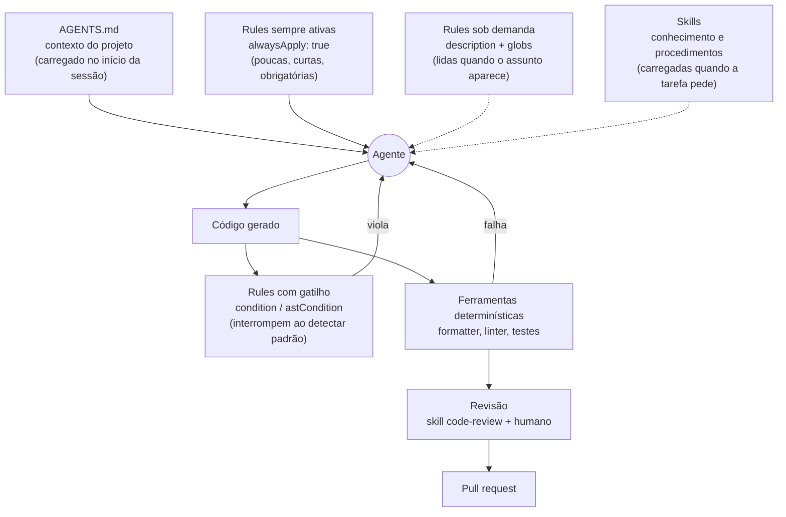
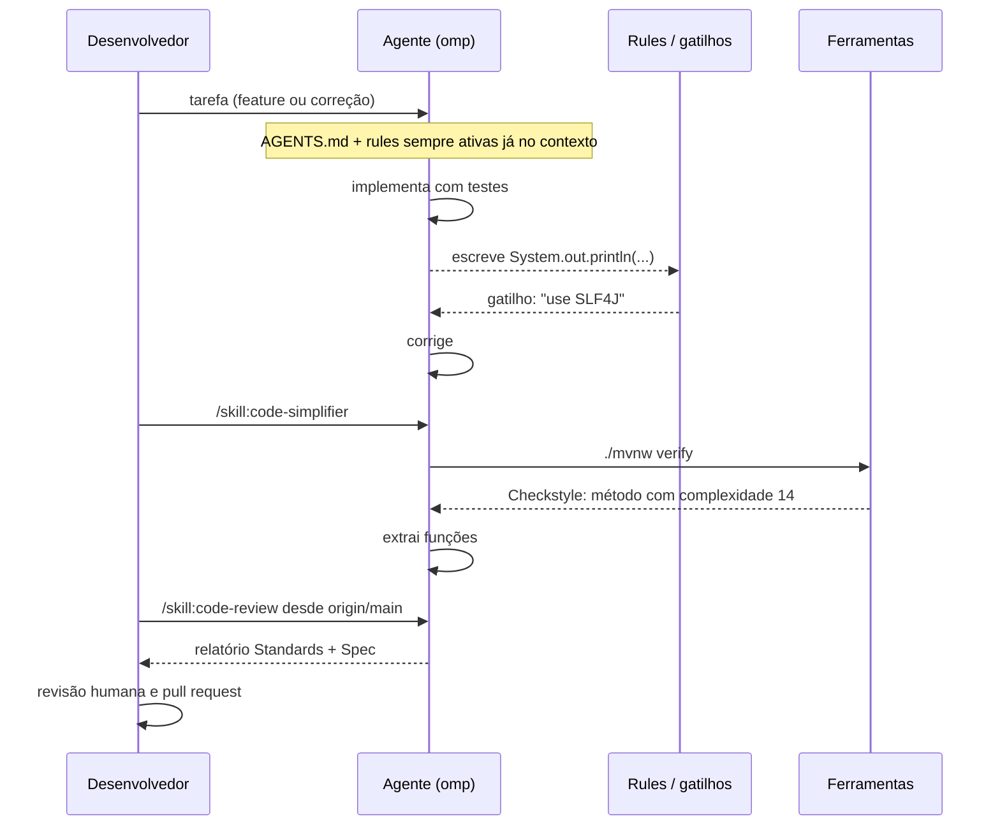

# Módulo 2 — Clean Code: do zero à prática com agentes de IA

[← Módulo 1 — Ambiente](modulo-1-ambiente.md) · [Índice do curso](README.md) · [Módulo 3 — TDD e cobertura →](modulo-3-tdd-e-cobertura.md)

> **Pré-requisitos:** [Módulo 1](modulo-1-ambiente.md). O Módulo 1 monta o ambiente (oh-my-pi, `.agents/`, skills, rules e segurança).


> Tutorial para quem está começando. Cada conceito é explicado com uma analogia, um exemplo e o motivo de existir.
> Parte I ensina a teoria de código limpo. Parte II explica como aplicar isso quando uma IA escreve parte do código. Parte III monta um projeto com **skills** e **rules** em `.agents/`, usando o **oh-my-pi (`omp`)**.
>
> Os exemplos de código estão em Java, a linguagem da disciplina, mas todos os conceitos valem para qualquer linguagem.
>
> Tudo o que aparece como "saída real" foi executado em 26/09/2026 com `omp` 18.3.2 e com o instalador `skills` do [skills.sh](https://www.skills.sh). Os números de instalação são os exibidos no skills.sh nessa data.

---

## Sumário

**Parte I — Teoria de Clean Code**

1. [O que é código limpo](#1-o-que-é-código-limpo)
2. [De onde vêm essas ideias](#2-de-onde-vêm-essas-ideias)
3. [Nomes](#3-nomes)
4. [Funções](#4-funções)
5. [Comentários](#5-comentários)
6. [Formatação](#6-formatação)
7. [Objetos, estruturas de dados e a Lei de Demeter](#7-objetos-estruturas-de-dados-e-a-lei-de-demeter)
8. [Tratamento de erros](#8-tratamento-de-erros)
9. [Classes: coesão e acoplamento](#9-classes-coesão-e-acoplamento)
10. [SOLID explicado sem mistério](#10-solid-explicado-sem-mistério)
11. [Princípios gerais: DRY, KISS, YAGNI e companhia](#11-princípios-gerais-dry-kiss-yagni-e-companhia)
12. [Code smells: os cheiros do código](#12-code-smells-os-cheiros-do-código)
13. [Refatoração](#13-refatoração)
14. [Exemplo completo: antes e depois](#14-exemplo-completo-antes-e-depois)
15. [Medindo: complexidade e ferramentas automáticas](#15-medindo-complexidade-e-ferramentas-automáticas)
16. [Críticas e equilíbrio](#16-críticas-e-equilíbrio)

**Parte II — Clean Code com programação assistida por IA**

17. [Por que a IA precisa de regras de código limpo](#17-por-que-a-ia-precisa-de-regras-de-código-limpo)
18. [As camadas de controle: contexto, rules, skills e ferramentas](#18-as-camadas-de-controle-contexto-rules-skills-e-ferramentas)

**Parte III — Na prática com `.agents` e oh-my-pi**

19. [Skills recomendadas do skills.sh](#19-skills-recomendadas-do-skillssh)
20. [Instalação das skills em `.agents/skills`](#20-instalação-das-skills-em-agentsskills)
21. [O arquivo de contexto `AGENTS.md`](#21-o-arquivo-de-contexto-agentsmd)
22. [Rules em `.agents/rules`](#22-rules-em-agentsrules)
23. [O fluxo de trabalho com o agente](#23-o-fluxo-de-trabalho-com-o-agente)
24. [Portões automáticos no CI](#24-portões-automáticos-no-ci)
25. [Checklist, glossário e referências](#25-checklist-glossário-e-referências)

---

# Parte I — Teoria de Clean Code

## 1. O que é código limpo

### 1.1 Uma definição simples

**Código limpo é código fácil de entender e fácil de mudar por outra pessoa que não o autor.**

Grady Booch, um dos criadores da UML, resumiu assim: código limpo "é simples e direto" e "se lê como uma prosa bem escrita".

Repare no que a definição **não** diz: não diz "código que funciona". Funcionar é o mínimo. Um código pode funcionar perfeitamente e ser um pesadelo para alterar.

### 1.2 Analogia: a receita de bolo

Imagine duas receitas do mesmo bolo:

- **Receita A:** "Mistura 3 da coisa branca com 2 da amarela, bate, põe o resto, forno."
- **Receita B:** "Misture 3 xícaras de farinha com 2 ovos. Bata por 5 minutos. Acrescente o leite e o açúcar. Asse a 180 °C por 40 minutos."

As duas levam ao mesmo bolo, se você já souber fazer. Mas só a B pode ser seguida por outra pessoa, corrigida ("e se eu quiser menos açúcar?") e ensinada. Código é igual: o computador entende as duas versões; **quem precisa de clareza é o humano**.

### 1.3 Por que isso importa tanto

- **Lemos muito mais do que escrevemos.** Robert C. Martin estima que a proporção entre tempo lendo e tempo escrevendo código passa de 10 para 1. Para escrever uma linha nova, você lê dezenas de linhas existentes.
- **Software vive muito.** A maior parte do custo de um sistema está na manutenção: corrigir, adaptar, estender. Código difícil de ler deixa cada mudança mais cara.
- **Bagunça gera bagunça.** Em código já confuso, a tendência é acrescentar mais confusão ("já está ruim mesmo"). É a teoria das janelas quebradas, citada em *The Pragmatic Programmer*.

### 1.4 Dívida técnica

Ward Cunningham criou a metáfora da **dívida técnica**: escrever código apressado é como pegar dinheiro emprestado. Você ganha velocidade agora, mas paga **juros** depois, em forma de lentidão a cada nova mudança. Se nunca pagar a dívida (refatorar), os juros consomem toda a produtividade.

| Dívida financeira | Dívida técnica |
| --- | --- |
| Empréstimo | Atalho no código ("depois eu arrumo") |
| Juros | Tempo extra em cada mudança futura |
| Pagar a dívida | Refatorar |
| Falência | Sistema que ninguém consegue mais alterar ("vamos reescrever do zero") |

Nem toda dívida é ruim: às vezes vale a pena lançar rápido e pagar depois. O problema é a dívida **não percebida** ou **nunca paga**.

## 2. De onde vêm essas ideias

| Obra | Autor, ano | Contribuição principal |
| --- | --- | --- |
| *Code Complete* | Steve McConnell, 1993 | Construção de software: nomes, rotinas, complexidade |
| *The Pragmatic Programmer* | Hunt e Thomas, 1999 | DRY, janelas quebradas, responsabilidade profissional |
| *Refactoring* | Martin Fowler, 1999 (2ª ed. 2018) | Catálogo de *code smells* e de refatorações |
| *Extreme Programming Explained* | Kent Beck, 1999 | As quatro regras do design simples |
| *Clean Code* | Robert C. Martin, 2008 | Popularizou o termo; regras para nomes, funções, classes |
| *Working Effectively with Legacy Code* | Michael Feathers, 2004 | Como melhorar código existente com segurança |
| *A Philosophy of Software Design* | John Ousterhout, 2018 | Complexidade, módulos profundos; contraponto a algumas regras de *Clean Code* |

### 2.1 As quatro regras do design simples (Kent Beck)

Em ordem de prioridade, um design é simples quando:

1. **Passa em todos os testes** (funciona).
2. **Revela a intenção** (é claro).
3. **Não tem duplicação**.
4. **Tem o menor número de elementos** (sem nada sobrando).

Essa lista cabe na cabeça e resume boa parte do resto deste tutorial.

## 3. Nomes

Nomes são a ferramenta mais barata e mais poderosa de clareza. Um bom nome dispensa comentário.

### 3.1 Revele a intenção

```java
// Ruim: o que é d? dias? distância?
int d;

// Bom
int diasDesdeUltimoPedido;
```

**Teste prático:** se você precisa de um comentário para explicar o nome, o nome está errado.

### 3.2 Evite desinformação

```java
// Ruim: não é uma lista, é um mapa
Map<Long, Cliente> listaClientes;

// Bom
Map<Long, Cliente> clientesPorId;
```

### 3.3 Faça distinções significativas

```java
// Ruim: qual a diferença entre os três?
ProdutoInfo, ProdutoData, ProdutoDados

// Ruim: números em série
void copiar(char[] a1, char[] a2)

// Bom
void copiar(char[] origem, char[] destino)
```

### 3.4 Nomes pronunciáveis e pesquisáveis

```java
// Ruim: impossível de falar numa reunião ou achar com busca
Date gerdmahms;
int x = 7;            // 7 o quê? procurar por "7" no código traz centenas de resultados

// Bom
Date dataHoraGeracao;
static final int DIAS_POR_SEMANA = 7;
```

### 3.5 Convenções por tipo de elemento

| Elemento | Forma | Exemplos |
| --- | --- | --- |
| Classe | Substantivo | `Cliente`, `Pedido`, `CalculadoraDeFrete` |
| Método que faz algo | Verbo | `cadastrar()`, `enviarEmail()`, `calcularTotal()` |
| Método que responde sim/não | `is`/`has`/`pode` + adjetivo | `isAtivo()`, `temEstoque()`, `podeSerCancelado()` |
| Constante | MAIÚSCULAS com `_` (em Java) | `VALOR_MINIMO_FRETE_GRATIS` |

Evite nomes genéricos como `Manager`, `Processor`, `Helper`, `Util`, `Data`: eles não dizem o que a classe faz e acabam virando depósito de código sem relação.

### 3.6 Use a linguagem do domínio

Se o negócio fala "pedido", "item" e "frete", o código também deve falar. Esse vocabulário compartilhado entre desenvolvedores e especialistas do negócio é chamado de **linguagem ubíqua** no *Domain-Driven Design* (Eric Evans). Quando código e negócio usam as mesmas palavras, conversas e mudanças ficam mais simples.

### 3.7 O tamanho do nome acompanha o escopo

Uma variável que vive três linhas (`i` num laço curto) pode ter nome curto. Algo visível no sistema inteiro precisa de um nome completo e preciso.

## 4. Funções

### 4.1 Pequenas

A regra de *Clean Code* é: funções devem ser pequenas, e depois menores ainda. Não existe um número mágico; referências comuns ficam entre 20 e 60 linhas. O critério mais útil: **uma função deve caber na tela e ser entendida sem rolar**.

### 4.2 Fazem uma coisa só

Uma função deve fazer **uma coisa**, fazê-la bem e fazer apenas ela.

Como saber se faz uma coisa só? Tente extrair um pedaço dela com um nome que **não** seja apenas a repetição do código. Se conseguir, ela fazia mais de uma coisa.

### 4.3 Um nível de abstração por função

Não misture decisões de negócio com detalhes técnicos na mesma função.

```java
// Ruim: regra de negócio misturada com SQL e formatação de texto
void finalizarPedido(Pedido p) {
    if (p.getItens().isEmpty()) throw new IllegalStateException();
    jdbc.update("UPDATE pedido SET status = 'FINALIZADO' WHERE id = ?", p.getId());
    String msg = "Olá " + p.getCliente().getNome() + ", seu pedido " + p.getId() + " foi finalizado";
    emailClient.send(p.getCliente().getEmail(), msg);
}

// Bom: a função conta a história; os detalhes ficam em funções de nível mais baixo
void finalizarPedido(Pedido pedido) {
    validarQueTemItens(pedido);
    pedidoRepository.marcarComoFinalizado(pedido);
    notificador.avisarFinalizacao(pedido);
}
```

**Regra do degrau (stepdown rule):** o código deve se ler de cima para baixo, como uma narrativa. Cada função chama funções do próximo nível de detalhe, logo abaixo dela.

### 4.4 Poucos parâmetros

| Parâmetros | Avaliação |
| --- | --- |
| 0 | Ideal |
| 1 a 2 | Bom |
| 3 | Pense duas vezes |
| 4 ou mais | Agrupe em um objeto |

```java
// Ruim
Pedido criarPedido(String nome, String email, String rua, String cidade, String cep, boolean expresso)

// Bom: parâmetros que andam juntos viram um objeto (Introduce Parameter Object)
Pedido criarPedido(Cliente cliente, Endereco endereco, TipoEntrega entrega)
```

### 4.5 Sem argumentos booleanos ("flags")

Um `boolean` como parâmetro anuncia que a função faz **duas coisas**: uma se for `true`, outra se for `false`.

```java
// Ruim: o que significa "true" aqui?
relatorio.gerar(dados, true);

// Bom: duas funções com nomes que dizem a intenção
relatorio.gerarResumido(dados);
relatorio.gerarCompleto(dados);
```

### 4.6 Sem efeitos colaterais escondidos

Um **efeito colateral** é qualquer mudança que a função faz além do que o nome promete.

```java
// Ruim: o nome diz "verificar", mas a função também inicia uma sessão
boolean verificarSenha(String usuario, String senha) {
    if (hash(senha).equals(buscarHash(usuario))) {
        Sessao.iniciar(usuario);   // surpresa!
        return true;
    }
    return false;
}
```

### 4.7 Separação entre comando e consulta (CQS)

Proposta por Bertrand Meyer: uma função **ou faz algo** (comando) **ou responde algo** (consulta), nunca as duas coisas.

```java
// Ruim: define E responde se deu certo
if (set("usuario", "ana")) { ... }

// Bom
if (existeAtributo("usuario")) {
    definirAtributo("usuario", "ana");
}
```

### 4.8 Retorno antecipado em vez de aninhamento

Aninhar `if` dentro de `if` cria a "seta" (*arrow code*): o código escorrega para a direita e fica difícil de seguir. **Cláusulas de guarda** tratam os casos especiais primeiro e saem cedo.

```java
// Ruim: três níveis de aninhamento
double calcularDesconto(Cliente c) {
    if (c != null) {
        if (c.isAtivo()) {
            if (c.getPedidos() > 10) {
                return 0.10;
            } else {
                return 0.05;
            }
        }
    }
    return 0;
}

// Bom: casos especiais primeiro, caminho principal no fim
double calcularDesconto(Cliente cliente) {
    if (cliente == null || !cliente.isAtivo()) return SEM_DESCONTO;
    if (cliente.getPedidos() > PEDIDOS_PARA_CLIENTE_FIEL) return DESCONTO_CLIENTE_FIEL;
    return DESCONTO_PADRAO;
}
```

## 5. Comentários

### 5.1 A ideia central

> Não comente código ruim: reescreva-o.

Comentários não são proibidos, mas **cada comentário é uma admissão de que o código não conseguiu se explicar sozinho**. E comentários envelhecem: o código muda, o comentário fica, e passa a mentir.

```java
// Ruim: comentário explicando uma condição obscura
// verifica se o funcionário tem direito a todos os benefícios
if ((funcionario.flags & HORISTA) != 0 && funcionario.idade > 65)

// Bom: a condição vira uma função com nome
if (funcionario.temDireitoATodosOsBeneficios())
```

### 5.2 Comentários bons e ruins

| Bons | Ruins |
| --- | --- |
| Aviso legal / licença exigida | Redundante: `i++; // incrementa i` |
| Explicação de **por quê** (uma decisão não óbvia) | Explicação de **o quê** (o código já diz) |
| Intenção de uma expressão regular complexa | Código comentado "para o caso de precisar" (o Git guarda o histórico) |
| Aviso de consequência ("não rode em produção: apaga a tabela") | Diário de alterações ("12/03 - Maria mudou isso") |
| Documentação de API pública (Javadoc) | Marcadores de posição (`///////// GETTERS ////////`) |
| `TODO` com responsável e motivo | Comentário que contradiz o código |

## 6. Formatação

### 6.1 A metáfora do jornal

Um bom arquivo de código se lê como uma notícia: o **título** (nome da classe) diz o assunto; o **primeiro parágrafo** (métodos públicos no topo) dá a visão geral; os **detalhes** (métodos privados) vêm abaixo, na ordem em que são chamados.

### 6.2 Regras práticas

- **Linhas relacionadas ficam juntas**; blocos de assuntos diferentes são separados por uma linha em branco.
- **Variáveis são declaradas perto de onde são usadas.**
- **Funções que chamam outras ficam acima delas.**
- **Indentação consistente** mostra a estrutura.

### 6.3 Automatize

Formatação é o tipo de regra que **não deve depender de disciplina humana nem da IA**. Use um formatador automático (Spotless ou google-java-format em Java, Prettier em JavaScript, Black ou Ruff em Python, `gofmt` em Go) e um arquivo `.editorconfig`. A discussão sobre "onde vai a chave" acaba no dia em que a ferramenta decide.

## 7. Objetos, estruturas de dados e a Lei de Demeter

### 7.1 A diferença

- **Estrutura de dados** expõe dados e não tem comportamento (um `record` Java, um DTO).
- **Objeto** esconde seus dados e expõe comportamento.

Nenhum é melhor: são ferramentas para coisas diferentes. O problema é o **híbrido**, uma classe com getters e setters para tudo **e** regras de negócio espalhadas nos lugares que usam esses getters.

### 7.2 Tell, don't ask ("mande, não pergunte")

```java
// Ruim: pergunta os dados e decide fora do objeto
if (conta.getSaldo() >= valor) {
    conta.setSaldo(conta.getSaldo() - valor);
}

// Bom: manda o objeto fazer; a regra fica dentro dele
conta.sacar(valor);
```

### 7.3 Lei de Demeter ("fale só com seus amigos próximos")

Um método deve chamar apenas: métodos do próprio objeto, dos seus parâmetros, dos objetos que ele cria e dos seus atributos diretos. **Não navegue pela estrutura interna de outros objetos.**

```java
// Ruim: "trem descarrilhado" — conhece a estrutura interna de 3 classes
String cidade = pedido.getCliente().getEndereco().getCidade().getNome();

// Bom: pede ao objeto o que precisa
String cidade = pedido.cidadeDeEntrega();
```

Analogia: para pagar no caixa, você entrega o dinheiro. Você não deixa o caixa abrir sua bolsa, pegar sua carteira e retirar as notas.

## 8. Tratamento de erros

### 8.1 Exceções em vez de códigos de retorno

```java
// Ruim: o chamador precisa lembrar de verificar o código
int resultado = salvar(pedido);
if (resultado == -1) { ... } else if (resultado == -2) { ... }

// Bom
try {
    salvar(pedido);
} catch (EstoqueInsuficienteException e) {
    ...
}
```

### 8.2 Não retorne `null`, não passe `null`

Cada `null` retornado obriga todos os chamadores a lembrar de verificar. Um esquecimento vira `NullPointerException` em produção.

```java
// Ruim
Cliente buscar(Long id) { ... return null; }

// Bom: Optional deixa explícito que pode não existir
Optional<Cliente> buscar(Long id)

// Bom: coleção vazia em vez de null
List<Pedido> pedidosDo(Cliente c) { ... return List.of(); }
```

### 8.3 Dê contexto e nunca engula exceções

```java
// Péssimo: o erro some sem deixar rastro
try { processar(); } catch (Exception e) { }

// Ruim: perde a causa original
catch (SQLException e) { throw new RuntimeException("erro"); }

// Bom: mensagem com contexto e causa preservada
catch (SQLException e) {
    throw new FalhaAoSalvarPedidoException("Falha ao salvar pedido " + pedido.getId(), e);
}
```

### 8.4 Valide na fronteira

Valide os dados **uma vez**, no ponto em que entram no sistema (controller, fila, arquivo). Dali para dentro, o código de negócio recebe dados já confiáveis e não precisa ficar se defendendo em cada linha.

## 9. Classes: coesão e acoplamento

### 9.1 Coesão

**Coesão** mede o quanto as partes de uma classe pertencem ao mesmo assunto. Alta coesão: todos os métodos usam os mesmos dados e servem ao mesmo propósito.

Analogia: uma **caixa de ferramentas** organizada tem uma gaveta só de chaves de fenda. Uma gaveta com chave de fenda, meia, pilha e receita de bolo tem coesão baixa.

### 9.2 Acoplamento

**Acoplamento** mede o quanto uma classe depende de outras. Acoplamento alto: mudar uma classe obriga a mudar várias outras.

Analogia: aparelhos com **tomada padrão** têm acoplamento baixo (troca-se o aparelho sem mexer na instalação). Um aparelho **soldado** na fiação tem acoplamento alto.

**Objetivo: alta coesão e baixo acoplamento.**

### 9.3 Classes pequenas

O tamanho de uma classe não se mede em linhas, e sim em **responsabilidades**. Um bom teste: descreva a classe em uma frase sem usar "e", "ou", "mas". Se não conseguir, ela tem responsabilidades demais.

### 9.4 Composição em vez de herança

Herança cria o acoplamento mais forte que existe: a subclasse depende de detalhes da superclasse. Prefira **compor** objetos (um objeto que *tem* outro) a herdar (um objeto que *é* outro), a não ser que a relação "é um" seja verdadeira e estável.

## 10. SOLID explicado sem mistério

SOLID é um acrônimo de cinco princípios de design orientado a objetos, reunidos por Robert C. Martin.

### 10.1 S — Single Responsibility (Responsabilidade Única)

**Uma classe deve ter um, e apenas um, motivo para mudar.** "Motivo para mudar" quer dizer: um grupo de pessoas que pode pedir mudanças.

Analogia: num restaurante, o cozinheiro cozinha e o caixa cobra. Se o cozinheiro também cobrar, uma mudança na forma de pagamento atrapalha a cozinha.

```java
// Ruim: três motivos para mudar (regra de negócio, persistência, formato do relatório)
class Pedido {
    BigDecimal calcularTotal() { ... }
    void salvarNoBanco() { ... }
    String gerarRelatorioPdf() { ... }
}

// Bom
class Pedido { BigDecimal calcularTotal() { ... } }
class PedidoRepository { void salvar(Pedido p) { ... } }
class RelatorioDePedido { byte[] gerarPdf(Pedido p) { ... } }
```

### 10.2 O — Open/Closed (Aberto/Fechado)

**Aberto para extensão, fechado para modificação.** Acrescentar um comportamento novo não deveria exigir editar código que já funciona.

Analogia: uma régua de tomadas. Para ligar mais um aparelho, você conecta na tomada livre; não abre a parede.

```java
// Ruim: cada forma de pagamento nova obriga a editar este método
BigDecimal taxa(String tipo, BigDecimal valor) {
    if (tipo.equals("PIX")) return BigDecimal.ZERO;
    if (tipo.equals("CARTAO")) return valor.multiply(new BigDecimal("0.03"));
    if (tipo.equals("BOLETO")) return new BigDecimal("2.50");
    throw new IllegalArgumentException();
}

// Bom: nova forma de pagamento = nova classe, sem tocar nas existentes
interface FormaDePagamento { BigDecimal taxa(BigDecimal valor); }
class Pix implements FormaDePagamento { public BigDecimal taxa(BigDecimal v) { return BigDecimal.ZERO; } }
class Cartao implements FormaDePagamento { public BigDecimal taxa(BigDecimal v) { return v.multiply(TAXA_CARTAO); } }
```

### 10.3 L — Liskov Substitution (Substituição de Liskov)

Formulado por Barbara Liskov: **onde se usa um tipo, deve ser possível usar qualquer subtipo dele sem que o programa se comporte de forma errada.**

Exemplo clássico: se `Quadrado extends Retangulo`, e o código faz `r.setLargura(5); r.setAltura(2);` esperando área 10, o quadrado quebra a expectativa (ao mudar a altura, muda a largura). Matematicamente um quadrado "é um" retângulo; em código, com esse comportamento, não é substituível.

**Sinal de violação:** subclasse que lança `UnsupportedOperationException` ou ignora métodos herdados.

### 10.4 I — Interface Segregation (Segregação de Interfaces)

**Nenhuma classe deve ser obrigada a depender de métodos que não usa.** Prefira várias interfaces pequenas a uma grande.

```java
// Ruim: impressora simples obrigada a implementar fax e scanner
interface Multifuncional { void imprimir(); void escanear(); void enviarFax(); }

// Bom
interface Impressora { void imprimir(); }
interface Scanner { void escanear(); }
```

### 10.5 D — Dependency Inversion (Inversão de Dependência)

**Módulos de alto nível (regras de negócio) não devem depender de módulos de baixo nível (banco, e-mail, HTTP). Os dois devem depender de abstrações.**

```java
// Ruim: a regra de negócio cria e depende da classe concreta de e-mail
class ServicoDePedido {
    private final SmtpEmailClient email = new SmtpEmailClient();
}

// Bom: depende de uma interface, recebida de fora (injeção de dependência)
class ServicoDePedido {
    private final Notificador notificador;
    ServicoDePedido(Notificador notificador) { this.notificador = notificador; }
}
```

Esse é o princípio por trás da injeção de dependência do Spring, e é o que permite testar a regra de negócio sem enviar e-mails de verdade.

## 11. Princípios gerais: DRY, KISS, YAGNI e companhia

| Princípio | Significado | Cuidado |
| --- | --- | --- |
| **DRY** (Don't Repeat Yourself) | Cada conhecimento tem uma única representação no sistema | Não junte código que só *parece* igual. Junte o que muda **pelo mesmo motivo**. |
| **Regra de três** | Na terceira repetição, extraia | Duas ocorrências ainda podem ser coincidência |
| **KISS** (Keep It Simple) | A solução mais simples que resolve | Simples não é o mesmo que "rápido e sujo" |
| **YAGNI** (You Aren't Gonna Need It) | Não construa o que ninguém pediu | Evita a "generalidade especulativa" |
| **Regra do escoteiro** | Deixe o código um pouco melhor do que encontrou | Melhore o que está perto do que você já está mexendo; não reescreva tudo |
| **Menor surpresa** | O código faz o que o nome e o contexto levam a esperar | |
| **Sem números mágicos** | Todo número com significado vira constante com nome | `0.03` → `TAXA_CARTAO` |

### 11.1 DRY mal aplicado: a duplicação falsa

```java
// Parece duplicado, mas são regras diferentes que mudam por motivos diferentes
boolean podeTirarCnh(Pessoa p) { return p.idade() >= 18; }
boolean podeVotarSemObrigatoriedade(Pessoa p) { return p.idade() >= 16; }
```

Se um dia você extraísse `maiorDeIdade()` para as duas e a lei de uma delas mudasse, a outra quebraria junto. **Duplicação de código não é o mesmo que duplicação de conhecimento.**

## 12. Code smells: os cheiros do código

Um **code smell** (termo de Kent Beck e Martin Fowler) é um sintoma na superfície do código que *costuma* indicar um problema mais profundo. Como cheiro na cozinha: não prova que algo estragou, mas manda investigar.

| Cheiro | Como reconhecer | Refatoração típica |
| --- | --- | --- |
| **Nome misterioso** | O nome não diz o que a coisa faz | Renomear |
| **Código duplicado** | A mesma lógica em vários lugares | Extrair função |
| **Função longa** | Precisa rolar a tela para ler | Extrair função |
| **Lista longa de parâmetros** | 4 ou mais parâmetros | Introduzir objeto de parâmetro |
| **Dados globais / mutáveis** | Qualquer parte pode alterar o valor | Encapsular variável; tornar imutável |
| **Mudança divergente** | Um arquivo muda por vários motivos diferentes | Separar em módulos |
| **Cirurgia de espingarda** | Uma mudança exige editar muitos arquivos | Mover função/campo para juntar o que muda junto |
| **Inveja de recurso** | Um método usa mais os dados de outra classe que os da própria | Mover o método para a classe dos dados |
| **Aglomerado de dados** | Os mesmos campos sempre andam juntos | Criar uma classe para eles |
| **Obsessão por primitivos** | `String cpf`, `double dinheiro` | Criar tipos pequenos (`Cpf`, `Dinheiro`) |
| **Switches repetidos** | O mesmo `switch` sobre o mesmo tipo em vários lugares | Substituir condicional por polimorfismo |
| **Generalidade especulativa** | Abstrações para necessidades que não existem | Remover; simplificar |
| **Cadeia de mensagens** | `a.getB().getC().getD()` | Esconder delegação |
| **Intermediário** | Classe que só repassa chamadas | Remover o intermediário |
| **Herança recusada** | Subclasse ignora o que herda | Trocar herança por composição |
| **Comentário como desodorante** | Comentário explicando código confuso | Extrair função com nome claro |

A skill `code-review`, recomendada na Parte III, carrega uma "linha de base" com doze desses cheiros de Fowler e aplica-a em toda revisão (seção 19).

## 13. Refatoração

### 13.1 Definição

**Refatorar é mudar a estrutura interna do código sem mudar o seu comportamento externo.** (Fowler)

Duas consequências importantes:

1. Se o comportamento mudou, não foi refatoração: foi alteração de funcionalidade.
2. **Só é seguro refatorar com testes.** Sem testes, você não tem como saber se o comportamento continua o mesmo.

### 13.2 Os dois chapéus (Kent Beck)

Ao programar você usa um de dois chapéus, **nunca os dois ao mesmo tempo**:

- **Chapéu de funcionalidade:** acrescenta comportamento novo (e testes novos).
- **Chapéu de refatoração:** só reorganiza; nenhum teste novo, nenhum comportamento novo.

Misturar os dois num mesmo commit torna impossível revisar e desfazer.

### 13.3 Passos pequenos

Refatore em passos minúsculos, rodando os testes depois de cada um. Se algo quebrar, você sabe exatamente qual passo causou.

### 13.4 Catálogo básico

| Refatoração | Quando usar |
| --- | --- |
| Renomear (variável, método, classe) | Nome não revela intenção |
| Extrair função | Trecho que faz uma coisa identificável |
| Internalizar função (*inline*) | Função cujo corpo é tão claro quanto o nome |
| Extrair variável | Expressão complexa que merece nome |
| Substituir número mágico por constante | Número com significado de negócio |
| Introduzir objeto de parâmetro | Parâmetros que andam juntos |
| Substituir condicional por polimorfismo | `switch` sobre tipo que se repete |
| Decompor condicional | `if` com condição longa |
| Substituir aninhamento por cláusulas de guarda | Código em "seta" |
| Mover função | Inveja de recurso |
| Separar consulta de modificação | Função que responde e altera ao mesmo tempo |

Os ambientes de desenvolvimento (IntelliJ, VS Code, Eclipse) fazem várias dessas refatorações automaticamente e com segurança: prefira-as a editar à mão.

## 14. Exemplo completo: antes e depois

### 14.1 O código original

Um método real de "bate-pronto", que funciona:

```java
public class PedidoService {

    public String proc(Pedido p, boolean f) {
        double t = 0;
        for (int i = 0; i < p.getItens().size(); i++) {
            t = t + p.getItens().get(i).getPreco() * p.getItens().get(i).getQtd();
        }
        if (p.getCliente() != null) {
            if (p.getCliente().getTipo() == 2) {
                t = t - t * 0.1;
            } else {
                if (t > 500) {
                    t = t - t * 0.05;
                }
            }
        }
        if (f) {
            t = t + 25;
        } else {
            if (t < 300) {
                t = t + 15;
            }
        }
        System.out.println("total " + t);
        // salva
        repo.save(p.getId(), t);
        return "OK";
    }
}
```

### 14.2 Diagnóstico

| Linha / trecho | Problema | Seção |
| --- | --- | --- |
| `proc`, `p`, `f`, `t` | Nomes misteriosos | 3 |
| `boolean f` | Argumento booleano | 4.5 |
| `getTipo() == 2`, `0.1`, `500`, `0.05`, `25`, `300`, `15` | Números mágicos | 11 |
| `double` para dinheiro | Obsessão por primitivos; erro de arredondamento | 12 |
| Três níveis de `if` | Código em "seta" | 4.8 |
| Soma, desconto, frete, log e gravação na mesma função | Faz várias coisas; vários níveis de abstração | 4.2, 4.3 |
| `System.out.println` | Log improvisado | — |
| `// salva` | Comentário redundante | 5 |
| `return "OK"` | Retorno sem significado; erros viram o quê? | 8 |

### 14.3 Passo a passo (cada passo com os testes verdes)

1. **Escrever testes de caracterização** que registram o comportamento atual (cliente tipo 2, pedido acima de 500, expresso, pedido abaixo de 300). Sem eles, não há refatoração segura.
2. **Renomear** `proc` → `finalizar`, `p` → `pedido`, `t` → `total`.
3. **Substituir números mágicos** por constantes com nome.
4. **Extrair função** `calcularSubtotal`, `aplicarDesconto`, `calcularFrete`.
5. **Substituir aninhamento por cláusulas de guarda** no desconto e no frete.
6. **Trocar o `boolean` por um `enum TipoEntrega`**.
7. **Trocar `double` por `BigDecimal`** e mover a soma para `Pedido` (inveja de recurso).
8. **Trocar `System.out` por logger** e remover o comentário.
9. **Retornar algo útil** (o total) em vez de `"OK"`.

### 14.4 O resultado

```java
public class PedidoService {

    private static final Logger log = LoggerFactory.getLogger(PedidoService.class);

    private final PedidoRepository pedidoRepository;
    private final PoliticaDeDesconto politicaDeDesconto;
    private final CalculadoraDeFrete calculadoraDeFrete;

    public PedidoService(PedidoRepository pedidoRepository,
                         PoliticaDeDesconto politicaDeDesconto,
                         CalculadoraDeFrete calculadoraDeFrete) {
        this.pedidoRepository = pedidoRepository;
        this.politicaDeDesconto = politicaDeDesconto;
        this.calculadoraDeFrete = calculadoraDeFrete;
    }

    public BigDecimal finalizar(Pedido pedido, TipoEntrega entrega) {
        BigDecimal comDesconto = politicaDeDesconto.aplicar(pedido.subtotal(), pedido.cliente());
        BigDecimal total = comDesconto.add(calculadoraDeFrete.calcular(comDesconto, entrega));

        pedidoRepository.salvarTotal(pedido.id(), total);
        log.info("Pedido {} finalizado com total {}", pedido.id(), total);

        return total;
    }
}
```

```java
public class PoliticaDeDesconto {

    private static final BigDecimal DESCONTO_CLIENTE_VIP = new BigDecimal("0.10");
    private static final BigDecimal DESCONTO_PEDIDO_GRANDE = new BigDecimal("0.05");
    private static final BigDecimal VALOR_PEDIDO_GRANDE = new BigDecimal("500");

    public BigDecimal aplicar(BigDecimal subtotal, Optional<Cliente> cliente) {
        if (cliente.isEmpty()) return subtotal;
        if (cliente.get().isVip()) return subtotal.subtract(subtotal.multiply(DESCONTO_CLIENTE_VIP));
        if (subtotal.compareTo(VALOR_PEDIDO_GRANDE) > 0) return subtotal.subtract(subtotal.multiply(DESCONTO_PEDIDO_GRANDE));
        return subtotal;
    }
}
```

```java
public class CalculadoraDeFrete {

    private static final BigDecimal FRETE_EXPRESSO = new BigDecimal("25");
    private static final BigDecimal FRETE_PADRAO = new BigDecimal("15");
    private static final BigDecimal VALOR_MINIMO_FRETE_GRATIS = new BigDecimal("300");

    public BigDecimal calcular(BigDecimal valorPedido, TipoEntrega entrega) {
        if (entrega == TipoEntrega.EXPRESSA) return FRETE_EXPRESSO;
        if (valorPedido.compareTo(VALOR_MINIMO_FRETE_GRATIS) >= 0) return BigDecimal.ZERO;
        return FRETE_PADRAO;
    }
}
```

O que melhorou, em termos que um leigo pode verificar:

- **Dá para ler em voz alta:** "aplica a política de desconto no subtotal, soma o frete, salva e registra".
- **Cada regra tem um endereço:** mudou o desconto VIP? Só `PoliticaDeDesconto` muda.
- **Cada regra pode ser testada sozinha**, sem banco de dados.
- **Nenhum número sem nome.**

> Atenção a um detalhe de negócio que a refatoração revelou: no original, o frete era calculado sobre o total **com desconto**. Mantivemos isso de propósito, porque refatorar não muda comportamento. Se a regra certa for outra, isso é uma **mudança de funcionalidade**, feita em outro commit, com outro teste.

## 15. Medindo: complexidade e ferramentas automáticas

### 15.1 Complexidade ciclomática

Criada por Thomas McCabe (1976): conta o número de **caminhos independentes** em uma função. Na prática: 1 + número de decisões (`if`, `for`, `while`, `case`, `&&`, `||`, `catch`).

| Complexidade | Interpretação comum |
| --- | --- |
| 1 a 10 | Simples |
| 11 a 20 | Moderada; considere dividir |
| Acima de 20 | Difícil de testar e de manter |

Ela também indica o **número mínimo de testes** para cobrir todos os caminhos da função.

### 15.2 Complexidade cognitiva

Proposta pela SonarSource: mede o quanto a função é difícil de **entender**. Diferente da ciclomática, **penaliza o aninhamento**: um `if` dentro de um `for` dentro de outro `if` pesa mais que três `if` em sequência. É a métrica que melhor captura o problema do código em "seta".

### 15.3 Outras métricas

| Métrica | O que indica |
| --- | --- |
| Tamanho de função e de classe | Muitas responsabilidades |
| Número de parâmetros | Função fazendo coisas demais ou aglomerado de dados |
| Profundidade de aninhamento | Legibilidade |
| Duplicação (% de linhas repetidas) | Conhecimento espalhado |
| Acoplamento (dependências de entrada e de saída) | Fragilidade a mudanças |

### 15.4 Ferramentas que cobram as regras sozinhas

| Categoria | Java | JavaScript/TypeScript | Python |
| --- | --- | --- | --- |
| Formatador | Spotless, google-java-format | Prettier | Black, Ruff format |
| Linter de estilo e complexidade | Checkstyle, PMD | ESLint (`complexity`, `max-depth`, `max-params`) | Ruff (regras `C901`, `PLR`) |
| Bugs prováveis | SpotBugs, Error Prone | ESLint, TypeScript `strict` | mypy, Pyright |
| Plataforma de qualidade | SonarQube / SonarCloud (todas as linguagens) | | |

Regra de ouro: **o que uma ferramenta consegue verificar, não deixe na mão de pessoas nem de IA.** Guarde a atenção humana (e as instruções do agente) para o que as ferramentas não enxergam: nomes, responsabilidades, design.

## 16. Críticas e equilíbrio

Clean Code não é uma religião. Algumas regras são debatidas por gente experiente:

- **Funções minúsculas demais.** Ousterhout (*A Philosophy of Software Design*) argumenta que quebrar tudo em funções de 3 ou 4 linhas espalha a lógica e obriga o leitor a pular entre dezenas de lugares. Ele prefere **módulos profundos**: muito comportamento atrás de uma interface pequena. Martin e Ousterhout debateram essas diferenças publicamente.
- **Comentários.** Ousterhout defende mais comentários explicando interfaces e decisões do que *Clean Code* sugere.
- **Exemplos datados.** Parte dos exemplos do livro de 2008 é considerada exagerada hoje.
- **Desempenho.** Algumas abstrações têm custo; em trechos críticos, clareza e desempenho precisam ser equilibrados com medição.

**Postura recomendada:** use as regras como **heurísticas**, não como leis. Quando duas regras entram em conflito, pergunte: *"qual versão um colega entende e altera mais rápido?"*. E registre as decisões do seu time num lugar só (na Parte III, isso vira o `AGENTS.md` e as rules).

---

# Parte II — Clean Code com programação assistida por IA

## 17. Por que a IA precisa de regras de código limpo

Um agente de IA escreve código muito rápido. Se ninguém disser como o projeto quer o código, ele segue os padrões médios que aprendeu, e esses padrões nem sempre combinam com o seu projeto.

### 17.1 Problemas comuns em código gerado por IA

| Problema | Exemplo | Princípio violado |
| --- | --- | --- |
| **Duplicação** | Cria uma função nova igual a uma que já existe em outro arquivo, porque não a encontrou | DRY |
| **Generalidade especulativa** | Interface, fábrica e três camadas para algo que tem uma implementação só | YAGNI, KISS |
| **Comentários óbvios** | `// incrementa o contador` acima de `contador++` | Seção 5 |
| **Nomes genéricos** | `data`, `result`, `handleStuff`, `UserManager` | Seção 3 |
| **Ignorar convenções do projeto** | Usa `System.out` onde o projeto usa SLF4J; mistura estilos | Consistência |
| **Funções gigantes** | Resolve tudo num método de 150 linhas | Seção 4 |
| **Tratamento de erro frágil** | `catch (Exception e) { e.printStackTrace(); }` | Seção 8 |
| **Mudanças além do pedido** | "Aproveita" para reformatar arquivos que não tinham relação | Escopo; revisão impossível |

A empresa GitClear publicou em 2024 uma análise de repositórios indicando aumento de código duplicado e de código reescrito logo após ser criado no período de adoção de assistentes de IA. O estudo é observacional e discutido, mas o alerta é útil: **a IA acelera tanto o código bom quanto o ruim.**

### 17.2 A ideia central

Você não "pede código limpo" uma vez. Você **monta o ambiente** para que o agente:

1. **saiba** as regras do projeto desde o início (contexto e rules);
2. **consulte** conhecimento aprofundado quando precisar (skills);
3. **seja barrado** automaticamente quando violar uma regra verificável (ferramentas, gatilhos);
4. **passe por revisão** antes de o código entrar (skill de revisão e revisão humana).

## 18. As camadas de controle: contexto, rules, skills e ferramentas



### 18.1 Qual mecanismo usar para quê

| Mecanismo | O que é | Quando é carregado | Custo de contexto | Use para |
| --- | --- | --- | --- | --- |
| **AGENTS.md** | Texto livre sobre o projeto | Sempre, no início da sessão | Médio | Stack, arquitetura, comandos, convenções gerais |
| **Rule sempre ativa** | Regra curta e obrigatória | Em toda requisição (continua visível em conversas longas) | Alto se for longa | 5 a 15 regras inegociáveis |
| **Rule sob demanda** | Regra com descrição e, opcionalmente, globs | O agente vê só nome e descrição; lê o conteúdo quando precisa | Baixo | Convenções por área (Java, testes, banco) |
| **Rule com gatilho** | Regra com expressão regular ou padrão de sintaxe | Só quando o agente escreve algo que casa com o padrão | Quase zero | Proibições verificáveis (`System.out`, números mágicos) |
| **Skill** | Pasta com `SKILL.md` e arquivos de apoio | Quando a tarefa casa com a descrição, ou por comando | Baixo até ser usada | Procedimentos e conhecimento aprofundado (revisão, refatoração) |
| **Ferramenta** | Formatter, linter, testes, CI | Quando roda | Zero | Tudo o que pode ser verificado automaticamente |

### 18.2 Regras de bolso

- **Se uma ferramenta consegue verificar, use a ferramenta**, não uma instrução.
- **Rules sempre ativas são caras:** ficam em todas as requisições. Mantenha poucas e curtas.
- **Skills são para "como fazer"**; rules são para "o que é obrigatório".
- **A convenção do projeto vence a skill genérica.** Diga isso explicitamente no `AGENTS.md`.
- **Nunca edite skills de terceiros:** o `skills update` sobrescreve. Coloque suas decisões em rules e no `AGENTS.md`.

---

# Parte III — Na prática com `.agents` e oh-my-pi

## 19. Skills recomendadas do skills.sh

Pesquisei o [skills.sh](https://www.skills.sh) por skills de código limpo, refatoração e revisão, li o `SKILL.md` de cada candidata e instalei todas num projeto de teste para confirmar que o `omp` as encontra.

### 19.1 Seleção

| Skill | Origem | Instalações | Função no processo | Invocação |
| --- | --- | --- | --- | --- |
| [`code-review`](https://www.skills.sh/mattpocock/skills) | mattpocock/skills | 620,6 mil | Revisa o diff em dois eixos: padrões do repositório + cheiros de Fowler, e aderência à spec | Automática ou `/skill:code-review` |
| [`codebase-design`](https://www.skills.sh/mattpocock/skills) | mattpocock/skills | 681,5 mil | Vocabulário de módulos profundos, interfaces e seams (Ousterhout, Feathers) | Automática |
| [`improve-codebase-architecture`](https://www.skills.sh/mattpocock/skills/improve-codebase-architecture) | mattpocock/skills | 997,6 mil | Varre o código atrás de módulos rasos e acoplamento; gera relatório | **Só manual** (`disable-model-invocation: true`) |
| [`domain-modeling`](https://www.skills.sh/mattpocock/skills) | mattpocock/skills | 703,9 mil | Linguagem do domínio em `CONTEXT.md` e registro de decisões (ADRs): base para bons nomes | Automática |
| [`clean-code`](https://www.skills.sh/sickn33/agentic-awesome-skills/clean-code) | sickn33/agentic-awesome-skills | 11,7 mil | Resumo dos princípios do livro *Clean Code* com checklist | Automática |
| [`code-simplifier`](https://www.skills.sh/aktsmm/agent-skills/code-simplifier) | aktsmm/agent-skills | 360 | Simplifica código recém-escrito sem mudar comportamento | Automática |
| [`find-skills`](https://www.skills.sh/vercel-labs/skills) | vercel-labs/skills | cerca de 3,6 milhões | Ajuda o agente a procurar e instalar skills novas | Automática |

A página do skills.sh das skills `clean-code` e `code-simplifier` mostrava as três auditorias de segurança exibidas pelo site (Gen Agent Trust Hub, Socket e Snyk) como aprovadas.

### 19.2 O que cada uma faz, em detalhe

**`code-review` (a mais importante para o processo).** Revisa as mudanças desde um ponto fixo (commit, branch ou tag) em dois eixos, cada um em um subagente:

- **Standards:** o diff segue os padrões documentados do repositório? Além deles, aplica sempre uma **linha de base de 12 cheiros de Fowler**: nome misterioso, código duplicado, inveja de recurso, aglomerado de dados, obsessão por primitivos, switches repetidos, cirurgia de espingarda, mudança divergente, generalidade especulativa, cadeia de mensagens, intermediário e herança recusada. Cada cheiro é tratado como **heurística** ("possível inveja de recurso"), nunca como violação absoluta, e **a regra documentada do repositório vence** a linha de base.
- **Spec:** o código faz o que a issue ou spec pediu? Aponta o que falta, o que foi feito sem ser pedido e o que parece implementado errado.

**`codebase-design`.** Não executa tarefas: é o vocabulário que outras skills consultam. Ensina que módulo **profundo** é muito comportamento atrás de interface pequena, que "a interface é a superfície de teste" e que "um adaptador é um seam hipotético; dois adaptadores são um seam real" (não crie interfaces sem necessidade).

**`improve-codebase-architecture`.** Procura oportunidades de aprofundar módulos, gera um relatório visual em HTML e conduz uma discussão sobre a opção escolhida. Como tem `disable-model-invocation: true`, o agente **nunca** a chama sozinho: você precisa pedir.

**`domain-modeling`.** Mantém o `CONTEXT.md` com os termos do negócio e os ADRs. Nomes bons (seção 3.6) dependem desse vocabulário.

**`clean-code`.** Um resumo em 105 linhas das regras de *Clean Code*: nomes, funções, comentários, formatação, objetos, erros, testes, classes e cheiros, com um checklist final. É um bom "livro de bolso" para o agente.

**`code-simplifier`.** Foca em código **recém-alterado**: reduzir aninhamento, remover redundância, proibir ternários aninhados e one-liners compactos demais, preferir clareza a brevidade. Regra principal: "nunca mude o que o código faz, só como faz".

**`find-skills`.** Quando você pergunta "existe uma skill para X?", o agente pesquisa o ecossistema e sugere a instalação.

### 19.3 Pontos de atenção antes de instalar

| Ponto | Detalhe | Recomendação |
| --- | --- | --- |
| **Regras conflitantes** | A `clean-code` pede funções com menos de 20 linhas e inclui as três leis do TDD; outras fontes usam 60 linhas | Decida o limite do seu projeto e escreva numa rule (seção 22). A rule do projeto prevalece. |
| **Nomes repetidos** | Existe outra skill popular chamada `clean-code` ([cleitonsilvadev/skill-clean-code](https://github.com/cleitonsilvadev/skill-clean-code), com documentação em português e regras para Cursor/Windsurf) | Instale só uma skill com cada nome. Essa alternativa não tinha página própria no skills.sh no dia do teste, embora exista no GitHub. |
| **Licença** | `code-simplifier` usa CC BY-NC-SA 4.0 (**não comercial**) | Adequada para uso acadêmico; verifique antes de usar em projeto comercial |
| **Idioma dos gatilhos** | A descrição da `code-simplifier` inclui gatilhos em japonês | Não atrapalha; o agente também a ativa por "simplify", "refactor", "clean up" |
| **Permissões** | O instalador avisa: skills "run with full agent permissions" | Leia cada `SKILL.md` antes de instalar e versione no Git |
| **Excesso de skills** | Muitas skills com descrições parecidas confundem a escolha do agente | Comece com `code-review`, `codebase-design` e uma de clean code; acrescente se sentir falta |

> **⚠ Segurança:** a `code-review` aparece no skills.sh com **falha no Snyk** e **aviso no Gen Agent Trust Hub** (risco de reproduzir segredos do diff e de injeção de prompt vinda do conteúdo do repositório). Antes de usá-la, ative as rules de segurança do [Módulo 1, seção 13](modulo-1-ambiente.md#13-o-kit-inicial-do-curso-e-como-ele-cresce). Análise completa no [Módulo 5, seção 16](modulo-5-design-e-revisao.md#16-ficha-técnica-e-dependências-das-skills).

## 20. Instalação das skills em `.agents/skills`

### 20.1 Pré-requisitos

Ambiente do [Módulo 1](modulo-1-ambiente.md) pronto: `omp` instalado, repositório Git com `.agents/` e as duas rules de segurança do kit inicial. O comando padrão de instalação de skills é explicado no [Módulo 1, seção 8.4](modulo-1-ambiente.md#84-instalar-comando-padrão-do-curso).

### 20.2 Por que `.agents/skills`

É a pasta neutra de skills de projeto que o `omp` lê por padrão; no instalador do skills.sh, o alvo que grava nela é `--agent universal`. Detalhes no [Módulo 1, seção 7](modulo-1-ambiente.md#7-a-pasta-agents).

### 20.3 Comandos (testados)

```bash
cd meu-projeto

# revisão, design e domínio (Matt Pocock)
npx skills@latest add mattpocock/skills \
  --skill code-review codebase-design improve-codebase-architecture domain-modeling grilling \
  --agent universal --copy -y

# princípios de Clean Code
npx skills@latest add https://github.com/sickn33/agentic-awesome-skills \
  --skill clean-code --agent universal --copy -y

# simplificação pós-implementação
npx skills@latest add https://github.com/aktsmm/agent-skills \
  --skill code-simplifier --agent universal --copy -y

# descoberta de novas skills
npx skills@latest add vercel-labs/skills --skill find-skills --agent universal --copy -y
```

`--copy` grava arquivos reais (em vez de links simbólicos), para que o projeto fique autocontido no Git. `-y` pula as perguntas.

Saída real (trecho):

```text
•  Selected 4 skills: code-review, codebase-design, domain-modeling, improve-codebase-architecture
|  ✓ code-review (copied)
|    → ./.agents/skills/code-review
|  ✓ codebase-design (copied)
|    → ./.agents/skills/codebase-design
...
•  Selected 1 skill: clean-code
|  ✓ clean-code (copied)
|    → ./.agents/skills/clean-code
```

### 20.4 Verificação

```text
$ ls .agents/skills
clean-code
code-review
code-simplifier
codebase-design
domain-modeling
find-skills
improve-codebase-architecture

$ for s in code-review codebase-design clean-code code-simplifier find-skills; do
>   printf "%s: " $s; omp read skill://$s | sed -n 2p; done
code-review: name: code-review
codebase-design: name: codebase-design
clean-code: name: clean-code
code-simplifier: name: code-simplifier
find-skills: name: find-skills
```

`omp read skill://<nome>` usa a mesma descoberta do agente, sem chamar o modelo. Se a skill não fosse encontrada, o comando falharia.

### 20.5 Estrutura final do projeto

```text
meu-projeto/
├── AGENTS.md                     # contexto do projeto (seção 21)
├── .agents/
│   ├── rules/                    # regras do projeto (seção 22)
│   │   ├── repo-content-is-data.md     # do Módulo 1
│   │   ├── no-secrets-in-output.md     # do Módulo 1
│   │   ├── clean-code-core.md
│   │   ├── java-conventions.md
│   │   ├── no-system-out.md
│   │   ├── no-magic-http-status.md
│   │   └── no-swallowed-exception.md
│   └── skills/                   # skills instaladas (não editar)
│       ├── clean-code/
│       ├── code-review/
│       ├── code-simplifier/
│       ├── codebase-design/
│       ├── domain-modeling/
│       ├── find-skills/
│       ├── grilling/                 # dependência de improve-codebase-architecture
│       └── improve-codebase-architecture/
├── skills-lock.json              # versões e hashes das skills
├── CONTEXT.md                    # vocabulário do domínio (skill domain-modeling)
└── src/...
```

Versione tudo isso no Git. Para atualizar as skills: `npx skills update -p` e revise o diff antes de commitar.

## 21. O arquivo de contexto `AGENTS.md`

O agente carrega automaticamente o `AGENTS.md` da raiz no início da sessão; não é preciso pedir para lê-lo. É o formato que todos os agentes do curso leem ([Módulo 1, seção 6.4](modulo-1-ambiente.md#64-independência-de-plataforma-o-curso-em-outros-agentes)); mantenha um arquivo de contexto só.

O arquivo já existe: foi criado no [Módulo 1, seção 13.2](modulo-1-ambiente.md#132-agentsmd-inicial), com a stack, os comandos e as regras gerais de trabalho (as rules prevalecem sobre as skills, escopo mínimo, refatoração em commit separado). Cada módulo **acrescenta** só o que é novo, sem repetir o que já está lá nem o que uma rule sempre ativa já diz. Acrescente ao `AGENTS.md`:

```markdown
## Arquitetura
Pacotes por funcionalidade (`product/`, `order/`). Camadas controller → service → repository.
Regras de negócio ficam em services e entidades, nunca em controllers.
Vocabulário do domínio em `CONTEXT.md`: use esses termos nos nomes.

## Clean Code neste projeto
- Formatar: `./mvnw spotless:apply` (o `./mvnw verify` também roda Checkstyle e PMD).
- Melhore apenas o código próximo ao que a tarefa pede (regra do escoteiro).

## Fluxo esperado
1. Implemente com testes.
2. Use a skill `code-simplifier` no código alterado.
3. Rode `./mvnw verify`.
4. Use a skill `code-review` desde `origin/main` e corrija os achados.
```

As regras de Clean Code propriamente ditas (nomes, tamanho de função, erros) ficam na rule sempre ativa `clean-code-core` (seção 22), não no `AGENTS.md`: uma fonte por assunto. O [Módulo 9](modulo-9-context-engineering.md) mede quanto cada linha deste arquivo custa em toda chamada ao modelo.

## 22. Rules em `.agents/rules`

> A mecânica geral das rules (tipos, testes com `omp ttsr`, cuidados com YAML) está no [Módulo 1, seção 10](modulo-1-ambiente.md#10-rules). Aqui o foco são as regras de Clean Code.

O `omp` carrega rules de `.agents/rules/*.md` (e `*.mdc`) subindo da pasta atual até a raiz do repositório, e também de `~/.agents/rules/`. O **nome da rule é o nome do arquivo**. O que a rule faz depende do cabeçalho YAML (frontmatter):

| Tipo | Frontmatter | Comportamento |
| --- | --- | --- |
| **Sempre ativa** | `alwaysApply: true` | Conteúdo completo em toda requisição |
| **Sob demanda (rulebook)** | `description:` (e opcionalmente `globs:`) | Agente vê nome, globs e descrição; lê o conteúdo com `rule://<nome>` quando o assunto aparece |
| **Com gatilho (TTSR)** | `condition:` (regex), `astCondition:` (padrão de sintaxe) ou `question:` (pergunta avaliada por um modelo) | Monitora o que o agente escreve; ao detectar o padrão, interrompe e injeta a regra |

TTSR significa *Time-Traveling Stream Rules*: a regra fica "dormindo" e só entra no contexto quando o agente começa a escrever algo proibido, o que praticamente não gasta contexto.

> Rules sem `description`, sem `alwaysApply` e sem gatilho não entram em nenhum grupo. Sempre coloque pelo menos um desses campos.

### 22.1 Rule sempre ativa: o núcleo inegociável

`.agents/rules/clean-code-core.md`:

```markdown
---
description: Regras essenciais de Clean Code do projeto
alwaysApply: true
---
- Nomes revelam intenção; sem abreviações (qtd, tmp, val) nem nomes genéricos (Manager, Helper, Util, data).
- Funções fazem uma coisa, com no máximo 30 linhas e 3 parâmetros; acima disso, extraia ou agrupe em objeto.
- Sem argumentos booleanos de controle: crie duas funções com nomes claros.
- Cláusulas de guarda em vez de if aninhado; no máximo 2 níveis de aninhamento.
- Sem números mágicos: constantes com nome.
- Nunca retorne null: use Optional ou coleção vazia.
- Nunca engula exceções; relance com contexto e causa.
- Comentários explicam o porquê, nunca o quê. Sem código comentado.
- Não altere arquivos fora do escopo da tarefa.
```

Mantenha essa lista curta: ela vai em **todas** as requisições.

### 22.2 Rule sob demanda, com glob

`.agents/rules/java-conventions.md`:

```markdown
---
description: Convenções de código Java e Spring deste projeto
globs: ["**/*.java"]
---
- Injeção de dependência por construtor; campos `private final`. Nunca @Autowired em campo.
- DTOs como `record`. Entidades JPA não saem da camada de serviço.
- Dinheiro em BigDecimal, nunca double.
- Log com SLF4J (`LoggerFactory.getLogger`), com placeholders `{}`, nunca concatenação.
- Erros de API em ProblemDetail (RFC 9457) via @RestControllerAdvice.
- Nomes de testes descrevem o comportamento: `deveRecusarPedidoSemItens()`.
```

O agente vê na lista de regras disponíveis algo como `java-conventions (**/*.java): Convenções de código Java...` e lê o conteúdo quando vai mexer em Java.

### 22.3 Rules com gatilho (testadas)

`.agents/rules/no-system-out.md`:

```markdown
---
description: Proíbe System.out.println em código de produção
condition: "System\\.out\\.println"
globs: ["src/main/**/*.java"]
---
Use um logger (SLF4J) em vez de System.out.println.
```

`.agents/rules/no-magic-http-status.md`:

```markdown
---
description: Proíbe códigos de status HTTP como números mágicos em controllers
condition: "status\\((200|201|204|400|404|409|500)\\)"
globs: ["src/main/**/*.java"]
---
Use HttpStatus.CREATED, HttpStatus.NOT_FOUND etc. em vez de números mágicos.
```

`.agents/rules/no-swallowed-exception.md`:

```markdown
---
description: Proíbe blocos catch vazios
condition: "catch\\s*\\([^)]*\\)\\s*\\{\\s*\\}"
globs: ["src/**/*.java"]
---
Nunca engula exceções. Trate, ou relance com contexto: throw new XxxException("mensagem com contexto", e).
```

O subcomando `omp ttsr` testa essas regras **sem chamar o modelo**.

**Listar** (as regras do projeto aparecem com a origem `[agents]`; o `omp` também traz regras embutidas para Go e Rust):

```text
$ omp ttsr list
TTSR rules (30)
  no-magic-http-status [agents] condition: status\((200|201|204|400|404|409|500)\)  globs: src/main/**/*.java
    Proíbe códigos de status HTTP como números mágicos em controllers
  no-swallowed-exception [agents] condition: catch\s*\([^)]*\)\s*\{\s*\}  globs: src/**/*.java
    Proíbe blocos catch vazios
  no-system-out [agents] condition: System\.out\.println  globs: src/main/**/*.java
    Proíbe System.out.println em código de produção
  go-ioutil [builtin-defaults] condition: "io/ioutil"  scope: tool:edit(*.go), tool:write(*.go)
    Use io and os instead of the deprecated io/ioutil package
  ...
```

**Testar um trecho** como se o agente estivesse escrevendo num arquivo:

```text
$ omp ttsr test --source tool --tool write --path src/main/java/App.java 'System.out.println("debug");'
Triggered (1)
  ✓ no-system-out  condition: /System\.out\.println/ [agents]

$ omp ttsr test --source tool --tool write --path src/test/java/AppTest.java 'System.out.println("debug");'
No rules triggered. (evaluated 30)
```

Repare no efeito do `globs`: o mesmo trecho dispara em `src/main` e **não** dispara em `src/test`.

```text
$ omp ttsr test --source tool --tool write --path src/main/java/X.java 'try { a(); } catch (Exception e) { }'
Triggered (1)
  ✓ no-swallowed-exception  condition: /catch\s*\([^)]*\)\s*\{\s*\}/ [agents]
```

**Auditar o código existente** (útil para medir a dívida antes de começar):

```text
$ omp ttsr scan --verbose src/
Found violations/matches: (3 matches across 1 files)

src/main/java/br/edu/fatec/Pedido.java
  ✓ no-magic-http-status  condition: /status\((200|201|204|400|404|409|500)\)/ [agents]
  ✓ no-swallowed-exception  condition: /catch\s*\([^)]*\)\s*\{\s*\}/ [agents]
  ✓ no-system-out  condition: /System\.out\.println/ [agents]
```

> No teste, `omp ttsr scan` terminou com **código de saída 0 mesmo encontrando violações**. Para usá-lo como portão no CI, leia a saída JSON (`--json`) e falhe quando `summary.totalMatches` for maior que zero (seção 24).

### 22.4 Rules com padrão de sintaxe e com pergunta

Duas opções mais avançadas, descritas na documentação do `omp` (não testadas aqui):

- `astCondition`: padrão estrutural no estilo **ast-grep**, que entende a sintaxe em vez de texto. Útil quando uma regex daria falsos positivos. Só atua em escrita e edição de arquivos.
- `question`: uma pergunta de sim/não que um modelo "juiz" responde sobre cada saída concluída, por exemplo: `question: "A resposta afirma que os testes passaram sem mostrar a execução?"`. Não interrompe; entrega a regra como aviso.

### 22.5 Onde cada regra de Clean Code deve morar

| Regra | Melhor lugar | Motivo |
| --- | --- | --- |
| Formatação, indentação, imports | Formatter (Spotless) | Automático, zero discussão |
| Complexidade, tamanho, nº de parâmetros | Linter (Checkstyle/PMD) + rule sempre ativa curta | O linter prova; a rule orienta antes |
| `System.out`, `catch` vazio, status mágico | Rule com gatilho + linter | Barra no momento em que o agente escreve |
| Convenções Java/Spring | Rule sob demanda com `globs` | Só carrega quando mexe em Java |
| Nomes que revelam intenção, SRP, design | Rule sempre ativa + skills `clean-code` e `code-review` | Não dá para verificar mecanicamente |
| Vocabulário do domínio | `CONTEXT.md` + skill `domain-modeling` | É conhecimento do negócio |

## 23. O fluxo de trabalho com o agente

### 23.1 Visão geral



### 23.2 Pedidos modelo

**Implementar:**

```text
Implemente o cancelamento de pedido conforme specs/cancelamento.md.
Siga as rules do projeto. Mexa só nos arquivos necessários.
Ao terminar, rode ./mvnw verify e mostre o resultado.
```

**Simplificar o que acabou de ser feito:**

```text
/skill:code-simplifier Simplifique apenas os arquivos alterados nesta tarefa.
Não mude comportamento; rode os testes antes e depois.
```

**Revisar:**

```text
/skill:code-review Revise desde origin/main. A spec é specs/cancelamento.md.
```

**Refatorar código legado com segurança:**

```text
/skill:clean-code Refatore PedidoService.proc (src/main/java/.../PedidoService.java).
1. Primeiro escreva testes de caracterização do comportamento atual e rode-os.
2. Depois refatore em passos pequenos: renomear, constantes, extrair funções,
   cláusulas de guarda. Rode os testes a cada passo.
3. Não mude nenhuma regra de negócio. Se encontrar algo que parece bug, pare e me avise.
4. Um commit por passo.
```

**Investigar a arquitetura (manual):**

```text
/skill:improve-codebase-architecture
```

### 23.3 Revisão humana: o que olhar no código gerado

Mesmo com tudo isso, **revise o diff**. Perguntas rápidas:

1. Os nomes estão na linguagem do negócio?
2. Alguma função nova duplica algo que já existia?
3. Surgiu alguma abstração que ninguém pediu?
4. O diff mexe em arquivos fora do escopo?
5. Algum teste foi apagado, afrouxado ou ficou sem asserção?
6. Alguma exclusão de linter ou `@SuppressWarnings` nova sem justificativa?

## 24. Portões automáticos no CI

As instruções guiam o agente; o CI **garante**. Exemplo para Maven (troque pelo equivalente do seu ecossistema, seção 15.4):

```yaml
# .github/workflows/quality.yml
name: quality
on: [pull_request]
jobs:
  quality:
    runs-on: ubuntu-latest
    steps:
      - uses: actions/checkout@v4
      - uses: actions/setup-java@v4
        with: { distribution: temurin, java-version: 21 }

      # formatação, testes, cobertura, Checkstyle e PMD configurados no pom.xml
      - run: ./mvnw -B spotless:check verify

      # as mesmas rules com gatilho que o agente usa, aplicadas ao código do PR
      - run: curl -fsSL https://omp.sh/install | sh
      - name: TTSR scan
        run: |
          omp ttsr scan --json src/ > ttsr.json
          matches=$(jq '.summary.totalMatches' ttsr.json)
          echo "Violações encontradas: $matches"
          test "$matches" -eq 0
```

Proteja os arquivos de configuração (`pom.xml`, `.agents/`, `.github/workflows/`) com **CODEOWNERS**, para que nem pessoas nem agentes afrouxem as regras sem aprovação.

## 25. Checklist, glossário e referências

### 25.1 Checklist de código limpo (para cada mudança)

- [ ] Os nomes revelam a intenção e usam o vocabulário do domínio
- [ ] Cada função faz uma coisa e tem um nível de abstração
- [ ] Sem argumentos booleanos de controle
- [ ] Sem aninhamento profundo: cláusulas de guarda
- [ ] Sem números mágicos
- [ ] Sem `null` retornado; exceções com contexto; nenhum `catch` vazio
- [ ] Comentários só para o porquê; sem código comentado
- [ ] Classes coesas, com uma responsabilidade
- [ ] Dependências por interface, recebidas de fora
- [ ] Sem duplicação de conhecimento; sem abstração especulativa
- [ ] Refatoração e mudança de comportamento em commits separados
- [ ] Testes passando antes e depois

### 25.2 Checklist do ambiente com IA

- [ ] Skills instaladas em `.agents/skills` com `--agent universal --copy`
- [ ] `omp read skill://<nome>` resolve cada skill
- [ ] Um único arquivo de contexto (`AGENTS.md`) com stack, comandos e convenções
- [ ] Poucas rules sempre ativas; convenções por área como rules sob demanda
- [ ] Rules com gatilho testadas com `omp ttsr test` e `omp ttsr scan`
- [ ] Formatter e linter no build; `ttsr scan` no CI com checagem do JSON
- [ ] `skills-lock.json`, `.agents/` e `CONTEXT.md` versionados
- [ ] Nenhuma skill de terceiros editada; decisões do projeto em rules
- [ ] CODEOWNERS nos arquivos de configuração

### 25.3 Glossário

| Termo | Significado |
| --- | --- |
| **Acoplamento** | Grau de dependência entre partes do código |
| **ADR** | *Architecture Decision Record*: registro curto de uma decisão técnica e seu motivo |
| **Cláusula de guarda** | `if` no início da função que trata um caso especial e sai |
| **Code smell** | Sintoma que costuma indicar problema de design |
| **Coesão** | Grau em que as partes de uma classe pertencem ao mesmo assunto |
| **Complexidade ciclomática** | Número de caminhos independentes de uma função |
| **Dívida técnica** | Custo futuro de atalhos tomados no código |
| **Formatter** | Ferramenta que formata o código automaticamente |
| **Linter** | Ferramenta que aponta problemas de estilo e erros prováveis |
| **Módulo profundo** | Muito comportamento atrás de uma interface pequena |
| **Refatoração** | Mudar a estrutura sem mudar o comportamento |
| **Rule (omp)** | Regra em `.agents/rules/*.md`: sempre ativa, sob demanda ou com gatilho |
| **Skill** | Pasta com `SKILL.md` que ensina o agente a fazer uma tarefa |
| **SOLID** | Cinco princípios de design orientado a objetos |
| **TTSR** | Rules com gatilho do `omp`, disparadas quando o agente escreve um padrão |

### 25.4 Referências

**Livros**

- Robert C. Martin. *Clean Code: A Handbook of Agile Software Craftsmanship*. Prentice Hall, 2008.
- Martin Fowler. *Refactoring: Improving the Design of Existing Code*. 2ª ed., Addison-Wesley, 2018.
- Steve McConnell. *Code Complete*. 2ª ed., Microsoft Press, 2004.
- Andrew Hunt e David Thomas. *The Pragmatic Programmer*. Addison-Wesley, 1999.
- Kent Beck. *Extreme Programming Explained*. Addison-Wesley, 1999.
- John Ousterhout. *A Philosophy of Software Design*. Yaknyam Press, 2018.
- Michael Feathers. *Working Effectively with Legacy Code*. Prentice Hall, 2004.
- Eric Evans. *Domain-Driven Design*. Addison-Wesley, 2003.
- Thomas J. McCabe. "A Complexity Measure". *IEEE Transactions on Software Engineering*, 1976.

**Skills e ferramentas**

- [skills.sh](https://www.skills.sh) — [mattpocock/skills](https://github.com/mattpocock/skills), [sickn33/agentic-awesome-skills: clean-code](https://www.skills.sh/sickn33/agentic-awesome-skills/clean-code), [aktsmm/agent-skills: code-simplifier](https://www.skills.sh/aktsmm/agent-skills/code-simplifier), [cleitonsilvadev/skill-clean-code](https://github.com/cleitonsilvadev/skill-clean-code)
- [oh-my-pi](https://github.com/can1357/oh-my-pi): documentação de [context files](https://github.com/can1357/oh-my-pi/blob/main/docs/context-files.md), [skills](https://github.com/can1357/oh-my-pi/blob/main/docs/skills.md) e [rules](https://github.com/can1357/oh-my-pi/blob/main/docs/rulebook-matching-pipeline.md)
- [SonarSource: Cognitive Complexity](https://www.sonarsource.com/docs/CognitiveComplexity.pdf)

---

[← Módulo 1 — Ambiente](modulo-1-ambiente.md) · [Índice do curso](README.md) · [Módulo 3 — TDD e cobertura →](modulo-3-tdd-e-cobertura.md)
