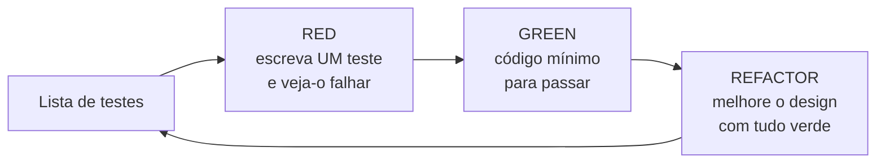
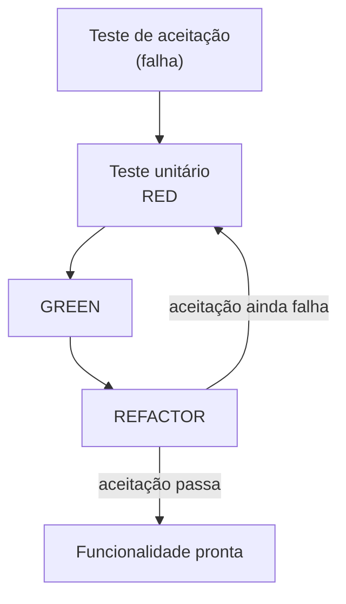
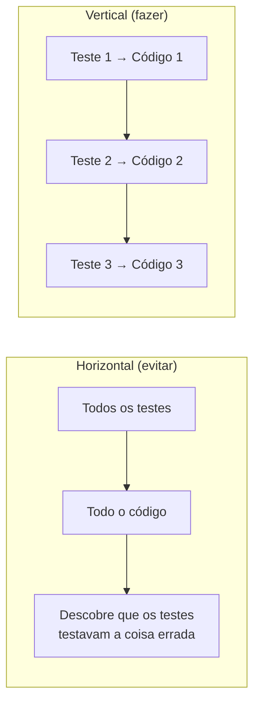
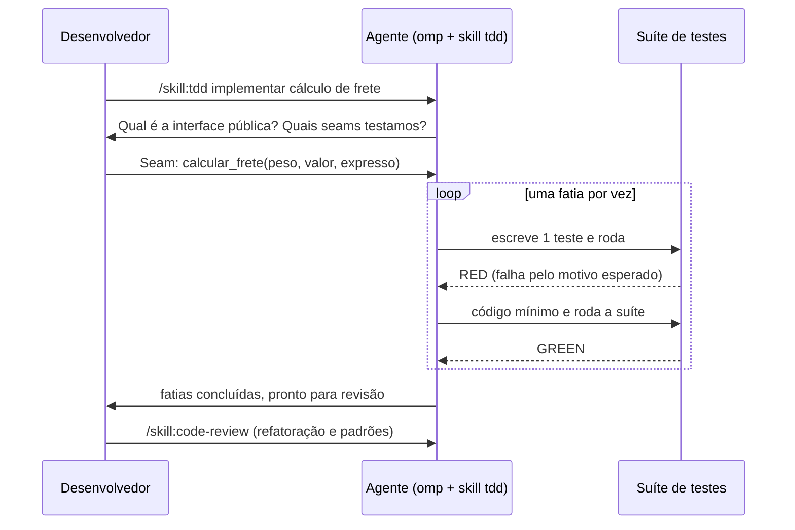

# Módulo 3 — TDD: Test-Driven Development com agentes de IA

[← Módulo 2 — Clean Code](modulo-2-clean-code.md) · [Índice do curso](README.md) · [Módulo 4 — SOLID →](modulo-4-solid.md)

> **Pré-requisitos:** [Módulo 1](modulo-1-ambiente.md), [Módulo 2](modulo-2-clean-code.md). O Módulo 1 monta o ambiente (oh-my-pi, `.agents/`, skills, rules e segurança).


> Material agnóstico de linguagem e de ferramenta de IA.
> Parte I aprofunda a teoria. Parte II analisa a skill [`tdd` de Matt Pocock](https://www.skills.sh/mattpocock/skills/tdd), mostra como instalá-la em `.agents/` e usá-la com o **oh-my-pi (`omp`)**. Parte III trata de cobertura de testes com um portão mínimo de **80%**.
>
> Tudo o que aparece como "saída real" foi executado em 26/09/2026: `omp` 18.3.2, CLI `skills` (skills.sh), skill `tdd` no commit `c55ee46` do repositório `mattpocock/skills`, `coverage.py` 7.16.1 com `pytest-cov` 7.1.0, Vitest 5.0.2 com `@vitest/coverage-v8`, e `mutmut` 3.8.0.

---

## Sumário

**Parte I — Teoria**

1. [O que é TDD, e o que não é](#1-o-que-é-tdd-e-o-que-não-é)
2. [Origem e fundamentos](#2-origem-e-fundamentos)
3. [O ciclo Red → Green → Refactor em detalhe](#3-o-ciclo-red--green--refactor-em-detalhe)
4. [Estratégias para chegar ao verde](#4-estratégias-para-chegar-ao-verde)
5. [O que é um bom teste](#5-o-que-é-um-bom-teste)
6. [Escolas de TDD: clássica x mockista](#6-escolas-de-tdd-clássica-x-mockista)
7. [Dublês de teste (test doubles)](#7-dublês-de-teste-test-doubles)
8. [Seams, módulos profundos e design orientado a testes](#8-seams-módulos-profundos-e-design-orientado-a-testes)
9. [Fatiamento vertical e tracer bullets](#9-fatiamento-vertical-e-tracer-bullets)
10. [Níveis de teste e a forma da suíte](#10-níveis-de-teste-e-a-forma-da-suíte)
11. [TDD, BDD, ATDD e SDD](#11-tdd-bdd-atdd-e-sdd)
12. [O que dizem as pesquisas](#12-o-que-dizem-as-pesquisas)
13. [TDD com agentes de IA: por que importa mais agora](#13-tdd-com-agentes-de-ia-por-que-importa-mais-agora)
14. [Exemplo guiado, passo a passo](#14-exemplo-guiado-passo-a-passo)

**Parte II — A skill `tdd` e o oh-my-pi**

15. [Análise da skill](#15-análise-da-skill)
16. [Instalação com oh-my-pi em `.agents/`](#16-instalação-com-oh-my-pi-em-agents)
17. [Usando a skill no dia a dia](#17-usando-a-skill-no-dia-a-dia)

**Parte III — Cobertura de testes (mínimo de 80%)**

18. [Teoria de cobertura](#18-teoria-de-cobertura)
19. [Instalação e configuração por ecossistema](#19-instalação-e-configuração-por-ecossistema)
20. [Verificação na prática: saídas reais](#20-verificação-na-prática-saídas-reais)
21. [Cobertura não é qualidade: teste de mutação](#21-cobertura-não-é-qualidade-teste-de-mutação)
22. [Portão de cobertura: local, pre-commit, CI e agente](#22-portão-de-cobertura-local-pre-commit-ci-e-agente)
23. [Checklist, glossário e referências](#23-checklist-glossário-e-referências)

---

# Parte I — Teoria

## 1. O que é TDD, e o que não é

**TDD é uma disciplina de design em que o teste é escrito antes do código de produção, em ciclos muito curtos.** Cada ciclo acrescenta um único comportamento: escreve-se um teste que falha, escreve-se o mínimo de código para ele passar e, com a rede de segurança dos testes, melhora-se o design.

O nome engana. TDD não é principalmente uma técnica de teste: é uma técnica de **especificação executável e de design incremental**. Os testes são o subproduto que fica.

| TDD é | TDD não é |
| --- | --- |
| Escrever o teste **antes**, um comportamento por vez | Escrever todos os testes primeiro e depois todo o código |
| Um ciclo de minutos | Uma fase de testes no fim do projeto |
| Design guiado pelo uso da interface | Garantia de ausência de bugs |
| Feedback rápido e contínuo | Busca por 100% de cobertura |
| Especificação do comportamento observável | Verificação de detalhes internos de implementação |

A diferença entre *test-first* e *test-last* não é só de ordem. Quem escreve o teste antes é obrigado a pensar primeiro em **como o código será usado** (a interface) e só depois em **como será feito** (a implementação). Essa inversão é o que produz o efeito de design.

## 2. Origem e fundamentos

- **Raízes.** Escrever o teste antes do código já aparecia em projetos da NASA nos anos 1960 (Projeto Mercury), segundo o levantamento histórico de Larman e Basili sobre desenvolvimento iterativo.
- **Extreme Programming (XP).** Kent Beck formalizou a prática no fim dos anos 1990 como uma das práticas centrais do XP.
- **O livro de referência.** *Test-Driven Development: By Example* (Kent Beck, 2002) define o ciclo, as estratégias de verde e a ideia de lista de testes.
- **As "três leis do TDD"** (Robert C. Martin), uma formulação mais rígida:
  1. Você não pode escrever código de produção, a não ser para fazer passar um teste que está falhando.
  2. Você não pode escrever mais de um teste do que o suficiente para falhar (e não compilar é falhar).
  3. Você não pode escrever mais código de produção do que o suficiente para passar o teste que está falhando.
- **Growing Object-Oriented Software, Guided by Tests** (Freeman e Pryce, 2009) descreve a escola "mockista" e o duplo ciclo de testes de aceitação e unitários.
- **Working Effectively with Legacy Code** (Michael Feathers, 2004) introduz o conceito de *seam* e define código legado como "código sem testes".

### 2.1 Os dois objetivos declarados por Beck

1. **Código limpo que funciona** ("clean code that works").
2. **Controle do medo.** Com uma suíte confiável, mudar o código deixa de ser arriscado. Isso permite refatorar, o que mantém o design saudável ao longo do tempo.

## 3. O ciclo Red → Green → Refactor em detalhe



### 3.1 RED: escrever um teste que falha

- Escolha **um** item da lista de testes: o mais simples que ensina algo novo.
- Escreva o teste como você **gostaria** que a interface fosse usada. Se a classe ou função não existe, o teste não compila: isso já é vermelho.
- **Rode e veja falhar.** Esse passo não é cerimônia. Ele prova duas coisas: que o teste é capaz de falhar (não é tautológico) e que ele falha **pelo motivo esperado**. Um teste que nunca foi visto falhando não prova nada.

### 3.2 GREEN: fazer passar com o mínimo

- Escreva o **menor** código que faz o teste passar, mesmo que pareça ingênuo (seção 4).
- Não antecipe testes futuros nem adicione funcionalidades especulativas (princípio YAGNI: "you aren't gonna need it").
- Rode **toda** a suíte, não só o teste novo.

### 3.3 REFACTOR: melhorar o design sem mudar o comportamento

- Só com tudo verde.
- Remova duplicação (inclusive entre teste e código), melhore nomes, extraia funções, simplifique condicionais.
- Refatore **também os testes**: eles são código e precisam ser legíveis.
- Rode a suíte após cada pequena mudança.

> **Nota sobre a skill analisada:** a versão atual da skill `tdd` de Matt Pocock trata o ciclo como *red → green* e move a refatoração para a etapa de revisão de código (seção 15.3). Isso é uma decisão deliberada da skill, diferente da formulação clássica de Beck.

### 3.4 A lista de testes

Antes de começar, anote em linguagem natural os comportamentos que você sabe que precisa cobrir. A lista é um instrumento de foco:

- Você pega um item por vez.
- Ideias novas que surgem no meio do ciclo vão para a lista, não para o código.
- A lista **muda** conforme você aprende; ela não é um plano fechado.

### 3.5 Ritmo e tamanho do passo

Beck descreve o tamanho do passo como ajustável: passos grandes quando você está confiante, passos minúsculos quando algo dá errado. Um bom indicador: se você ficou mais de alguns minutos sem ver a barra verde, o passo foi grande demais. Desfaça e dê um passo menor.

## 4. Estratégias para chegar ao verde

Beck propõe três estratégias:

| Estratégia | Como funciona | Quando usar |
| --- | --- | --- |
| **Fake It ('til you make it)** | Retorne uma constante que faz o teste passar; depois generalize com novos testes | Quando você não vê a implementação ainda |
| **Triangulação** | Só generalize quando **dois ou mais** exemplos exigirem | Quando a abstração correta não está clara |
| **Implementação óbvia** | Escreva direto a implementação real | Quando ela é trivial e você está confiante |

Exemplo de triangulação, em pseudocódigo:

```text
teste: soma(2, 3) deve ser 5
  → implementação: retorna 5            (fake it)
teste: soma(4, 1) deve ser 5
  → ainda passa! o exemplo não ensinou nada novo, descarte-o
teste: soma(4, 4) deve ser 8
  → agora "retorna 5" falha → generalize: retorna a + b
```

### 4.1 Transformation Priority Premise

Robert C. Martin propôs uma ordem preferencial de transformações do código, da mais simples para a mais complexa, para escolher a menor mudança que faz o teste passar. Uma versão resumida:

1. nada → constante
2. constante → variável
3. instrução única → condicional (`if`)
4. escalar → coleção
5. condicional → laço
6. recursão, e assim por diante

A ideia: se o próximo teste exige pular muitos degraus, talvez você tenha escolhido o teste errado. Escolha um teste que peça uma transformação menor.

## 5. O que é um bom teste

### 5.1 Anatomia: Arrange, Act, Assert

```text
teste "pedido acima de 300 tem frete grátis":
    # Arrange (Given): prepare o cenário
    pedido ← pedido com valor 300 e peso 2 kg
    # Act (When): execute UM comportamento
    frete ← calcular_frete(pedido)
    # Assert (Then): verifique o resultado observável
    espere frete = 0,00
```

### 5.2 Propriedades FIRST

| Letra | Propriedade | Significado |
| --- | --- | --- |
| F | Fast | Roda em milissegundos; a suíte inteira em poucos segundos |
| I | Independent | Não depende da ordem nem de outros testes |
| R | Repeatable | Mesmo resultado em qualquer máquina e horário |
| S | Self-validating | Passa ou falha sozinho, sem inspeção manual |
| T | Timely | Escrito no momento certo: antes do código |

### 5.3 Teste de comportamento, não de implementação

Esta é a regra mais importante e a que a skill analisada mais enfatiza:

> Testes verificam comportamento através de interfaces públicas, não detalhes de implementação. O código pode mudar inteiro; os testes não deveriam.

**Teste resistente a refatoração:** quebra quando o comportamento muda, e só nesse caso.

| Sinal de alerta | Por que é ruim |
| --- | --- |
| Testa método privado | Acopla o teste à estrutura interna |
| Faz mock de colaborador interno | Congela o desenho atual; qualquer refatoração quebra o teste |
| Verifica número ou ordem de chamadas | Testa o *como*, não o *o quê* |
| Verifica por canal lateral (consulta o banco em vez de usar a interface) | Contorna a interface que o usuário realmente usa |
| Nome do teste descreve o *como* ("chama o repositório") | Deveria descrever a capacidade ("usuário cadastrado pode ser consultado") |

Exemplo em pseudocódigo:

```text
# RUIM: verifica por canal lateral
teste "criar usuário grava no banco":
    criar_usuario(nome = "Ana")
    linha ← banco.consultar("SELECT * FROM usuarios WHERE nome = 'Ana'")
    espere linha existe

# BOM: verifica pela própria interface
teste "usuário criado pode ser consultado":
    u ← criar_usuario(nome = "Ana")
    espere buscar_usuario(u.id).nome = "Ana"
```

### 5.4 Teste tautológico

É o teste que **recalcula o valor esperado do mesmo jeito que o código**. Ele passa por construção e nunca discorda do código.

```text
# RUIM: o esperado é calculado com a mesma lógica da implementação
itens ← [10, 5]
esperado ← soma(itens)             # mesma fórmula que calcular_total usa
espere calcular_total(itens) = esperado

# BOM: o esperado vem de uma fonte independente (um literal conhecido)
espere calcular_total([10, 5]) = 15
```

O valor esperado deve vir de uma fonte independente: um literal conferido, um exemplo trabalhado à mão, a especificação.

> Este é o erro mais comum de agentes de IA ao escrever testes depois do código: eles leem a implementação e escrevem asserções que a espelham.

### 5.5 Uma asserção lógica por teste

Um teste pode ter várias linhas de `assert`, desde que verifiquem **um único comportamento**. Se o nome do teste precisa de "e" ("calcula o frete **e** envia e-mail"), provavelmente são dois testes.

## 6. Escolas de TDD: clássica x mockista

| Aspecto | Clássica (Detroit/Chicago) | Mockista (Londres) |
| --- | --- | --- |
| Referência | Beck, *TDD by Example* | Freeman e Pryce, *GOOS* |
| Direção | Geralmente de dentro para fora (*inside-out*) | De fora para dentro (*outside-in*) |
| Uso de dublês | Só em fronteiras do sistema (rede, relógio, banco externo) | Em colaboradores, para descobrir interfaces |
| Verificação | Estado e resultado | Interações entre objetos |
| Vantagem | Testes resistentes a refatoração | Descobre o design das interfaces cedo |
| Risco | Testes mais lentos se mal fatiados | Testes frágeis, acoplados à estrutura |

Martin Fowler discute essa diferença em *Mocks Aren't Stubs*. As duas escolas convivem; o importante é saber qual você está praticando e por quê.

**A skill analisada é claramente clássica:** faz mock "apenas em fronteiras do sistema" e proíbe mock de "suas próprias classes ou módulos".

### 6.1 Outside-in e o duplo ciclo



O ciclo externo (aceitação) diz **quando parar**; o ciclo interno (unitário) diz **como avançar**.

## 7. Dublês de teste (test doubles)

Taxonomia de Gerard Meszaros (*xUnit Test Patterns*):

| Tipo | O que faz | Exemplo |
| --- | --- | --- |
| **Dummy** | Só preenche um parâmetro; nunca é usado | Um logger passado mas não chamado |
| **Stub** | Devolve respostas prontas | Cotação de câmbio fixa em 5,00 |
| **Spy** | Stub que registra como foi chamado | Serviço de e-mail que guarda as mensagens enviadas |
| **Mock** | Pré-programado com expectativas; falha se não forem cumpridas | "Deve chamar `cobrar(150)` exatamente uma vez" |
| **Fake** | Implementação funcional simplificada | Repositório em memória no lugar do banco |

### 7.1 Onde usar dublês (regra da skill, alinhada à escola clássica)

Use dublês **apenas em fronteiras do sistema**:

- APIs externas (pagamento, e-mail, mensageria)
- Banco de dados (às vezes; prefira um banco de teste real ou um fake)
- Tempo e aleatoriedade
- Sistema de arquivos (às vezes)

**Não** use dublês para suas próprias classes, colaboradores internos ou qualquer coisa que você controla.

### 7.2 Projetar para ser substituível

1. **Injeção de dependência:** receba a dependência externa como parâmetro em vez de criá-la dentro da função.
2. **Interfaces no estilo SDK:** uma função por operação externa (`buscar_usuario`, `criar_pedido`) em vez de um `requisitar(url, opcoes)` genérico. Cada dublê devolve um formato só e não precisa de lógica condicional.

```text
# Difícil de substituir
função processar_pagamento(pedido):
    cliente ← novo ClienteGatewayPagamento(chave_do_ambiente)
    retorna cliente.cobrar(pedido.total)

# Fácil de substituir
função processar_pagamento(pedido, cliente_pagamento):
    retorna cliente_pagamento.cobrar(pedido.total)
```

## 8. Seams, módulos profundos e design orientado a testes

### 8.1 Seam

**Seam** (Feathers): um lugar onde se pode alterar o comportamento do programa sem editar naquele lugar. Na prática, é a **interface** onde o teste observa o comportamento sem entrar no módulo.

A skill usa o termo de forma operacional: *seam* é a fronteira pública onde os testes vivem. E impõe uma regra forte: **antes de escrever qualquer teste, liste os seams que serão testados e confirme com o usuário.** Como não dá para testar tudo, combinar os seams antes concentra o esforço nos caminhos críticos.

Uma regra útil da skill complementar `codebase-design`: **"um adaptador significa um seam hipotético; dois adaptadores significam um seam real."** Não crie uma interface só para poder testar se nada de fato varia através dela.

### 8.2 Módulos profundos

John Ousterhout (*A Philosophy of Software Design*) chama de **profundo** o módulo que esconde muito comportamento atrás de uma interface pequena, e de **raso** aquele cuja interface é quase tão complexa quanto a implementação.

Relação direta com TDD:

- **A interface é a superfície de teste.** Quem chama e quem testa cruzam o mesmo seam.
- Módulo profundo = poucos testes na interface cobrem muito comportamento, e a implementação pode ser reescrita livremente.
- Se você sente necessidade de testar "por trás" da interface, o módulo provavelmente tem o formato errado.

### 8.3 O teste como primeiro cliente

Escrever o teste antes obriga a usar a interface antes de ela existir. Interfaces difíceis de testar costumam ser difíceis de usar: muitos parâmetros, dependências escondidas, efeitos colaterais. **A dor no teste é informação de design.**

## 9. Fatiamento vertical e tracer bullets

**Fatiamento horizontal (antipadrão):** escrever todos os testes primeiro e depois toda a implementação. A skill explica por que é ruim:

- Os testes em lote verificam um comportamento **imaginado**.
- Testam o **formato** das coisas, não o comportamento visível ao usuário.
- Ficam insensíveis a mudanças reais.
- Comprometem a estrutura dos testes antes de você entender a implementação.

**Fatiamento vertical:** um teste → uma implementação → repete. Cada teste é uma **tracer bullet** (termo de *The Pragmatic Programmer*): um disparo que atravessa todas as camadas necessárias e mostra onde você acertou, e o próximo disparo se ajusta pelo que o anterior ensinou.



## 10. Níveis de teste e a forma da suíte

| Nível | Escopo | Velocidade | Confiança sobre o sistema real |
| --- | --- | --- | --- |
| Unitário | Uma unidade de comportamento, sem I/O | Milissegundos | Baixa a média |
| Integração | Módulo + dependências reais (banco, framework) | Segundos | Média a alta |
| Ponta a ponta (E2E) | Sistema inteiro pela interface do usuário ou API | Lento | Alta |

Modelos de distribuição conhecidos:

- **Pirâmide de testes** (Mike Cohn): muitos unitários, menos integração, poucos E2E.
- **Troféu de testes** (Kent C. Dodds): ênfase maior em testes de integração.

A skill se alinha com a ideia de testes "no estilo integração", ou seja, que atravessam interfaces reais em vez de simular as partes internas. O que importa não é o rótulo, mas o **seam**: teste onde o comportamento é observável e estável.

## 11. TDD, BDD, ATDD e SDD

| Prática | Pergunta central | Artefato | Nível |
| --- | --- | --- | --- |
| **TDD** | Esta unidade faz o que deve? | Teste automatizado escrito antes | Código |
| **BDD** | O sistema se comporta como o negócio espera? | Cenários Given/When/Then em linguagem de domínio | Funcionalidade |
| **ATDD** | Quando a história está pronta? | Testes de aceitação combinados com o cliente | História |
| **SDD** | O que deve ser construído, e por quê? | Especificação versionada que guia a IA | Mudança/feature |

Elas se encaixam: a **spec** (SDD) define cenários; cada cenário vira um **teste de aceitação** (ATDD/BDD); o ciclo **TDD** implementa o código que faz esses testes passarem. Nos Módulos [7 — OpenSpec](modulo-7-openspec.md) e [8 — Spec Kit](modulo-8-spec-kit.md), cada `#### Scenario` ou *Acceptance Scenario* é o ponto de partida natural de um ciclo TDD.

## 12. O que dizem as pesquisas

A evidência empírica sobre TDD é **mista**, e é importante apresentá-la com honestidade.

- **Nagappan, Maximilien, Bhat e Williams (2008)**, *Empirical Software Engineering*: quatro equipes industriais (Microsoft e IBM) tiveram redução de densidade de defeitos entre 40% e 90% em relação a projetos semelhantes sem TDD, com aumento de 15% a 35% no tempo inicial de desenvolvimento, segundo a avaliação subjetiva dos gestores.
- **Fucci et al. (2017)**, *IEEE Transactions on Software Engineering*, "A Dissection of the Test-Driven Development Process": ao decompor o processo, encontraram que a **granularidade** (ciclos curtos) e a **uniformidade** (ritmo constante) explicam mais os resultados de qualidade e produtividade do que a ordem "teste antes" em si.
- Revisões sistemáticas tendem a encontrar efeitos positivos em qualidade externa com mais frequência em contextos industriais, e resultados menos conclusivos sobre produtividade e em experimentos com estudantes.

**Leitura prática:** os benefícios mais consistentes vêm de **ciclos pequenos e ritmo constante** com feedback automatizado. Escrever o teste antes é a forma mais simples de garantir esses ciclos, mas o ganho não é mágico nem automático.

## 13. TDD com agentes de IA: por que importa mais agora

Agentes de IA escrevem muito código rápido. Isso muda o problema: o gargalo deixa de ser digitar código e passa a ser **saber se o código faz o que deveria**.

### 13.1 Por que TDD funciona bem com agentes

| Benefício | Explicação |
| --- | --- |
| **Laço de feedback objetivo** | O agente não precisa "achar" que acertou: o teste diz. Ciclos red → green são exatamente o tipo de tarefa verificável em que agentes vão bem. |
| **Especificação antes do palpite** | O teste escrito primeiro fixa o comportamento antes de o agente escolher uma implementação. |
| **Escopo contido** | "Um teste, um comportamento" impede o agente de gerar funcionalidades especulativas. |
| **Rede de segurança** | O agente pode refatorar grandes trechos com confiança se a suíte for boa. |
| **Contexto persistente** | Testes são documentação executável que sobrevive entre sessões do agente. |

### 13.2 Riscos específicos de agentes, e como mitigar

| Risco | Sintoma | Mitigação |
| --- | --- | --- |
| **Testes tautológicos** | O agente lê o código e escreve asserções que o espelham | Exigir o vermelho antes do verde; esperados literais tirados da spec |
| **Fatiamento horizontal** | O agente gera 30 testes de uma vez | Regra "um teste por ciclo" (a skill impõe isso) |
| **Alterar o teste para passar** | O agente "corrige" o teste em vez do código | Revisão do diff de testes; testes de aceitação protegidos |
| **Mocks em excesso** | Tudo mockado, nada testado de verdade | Regra "mock só em fronteiras" |
| **Burlar a cobertura** | Baixar o limite, excluir arquivos, testes sem asserção | Portão de cobertura protegido (seção 22) + teste de mutação (seção 21) |
| **Pular o vermelho** | Escreve teste e código juntos | Exigir que o agente mostre a saída do teste falhando |

## 14. Exemplo guiado, passo a passo

Regras de negócio de um cálculo de frete:

- Taxa base de R$ 10,00 + R$ 2,50 por kg.
- Pedidos a partir de R$ 300,00 têm frete grátis.
- Entrega expressa custa o dobro e nunca é grátis.
- Peso deve ser positivo.

**Seam combinado:** a função pública `calcular_frete(peso, valor_pedido, expresso)`.

**Lista de testes inicial:**

```text
[ ] pedido comum paga taxa base + peso
[ ] pedido a partir de 300 tem frete grátis
[ ] expresso custa o dobro
[ ] expresso não é grátis mesmo acima de 300
[ ] peso zero ou negativo é recusado
```

**Ciclo 1 — RED**

```text
teste "pedido comum paga taxa base mais peso":
    espere calcular_frete(peso = 2, valor = 100) = 15,00
```

Resultado: falha, porque `calcular_frete` não existe.

**Ciclo 1 — GREEN** (fake it)

```text
função calcular_frete(peso, valor, expresso = falso):
    retorna 15,00
```

**Ciclo 2 — RED**

```text
teste "pedido a partir de 300 tem frete grátis":
    espere calcular_frete(peso = 2, valor = 300) = 0,00
```

**Ciclo 2 — GREEN**

```text
função calcular_frete(peso, valor, expresso = falso):
    se valor ≥ 300: retorna 0,00
    retorna 15,00
```

**Ciclo 3 — RED** (triangulação: força a fórmula real)

```text
teste "peso maior aumenta o frete":
    espere calcular_frete(peso = 4, valor = 100) = 20,00
```

**Ciclo 3 — GREEN**

```text
função calcular_frete(peso, valor, expresso = falso):
    se valor ≥ 300: retorna 0,00
    retorna 10,00 + 2,50 × peso
```

**Ciclo 4 e 5 — expresso**

```text
teste "expresso custa o dobro mesmo acima de 300":
    espere calcular_frete(peso = 2, valor = 500, expresso = verdadeiro) = 30,00

função calcular_frete(peso, valor, expresso = falso):
    se valor ≥ 300 e não expresso: retorna 0,00
    frete ← 10,00 + 2,50 × peso
    se expresso: frete ← frete × 2
    retorna arredonda(frete, 2)
```

**Ciclo 6 — validação**

```text
teste "peso zero é recusado":
    espere erro PesoInvalido ao chamar calcular_frete(peso = 0, valor = 100)
```

**Refatoração** (tudo verde): extrair constantes `TAXA_BASE`, `POR_KG`, `FRETE_GRATIS_A_PARTIR_DE`; usar tipo decimal para dinheiro.

**Descoberta posterior (seção 21):** um teste de mutação mostrou que nenhum teste usava peso entre 0 e 1. O item "peso fracionado menor que 1 kg é aceito" foi acrescentado à lista, e o ciclo continuou.

---

# Parte II — A skill `tdd` e o oh-my-pi

## 15. Análise da skill

### 15.1 Ficha técnica

| Item | Valor |
| --- | --- |
| Página | [skills.sh/mattpocock/skills/tdd](https://www.skills.sh/mattpocock/skills/tdd) |
| Fonte | [github.com/mattpocock/skills](https://github.com/mattpocock/skills), pasta `skills/engineering/tdd/` |
| Versão analisada | commit `c55ee46` (18/09/2026) |
| Instalações exibidas na página | cerca de 970 mil |
| Formato | Agent Skill padrão: pasta com `SKILL.md` (frontmatter YAML + Markdown) e arquivos de apoio |
| Dependência de linguagem | Nenhuma (os exemplos são em TypeScript, mas as regras são gerais) |

Arquivos da skill (listagem real após instalação):

```text
.agents/skills/tdd/
├── SKILL.md            # 38 linhas: regras principais
├── tests.md            # 77 linhas: exemplos de testes bons e ruins
├── mocking.md          # 59 linhas: quando e como usar dublês
└── agents/openai.yaml  # metadados de exibição (nome "TDD")
```

Frontmatter:

```yaml
---
name: tdd
description: Test-driven development. Use when the user wants to build features or fix bugs
  test-first, mentions "red-green-refactor", or wants integration tests.
---
```

O campo `description` é o que o agente usa para decidir **quando** carregar a skill. Ela é ativada automaticamente quando você pede algo "test-first", menciona red-green-refactor ou pede testes de integração, ou manualmente pelo comando do agente.

### 15.2 Conteúdo, seção por seção

| Seção do `SKILL.md` | Regra | Conceito teórico (Parte I) |
| --- | --- | --- |
| Abertura | Consulte todas as seções antes e durante o ciclo, não depois. Leia `CONTEXT.md` (vocabulário do domínio) e respeite ADRs | Linguagem ubíqua (DDD); decisões registradas |
| *What a good test is* | Comportamento por interfaces públicas; o teste lê como uma especificação | Seção 5.3 |
| *Seams: where tests go* | Teste só em seams **combinados antes com o usuário** | Seção 8.1 |
| *Anti-patterns* | Acoplado à implementação; tautológico; fatiamento horizontal | Seções 5.3, 5.4 e 9 |
| *Rules of the loop* | Vermelho antes do verde; uma fatia por vez; **refatoração fora do ciclo** | Seção 3 |
| `tests.md` | Exemplos: checkout pela interface; não verificar pelo banco; esperado literal | Seções 5.3 e 5.4 |
| `mocking.md` | Mock só em fronteiras; injeção de dependência; interfaces estilo SDK | Seção 7 |

### 15.3 Pontos fortes

1. **Foco no que os agentes mais erram.** Os três antipadrões listados (acoplamento à implementação, tautologia e fatiamento horizontal) são exatamente os erros típicos de testes gerados por IA.
2. **Seams combinados com o humano.** Obriga uma conversa sobre *o que vale a pena testar* antes de gastar esforço, e coloca o humano no ponto de decisão.
3. **Curta e composável.** São 38 linhas no arquivo principal, o que consome pouco contexto do modelo. Detalhes ficam em arquivos carregados só quando necessário.
4. **Agnóstica.** Nada depende de linguagem, framework ou agente específico.

### 15.4 Pontos de atenção

| Ponto | Detalhe | Recomendação |
| --- | --- | --- |
| **Refatoração fora do ciclo** | A skill diz: "Refactoring is not part of the loop", e manda a refatoração para a skill `code-review`. É diferente do ciclo clássico de Beck. | Se você ensina o ciclo clássico, diga isso ao agente ou refatore ao final de cada fatia verde. A escolha da skill evita que o agente "refatore" no meio do ciclo e perca o foco. |
| **Dependências não instaladas** | A skill cita `codebase-design` (vocabulário de seams e módulos profundos) e `code-review`. Instalar só `tdd` deixa essas referências sem destino. | Instalar as três juntas (seção 16.3). |
| **Divergência entre página e repositório** | O resumo exibido no skills.sh citava refatoração com SOLID como parte da skill; o `SKILL.md` atual não tem mais isso. A skill evolui. | Versionar o `skills-lock.json` e revisar o diff em cada `skills update`. |
| **Não fala de cobertura** | Nenhuma regra sobre métricas de cobertura. | Complementar com uma skill local de portão de cobertura (seção 22.4). |
| **Exige humano presente** | "Confirme os seams com o usuário" trava execuções autônomas. | Em modo não interativo, forneça os seams já no pedido. |
| **Roda com permissão total** | O próprio instalador alerta: "Review skills before use; they run with full agent permissions." | Ler os arquivos antes de instalar; preferir `--copy` e versionar no Git. |

## 16. Instalação com oh-my-pi em `.agents/`

### 16.1 Por que `.agents/skills`

`.agents/skills/<nome>/SKILL.md` é o diretório **neutro** de skills de projeto: vários agentes o leem. Instalar ali significa que a mesma skill serve para o oh-my-pi e para outros agentes compatíveis, sem duplicar arquivos por ferramenta.

O oh-my-pi lê essa pasta por padrão. Configuração real (`omp config list`):

```text
  skills.enabled = true (boolean)
  skills.enableAgentsProject = true (boolean)     ← lê ./.agents/skills
  skills.enableAgentsUser = true (boolean)        ← lê ~/.agents/skills
  skills.enableClaudeProject = true (boolean)
  skills.enablePiProject = true (boolean)
  skills.enablePiUser = true (boolean)
  skills.enableCodexUser = false (boolean)
  skills.enableClaudeUser = false (boolean)
  skills.customDirectories = [] (array)
  skills.ignoredSkills = [] (array)
  skills.includeSkills = [] (array)
  skills.enableSkillCommands = true (boolean)     ← habilita /skill:<nome>
```

Regras de descoberta, segundo a documentação do `omp`:

- As skills ficam **um nível abaixo** de `skills/` (`skills/tdd/SKILL.md`). Pastas aninhadas não são descobertas.
- Quando duas fontes têm uma skill com o mesmo nome, **vale a primeira** na ordem de prioridade (fontes nativas `.omp` primeiro). Evite instalar a mesma skill em várias pastas.

### 16.2 Instalar o oh-my-pi

Veja o [Módulo 1, seção 6](modulo-1-ambiente.md#6-o-oh-my-pi-omp): formas de instalação, o problema real da versão do Bun (o `omp` 18.3.2 exige Bun 1.3.14 ou superior), `omp login` e os primeiros comandos.

### 16.3 Instalar a skill em `.agents/skills`

O oh-my-pi não aparece com um nome próprio na lista de agentes do instalador `skills` (skills.sh). O alvo que grava em `.agents/skills` é o **`universal`**:

```bash
cd meu-projeto

# só a skill tdd
npx skills@latest add https://github.com/mattpocock/skills --skill tdd --agent universal --copy -y

# recomendado: a skill tdd + as duas que ela referencia
npx skills@latest add mattpocock/skills --skill tdd codebase-design code-review --agent universal --copy -y
```

| Flag | Por que usar |
| --- | --- |
| `--skill tdd codebase-design code-review` | Instala só o que você precisa (o repositório tem 38 skills) |
| `--agent universal` | Grava em `./.agents/skills/`, que o `omp` lê |
| `--copy` | Copia os arquivos em vez de criar links simbólicos; o projeto fica autocontido para o Git |
| `-y` | Sem perguntas (útil em scripts e CI) |
| `-g` | Instala para o usuário (`~/.agents/skills`), em vez do projeto |

Saída real:

```text
o  Found 38 skills
•  Selected 1 skill: tdd
o  Installed 1 skill
|  Mattpocock Skills
|  ✓ tdd (copied)
|    → ./.agents/skills/tdd
—  Done!  Review skills before use; they run with full agent permissions.
```

> Não combine `--agent universal pi`: no teste, isso copiou as skills também para `./.pi/skills/`, e o `omp` passou a enxergar duas cópias de cada uma.

O instalador cria o `skills-lock.json` (versione no Git):

```json
{
  "version": 1,
  "skills": {
    "tdd": {
      "source": "mattpocock/skills",
      "sourceType": "github",
      "skillPath": "skills/engineering/tdd/SKILL.md",
      "computedHash": "e753a5da75292bbe59d302d89566bc2c53d0e73944da2f0e944a7578883c07d0"
    }
  }
}
```

O `computedHash` identifica exatamente a versão instalada. Outra pessoa restaura as mesmas versões com `npx skills experimental_install`.

### 16.4 Verificar que o oh-my-pi enxerga a skill

O `omp read` mostra o que a ferramenta de leitura do agente devolve para um endereço interno, sem chamar o modelo. O esquema `skill://<nome>` resolve a skill pela descoberta real:

```text
$ omp read skill://tdd
---
name: tdd
description: Test-driven development. Use when the user wants to build features or fix bugs
  test-first, mentions "red-green-refactor", or wants integration tests.
---

# Test-Driven Development
...

$ omp read skill://tdd/mocking.md
# When to Mock

Mock at **system boundaries** only:
```

Se a skill não fosse encontrada, o comando falharia. Outras verificações:

```bash
npx skills list          # lista skills do projeto e a origem de cada uma
omp --skills=tdd         # abre o agente carregando só skills que casam com o padrão
omp --no-skills          # abre sem nenhuma skill (útil para comparar comportamento)
```

### 16.5 Atualizar, remover e o que versionar

```bash
npx skills update -p        # atualiza skills do projeto (revise o diff antes de commitar!)
npx skills remove tdd
```

| Caminho | Versionar? |
| --- | --- |
| `.agents/skills/` | Sim: todo o time usa as mesmas skills |
| `skills-lock.json` | Sim: fixa versões e hashes |
| `~/.omp/agent/` (configuração pessoal, credenciais) | Não |

Não edite `.agents/skills/tdd/SKILL.md` diretamente: um `skills update` sobrescreve. Para regras do seu projeto, crie uma skill local separada (seção 22.4).

## 17. Usando a skill no dia a dia

### 17.1 Invocação

- **Automática:** peça algo que case com a descrição ("implemente com TDD", "test-first").
- **Explícita no oh-my-pi:** `/skill:tdd <pedido>` (com `skills.enableSkillCommands = true`).

### 17.2 Fluxo esperado de uma sessão



### 17.3 Modelo de pedido

```text
/skill:tdd
Funcionalidade: cálculo de frete (regras na spec specs/frete.md).
Seam já combinado: a função pública calcular_frete(peso, valor, expresso).
Lista de testes inicial:
  - pedido comum paga taxa base + peso
  - a partir de 300 é grátis
  - expresso custa o dobro e nunca é grátis
  - peso <= 0 é recusado
Regras: uma fatia por vez; mostre a saída do teste falhando antes de implementar;
valores esperados literais tirados da spec; cobertura de linhas e ramos >= 80% ao final.
```

Fornecer os seams no pedido evita que a skill pare para perguntar, o que é útil em execução não interativa (`omp -p "..."`).

---

# Parte III — Cobertura de testes (mínimo de 80%)

## 18. Teoria de cobertura

### 18.1 O que é

**Cobertura de código** mede quanto do código foi executado durante os testes. Ela responde "o que os testes **executaram**", não "o que os testes **verificaram**". Essa distinção é o ponto mais importante desta parte.

### 18.2 Critérios de cobertura

| Critério | Mede | Exemplo de lacuna que revela |
| --- | --- | --- |
| **Função/método** | Funções chamadas ao menos uma vez | Função nunca exercitada |
| **Linha** | Linhas executadas | Bloco de código morto |
| **Instrução (statement)** | Instruções executadas (várias por linha) | Um `if (x) return` em uma linha só |
| **Ramo (branch/decisão)** | Cada saída de cada decisão (verdadeiro e falso) | O caminho do `else` implícito nunca testado |
| **Condição** | Cada subcondição booleana assumindo verdadeiro e falso | Em `a && b`, `b` nunca é avaliado como falso |
| **MC/DC** | Cada condição mostrada influenciando sozinha o resultado da decisão | Exigido pela norma aeronáutica DO-178C para software de nível A |
| **Caminho** | Todas as combinações de caminhos | Explosão combinatória; raramente viável |

Da mais fraca para a mais forte: função < linha < instrução < ramo < condição < MC/DC < caminho.

**Para o portão de 80%, meça pelo menos linha e ramo.** Linha sozinha engana, como mostra a seção 20.3.

### 18.3 Por que 80%?

Não existe número mágico. 80% é uma **heurística de mercado** que equilibra custo e benefício: acima disso, cada ponto adicional costuma custar testes cada vez mais artificiais. O Google, em seu blog de testes (*Code Coverage Best Practices*, 2020), cita como referência geral 60% "aceitável", 75% "louvável" e 90% "exemplar", e recomenda olhar com mais rigor para a cobertura do **código novo** em cada mudança.

Usar 80% como **piso** faz sentido quando:

- é medido em **linhas e ramos**;
- é aplicado também ao **código alterado** (diff coverage), não só ao total;
- vem acompanhado de revisão da **qualidade** dos testes (mutação, revisão de código).

### 18.4 A Lei de Goodhart

> "Quando uma medida se torna uma meta, ela deixa de ser uma boa medida."

Cobertura como meta cega produz testes sem asserção, testes de getters e exclusões convenientes. A pesquisa de Inozemtseva e Holmes (ICSE 2014, "Coverage Is Not Strongly Correlated with Test Suite Effectiveness") encontrou correlação fraca a moderada entre cobertura e capacidade de detectar defeitos quando se controla o tamanho da suíte.

**Conclusão prática:** cobertura baixa é um sinal confiável de problema (código não testado). Cobertura alta **não** é garantia de qualidade. Por isso o portão é um **mínimo**, não um objetivo.

### 18.5 Cobertura e TDD

Em TDD bem feito, a cobertura alta é **consequência**: nenhuma linha de produção existe sem um teste que a exigiu. Se a cobertura cai abaixo de 80% num projeto TDD, algo saiu do ciclo, por exemplo código escrito "de brinde" sem teste. A métrica funciona como **auditoria da disciplina**.

## 19. Instalação e configuração por ecossistema

Em todos os casos o princípio é o mesmo: **o build falha se linha ou ramo ficar abaixo de 80%.**

| Ecossistema | Ferramenta | Instalação | Portão de 80% | Relatórios |
| --- | --- | --- | --- | --- |
| Python | coverage.py + pytest-cov | `pip install pytest pytest-cov` | `--cov-fail-under=80` / `fail_under = 80` | term, html, xml |
| JavaScript/TypeScript | Vitest + V8 | `npm i -D vitest @vitest/coverage-v8` | `coverage.thresholds` | text, html, lcov |
| JavaScript/TypeScript | Jest | nativo (`--coverage`) | `coverageThreshold` | text, lcov |
| Java | JaCoCo | plugin Maven/Gradle | regra `check` com `COVEREDRATIO 0.80` | html, xml, csv |
| Go | nativo | `go test -coverprofile` | script sobre `go tool cover` | func, html |
| C# / .NET | coverlet | `dotnet add package coverlet.msbuild` | `/p:Threshold=80` | cobertura, lcov, opencover |

> Python e Vitest foram executados nesta sessão (seção 20). As configurações de Jest, JaCoCo, Go e coverlet seguem a documentação oficial das ferramentas, mas não foram executadas aqui.

### 19.1 Python (coverage.py + pytest-cov)

```bash
pip install pytest pytest-cov
```

`pyproject.toml` (usado no teste):

```toml
[tool.pytest.ini_options]
pythonpath = ["src"]
addopts = "--cov=frete --cov-branch --cov-report=term-missing --cov-fail-under=80"

[tool.coverage.run]
branch = true              # mede ramos, não só linhas
source = ["src/frete"]

[tool.coverage.report]
fail_under = 80            # vale também para "coverage report"
show_missing = true        # mostra as linhas não cobertas
```

```bash
pytest                               # roda testes + cobertura + portão
coverage html                        # relatório navegável em htmlcov/index.html
coverage xml -o coverage.xml         # para CI e diff-cover
```

### 19.2 JavaScript/TypeScript com Vitest

```bash
npm i -D vitest @vitest/coverage-v8
```

`vitest.config.js` (usado no teste):

```js
import { defineConfig } from 'vitest/config';

export default defineConfig({
  test: {
    coverage: {
      provider: 'v8',
      include: ['src/**'],                 // sem isso, arquivos nunca importados não contam
      reporter: ['text', 'html', 'lcov'],
      thresholds: { lines: 80, branches: 80, functions: 80, statements: 80 },
    },
  },
});
```

```bash
npx vitest run --coverage
```

### 19.3 JavaScript/TypeScript com Jest

```json
{
  "jest": {
    "collectCoverage": true,
    "collectCoverageFrom": ["src/**/*.{js,ts}"],
    "coverageThreshold": {
      "global": { "lines": 80, "branches": 80, "functions": 80, "statements": 80 }
    }
  }
}
```

### 19.4 Java com JaCoCo (Maven)

```xml
<plugin>
  <groupId>org.jacoco</groupId>
  <artifactId>jacoco-maven-plugin</artifactId>
  <version>0.8.13</version>
  <executions>
    <execution>
      <id>prepare-agent</id>
      <goals><goal>prepare-agent</goal></goals>
    </execution>
    <execution>
      <id>report</id>
      <phase>verify</phase>
      <goals><goal>report</goal></goals>
    </execution>
    <execution>
      <id>check</id>
      <phase>verify</phase>
      <goals><goal>check</goal></goals>
      <configuration>
        <rules>
          <rule>
            <element>BUNDLE</element>
            <limits>
              <limit>
                <counter>LINE</counter>
                <value>COVEREDRATIO</value>
                <minimum>0.80</minimum>
              </limit>
              <limit>
                <counter>BRANCH</counter>
                <value>COVEREDRATIO</value>
                <minimum>0.80</minimum>
              </limit>
            </limits>
          </rule>
        </rules>
      </configuration>
    </execution>
  </executions>
</plugin>
```

```bash
./mvnw verify      # falha se LINE ou BRANCH < 80%; relatório em target/site/jacoco/index.html
```

Gradle (Kotlin DSL):

```kotlin
plugins { jacoco }

tasks.jacocoTestCoverageVerification {
    violationRules {
        rule { limit { counter = "LINE";   minimum = "0.80".toBigDecimal() } }
        rule { limit { counter = "BRANCH"; minimum = "0.80".toBigDecimal() } }
    }
}
tasks.check { dependsOn(tasks.jacocoTestCoverageVerification) }
```

### 19.5 Go

O Go mede cobertura nativamente, mas não tem opção de limite mínimo. Use um script:

```bash
go test ./... -covermode=atomic -coverprofile=cover.out
total=$(go tool cover -func=cover.out | awk '/^total:/ {gsub("%","",$3); print $3}')
echo "cobertura total: ${total}%"
awk -v t="$total" 'BEGIN { exit (t < 80) }' || { echo "abaixo de 80%"; exit 1; }
go tool cover -html=cover.out -o cover.html
```

A cobertura do Go é por instrução; não há cobertura de ramos nativa.

### 19.6 C# / .NET com coverlet

```bash
dotnet add package coverlet.msbuild
dotnet test /p:CollectCoverage=true /p:Threshold=80 /p:ThresholdType=\"line,branch\" /p:CoverletOutputFormat=cobertura
```

### 19.7 Exclusões: com critério

Excluir código da medição é legítimo para código gerado, arquivos de configuração e pontos de entrada triviais (`main`). Deixe as exclusões **explícitas, poucas e revisadas**:

| Ferramenta | Como excluir |
| --- | --- |
| coverage.py | `omit = [...]` em `[tool.coverage.run]`; `# pragma: no cover` na linha |
| Vitest | `coverage.exclude` |
| JaCoCo | `<excludes>` no plugin; classes anotadas com uma anotação que contenha `Generated` |
| coverlet | `/p:ExcludeByAttribute=GeneratedCodeAttribute` |

Toda exclusão nova deve aparecer no diff do pull request e ser justificada.

## 20. Verificação na prática: saídas reais

Implementação usada (Python), resultado do exemplo da seção 14:

```python
from decimal import Decimal

TAXA_BASE = Decimal("10.00")
POR_KG = Decimal("2.50")
FRETE_GRATIS_ACIMA = Decimal("300.00")


class PesoInvalido(ValueError):
    pass


def calcular_frete(peso_kg: Decimal, valor_pedido: Decimal, expresso: bool = False) -> Decimal:
    if peso_kg <= 0:
        raise PesoInvalido("peso deve ser positivo")
    if valor_pedido >= FRETE_GRATIS_ACIMA and not expresso:
        return Decimal("0.00")
    frete = TAXA_BASE + POR_KG * peso_kg
    if expresso:
        frete = frete * 2
    return frete.quantize(Decimal("0.01"))
```

### 20.1 Abaixo de 80%: o build falha mesmo com o teste passando

Com um único teste (pedido comum):

```text
$ pytest -q
.
ERROR: Coverage failure: total of 71 is less than fail-under=80

Name                    Stmts   Miss Branch BrPart  Cover   Missing
-------------------------------------------------------------------
src/frete/__init__.py       0      0      0      0   100%
src/frete/calculo.py       15      3      6      3    71%   14, 16, 19
-------------------------------------------------------------------
TOTAL                      15      3      6      3    71%
FAIL Required test coverage of 80% not reached. Total coverage: 71.43%
1 passed in 0.03s
$ echo $?
1
```

Como ler:

- `1 passed`: o teste passou, mas o **código de saída é 1** por causa do portão. O CI fica vermelho.
- `Missing 14, 16, 19`: as linhas do erro de peso, do frete grátis e do expresso nunca rodaram.
- `Branch 6 / BrPart 3`: das 6 saídas de decisão, 3 decisões foram tomadas só para um lado.

### 20.2 Acima de 80%

Com os testes de frete grátis, expresso e peso zero:

```text
$ pytest -q
Name                    Stmts   Miss Branch BrPart  Cover   Missing
-------------------------------------------------------------------
src/frete/__init__.py       0      0      0      0   100%
src/frete/calculo.py       15      0      6      0   100%
-------------------------------------------------------------------
TOTAL                      15      0      6      0   100%
Required test coverage of 80% reached. Total coverage: 100.00%
4 passed in 0.03s
$ echo $?
0
```

### 20.3 Por que medir ramos: linha 100%, ramos 55%

A mesma lógica em JavaScript, com os `if` escritos em uma linha só:

```js
export function calcularFrete(pesoKg, valorPedido, expresso = false) {
  if (pesoKg <= 0) throw new PesoInvalido('peso deve ser positivo');
  if (valorPedido >= 300 && !expresso) return 0;
  let frete = 10 + 2.5 * pesoKg;
  if (expresso) frete = frete * 2;
  return Math.round(frete * 100) / 100;
}
```

Com um único teste (Vitest 5.0.2):

```text
$ npx vitest run --coverage
Statements   : 62.5% ( 5/8 )
Branches     : 55.55% ( 5/9 )
Functions    : 100% ( 1/1 )
Lines        : 100% ( 5/5 )
ERROR: Coverage for statements (62.5%) does not meet global threshold (80%)
ERROR: Coverage for branches (55.55%) does not meet global threshold (80%)
$ echo $?
1
```

**Cobertura de linhas em 100% com metade dos caminhos nunca executada.** Cada linha foi "tocada", mas o `throw`, o `return 0` e a multiplicação do expresso nunca rodaram. Um portão só de linhas teria aprovado esse código.

Com os cinco testes completos:

```text
      Tests  5 passed (5)
Statements   : 100% ( 8/8 )
Branches     : 100% ( 9/9 )
Functions    : 100% ( 1/1 )
Lines        : 100% ( 5/5 )
```

## 21. Cobertura não é qualidade: teste de mutação

### 21.1 Demonstração: 100% de cobertura sem verificar nada

Uma suíte que chama a função em todos os caminhos, **sem nenhuma asserção**:

```python
def test_executa_tudo_sem_verificar_nada():
    calcular_frete(Decimal("2"), Decimal("100"))
    calcular_frete(Decimal("2"), Decimal("300"))
    calcular_frete(Decimal("2"), Decimal("500"), expresso=True)
    try:
        calcular_frete(Decimal("0"), Decimal("100"))
    except Exception:
        pass
```

Introduzimos um bug de propósito: o expresso passa a **triplicar** em vez de dobrar.

```text
# suíte sem asserções, com o bug
TOTAL                      15      0      6      0   100%
Required test coverage of 80% reached. Total coverage: 100.00%
1 passed

# suíte com asserções, com o mesmo bug
>       assert calcular_frete(Decimal("2"), Decimal("500"), expresso=True) == Decimal("30.00")
E       AssertionError: assert Decimal('45.00') == Decimal('30.00')
TOTAL                      15      0      6      0   100%
1 failed, 3 passed
```

As duas suítes têm **100% de cobertura**. Só uma pega o bug. A cobertura não enxerga essa diferença.

### 21.2 Teste de mutação

O teste de mutação responde a pergunta que a cobertura não responde: **"se o código estiver errado, os testes percebem?"**

1. A ferramenta cria **mutantes**: cópias do código com uma pequena alteração (`<=` vira `<`, `*2` vira `*3`, `and` vira `or`, uma string vira outra).
2. Roda a suíte contra cada mutante.
3. **Mutante morto:** algum teste falhou (bom, o teste detectou a mudança).
4. **Mutante sobrevivente:** todos os testes passaram (lacuna: aquela mudança passaria despercebida).

**Escore de mutação** = mutantes mortos ÷ mutantes gerados.

| Ecossistema | Ferramenta |
| --- | --- |
| Python | mutmut, cosmic-ray |
| JavaScript/TypeScript, C#, Scala | Stryker |
| Java | PIT (pitest) |
| Go | go-mutesting, gremlins |

### 21.3 Saída real com mutmut 3.8.0

Sobre a suíte com **100% de cobertura** da seção 20.2:

```text
$ mutmut run
20/20  🎉 16  🙁 4
$ mutmut results
    frete.calculo.x_calcular_frete__mutmut_3: survived
    frete.calculo.x_calcular_frete__mutmut_4: survived
    frete.calculo.x_calcular_frete__mutmut_5: survived
    frete.calculo.x_calcular_frete__mutmut_6: survived
```

Escore: 16/20 = 80%. Os sobreviventes:

```diff
# mutante 3: SOBREVIVEU — lacuna real
-    if peso_kg <= 0:
+    if peso_kg <= 1:

# mutantes 4, 5 e 6: só mudam o texto da mensagem de erro
-        raise PesoInvalido("peso deve ser positivo")
+        raise PesoInvalido(None)
```

O mutante 3 revela um **bug de fronteira que a cobertura de 100% escondia**: nenhum teste usa peso entre 0 e 1 kg. Se alguém trocar `<= 0` por `<= 1`, pedidos de 500 g passam a ser recusados e nenhum teste falha.

Aplicando TDD: o achado vira um novo item da lista e um novo ciclo.

```python
def test_peso_fracionado_menor_que_1kg_e_aceito():
    assert calcular_frete(Decimal("0.5"), Decimal("100")) == Decimal("11.25")
```

Após o novo teste, o mutante 3 morre e restam só os três de mensagem (17/20 = 85%). Esses só importam se o texto da mensagem fizer parte do contrato (por exemplo, exibido ao usuário); nesse caso, verifique a mensagem no teste.

Configuração usada (`pyproject.toml`):

```toml
[tool.mutmut]
paths_to_mutate = ["src/frete/"]      # a 3.8 avisa: renomear para source_paths
tests_dir = ["tests/"]
pytest_add_cli_args = ["-p", "no:cacheprovider", "--no-cov"]
```

**Recomendação:** mutação é cara (roda a suíte uma vez por mutante). Use no CI noturno ou apenas nos arquivos alterados, não em cada commit.

## 22. Portão de cobertura: local, pre-commit, CI e agente

### 22.1 Camadas do portão

| Camada | Quando roda | O que garante |
| --- | --- | --- |
| Configuração do projeto | Sempre que os testes rodam | Build local falha abaixo de 80% |
| Hook de pre-commit | Antes de cada commit | Ninguém commita abaixo do piso |
| CI | Em cada push e pull request | Portão incontornável, igual para todos |
| Diff coverage no CI | Em cada pull request | O **código novo** também tem pelo menos 80% |
| Regras do agente | Durante a sessão com IA | O agente verifica sozinho e não burla o portão |

### 22.2 Pre-commit (agnóstico)

`.git/hooks/pre-commit` (ou via ferramenta de hooks do seu ecossistema):

```bash
#!/usr/bin/env sh
set -e
# troque pela linha do seu ecossistema (tabela da seção 19)
pytest -q                          # Python: já contém --cov-fail-under=80
# npx vitest run --coverage        # JS/TS
# ./mvnw -q verify                 # Java
```

### 22.3 CI com diff coverage

A ferramenta `diff-cover` lê relatórios Cobertura XML ou LCOV de **qualquer** linguagem e mede só as linhas alteradas no pull request:

```yaml
# .github/workflows/tests.yml
name: tests
on: [pull_request]
jobs:
  test:
    runs-on: ubuntu-latest
    steps:
      - uses: actions/checkout@v4
        with: { fetch-depth: 0 }                  # necessário para comparar com a main
      # ... setup da linguagem ...
      - run: pytest                                # portão total >= 80% (troque pelo seu comando)
      - run: pip install diff-cover
      - run: diff-cover coverage.xml --compare-branch=origin/main --fail-under=80
      - uses: actions/upload-artifact@v4
        with: { name: coverage-html, path: htmlcov/ }
```

### 22.4 Regras para o agente: skill local `coverage-gate`

Em vez de editar a skill `tdd` (que o `skills update` sobrescreveria), crie uma skill do projeto ao lado dela. O `omp` a descobre pelo mesmo mecanismo (verificado com `omp read skill://coverage-gate`):

```text
.agents/skills/
├── tdd/                 # de mattpocock/skills (não editar)
├── codebase-design/
├── code-review/
└── coverage-gate/       # sua skill local
    └── SKILL.md
```

`.agents/skills/coverage-gate/SKILL.md`:

```markdown
---
name: coverage-gate
description: Coverage gate for this project. Use after every green step of TDD, before
  committing, and before opening a PR, to verify line and branch coverage stay at or above 80%.
---

# Coverage gate

## Command
Run the project coverage command:
- Python: `pytest` (pyproject already enforces --cov-branch and --cov-fail-under=80)
- JS/TS: `npx vitest run --coverage`
- Java: `./mvnw verify`

## Rules
1. Line AND branch coverage MUST be >= 80% overall, and >= 80% on changed lines
   (`diff-cover coverage.xml --compare-branch=origin/main --fail-under=80`).
2. If coverage drops, go back to the TDD loop: add a failing test for the uncovered
   behavior at an agreed seam, then make it pass. Never add tests without assertions.
3. NEVER lower thresholds, add exclusions, add "no cover" pragmas, skip or delete tests
   to pass the gate. If you believe an exclusion is justified, stop and ask the user.
4. Report the coverage summary (lines and branches) at the end of each task.
```

Listagem real depois de criá-la:

```text
$ npx skills list
Project Skills
coverage-gate ./.agents/skills/coverage-gate
  Agents: not linked  Source: local
tdd           ./.agents/skills/tdd
  Agents: not linked  Source: mattpocock/skills
```

### 22.5 Proteger a configuração contra o próprio agente

A regra 3 acima é uma instrução; instruções podem ser ignoradas. Complemente com barreiras técnicas:

- **CODEOWNERS** exigindo aprovação humana para `pyproject.toml`, `vitest.config.*`, `pom.xml`, `.github/workflows/`, `.agents/skills/`.
- **CI roda o portão com os valores do branch principal**, não com os do PR (ou valida que os limites não diminuíram).
- **Revisão do diff de testes**: testes apagados ou afrouxados devem chamar atenção no PR.

## 23. Checklist, glossário e referências

### 23.1 Checklist

**TDD**

- [ ] Seams combinados antes do primeiro teste
- [ ] Lista de testes escrita e atualizada durante o trabalho
- [ ] Cada ciclo: um teste, visto falhando pelo motivo certo, depois código mínimo
- [ ] Valores esperados literais, vindos da spec (sem tautologia)
- [ ] Dublês só nas fronteiras do sistema
- [ ] Refatoração com tudo verde (no ciclo ou na etapa de revisão, conforme o combinado)

**Skill e agente**

- [ ] `tdd`, `codebase-design` e `code-review` instaladas em `.agents/skills` com `--agent universal --copy`
- [ ] `omp read skill://tdd` resolve a skill
- [ ] `skills-lock.json` e `.agents/skills/` versionados no Git
- [ ] Skill local `coverage-gate` criada; a skill de terceiros não foi editada

**Cobertura**

- [ ] Ferramenta de cobertura instalada e medindo **linhas e ramos**
- [ ] Build falha abaixo de 80% (local, pre-commit e CI)
- [ ] Diff coverage de 80% no pull request
- [ ] Exclusões poucas, explícitas e justificadas
- [ ] Teste de mutação periódico nos módulos críticos
- [ ] Arquivos de configuração do portão protegidos por CODEOWNERS

### 23.2 Glossário

| Termo | Significado |
| --- | --- |
| **ATDD / BDD** | Testes de aceitação escritos a partir de cenários de negócio, antes do código; ponte entre a spec e o ciclo TDD |
| **Cobertura de linhas / de ramos** | Fração das linhas / dos caminhos de decisão (`if`, `switch`) executados pelos testes |
| **Diff coverage** | Cobertura medida só nas linhas alteradas pelo pull request |
| **Dublê de teste** | Objeto que substitui uma dependência real no teste: dummy, stub, spy, mock ou fake (seção 7) |
| **Escola clássica / mockista** | Clássica: testa pelo estado, com dublês só nas fronteiras. Mockista: verifica interações entre objetos com mocks |
| **Mutante / teste de mutação** | Cópia do código com uma pequena alteração proposital; um bom teste deve falhar com ela ("matar o mutante") |
| **Mutante sobrevivente** | Alteração que nenhum teste percebeu: sinal de verificação fraca |
| **Red → Green → Refactor** | O ciclo do TDD: teste que falha, código mínimo que passa, melhoria com tudo verde |
| **Seam** | Ponto do código onde um comportamento pode ser trocado no teste sem editar o código em volta |
| **Tautologia (em teste)** | Teste cujo valor esperado é calculado com a mesma lógica da implementação; passa mesmo com o código errado |
| **Tracer bullet** | Fatia fina que atravessa todas as camadas de ponta a ponta, para validar o caminho antes de engordar cada parte |

### 23.3 Referências

**Livros e artigos**

- Kent Beck. *Test-Driven Development: By Example*. Addison-Wesley, 2002.
- Steve Freeman e Nat Pryce. *Growing Object-Oriented Software, Guided by Tests*. Addison-Wesley, 2009.
- Michael Feathers. *Working Effectively with Legacy Code*. Prentice Hall, 2004.
- Gerard Meszaros. *xUnit Test Patterns*. Addison-Wesley, 2007.
- John Ousterhout. *A Philosophy of Software Design*. Yaknyam Press, 2018.
- Andrew Hunt e David Thomas. *The Pragmatic Programmer*. Addison-Wesley, 1999 (tracer bullets).
- Martin Fowler. [Mocks Aren't Stubs](https://martinfowler.com/articles/mocksArentStubs.html).
- Robert C. Martin. [The Transformation Priority Premise](https://blog.cleancoder.com/uncle-bob/2013/05/27/TheTransformationPriorityPremise.html).
- N. Nagappan, E. M. Maximilien, T. Bhat, L. Williams. "Realizing quality improvement through test driven development: results and experiences of four industrial teams". *Empirical Software Engineering*, 13, 2008.
- D. Fucci et al. "A Dissection of the Test-Driven Development Process: Does It Really Matter to Test-First or to Test-Last?". *IEEE Transactions on Software Engineering*, 43(7), 2017.
- L. Inozemtseva e R. Holmes. "Coverage Is Not Strongly Correlated with Test Suite Effectiveness". ICSE 2014.
- C. Larman e V. Basili. "Iterative and Incremental Development: A Brief History". *IEEE Computer*, 2003.
- Google Testing Blog. [Code Coverage Best Practices](https://testing.googleblog.com/2020/08/code-coverage-best-practices.html), 2020.

**Ferramentas**

- [Skill `tdd` no skills.sh](https://www.skills.sh/mattpocock/skills/tdd) e [repositório mattpocock/skills](https://github.com/mattpocock/skills)
- [oh-my-pi (omp)](https://github.com/can1357/oh-my-pi) e [documentação de skills do omp](https://github.com/can1357/oh-my-pi/blob/main/docs/skills.md)
- [coverage.py](https://coverage.readthedocs.io/), [pytest-cov](https://pytest-cov.readthedocs.io/), [Vitest coverage](https://vitest.dev/guide/coverage), [JaCoCo](https://www.jacoco.org/jacoco/), [coverlet](https://github.com/coverlet-coverage/coverlet), [diff-cover](https://github.com/Bachmann1234/diff_cover), [mutmut](https://github.com/boxed/mutmut), [Stryker](https://stryker-mutator.io/), [PIT](https://pitest.org/)

---

[← Módulo 2 — Clean Code](modulo-2-clean-code.md) · [Índice do curso](README.md) · [Módulo 4 — SOLID →](modulo-4-solid.md)
