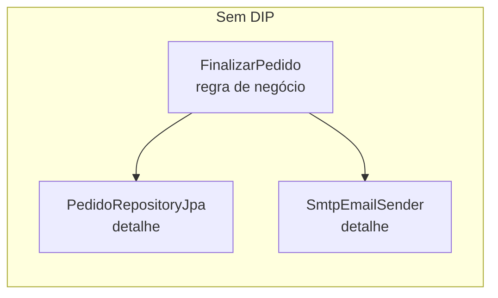
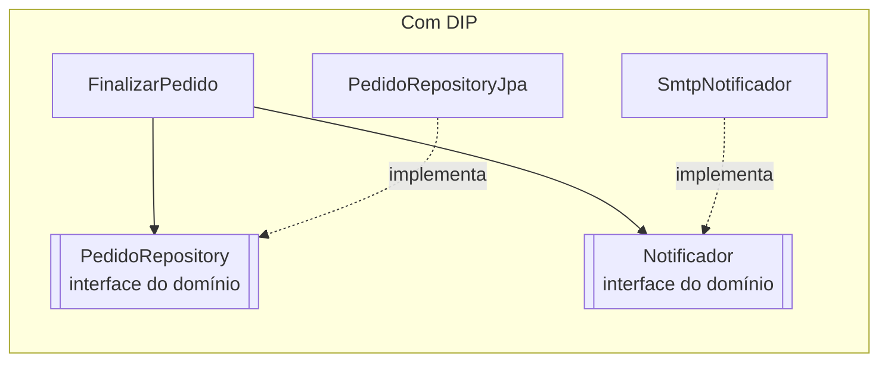
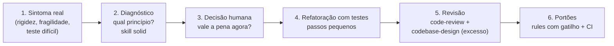

# Módulo 4 — SOLID com IA: os cinco princípios do design orientado a objetos, da teoria à prática com agentes

[← Módulo 3 — TDD e cobertura](modulo-3-tdd-e-cobertura.md) · [Índice do curso](README.md) · [Módulo 5 — Design de módulos e revisão →](modulo-5-design-e-revisao.md)

> **Pré-requisitos:** [Módulo 2](modulo-2-clean-code.md), [Módulo 3](modulo-3-tdd-e-cobertura.md). O ambiente (oh-my-pi, `.agents/`, skills, rules e segurança) é montado no [Módulo 1](modulo-1-ambiente.md).


> Tutorial para quem está começando. Cada princípio é explicado com **analogia**, **definição original e atual**, **sintomas de violação**, **exemplo em Java antes e depois**, **onde o Spring aplica o princípio** e **quando o princípio é levado longe demais**.
>
> Parte I: teoria. Parte II: SOLID e IA. Parte III: roteiro prático com a skill escolhida no [skills.sh](https://www.skills.sh), usando `.agents/` e o **oh-my-pi (`omp`)**.
>
> Tudo o que aparece como "saída real" foi executado em 26/09/2026 com `omp` 18.3.2 e o instalador `skills`. Números de instalação são os exibidos no skills.sh nessa data. Os exemplos Java seguem o mesmo projeto de pedidos dos outros módulos do curso.

---

## Sumário

**Parte I — Teoria**

1. [O problema que o SOLID resolve: software que apodrece](#1-o-problema-que-o-solid-resolve-software-que-apodrece)
2. [História e visão geral](#2-história-e-visão-geral)
3. [Conceitos de base: dependência, acoplamento, coesão, abstração](#3-conceitos-de-base-dependência-acoplamento-coesão-abstração)
4. [S — Princípio da Responsabilidade Única](#4-s--princípio-da-responsabilidade-única-srp)
5. [O — Princípio Aberto/Fechado](#5-o--princípio-abertofechado-ocp)
6. [L — Princípio da Substituição de Liskov](#6-l--princípio-da-substituição-de-liskov-lsp)
7. [I — Princípio da Segregação de Interfaces](#7-i--princípio-da-segregação-de-interfaces-isp)
8. [D — Princípio da Inversão de Dependência](#8-d--princípio-da-inversão-de-dependência-dip)
9. [Como os cinco se conectam](#9-como-os-cinco-se-conectam)
10. [SOLID e padrões de projeto](#10-solid-e-padrões-de-projeto)
11. [Além das classes: princípios de componentes](#11-além-das-classes-princípios-de-componentes)
12. [Críticas, limites e o risco do excesso](#12-críticas-limites-e-o-risco-do-excesso)

**Parte II — SOLID e IA**

13. [O que muda quando uma IA escreve o código](#13-o-que-muda-quando-uma-ia-escreve-o-código)

**Parte III — Roteiro prático com `.agents` e oh-my-pi**

14. [Escolha da skill no skills.sh](#14-escolha-da-skill-no-skillssh)
15. [Instalação e verificação](#15-instalação-e-verificação)
16. [Contexto do projeto e calibragem da skill](#16-contexto-do-projeto-e-calibragem-da-skill)
17. [Rules de SOLID em `.agents/rules`](#17-rules-de-solid-em-agentsrules)
18. [Roteiro prático: refatorando um service-deus, princípio por princípio](#18-roteiro-prático-refatorando-um-service-deus-princípio-por-princípio)
19. [Portões no CI](#19-portões-no-ci)
20. [Checklist, glossário e referências](#20-checklist-glossário-e-referências)

---

# Parte I — Teoria

## 1. O problema que o SOLID resolve: software que apodrece

Todo sistema começa limpo. Com o tempo, a cada mudança feita às pressas, ele fica mais difícil de alterar. Robert C. Martin descreveu, no artigo *Design Principles and Design Patterns* (2000), quatro **sintomas de um design que apodrece**:

| Sintoma | O que o desenvolvedor sente | Exemplo |
| --- | --- | --- |
| **Rigidez** | "Uma mudança simples exige mexer em muitos lugares" | Mudar o cálculo de frete obriga a alterar controller, service, relatório e testes |
| **Fragilidade** | "Mexi aqui e quebrou lá, num lugar sem relação" | Alterar o formato do e-mail quebra o fechamento do pedido |
| **Imobilidade** | "Não consigo reaproveitar isso em outro projeto" | A regra de desconto está grudada no acesso ao banco e no HTTP |
| **Viscosidade** | "Fazer do jeito certo é mais difícil do que fazer gambiarra" | É mais fácil copiar e colar do que usar a abstração existente |

A causa comum dos quatro é a **gestão ruim de dependências**: partes do sistema que sabem demais umas das outras. **SOLID é um conjunto de cinco princípios para organizar dependências** de forma que o sistema continue fácil de mudar.

### 1.1 Analogia: a casa com a fiação embutida no concreto

Imagine uma casa em que os fios elétricos foram concretados direto na parede, sem conduíte, sem tomadas padronizadas, com cada aparelho soldado no fio. Funciona no dia da entrega. Mas trocar a geladeira exige quebrar a parede (rigidez); consertar o chuveiro derruba a luz da sala (fragilidade); você não consegue levar o ventilador para outra casa (imobilidade); e o eletricista prefere puxar um fio por fora a abrir a parede (viscosidade).

Os princípios SOLID são o equivalente a **conduítes, tomadas padronizadas e quadros de disjuntores separados por circuito**.

## 2. História e visão geral

- **1988.** Bertrand Meyer formula o Princípio Aberto/Fechado no livro *Object-Oriented Software Construction*.
- **1987–1994.** Barbara Liskov apresenta a ideia de substituição de tipos (palestra de 1987) e, com Jeannette Wing, publica a definição formal em 1994.
- **1990s.** Robert C. Martin (Uncle Bob) reúne e reformula os princípios em artigos e, em 2000, no texto *Design Principles and Design Patterns*.
- **Por volta de 2004.** Michael Feathers percebe que as iniciais formam a palavra **SOLID**, e o nome pega.
- **2017.** Martin revisa as definições no livro *Clean Architecture*, especialmente a do SRP.

| Letra | Princípio | Em uma frase |
| --- | --- | --- |
| **S** | Single Responsibility | Um módulo deve responder a um único ator (um único motivo para mudar) |
| **O** | Open/Closed | Aberto para extensão, fechado para modificação |
| **L** | Liskov Substitution | Subtipos devem poder substituir seus tipos base sem quebrar o programa |
| **I** | Interface Segregation | Ninguém deve depender de métodos que não usa |
| **D** | Dependency Inversion | Regras de negócio não dependem de detalhes; os dois dependem de abstrações |

## 3. Conceitos de base: dependência, acoplamento, coesão, abstração

Antes dos princípios, quatro palavras que aparecem em todos eles.

### 3.1 Dependência

A classe **A depende de B** quando A precisa de B para compilar ou funcionar: A chama métodos de B, cria B, recebe B como parâmetro ou herda de B. **Se B muda, A pode ser obrigada a mudar.**

```java
class PedidoService {
    private final PedidoRepository repositorio;   // PedidoService depende de PedidoRepository

    PedidoService(PedidoRepository repositorio) { this.repositorio = repositorio; }
}
```

### 3.2 Acoplamento

**Acoplamento** é o grau de dependência entre partes. Acoplamento **forte**: conhece detalhes internos, classes concretas, ordem de chamadas. Acoplamento **fraco**: conhece só um contrato mínimo.

Analogia: aparelhos ligados por **tomada** (fraco) contra aparelhos **soldados** na fiação (forte).

### 3.3 Coesão

**Coesão** é o quanto as partes de um módulo pertencem ao mesmo assunto. Alta coesão: tudo na classe serve ao mesmo propósito. Baixa coesão: a classe é uma "gaveta de tralhas".

**Objetivo de todo o SOLID: alta coesão dentro dos módulos, baixo acoplamento entre eles.**

### 3.4 Abstração e contrato

Uma **abstração** (em Java, geralmente uma `interface`) descreve **o que** algo faz, sem dizer **como**. O **contrato** é o conjunto de promessas da abstração: o que ela aceita, o que devolve, que erros pode lançar, que regras sempre valem.

```java
/** Contrato: devolve o valor do frete (>= 0) para o pedido; nunca devolve null. */
public interface CalculoDeFrete {
    BigDecimal calcular(Pedido pedido);
}
```

Quem usa `CalculoDeFrete` depende só dessas promessas, não de qual classe as cumpre.

---

## 4. S — Princípio da Responsabilidade Única (SRP)

### 4.1 Definição

- **Formulação clássica:** "Uma classe deve ter um, e apenas um, motivo para mudar."
- **Formulação revisada (*Clean Architecture*, 2017):** "Um módulo deve ser responsável por um, e apenas um, **ator**." Ator é um grupo de pessoas (usuários, áreas da empresa) que pode pedir mudanças naquele código.

A versão revisada resolve uma confusão comum. SRP **não** significa "uma classe faz uma coisa só" (essa é uma regra para **funções**, vista no [Módulo 2 — Clean Code](modulo-2-clean-code.md)). SRP significa: **código que muda por pedido de pessoas diferentes deve ficar separado.**

### 4.2 Analogia: o restaurante

Num restaurante, o **cozinheiro** cozinha e o **caixa** cobra. Se o cozinheiro também fosse o caixa, uma mudança pedida pelo financeiro ("agora aceitamos Pix") atrapalharia a cozinha no meio do serviço. Cada função responde a um "chefe" diferente: a cozinha responde ao chef; o caixa, ao financeiro.

### 4.3 Exemplo clássico: três atores, uma classe

Martin usa um exemplo em que uma classe `Funcionario` tem três métodos:

```java
class Funcionario {
    BigDecimal calcularPagamento() { ... }     // pedido pelo Financeiro
    Duration relatarHoras() { ... }            // pedido pelo RH
    void salvar() { ... }                      // pedido pela equipe de TI (banco de dados)
}
```

Suponha que `calcularPagamento` e `relatarHoras` usem um método privado comum, `horasRegulares()`. O Financeiro pede para mudar a regra de horas extras; o desenvolvedor altera `horasRegulares()`; o relatório do RH passa a sair errado, e ninguém percebe por semanas. **Três atores, uma classe: a mudança de um afetou o outro.**

### 4.4 Sintomas de violação

- A classe muda com frequência por **motivos sem relação** (o cheiro **mudança divergente**).
- O nome precisa de "e" ou é genérico: `PedidoManager`, `UsuarioService` com 40 métodos.
- Importa pacotes de assuntos muito diferentes (JPA, SMTP, PDF, HTTP) no mesmo arquivo.
- Testar uma regra exige montar banco, servidor de e-mail e gerador de PDF.
- Dois desenvolvedores de equipes diferentes vivem em conflito de merge no mesmo arquivo.

### 4.5 Antes e depois

```java
// ANTES: um service que responde a quatro atores
@Service
public class PedidoService {
    public BigDecimal calcularTotal(Pedido p) { ... }        // Comercial (regras de preço)
    public void salvar(Pedido p) { ... }                     // TI (persistência)
    public byte[] gerarNotaEmPdf(Pedido p) { ... }           // Fiscal (layout da nota)
    public void enviarEmailDeConfirmacao(Pedido p) { ... }   // Marketing (texto e canal)
}
```

```java
// DEPOIS: uma classe por ator; cada uma muda por um só motivo
public class Pedido { public BigDecimal total() { ... } }                    // regra de preço no domínio
public interface PedidoRepository { void salvar(Pedido p); }                // persistência
@Component public class GeradorDeNotaFiscal { public byte[] gerar(Pedido p) { ... } }
@Component public class NotificadorDePedido { public void confirmar(Pedido p) { ... } }

@Service
public class FinalizarPedido {                          // orquestra o caso de uso
    // recebe os três colaboradores no construtor
    public void executar(Pedido pedido) {
        repositorio.salvar(pedido);
        notas.gerar(pedido);
        notificador.confirmar(pedido);
    }
}
```

### 4.6 No Spring

A separação em **controller** (HTTP), **service** (caso de uso), **repository** (persistência) e **entidades** (regras do domínio) é uma aplicação de SRP em camadas. Um controller que acessa o banco direto, ou uma entidade que envia e-mail, viola SRP.

### 4.7 Quando o SRP é levado longe demais

- **Classes anêmicas e pulverizadas:** dividir cada método numa classe (`CalculadorDeTotal`, `ValidadorDeTotal`, `FormatadorDeTotal`) espalha uma regra simples por dez arquivos.
- **Critério:** separe quando houver **atores diferentes** ou **ritmos de mudança diferentes** de verdade, não por reflexo.

---

## 5. O — Princípio Aberto/Fechado (OCP)

### 5.1 Definição

"Entidades de software (classes, módulos, funções) devem ser **abertas para extensão**, mas **fechadas para modificação**." (Meyer, 1988)

Em palavras simples: **acrescentar um comportamento novo não deveria exigir editar código que já funciona e já foi testado.**

Meyer propôs isso usando herança. Martin reformulou com **polimorfismo e interfaces**: o código estável depende de uma abstração; comportamentos novos são novas implementações dessa abstração.

### 5.2 Analogia: a régua de tomadas

Para ligar mais um aparelho, você **conecta numa tomada livre** (extensão). Você não abre a parede para puxar um fio novo (modificação). A instalação está "fechada" e, ainda assim, aceita aparelhos novos.

### 5.3 Sintomas de violação

- `if/else` ou `switch` sobre **tipo**, **código** ou **string** que cresce a cada requisito novo.
- O mesmo `switch` repetido em vários lugares (o cheiro **switches repetidos**).
- Toda nova modalidade exige editar a mesma classe central, com risco de quebrar as modalidades antigas.

### 5.4 Antes e depois

```java
// ANTES: cada forma de pagamento nova edita este método
public BigDecimal taxa(String forma, BigDecimal valor) {
    switch (forma) {
        case "PIX":    return BigDecimal.ZERO;
        case "CARTAO": return valor.multiply(new BigDecimal("0.03"));
        case "BOLETO": return new BigDecimal("2.50");
        default: throw new IllegalArgumentException(forma);
    }
}
```

```java
// DEPOIS: nova forma de pagamento = nova classe; nada existente é editado
public interface FormaDePagamento {
    String codigo();
    BigDecimal taxa(BigDecimal valor);
}

@Component class Pix implements FormaDePagamento {
    public String codigo() { return "PIX"; }
    public BigDecimal taxa(BigDecimal v) { return BigDecimal.ZERO; }
}
@Component class Cartao implements FormaDePagamento {
    private static final BigDecimal TAXA = new BigDecimal("0.03");
    public String codigo() { return "CARTAO"; }
    public BigDecimal taxa(BigDecimal v) { return v.multiply(TAXA); }
}

@Service
public class CalculadoraDeTaxa {
    private final Map<String, FormaDePagamento> formas;
    public CalculadoraDeTaxa(List<FormaDePagamento> todas) {          // o Spring injeta todas
        this.formas = todas.stream().collect(Collectors.toMap(FormaDePagamento::codigo, f -> f));
    }
    public BigDecimal taxa(String codigo, BigDecimal valor) {
        return Optional.ofNullable(formas.get(codigo))
                .orElseThrow(() -> new FormaDePagamentoInvalida(codigo))
                .taxa(valor);
    }
}
```

Para aceitar "Boleto" amanhã, cria-se `class Boleto implements FormaDePagamento` e pronto: `CalculadoraDeTaxa`, `Pix` e `Cartao` não são tocados, nem seus testes.

### 5.5 Conceito relacionado: variação protegida

Alistair Cockburn e Craig Larman descrevem o princípio da **variação protegida**: identifique os **pontos de variação previsíveis** e crie uma interface estável em volta deles. OCP não pede que **tudo** seja extensível; pede que **o que varia de fato** seja.

### 5.6 No Spring

- Injeção de `List<Interface>` e `Map<String, Interface>` (todas as implementações registradas) é o jeito idiomático de OCP.
- **Eventos** (`@EventListener`): novos interessados em "pedido finalizado" são novas classes; o publicador não muda.
- **Configuração automática** (*auto-configuration*): você estende o comportamento do Spring declarando beans, sem editar o framework.

### 5.7 Quando o OCP é levado longe demais

- Criar interface e "ponto de extensão" para algo que tem **uma** variante e nenhuma previsão de outra. É generalidade especulativa.
- **Critério:** espere a **segunda** variação real (ou uma previsão concreta) antes de abrir o ponto de extensão. Na primeira vez, escreva o código direto; na segunda, refatore para OCP.

---

## 6. L — Princípio da Substituição de Liskov (LSP)

### 6.1 Definição

- **Informal:** se um código funciona com um tipo `T`, ele deve continuar funcionando **corretamente** quando recebe qualquer subtipo `S` de `T`.
- **Liskov e Wing (1994), simplificado:** qualquer propriedade que se possa provar sobre objetos de `T` deve valer também para objetos de `S`.

LSP é sobre **comportamento**, não sobre sintaxe. O compilador aceita que `Quadrado extends Retangulo`; o LSP pergunta se o programa **continua certo**.

### 6.2 Analogia: o carregador genérico

Você compra um carregador "compatível" com seu celular. Ele encaixa na tomada e no aparelho (a sintaxe está certa). Mas se ele esquentar até derreter, ou carregar só até 50%, ele **não substitui** o original, mesmo encaixando. Substituir é cumprir **as mesmas promessas**, não só ter o mesmo formato.

### 6.3 O exemplo clássico: Quadrado e Retângulo

```java
class Retangulo {
    protected int largura, altura;
    void setLargura(int l) { this.largura = l; }
    void setAltura(int a) { this.altura = a; }
    int area() { return largura * altura; }
}

class Quadrado extends Retangulo {             // "todo quadrado é um retângulo"... na matemática
    @Override void setLargura(int l) { this.largura = l; this.altura = l; }
    @Override void setAltura(int a) { this.largura = a; this.altura = a; }
}

void testarRetangulo(Retangulo r) {
    r.setLargura(5);
    r.setAltura(2);
    assert r.area() == 10;                     // falha com Quadrado: a área dá 4
}
```

Quem escreveu `testarRetangulo` confiou numa promessa implícita de `Retangulo`: "mudar a altura não muda a largura". `Quadrado` quebra essa promessa. **Na matemática, quadrado é retângulo; no código, com esse comportamento, não é substituível.**

### 6.4 As regras do contrato (Design by Contract)

Bertrand Meyer formalizou contratos com **pré-condições** (o que o método exige), **pós-condições** (o que ele garante) e **invariantes** (o que sempre vale). O LSP se traduz em regras objetivas:

| Regra | O subtipo pode... | O subtipo não pode... | Exemplo de violação |
| --- | --- | --- | --- |
| **Pré-condições** | Aceitar **mais** (enfraquecer) | Exigir **mais** (fortalecer) | Base aceita qualquer valor positivo; subtipo só aceita acima de 100 |
| **Pós-condições** | Garantir **mais** (fortalecer) | Garantir **menos** (enfraquecer) | Base promete nunca devolver `null`; subtipo devolve `null` |
| **Invariantes** | Acrescentar invariantes próprias | Quebrar as da base | Base garante saldo ≥ 0; subtipo permite saldo negativo |
| **Exceções** | Lançar subtipos das exceções previstas | Lançar exceções novas e inesperadas | Método da base não lança nada; subtipo lança `UnsupportedOperationException` |
| **Restrição de histórico** | — | Permitir mudanças de estado que a base proíbe | Base é imutável; subtipo acrescenta um setter |

### 6.5 Sintomas de violação

- `throw new UnsupportedOperationException()` ao sobrescrever um método.
- Métodos sobrescritos com corpo vazio ("não faz nada nesta subclasse").
- Código cliente com `if (x instanceof SubtipoEspecial)` para tratar um caso diferente: o cliente teve de descobrir o subtipo porque ele não se comporta como o tipo base.
- Testes que passam para a classe base e falham para uma subclasse.

### 6.6 Exemplo do dia a dia

```java
interface ContaBancaria {
    void sacar(BigDecimal valor);              // contrato: reduz o saldo pelo valor
}

class ContaPoupancaDeInvestimento implements ContaBancaria {
    public void sacar(BigDecimal valor) {
        throw new UnsupportedOperationException("Resgate só no vencimento");   // viola LSP
    }
}
```

Correção: o problema está na **abstração**. Nem toda conta aceita saque. Separe as capacidades (isso também é ISP):

```java
interface Conta { BigDecimal saldo(); }
interface ContaSacavel extends Conta { void sacar(BigDecimal valor); }

class ContaCorrente implements ContaSacavel { ... }
class Investimento implements Conta { void resgatarNoVencimento() { ... } }
```

### 6.7 LSP no Java e no Spring

- As listas de `List.of(...)` e `Collections.unmodifiableList(...)` lançam `UnsupportedOperationException` em `add`. É uma decisão **documentada** do JDK: o contrato de `List` declara essas operações como opcionais. Isso mostra que a violação às vezes é aceita conscientemente, mas **precisa estar no contrato**.
- No Spring, qualquer implementação de `PasswordEncoder`, `CacheManager` ou `CalculoDeFrete` deve funcionar no lugar de outra. Testes de contrato (seção 18) ajudam a garantir isso.

### 6.8 Teste de contrato: a ferramenta prática do LSP

Escreva **um conjunto de testes para a abstração** e rode-o contra **todas as implementações**:

```java
abstract class CalculoDeFreteContractTest {
    protected abstract CalculoDeFrete criar();

    @Test void freteNuncaENegativo() {
        assertThat(criar().calcular(pedidoComum())).isGreaterThanOrEqualTo(BigDecimal.ZERO);
    }
    @Test void freteNuncaENulo() {
        assertThat(criar().calcular(pedidoComum())).isNotNull();
    }
}

class FretePacTest extends CalculoDeFreteContractTest {
    protected CalculoDeFrete criar() { return new FretePac(); }
}
class FreteSedexTest extends CalculoDeFreteContractTest {
    protected CalculoDeFrete criar() { return new FreteSedex(); }
}
```

Toda implementação nova herda os testes do contrato. Se violar uma promessa, o teste falha.

---

## 7. I — Princípio da Segregação de Interfaces (ISP)

### 7.1 Definição

"Nenhum cliente deve ser forçado a depender de métodos que não usa." Prefira **várias interfaces pequenas e específicas** a uma interface grande e genérica.

### 7.2 Analogia: o controle remoto universal

Um controle com 80 botões, dos quais você usa 6. Além de confuso, se o fabricante muda o funcionamento de um botão que você nunca usa, você recebe um controle novo mesmo assim. Um controle simples, só com o que você precisa, é mais fácil de usar e não é afetado por mudanças nos outros botões.

### 7.3 A história de origem

Martin conta que o princípio nasceu de uma consultoria na Xerox. Um sistema de impressoras tinha uma classe `Job` usada por todas as tarefas (imprimir, grampear, enviar fax). Qualquer alteração em `Job`, mesmo numa parte usada só pelo fax, obrigava a recompilar e reimplantar tudo, e o ciclo levava cerca de uma hora. A solução foi criar interfaces específicas para cada tipo de cliente.

### 7.4 Sintomas de violação

- Implementações com métodos vazios ou lançando `UnsupportedOperationException` (também viola LSP).
- Interfaces com nomes genéricos e dezenas de métodos: `IService`, `PedidoOperations`.
- Um dublê de teste precisa implementar 15 métodos para testar uma classe que usa 2.
- Mudar um método da interface força recompilar e retestar classes que não o usam.

### 7.5 Antes e depois

```java
// ANTES: interface "gorda"
public interface Multifuncional {
    void imprimir(Documento d);
    void escanear(Documento d);
    void enviarFax(Documento d);
    void grampear(Documento d);
}

class ImpressoraSimples implements Multifuncional {
    public void imprimir(Documento d) { ... }
    public void escanear(Documento d) { throw new UnsupportedOperationException(); }
    public void enviarFax(Documento d) { throw new UnsupportedOperationException(); }
    public void grampear(Documento d) { throw new UnsupportedOperationException(); }
}
```

```java
// DEPOIS: interfaces por capacidade; cada classe implementa o que realmente faz
public interface Impressora { void imprimir(Documento d); }
public interface Scanner { void escanear(Documento d); }
public interface Fax { void enviarFax(Documento d); }

class ImpressoraSimples implements Impressora { ... }
class Multifuncional implements Impressora, Scanner, Fax { ... }

// o cliente declara só o que usa
class ServicoDeDigitalizacao {
    private final Scanner scanner;
    ServicoDeDigitalizacao(Scanner scanner) { this.scanner = scanner; }
}
```

### 7.6 Interfaces definidas pelo cliente

Uma forma poderosa de aplicar ISP: **a interface é desenhada pelo lado que a usa**, com o mínimo que ele precisa, e não pelo lado que a implementa.

```java
// O caso de uso de cobrança só precisa de uma operação do cliente
public interface BuscaEmailDoCliente {
    String emailDe(Long clienteId);
}
// O ClienteRepository completo (com 20 métodos) implementa essa interface pequena também
```

### 7.7 No Spring e no Java

- Interfaces funcionais do JDK: `Supplier`, `Consumer`, `Function`, `Predicate` são o extremo do ISP (um método cada).
- Spring Data oferece uma hierarquia segregada: `Repository` (vazia), `CrudRepository`, `ListCrudRepository`, `PagingAndSortingRepository`, `JpaRepository`. Você pode estender só o nível que precisa, ou declarar uma interface com apenas os métodos usados.
- O Spring separa as interfaces do ciclo de vida: `InitializingBean`, `DisposableBean`, `ApplicationContextAware`. Cada bean implementa só o que usa.

### 7.8 Quando o ISP é levado longe demais

Uma interface por método para tudo gera dezenas de interfaces que ninguém consegue navegar. **Critério:** agrupe métodos que os **mesmos clientes** usam **juntos**.

---

## 8. D — Princípio da Inversão de Dependência (DIP)

### 8.1 Definição

1. **Módulos de alto nível não devem depender de módulos de baixo nível. Ambos devem depender de abstrações.**
2. **Abstrações não devem depender de detalhes. Detalhes devem depender de abstrações.**

- **Alto nível:** as políticas e regras de negócio (finalizar pedido, calcular desconto).
- **Baixo nível:** os detalhes técnicos (JPA, SMTP, cliente HTTP dos Correios, sistema de arquivos).

### 8.2 Analogia: a tomada, de novo, mas do ponto de vista de quem manda

O **padrão da tomada** é definido pelas normas elétricas do país (o "alto nível"), e os fabricantes de aparelhos (os "detalhes") se adaptam a ele. Não é o fabricante de secador que decide o formato da tomada da sua casa. **Quem manda define a interface; quem executa se adapta.**

### 8.3 O que exatamente é "invertido"

Sem DIP, as dependências seguem o fluxo de execução: a regra de negócio chama o banco, então **depende** do banco.



Com DIP, a regra de negócio **define as interfaces de que precisa** (no pacote dela), e os detalhes as implementam. A seta da dependência de código **aponta para o negócio**, ao contrário do fluxo de execução:



O ponto sutil: não basta "usar uma interface". **A interface pertence ao módulo de alto nível** e fala a língua do negócio (`salvar(Pedido)`), não a língua do detalhe (`executeUpdate(String sql)`).

### 8.4 Sintomas de violação

- `new` de colaboradores dentro da regra de negócio: `new SmtpEmailSender()`, `new RestTemplate()`.
- A classe de negócio importa pacotes de infraestrutura (`jakarta.persistence`, `org.springframework.web.client`, SDK de pagamento).
- Não dá para testar a regra sem banco, rede ou serviço externo.
- A interface "abstrata" expõe detalhes do fornecedor: `interface Pagamento { StripeCharge cobrar(StripeRequest r); }`.

### 8.5 Antes e depois

```java
// ANTES: a regra de negócio cria e conhece os detalhes
public class FinalizarPedido {
    private final PedidoRepositoryJpa repositorio = new PedidoRepositoryJpa();
    private final SmtpEmailSender email = new SmtpEmailSender("smtp.empresa.com", 587);

    public void executar(Pedido pedido) {
        repositorio.persist(pedido);
        email.send(pedido.cliente().email(), "Pedido confirmado");
    }
}
```

```java
// DEPOIS: interfaces do domínio + injeção por construtor
package br.edu.fatec.pedido;                      // pacote do domínio

public interface PedidoRepository { void salvar(Pedido pedido); }
public interface Notificador { void pedidoConfirmado(Pedido pedido); }

@Service
public class FinalizarPedido {
    private final PedidoRepository repositorio;
    private final Notificador notificador;

    public FinalizarPedido(PedidoRepository repositorio, Notificador notificador) {
        this.repositorio = repositorio;
        this.notificador = notificador;
    }

    public void executar(Pedido pedido) {
        repositorio.salvar(pedido);
        notificador.pedidoConfirmado(pedido);
    }
}
```

```java
package br.edu.fatec.infra;                       // detalhes dependem do domínio

@Repository class PedidoRepositoryJpa implements PedidoRepository { ... }
@Component class SmtpNotificador implements Notificador { ... }
```

Teste da regra, sem banco e sem e-mail:

```java
@Test
void finalizarSalvaENotifica() {
    var repositorio = new PedidoRepositoryEmMemoria();       // fake
    var notificador = new NotificadorEspiao();               // spy
    new FinalizarPedido(repositorio, notificador).executar(pedido);

    assertThat(repositorio.todos()).contains(pedido);
    assertThat(notificador.confirmados()).contains(pedido);
}
```

### 8.6 DIP, injeção de dependência e inversão de controle: não confunda

| Termo | O que é | Relação |
| --- | --- | --- |
| **DIP** (princípio) | Regra de **design**: dependa de abstrações; a abstração pertence ao alto nível | O objetivo |
| **Injeção de dependência** (técnica) | Receber as dependências de fora (construtor, setter) em vez de criá-las | A forma mais comum de aplicar DIP |
| **Inversão de controle** (IoC) | O framework chama o seu código, e não o contrário ("não nos ligue, nós ligamos para você", o princípio de Hollywood) | O Spring é um contêiner de IoC que faz a injeção |

Dá para usar injeção de dependência **sem** DIP (injetar uma classe concreta de infraestrutura na regra de negócio) e dá para aplicar DIP **sem** framework (passando as implementações à mão no `main`).

### 8.7 No Spring

- **Injeção por construtor** com campos `private final` é a forma recomendada pela própria documentação do Spring. Com um único construtor, nem é preciso `@Autowired`.
- `@Autowired` em **campo** esconde dependências, impede imutabilidade e dificulta testes sem o contêiner. Na Parte III há uma rule que barra isso.
- Spring Data: você declara `interface PedidoRepository extends JpaRepository<...>`, e o Spring gera a implementação. Para DIP estrito, o domínio define uma interface própria e um adaptador a implementa usando o Spring Data.

### 8.8 Quando o DIP é levado longe demais

- Interface para **tudo**, inclusive classes do próprio domínio que nunca terão outra implementação (`IPedido`, `PedidoImpl`).
- **Critério:** crie a abstração nas **fronteiras** (banco, rede, fila, relógio, sistema externo) e onde houver **variação real**. Objetos de valor, entidades e utilitários puros não precisam de interface.

---

## 9. Como os cinco se conectam

Os princípios se reforçam:

| Relação | Explicação |
| --- | --- |
| **SRP → ISP** | Classes com uma responsabilidade tendem a ter interfaces pequenas |
| **ISP → LSP** | Interfaces enxutas evitam que implementações sejam forçadas a "fingir" métodos (e violar LSP) |
| **LSP → OCP** | O OCP só funciona se as novas implementações forem substituíveis; senão, o código "fechado" precisa de `if` para tratá-las |
| **DIP → OCP** | Depender de abstrações é o que torna possível estender sem modificar |
| **DIP → testabilidade** | Dependências injetadas podem ser trocadas por dublês nos testes |

Uma forma de lembrar: **S** e **I** tratam do **tamanho** certo das coisas; **L** trata da **honestidade** dos contratos; **O** e **D** tratam da **direção** das dependências.

## 10. SOLID e padrões de projeto

Os padrões GoF ([Módulo 6 — Padrões de Projeto](modulo-6-padroes-de-projeto.md)) são aplicações concretas do SOLID:

| Princípio | Padrões que o materializam |
| --- | --- |
| SRP | Command, Facade, Mediator (separam responsabilidades) |
| OCP | Strategy, Decorator, Observer, Chain of Responsibility, Template Method, Visitor |
| LSP | Todo padrão baseado em polimorfismo depende de subtipos substituíveis |
| ISP | Adapter (expõe só a interface que o cliente precisa), Facade |
| DIP | Factory Method, Abstract Factory, Adapter, Bridge, injeção de dependência |

## 11. Além das classes: princípios de componentes

Em *Clean Architecture*, Martin estende as ideias do SOLID para **componentes** (módulos, pacotes, JARs). São avançados; vale conhecer os nomes:

| Princípio | Ideia |
| --- | --- |
| **REP** (Reuse/Release Equivalence) | O que se reutiliza junto deve ser versionado e publicado junto |
| **CCP** (Common Closure) | Agrupe no mesmo componente o que muda pelos mesmos motivos (o SRP para componentes) |
| **CRP** (Common Reuse) | Não force quem usa um componente a depender do que não usa (o ISP para componentes) |
| **ADP** (Acyclic Dependencies) | Não pode haver ciclos de dependência entre componentes |
| **SDP** (Stable Dependencies) | Dependa na direção do que é mais estável |
| **SAP** (Stable Abstractions) | Componentes estáveis devem ser abstratos |

A **Regra da Dependência** da Arquitetura Limpa (as dependências de código apontam para dentro, em direção ao domínio) é o DIP aplicado à arquitetura inteira.

## 12. Críticas, limites e o risco do excesso

- **"SOLID gera classes demais."** Aplicado mecanicamente, sim: interfaces com uma implementação, dezenas de classes minúsculas. Os princípios são **ferramentas para gerenciar mudança**; onde não há mudança prevista, o custo pode não se pagar.
- **SRP é vago.** "Motivo para mudar" é subjetivo. A reformulação por **ator** ajuda, mas ainda exige julgamento.
- **Alternativas.** Dan North propôs em 2022 as propriedades **CUPID** (componível, filosofia Unix, previsível, idiomático, baseado no domínio) como contraponto: em vez de regras, qualidades desejáveis do código.
- **Programação funcional.** Várias ideias do SOLID aparecem de outra forma (funções puras, composição de funções, funções de ordem superior no lugar de Strategy).
- **Módulos profundos.** John Ousterhout alerta que dividir demais cria módulos **rasos**, cuja interface é quase tão complexa quanto a implementação.

**Postura recomendada:** use o SOLID como **lente para diagnosticar** problemas reais (rigidez, fragilidade, dificuldade de testar), não como checklist para aplicar em toda classe. **Duplicação pequena é melhor do que a abstração errada** (frase de Sandi Metz, citada inclusive pela skill escolhida na Parte III).

---

# Parte II — SOLID e IA

## 13. O que muda quando uma IA escreve o código

### 13.1 Violações típicas em código gerado

| Princípio | Como a IA costuma violar | Por quê |
| --- | --- | --- |
| **SRP** | Acrescenta tudo no service que já existe: o `PedidoService` ganha e-mail, PDF e integração | O caminho mais curto para "fazer funcionar" é editar o arquivo aberto |
| **OCP** | Mais um `else if` na cadeia existente | Estender o padrão local é o que parece mais seguro |
| **LSP** | Implementa a interface inteira e lança `UnsupportedOperationException` nos métodos que não fazem sentido | Satisfaz o compilador sem questionar a abstração |
| **ISP** | Cria `interface PedidoService` espelhando os 20 métodos da classe | Gera "interface para tudo" sem pensar em quem usa |
| **DIP** | `new RestTemplate()` e `new XxxClient()` dentro do service; `@Autowired` em campo | São os exemplos mais comuns em código público antigo |

### 13.2 E o excesso oposto

Quando instruída a "aplicar SOLID", a IA pode ir para o outro extremo: interface com uma implementação para cada classe, dez classes para uma regra de três linhas, fábricas sem necessidade. Por isso o ambiente precisa de **dois freios**: um contra a violação e outro contra o excesso.

### 13.3 O processo recomendado



---

# Parte III — Roteiro prático com `.agents` e oh-my-pi

## 14. Escolha da skill no skills.sh

### 14.1 Candidatas avaliadas

Pesquisei o skills.sh e o GitHub, clonei os repositórios e li o conteúdo de cada candidata.

| Skill | Repositório | Instalações | Tamanho | Exemplos | Auditorias no skills.sh |
| --- | --- | --- | --- | --- | --- |
| **`solid`** | [ramziddin/solid-skills](https://skills.sh/ramziddin/solid-skills/solid) | **3,2 mil** | 10 arquivos, cerca de 3.650 linhas | Conceitual, alguns trechos em TypeScript | 3 aprovadas |
| `solid-principles` | [thebushidocollective/han](https://www.skills.sh/thebushidocollective/han/solid-principles) | 522 | 1 arquivo, cerca de 400 linhas | Elixir e TypeScript | 3 aprovadas |
| `solid-principles` | lev-os/agents | — | 1 arquivo, cerca de 100 linhas | Conceitual | — |
| `code-review` | [mattpocock/skills](https://www.skills.sh/mattpocock/skills) | 620,6 mil | — | — | — |
| `codebase-design` | [mattpocock/skills](https://www.skills.sh/mattpocock/skills) | 681,5 mil | — | — | — |

### 14.2 A escolhida: `solid` (ramziddin/solid-skills)

**Por quê:**

1. **A mais usada e auditada** entre as skills dedicadas a SOLID.
2. **Vai além das definições.** O `SKILL.md` traz, para cada princípio, a pergunta de diagnóstico ("Tem UM motivo para mudar?", "Consigo estender sem modificar?"). A pasta `references/` aprofunda com nove arquivos: princípios SOLID, código limpo, cheiros de código, complexidade, design de objetos, padrões, arquitetura, testes e TDD.
3. **Tem freios contra o excesso:** YAGNI, "regra de três" antes de abstrair, "não force padrões", e a frase "um pouco de duplicação é dez vezes melhor que a abstração errada".
4. **Checklists antes, durante e depois do código**, fáceis de o agente seguir.

**Pontos de atenção (importantes):**

| Ponto | Detalhe | Como tratar |
| --- | --- | --- |
| **Ativa em qualquer código** | A descrição diz para usar "ALWAYS... when writing ANY code". Na prática, ela entra em quase toda tarefa | Aceitável para um projeto didático; em projetos grandes, invoque por comando |
| **Limites muito rígidos** | A seção *Red Flags* cita: classe com mais de 2 atributos, método com mais de 10 linhas, mais de um nível de indentação. São regras da *Object Calisthenics*, um exercício de disciplina, não um padrão de produção | Calibre por rule do projeto (seção 16.2): o projeto vence a skill |
| **TDD embutido e "inegociável"** | Manda sempre começar pelo teste, com refatoração **dentro** do ciclo | Se o projeto usa a skill `tdd` do Matt Pocock (refatoração na revisão), escolha uma orientação e registre no `AGENTS.md` |
| **Persona** | Abre com "You are now operating as a senior software engineer" | Inofensivo, mas aumenta a verbosidade das respostas |
| **Exemplos não são em Java** | Trechos em TypeScript | A rule `solid-spring-idioms` (seção 17.2) traduz para Spring |

### 14.3 As complementares

| Skill | Papel |
| --- | --- |
| `codebase-design` (mattpocock) | **Freio contra o excesso:** módulos profundos; "um adaptador é um seam hipotético, dois adaptadores são um seam real" (não crie interface para uma implementação só) |
| `code-review` (mattpocock) | **Revisão:** a linha de base de cheiros de Fowler inclui mudança divergente (SRP), switches repetidos (OCP), herança recusada (LSP), generalidade especulativa (excesso) |
| `tdd` (mattpocock), opcional | Implementar com testes primeiro, se preferir essa versão do ciclo |

> **⚠ Segurança:** a `code-review` aparece no skills.sh com **falha no Snyk** e **aviso no Gen Agent Trust Hub** (risco de reproduzir segredos do diff e de injeção de prompt vinda do conteúdo do repositório). Antes de usá-la, ative as rules de segurança do [Módulo 1, seção 13](modulo-1-ambiente.md#13-o-kit-inicial-do-curso-e-como-ele-cresce). Análise completa no [Módulo 5, seção 16](modulo-5-design-e-revisao.md#16-ficha-técnica-e-dependências-das-skills).

## 15. Instalação e verificação

### 15.1 Comandos (testados)

```bash
cd meu-projeto

npx skills@latest add https://github.com/ramziddin/solid-skills \
  --skill solid --agent universal --copy -y

npx skills@latest add mattpocock/skills \
  --skill codebase-design code-review --agent universal --copy -y
```

Saída real (trecho):

```text
•  Selected 1 skill: solid
|  ✓ solid (copied)
|    → ./.agents/skills/solid
•  Selected 2 skills: code-review, codebase-design
|  ✓ code-review (copied)
|    → ./.agents/skills/code-review
|  ✓ codebase-design (copied)
|    → ./.agents/skills/codebase-design
```

### 15.2 Estrutura instalada

```text
.agents/skills/solid/
├── SKILL.md
└── references/
    ├── solid-principles.md     # os cinco princípios em profundidade
    ├── object-design.md
    ├── code-smells.md
    ├── complexity.md
    ├── design-patterns.md
    ├── architecture.md
    ├── clean-code.md
    ├── testing.md
    └── tdd.md
```

### 15.3 Verificação com o `omp`

```text
$ omp read skill://solid | sed -n 2p
name: solid

$ omp read skill://solid/references/solid-principles.md | head -1
# SOLID Principles
```

`omp read skill://...` usa a mesma descoberta do agente, sem chamar o modelo, e resolve também os arquivos internos. Isso permite apontar o agente direto para uma referência: *"consulte skill://solid/references/solid-principles.md, seção LSP"*.

## 16. Contexto do projeto e calibragem da skill

### 16.1 Seção de SOLID no `AGENTS.md`

(É o `AGENTS.md` da raiz, criado no Módulo 1: um único arquivo de contexto, lido por qualquer agente.)

```markdown
## SOLID neste projeto
- Use SOLID para diagnosticar problemas reais (mudança difícil, quebra em cascata, teste difícil),
  não como checklist aplicado a toda classe.
- Refatorações de SOLID sempre com testes verdes antes e depois.
- Ao propor uma refatoração, diga qual princípio está sendo violado, qual sintoma isso causa
  e qual o custo da mudança.
```

O que já está no `AGENTS.md` desde o Módulo 1 (as rules prevalecem sobre as skills, refatoração em commit separado, plano aprovado antes de mudanças com mais de 3 arquivos) não se repete aqui. Os limites de tamanho e a regra "interface só em fronteira" ficam na rule sempre ativa `solid-calibration` (seção 16.2).

### 16.2 Rule de calibragem (sempre ativa)

`.agents/rules/solid-calibration.md`:

```markdown
---
description: Calibra os limites da skill solid para este projeto
alwaysApply: true
---
Os limites da seção "Red Flags" da skill solid (métodos de 10 linhas, classes com 2 atributos,
um nível de indentação) são exercícios de disciplina e NÃO valem neste projeto. Aqui valem:
- métodos com até 30 linhas; no máximo 2 níveis de aninhamento;
- classes com uma única responsabilidade (um ator), sem limite fixo de atributos;
- interface nova só em fronteira externa ou com duas implementações reais;
- regra de três antes de extrair abstração por duplicação.
```

## 17. Rules de SOLID em `.agents/rules`

Relembrando os tipos de rule do `omp` (detalhados no [Módulo 1, seção 10](modulo-1-ambiente.md#10-rules)): **sempre ativa** (`alwaysApply: true`), **sob demanda** (`description` + `globs`, lida quando o assunto aparece) e **com gatilho** (`condition`, `astCondition` ou `question`, disparada quando o agente escreve algo que casa com o padrão).

### 17.1 O que dá e o que não dá para verificar mecanicamente

| Princípio | Verificável por padrão de texto? | Melhor mecanismo |
| --- | --- | --- |
| SRP | Não (é julgamento sobre atores) | Skill `solid` + `code-review` + revisão humana |
| OCP | Parcialmente: cadeias de `instanceof`/`switch` por tipo | Gatilho (visto no [Módulo 6](modulo-6-padroes-de-projeto.md)) + revisão |
| LSP | Parcialmente: `UnsupportedOperationException`, métodos vazios | Gatilho + **testes de contrato** |
| ISP | Pouco | Revisão |
| DIP | **Bem**: `new` de colaboradores, `@Autowired` em campo, imports de infraestrutura no domínio | Gatilhos + ferramentas de arquitetura (ArchUnit) |

### 17.2 Idiomas do Spring (sob demanda, só em Java)

`.agents/rules/solid-spring-idioms.md`:

```markdown
---
description: Como aplicar cada princípio SOLID em Spring Boot neste projeto
globs: ["**/*.java"]
---
- SRP: controller (HTTP) → service de caso de uso → repository; regras de negócio nas entidades.
  Um service por caso de uso ou agregado, nunca um "PedidoService" com tudo.
- OCP: variações como implementações @Component de uma interface; injete List<Interface>
  e monte um Map pela chave. Novos interessados em eventos via @EventListener.
- LSP: toda interface com mais de uma implementação ganha um teste de contrato abstrato
  (classe *ContractTest) herdado pelos testes de cada implementação.
- ISP: interfaces pequenas, desenhadas pelo cliente que as usa. Repositórios expõem só
  os métodos usados pelo domínio.
- DIP: interfaces das fronteiras no pacote do domínio; implementações no pacote infra.
  Injeção por construtor com campos private final; sem @Autowired em campo; sem new de
  Repository/Service/Client/Gateway/Dao em código de produção.
```

### 17.3 Rules com gatilho (testadas, incluindo os erros que o teste revelou)

`.agents/rules/dip-no-new-collaborator.md`:

```markdown
---
description: DIP — proíbe instanciar colaboradores (repositórios, serviços, clientes) com new em código de produção
condition: "new\\s+(?!\\w*(Exception|Error)\\b)\\w*(Repository|Service|Client|Gateway|Dao)\\w*\\s*\\("
globs: ["src/main/**/*.java"]
---
Não instancie colaboradores com new. Declare a dependência como uma interface no construtor e deixe o Spring injetar (DIP).
Exceções (objetos de valor, DTOs, records, coleções) podem usar new normalmente.
```

`.agents/rules/dip-constructor-injection.md`:

```markdown
---
description: DIP — injeção de dependência por construtor, nunca @Autowired em campo
condition: "@Autowired\\s+(private|protected)\\s+(final\\s+)?[\\w.<>, ]+\\s+\\w+\\s*;"
globs: ["src/main/**/*.java"]
---
Use injeção por construtor com campos private final. @Autowired em campo esconde dependências, impede imutabilidade e dificulta testes.
```

`.agents/rules/lsp-unsupported-operation.md`:

```markdown
---
description: LSP — alerta para UnsupportedOperationException em código de produção
condition: "throw\\s+new\\s+UnsupportedOperationException"
globs: ["src/main/**/*.java"]
---
Lançar UnsupportedOperationException ao implementar uma interface ou sobrescrever um método costuma violar LSP
(o subtipo não cumpre o contrato do tipo base) e ISP (a interface é grande demais).
Avalie dividir a interface ou trocar herança por composição. Se for intencional (ex.: coleção imutável), justifique no Javadoc.
```

#### Lição do teste: toda rule com gatilho precisa de casos positivos e negativos

As primeiras versões dessas regras **erraram**, e só o teste mostrou. Vale reproduzir com os alunos:

| Versão | Expressão | Caso testado | Resultado | Problema |
| --- | --- | --- | --- | --- |
| 1 | `new\s+\w*(Repository\|Service\|...)\s*\(` | `new PedidoRepositoryJpa()` | Não disparou | **Falso negativo**: o nome continua depois de "Repository" |
| 1 | `@Autowired\s+(private\|protected\|public)?\s*\w+` | `@Autowired public PedidoService(...)` (construtor) | Disparou | **Falso positivo**: `@Autowired` em construtor é permitido |
| 2 | `new\s+\w*(Repository\|...)\w*\s*\(` | `new ServiceUnavailableException("x")` | Disparou | **Falso positivo**: exceção não é colaborador |
| 3 (final) | com `(?!\w*(Exception\|Error)\b)` e `@Autowired` exigindo campo terminado em `;` | todos abaixo | Corretos | — |

Bateria final, saída real de `omp ttsr test --source tool --tool write --path <arquivo> '<trecho>'`:

| Arquivo | Trecho | Resultado esperado | Resultado real |
| --- | --- | --- | --- |
| `src/main/.../A.java` | `new PedidoRepositoryJpa();` | Dispara | ✓ `dip-no-new-collaborator` |
| `src/main/.../A.java` | `new EmailService();` | Dispara | ✓ `dip-no-new-collaborator` |
| `src/main/.../A.java` | `new CorreiosClient(url);` | Dispara | ✓ `dip-no-new-collaborator` |
| `src/main/.../A.java` | `new ServiceUnavailableException("x");` | Não dispara | No rules triggered |
| `src/main/.../A.java` | `new HttpClientError(400);` | Não dispara | No rules triggered |
| `src/main/.../A.java` | `new Pedido(cliente, itens);` | Não dispara | No rules triggered |
| `src/test/.../ATest.java` | `new PedidoService(repoFake);` | Não dispara (teste pode instanciar) | No rules triggered |
| `src/main/.../A.java` | `@Autowired`↵`private PedidoRepository repo;` | Dispara | ✓ `dip-constructor-injection` |
| `src/main/.../A.java` | `@Autowired private List<CalculoDeFrete> calculos;` | Dispara | ✓ `dip-constructor-injection` |
| `src/main/.../A.java` | `@Autowired`↵`public PedidoService(PedidoRepository repo) {` | Não dispara | No rules triggered |
| `src/main/.../A.java` | `throw new UnsupportedOperationException();` | Dispara | ✓ `lsp-unsupported-operation` |

Auditoria de um service com as três violações:

```java
@Service
public class PedidoService {
    @Autowired
    private PedidoRepository repositorio;
    private final EmailService email = new EmailService();
    public void cancelar(Long id) { throw new UnsupportedOperationException(); }
}
```

```text
$ omp ttsr scan --verbose src/
src/main/java/br/edu/fatec/PedidoService.java
  ✓ dip-constructor-injection  condition: /@Autowired\s+(private|protected)\s+(final\s+)?[\w.<>, ]+\s+\w+\s*;/ [agents]
  ✓ dip-no-new-collaborator  condition: /new\s+(?!\w*(Exception|Error)\b)\w*(Repository|Service|Client|Gateway|Dao)\w*\s*\(/ [agents]
  ✓ lsp-unsupported-operation  condition: /throw\s+new\s+UnsupportedOperationException/ [agents]
```

**Moral:** uma rule com gatilho é código. Precisa de testes, e expressões regulares nunca pegam tudo. Complemente com revisão e, para regras de arquitetura (por exemplo, "o pacote `domain` não importa `jakarta.persistence`"), com uma ferramenta estrutural como o **ArchUnit**, que roda como teste JUnit.

### 17.4 Rule avaliada por pergunta para SRP (opcional, não testada)

SRP não se verifica por texto. A documentação do `omp` descreve rules com `question`, respondidas por um modelo "juiz" ao fim de cada saída (não interrompem; entregam um aviso):

```markdown
---
description: Possível violação de SRP em código novo
question: "O código escrito acrescenta a uma classe existente uma responsabilidade de outro ator (por exemplo, persistência, envio de e-mail, geração de PDF ou integração externa numa classe de regra de negócio)?"
scope: tool
---
Avalie mover a nova responsabilidade para uma classe própria (SRP). Consulte skill://solid/references/solid-principles.md.
```

## 18. Roteiro prático: refatorando um service-deus, princípio por princípio

Cenário: o projeto tem este `PedidoService`. Ele funciona, mas cada mudança quebra algo e os testes exigem banco e servidor de e-mail.

```java
@Service
public class PedidoService {

    @Autowired
    private PedidoRepository repositorio;

    private final RestTemplate http = new RestTemplate();
    private final JavaMailSender mail = new JavaMailSenderImpl();

    public Pedido finalizar(Long id, String formaPagamento) {
        Pedido p = repositorio.findById(id).orElseThrow();
        BigDecimal taxa;
        if (formaPagamento.equals("PIX")) taxa = BigDecimal.ZERO;
        else if (formaPagamento.equals("CARTAO")) taxa = p.getTotal().multiply(new BigDecimal("0.03"));
        else if (formaPagamento.equals("BOLETO")) taxa = new BigDecimal("2.50");
        else throw new IllegalArgumentException();
        p.setTotal(p.getTotal().add(taxa));
        http.postForObject("https://gateway.exemplo/cobrancas", p, String.class);
        repositorio.save(p);
        SimpleMailMessage msg = new SimpleMailMessage();
        msg.setTo(p.getCliente().getEmail());
        msg.setText("Pedido " + p.getId() + " confirmado");
        mail.send(msg);
        return p;
    }

    public byte[] gerarNotaPdf(Long id) { ... }
    public void cancelar(Long id) { throw new UnsupportedOperationException(); }
}
```

### Etapa 0 — Rede de segurança

```text
/skill:tdd (ou /skill:solid)
Antes de qualquer refatoração em PedidoService, escreva testes de caracterização de
finalizar(): PIX, CARTAO, BOLETO e forma inválida. Use dublês para o gateway e o e-mail.
Se não for possível testar sem banco e rede, anote isso: é o primeiro sintoma de DIP.
```

### Etapa 1 — Diagnóstico

```bash
omp ttsr scan --verbose src/      # resultado imediato, sem modelo: @Autowired em campo, UnsupportedOperationException
```

```text
/skill:solid
Analise src/main/java/br/edu/fatec/pedido/PedidoService.java.
Para cada princípio SOLID: está violado? Mostre a linha, o sintoma que isso causa
(rigidez, fragilidade, imobilidade, teste difícil) e a correção proposta.
Classifique por custo/benefício. NÃO altere código.
Siga a rule solid-calibration.
```

Diagnóstico esperado, em resumo:

| Princípio | Violação | Sintoma |
| --- | --- | --- |
| SRP | Taxa (comercial), cobrança (financeiro), persistência (TI), e-mail (marketing) e PDF (fiscal) na mesma classe | Fragilidade: mexer no e-mail pode quebrar a cobrança |
| OCP | Cadeia de `if` por forma de pagamento | Rigidez: cada forma nova edita este método |
| LSP / ISP | `cancelar` lança `UnsupportedOperationException` | O contrato promete algo que não é cumprido |
| DIP | `new RestTemplate()`, `new JavaMailSenderImpl()`, `@Autowired` em campo | Teste exige rede e servidor de e-mail |

### Etapa 2 — DIP primeiro (destrava os testes)

Começar por DIP é estratégico: com as dependências injetadas, todas as outras refatorações ficam testáveis.

```text
/skill:solid
Aplique DIP no PedidoService:
- crie no pacote do domínio as interfaces GatewayDePagamento e Notificador (na língua do negócio);
- mova RestTemplate e JavaMailSender para adaptadores no pacote infra;
- injeção por construtor, campos private final.
Rode os testes após cada passo. Um commit por passo.
```

As rules `dip-no-new-collaborator` e `dip-constructor-injection` interrompem o agente se ele reintroduzir `new XxxClient()` ou `@Autowired` em campo.

### Etapa 3 — OCP nas formas de pagamento

```text
Refatore o cálculo de taxa para OCP conforme a rule solid-spring-idioms:
interface FormaDePagamento com uma implementação @Component por forma; CalculadoraDeTaxa
recebendo List<FormaDePagamento>. Mantenha os testes de caracterização verdes.
```

Resultado: o código da seção 5.4.

### Etapa 4 — LSP e ISP no cancelamento

```text
O método cancelar() lança UnsupportedOperationException. Descubra quem chama essa operação
e proponha: (a) implementar de verdade, (b) remover do contrato público, ou (c) mover para
uma interface específica. Não implemente sem a minha escolha.
```

Se houver mais de uma implementação de alguma interface tocada, peça o **teste de contrato** (seção 6.8).

### Etapa 5 — SRP: separar por ator

```text
Separe PedidoService por ator (SRP), conforme a rule solid-spring-idioms:
FinalizarPedido (caso de uso), GeradorDeNotaFiscal, e a regra de total dentro da entidade Pedido.
Antes de criar cada classe, diga qual ator ela atende. Não crie interfaces para classes do domínio.
```

### Etapa 6 — Revisão contra violação **e** contra excesso

```text
/skill:code-review Revise desde origin/main.
```

```text
Usando o vocabulário da skill codebase-design: alguma interface criada nesta refatoração tem
uma única implementação e não está numa fronteira externa? Algum módulo ficou raso?
Liste o que deveria ser simplificado.
```

```bash
omp ttsr scan --verbose src/      # deve voltar sem violações
./mvnw verify
```

## 19. Portões no CI

```yaml
# trecho de .github/workflows/quality.yml
      - run: ./mvnw -B verify                      # inclui testes de contrato e ArchUnit, se houver
      - run: curl -fsSL https://omp.sh/install | sh
      - name: Rules SOLID (TTSR)
        run: |
          omp ttsr scan --json src/ > ttsr.json
          test "$(jq '.summary.totalMatches' ttsr.json)" -eq 0
```

`omp ttsr scan` termina com código 0 mesmo encontrando violações (ver [Módulo 1, seção 10.3](modulo-1-ambiente.md#103-quatro-lições-aprendidas-testando-as-rules-do-curso)); por isso o passo lê o JSON. Para regras de dependência entre pacotes, um teste ArchUnit é mais preciso que regex:

```java
@AnalyzeClasses(packages = "br.edu.fatec")
class ArquiteturaTest {
    @ArchTest
    static final ArchRule dominioNaoDependeDeInfra =
        noClasses().that().resideInAPackage("..pedido..")
            .should().dependOnClassesThat().resideInAnyPackage("..infra..", "jakarta.persistence..", "org.springframework.web.client..");
}
```

(Configuração ilustrativa, não executada nesta sessão; ajuste os pacotes ao seu projeto.)

## 20. Checklist, glossário e referências

### 20.1 Checklist por princípio

- [ ] **S:** cada classe responde a um único ator; o nome não precisa de "e"
- [ ] **O:** variações previsíveis ficam atrás de uma interface; nenhum `if` por tipo cresce a cada requisito
- [ ] **L:** nenhuma implementação lança `UnsupportedOperationException` ou ignora o contrato; testes de contrato para interfaces com várias implementações
- [ ] **I:** interfaces pequenas, desenhadas por quem as usa; nenhum dublê precisa implementar métodos inúteis
- [ ] **D:** regras de negócio dependem de interfaces do próprio domínio; injeção por construtor; nenhum `new` de colaborador
- [ ] **Excesso:** nenhuma interface com uma implementação fora das fronteiras; nenhuma classe criada "para o futuro"

### 20.2 Checklist do ambiente

- [ ] Skill `solid` + `codebase-design` + `code-review` em `.agents/skills`
- [ ] `omp read skill://solid/references/solid-principles.md` funciona
- [ ] Seção de SOLID no `AGENTS.md`
- [ ] Rule `solid-calibration` sobrescrevendo os limites rígidos da skill
- [ ] Rule `solid-spring-idioms` sob demanda para Java
- [ ] Rules com gatilho testadas com casos **positivos e negativos** (`omp ttsr test`)
- [ ] `ttsr scan` no CI lendo o JSON; ArchUnit para regras de pacote

### 20.3 Glossário

| Termo | Significado |
| --- | --- |
| **Abstração** | Descrição do que algo faz, sem dizer como (em Java, geralmente uma interface) |
| **Acoplamento** | Grau de dependência entre partes do código |
| **Ator** | Grupo de pessoas que pode pedir mudanças num módulo (base do SRP revisado) |
| **ArchUnit** | Biblioteca Java que testa regras de arquitetura (dependências entre pacotes) como testes JUnit |
| **Coesão** | Grau em que as partes de um módulo pertencem ao mesmo assunto |
| **Contrato** | Pré-condições, pós-condições e invariantes que uma abstração promete |
| **Falso positivo / negativo** | Regra que dispara sem violação / regra que não dispara quando há violação |
| **Injeção de dependência** | Técnica de receber dependências de fora em vez de criá-las |
| **Inversão de controle** | O framework chama o seu código (princípio de Hollywood) |
| **Object Calisthenics** | Exercício de disciplina com regras extremas (métodos minúsculos, poucos atributos) |
| **Teste de contrato** | Conjunto de testes da abstração executado contra todas as implementações |
| **TTSR** | Rules com gatilho do `omp`, disparadas quando o agente escreve um padrão |

### 20.4 Referências

**Livros e artigos**

- Robert C. Martin. "Design Principles and Design Patterns". 2000.
- Robert C. Martin. *Agile Software Development: Principles, Patterns, and Practices*. Prentice Hall, 2002.
- Robert C. Martin. *Clean Architecture*. Prentice Hall, 2017.
- Bertrand Meyer. *Object-Oriented Software Construction*. Prentice Hall, 1988 (2ª ed. 1997).
- Barbara Liskov e Jeannette Wing. "A Behavioral Notion of Subtyping". *ACM TOPLAS*, 16(6), 1994.
- Craig Larman. *Applying UML and Patterns*. 3ª ed., Prentice Hall, 2004 (variação protegida).
- John Ousterhout. *A Philosophy of Software Design*. Yaknyam Press, 2018.
- Dan North. "CUPID — for joyful coding". 2022.
- Sandi Metz. "The Wrong Abstraction". 2016.

**Skills e ferramentas**

- [solid (ramziddin/solid-skills)](https://skills.sh/ramziddin/solid-skills/solid) e [repositório](https://github.com/ramziddin/solid-skills)
- [solid-principles (thebushidocollective/han)](https://www.skills.sh/thebushidocollective/han/solid-principles)
- [mattpocock/skills](https://github.com/mattpocock/skills) (`codebase-design`, `code-review`, `tdd`)
- [oh-my-pi](https://github.com/can1357/oh-my-pi): [skills](https://github.com/can1357/oh-my-pi/blob/main/docs/skills.md), [rules](https://github.com/can1357/oh-my-pi/blob/main/docs/rulebook-matching-pipeline.md), [context files](https://github.com/can1357/oh-my-pi/blob/main/docs/context-files.md)
- [ArchUnit](https://www.archunit.org/)

---

[← Módulo 3 — TDD e cobertura](modulo-3-tdd-e-cobertura.md) · [Índice do curso](README.md) · [Módulo 5 — Design de módulos e revisão →](modulo-5-design-e-revisao.md)
