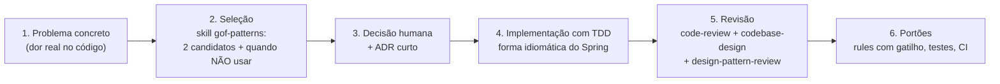

# Módulo 6 — Padrões de Projeto com IA: dos 23 padrões GoF à prática com agentes

[← Módulo 5 — Design de módulos e revisão](modulo-5-design-e-revisao.md) · [Índice do curso](README.md) · [Módulo 7 — OpenSpec →](modulo-7-openspec.md)

> **Pré-requisitos:** [Módulo 4](modulo-4-solid.md), [Módulo 5](modulo-5-design-e-revisao.md). O ambiente (oh-my-pi, `.agents/`, skills, rules e segurança) é montado no [Módulo 1](modulo-1-ambiente.md).


> Tutorial para quem está começando. Cada padrão é explicado com uma **analogia do dia a dia**, o **problema** que resolve, a **solução**, um **exemplo em Java**, **onde você já usa esse padrão** sem saber (JDK e Spring) e, principalmente, **quando não usar**.
>
> Parte I: teoria. Parte II: padrões e IA. Parte III: roteiro prático com a skill escolhida no [skills.sh](https://www.skills.sh), usando `.agents/` e o **oh-my-pi (`omp`)**.
>
> Tudo o que aparece como "saída real" foi executado em 26/09/2026 com `omp` 18.3.2 e o instalador `skills`. Números de instalação são os exibidos no skills.sh nessa data.

---

## Sumário

**Parte I — Teoria**

1. [O que é um padrão de projeto](#1-o-que-é-um-padrão-de-projeto)
2. [História: de Christopher Alexander à Gangue dos Quatro](#2-história-de-christopher-alexander-à-gangue-dos-quatro)
3. [Anatomia de um padrão](#3-anatomia-de-um-padrão)
4. [Os princípios por trás de todos os padrões](#4-os-princípios-por-trás-de-todos-os-padrões)
5. [Mapa dos 23 padrões](#5-mapa-dos-23-padrões)
6. [Padrões de criação](#6-padrões-de-criação) — Singleton, Factory Method, Abstract Factory, Builder, Prototype
7. [Padrões estruturais](#7-padrões-estruturais) — Adapter, Bridge, Composite, Decorator, Facade, Flyweight, Proxy
8. [Padrões comportamentais](#8-padrões-comportamentais) — Chain of Responsibility, Command, Interpreter, Iterator, Mediator, Memento, Observer, State, Strategy, Template Method, Visitor
9. [Padrões que se confundem](#9-padrões-que-se-confundem)
10. [Padrões em Java moderno](#10-padrões-em-java-moderno)
11. [Quando padrões atrapalham: "padronite" e antipadrões](#11-quando-padrões-atrapalham-padronite-e-antipadrões)
12. [Além do GoF](#12-além-do-gof)

**Parte II — Padrões de projeto e IA**

13. [O que muda quando uma IA escreve o código](#13-o-que-muda-quando-uma-ia-escreve-o-código)

**Parte III — Roteiro prático com `.agents` e oh-my-pi**

14. [Escolha da skill no skills.sh](#14-escolha-da-skill-no-skillssh)
15. [Instalação e verificação](#15-instalação-e-verificação)
16. [Contexto do projeto: `AGENTS.md`](#16-contexto-do-projeto-agentsmd)
17. [Rules para padrões em `.agents/rules`](#17-rules-para-padrões-em-agentsrules)
18. [Roteiro prático: quatro missões](#18-roteiro-prático-quatro-missões)
19. [Portões no CI](#19-portões-no-ci)
20. [Checklist, glossário e referências](#20-checklist-glossário-e-referências)

---

# Parte I — Teoria

## 1. O que é um padrão de projeto

**Um padrão de projeto é uma solução testada e com nome para um problema de design que se repete.**

Não é uma biblioteca nem um trecho de código para copiar. É uma **ideia de organização** que você adapta ao seu caso.

### 1.1 Analogia: receitas de cozinha

Nenhum cozinheiro reinventa o "refogado" a cada prato. Ele sabe que *refogar* resolve o problema de "dar sabor à base", sabe quando usar e quando não usar, e qualquer colega entende quando ele diz "refoga a cebola". Padrões de projeto são os "refogados" da programação:

- **Resolvem um problema conhecido** (dar sabor → desacoplar quem cria de quem usa).
- **Têm um nome** que todo mundo entende ("aqui cabe um Strategy").
- **Precisam ser adaptados** (refogado de cebola ou de alho; Strategy de frete ou de desconto).
- **Têm contraindicações** (não se refoga sobremesa; não se usa Visitor numa hierarquia que muda toda semana).

### 1.2 Por que aprender padrões

| Benefício | Explicação |
| --- | --- |
| **Vocabulário comum** | "Usa um Observer aqui" substitui dez minutos de explicação |
| **Soluções testadas** | Décadas de uso mostraram as vantagens e os problemas de cada um |
| **Ler código alheio** | Frameworks como o Spring são construídos com padrões; reconhecê-los ajuda a entender o framework |
| **Evitar armadilhas** | Cada padrão documenta suas consequências negativas |
| **Conversar com a IA** | Pedir "implemente com Strategy" é muito mais preciso do que descrever a estrutura inteira (Parte II) |

### 1.3 O que padrão NÃO é

- **Não é obrigatório.** Um bom código pode não ter nenhum padrão com nome.
- **Não é objetivo.** O objetivo é código simples e fácil de mudar; o padrão é um meio.
- **Não é código pronto.** É um molde que você adapta.

## 2. História: de Christopher Alexander à Gangue dos Quatro

- **1977 — Arquitetura.** O arquiteto Christopher Alexander publicou *A Pattern Language*, com 253 padrões para projetar cidades e casas ("Luz dos dois lados de cada cômodo"). Cada padrão descrevia um problema recorrente e o núcleo de uma solução.
- **1987 — Primeiros usos em software.** Kent Beck e Ward Cunningham aplicaram a ideia a interfaces em Smalltalk.
- **1994 — O livro.** Erich Gamma, Richard Helm, Ralph Johnson e John Vlissides publicaram *Design Patterns: Elements of Reusable Object-Oriented Software*, com **23 padrões** organizados em três categorias. Os quatro autores ficaram conhecidos como **Gang of Four (GoF)**, e os padrões do livro como "padrões GoF".
- **Depois.** Vieram catálogos de padrões de arquitetura corporativa (Martin Fowler, 2002), de integração (Hohpe e Woolf, 2003) e de sistemas distribuídos.

## 3. Anatomia de um padrão

O livro GoF descreve cada padrão sempre com as mesmas seções. A skill escolhida na Parte III segue essa mesma estrutura, então vale conhecê-la:

| Seção | Pergunta que responde |
| --- | --- |
| **Nome** | Como chamamos isso? |
| **Intenção** | Em uma frase, o que o padrão faz? |
| **Motivação** | Qual cenário concreto mostra o problema? |
| **Aplicabilidade** | Em que situações usar? |
| **Estrutura** | Quais classes e relações existem (diagrama)? |
| **Participantes** | Qual o papel de cada classe? |
| **Consequências** | Ganhos e custos |
| **Implementação** | Cuidados ao codificar |
| **Usos conhecidos** | Onde ele aparece em sistemas reais |
| **Padrões relacionados** | Com quais se combina ou se confunde |

Toda vez que for aplicar um padrão, responda pelo menos: **intenção, aplicabilidade e consequências.**

## 4. Os princípios por trás de todos os padrões

O livro GoF abre com dois princípios que explicam quase todos os 23 padrões:

### 4.1 "Programe para uma interface, não para uma implementação"

Dependa do **contrato** (o que algo faz), não da **classe concreta** (como faz).

```java
// Ruim: preso a uma implementação
ArrayList<Pedido> pedidos = new ArrayList<>();
PagamentoCartaoVisa pagamento = new PagamentoCartaoVisa();

// Bom: depende do contrato
List<Pedido> pedidos = new ArrayList<>();
FormaDePagamento pagamento = ...;   // qualquer forma que cumpra o contrato
```

Analogia: a **tomada**. O aparelho depende do formato da tomada (interface), não da usina que gera a energia (implementação).

### 4.2 "Prefira composição a herança"

Monte comportamentos **combinando objetos** (um objeto *tem* outro) em vez de **herdar** (um objeto *é* outro). Herança é rígida: é definida na compilação e expõe detalhes da classe-mãe. Composição pode ser trocada em tempo de execução.

Analogia: **LEGO** (composição) contra **escultura** (herança). No LEGO você troca uma peça; na escultura você esculpe outra estátua.

### 4.3 "Encapsule o que varia"

Identifique a parte do sistema que muda com frequência e isole-a atrás de uma interface. Quase todo padrão responde "o que varia?":

| O que varia | Padrão |
| --- | --- |
| O algoritmo | Strategy |
| O comportamento conforme o estado | State |
| A classe do objeto criado | Factory Method, Abstract Factory |
| A forma de construir um objeto complexo | Builder |
| A interface de um sistema externo | Adapter |
| Quem é avisado de uma mudança | Observer |
| Quem trata uma requisição | Chain of Responsibility |
| Os passos de um algoritmo fixo | Template Method |
| As operações sobre uma estrutura estável | Visitor |

### 4.4 Relação com SOLID

Os padrões são aplicações concretas dos princípios SOLID (vistos no [Módulo 2 — Clean Code](modulo-2-clean-code.md)):

- **Aberto/Fechado:** Strategy, Decorator, Observer, Visitor permitem acrescentar comportamento sem editar o que existe.
- **Inversão de dependência:** Factory, Abstract Factory, Adapter, Bridge fazem o código de negócio depender de abstrações.
- **Responsabilidade única:** Command, Facade, Mediator separam responsabilidades.

## 5. Mapa dos 23 padrões

| Categoria | Pergunta central | Padrões |
| --- | --- | --- |
| **Criação** (5) | Como criar objetos sem amarrar o código às classes concretas? | Singleton, Factory Method, Abstract Factory, Builder, Prototype |
| **Estruturais** (7) | Como montar classes e objetos em estruturas maiores? | Adapter, Bridge, Composite, Decorator, Facade, Flyweight, Proxy |
| **Comportamentais** (11) | Como os objetos dividem responsabilidades e se comunicam? | Chain of Responsibility, Command, Interpreter, Iterator, Mediator, Memento, Observer, State, Strategy, Template Method, Visitor |

### 5.1 Os mais usados no dia a dia (comece por eles)

Se você for estudar só alguns, comece por estes, que aparecem o tempo todo em aplicações Spring:

**Strategy, Observer, Builder, Factory Method, Adapter, Decorator, Facade, Proxy, Template Method, Chain of Responsibility.**

### 5.2 Como ler cada padrão a seguir

Cada padrão tem o mesmo roteiro: **analogia → problema → solução → exemplo Java → onde você já usa → use quando / não use quando**.

---

## 6. Padrões de criação

Tratam de **como os objetos nascem**. O problema comum: espalhar `new ClasseConcreta()` pelo código amarra tudo a classes específicas e dificulta trocar ou testar.

### 6.1 Singleton

**Intenção:** garantir que uma classe tenha **uma única instância** e oferecer um ponto global de acesso a ela.

**Analogia:** o **presidente do país**. Só existe um por vez, e todos sabem como chegar até ele ("o presidente"), sem criar outro.

**Problema:** algumas coisas devem existir uma vez só: a configuração da aplicação, um pool de conexões, um cache compartilhado.

**Solução clássica:** construtor privado + campo estático + método de acesso.

```java
public final class Configuracao {
    private static final Configuracao INSTANCIA = new Configuracao();

    private Configuracao() { }                 // ninguém mais pode dar new

    public static Configuracao getInstancia() {
        return INSTANCIA;
    }
}
```

Em Java, a forma mais segura (inclusive contra serialização e reflexão) é um `enum` de um elemento: `public enum Configuracao { INSTANCIA; }`.

**Onde você já usa:** `Runtime.getRuntime()` no JDK. No Spring, **todo bean é único por padrão** (escopo `singleton`), mas quem garante isso é o **contêiner**, não a classe.

**Use quando:** precisa de exatamente uma instância e o contêiner de injeção de dependência não resolve.

**Não use quando:**

- Você está no Spring: basta `@Component`/`@Service`. Singleton feito à mão ignora a injeção de dependência.
- Só quer uma "variável global" por conveniência: Singleton **é** estado global disfarçado.
- Precisa testar: substituir um Singleton por um dublê de teste é difícil.

> Singleton é o padrão **mais criticado** do catálogo e o mais usado de forma errada. Na Parte III há uma *rule* que barra o Singleton feito à mão em projetos Spring.

### 6.2 Factory Method

**Intenção:** definir uma interface para criar um objeto, mas deixar as **subclasses decidirem qual classe instanciar**.

**Analogia:** uma **franquia de pizzaria**. A matriz define o processo (receber pedido, assar, entregar), mas cada franquia decide *qual* pizza faz: a de São Paulo faz a de calabresa do seu jeito; a de Nápoles, do jeito dela.

**Problema:** um código genérico precisa criar objetos, mas não pode saber de antemão qual classe concreta usar.

**Solução:** um método "fábrica" abstrato (ou sobrescrevível) que as subclasses implementam.

```java
abstract class GeradorDeRelatorio {
    // o "esqueleto" usa o produto sem saber qual é
    public byte[] gerar(List<Venda> vendas) {
        Exportador exportador = criarExportador();   // Factory Method
        return exportador.exportar(vendas);
    }
    protected abstract Exportador criarExportador();
}

class GeradorPdf extends GeradorDeRelatorio {
    protected Exportador criarExportador() { return new ExportadorPdf(); }
}

class GeradorCsv extends GeradorDeRelatorio {
    protected Exportador criarExportador() { return new ExportadorCsv(); }
}
```

**Onde você já usa:** `Collection.iterator()`: cada coleção (`ArrayList`, `HashSet`) cria o seu próprio tipo de iterador. No Spring, métodos anotados com `@Bean` são fábricas de objetos.

**Não confunda:** um **método estático de fábrica** como `List.of(...)` ou `LocalDate.of(...)` é uma boa prática (Effective Java, item 1), mas não é o Factory Method do GoF, que depende de subclasses decidirem.

**Use quando:** a classe não sabe antecipadamente o tipo exato dos objetos que precisa criar; ou quer permitir que extensões escolham o tipo.

**Não use quando:** só existe um tipo de produto; um `new` direto é mais claro.

### 6.3 Abstract Factory

**Intenção:** criar **famílias de objetos relacionados** sem especificar suas classes concretas.

**Analogia:** uma **loja de móveis com coleções**. Você escolhe a coleção "Rústica" e recebe cadeira, mesa e sofá rústicos, que combinam entre si. Não dá para vir uma cadeira rústica com um sofá moderno.

**Problema:** o sistema precisa criar vários objetos que devem ser **compatíveis entre si** (mesma família).

**Solução:** uma interface de fábrica com um método de criação por tipo de produto; uma implementação por família.

```java
interface FabricaDePagamento {           // uma família = um provedor
    Autorizador criarAutorizador();
    Estornador criarEstornador();
    Conciliador criarConciliador();
}

class FabricaStripe implements FabricaDePagamento { /* cria os três do Stripe */ }
class FabricaPagSeguro implements FabricaDePagamento { /* cria os três do PagSeguro */ }

// o código de negócio só conhece a fábrica abstrata
class ServicoDePagamento {
    private final Autorizador autorizador;
    private final Estornador estornador;
    ServicoDePagamento(FabricaDePagamento fabrica) {
        this.autorizador = fabrica.criarAutorizador();
        this.estornador = fabrica.criarEstornador();
    }
}
```

**Onde você já usa:** `javax.xml.parsers.DocumentBuilderFactory` escolhe uma implementação de parser XML, e os objetos criados funcionam juntos.

**Use quando:** existem famílias de produtos que precisam ser usadas juntas, e você quer trocar a família inteira de uma vez.

**Não use quando:** há um produto só (use Factory Method ou nada), ou as famílias mudam com frequência: acrescentar um **novo tipo de produto** obriga a mudar todas as fábricas.

### 6.4 Builder

**Intenção:** separar a **construção** de um objeto complexo da sua representação, permitindo montá-lo **passo a passo**.

**Analogia:** montar um **sanduíche no balcão**. Você escolhe o pão, depois a proteína, depois os molhos, e no fim recebe o sanduíche pronto. Ninguém espera você dizer os 12 ingredientes numa frase só.

**Problema:** objetos com muitos campos, vários opcionais. O construtor fica com 10 parâmetros (o "construtor telescópico") e ninguém sabe qual `null` é qual.

```java
// Ruim: o que é cada true, null e 0?
new Pedido(cliente, itens, null, true, false, 0, "BRL", null, endereco);
```

**Solução:** um objeto construtor com métodos nomeados e um `build()` final que valida e entrega o objeto pronto (de preferência imutável).

```java
Pedido pedido = Pedido.builder()
        .cliente(cliente)
        .itens(itens)
        .entregaExpressa()
        .moeda("BRL")
        .enderecoDeEntrega(endereco)
        .build();                      // valida os obrigatórios aqui

public final class Pedido {
    private final Cliente cliente;
    private final List<Item> itens;
    private final boolean expressa;
    private final String moeda;
    private final Endereco enderecoDeEntrega;

    private Pedido(Builder b) {
        this.cliente = b.cliente; this.itens = List.copyOf(b.itens); this.expressa = b.expressa;
        this.moeda = b.moeda; this.enderecoDeEntrega = b.enderecoDeEntrega;
    }

    public static Builder builder() { return new Builder(); }

    public static final class Builder {
        private Cliente cliente;
        private List<Item> itens = new ArrayList<>();
        private boolean expressa;
        private String moeda = "BRL";
        private Endereco enderecoDeEntrega;
        public Builder cliente(Cliente c) { this.cliente = c; return this; }
        public Builder itens(List<Item> i) { this.itens = i; return this; }
        public Builder entregaExpressa() { this.expressa = true; return this; }
        public Builder moeda(String m) { this.moeda = m; return this; }
        public Builder enderecoDeEntrega(Endereco e) { this.enderecoDeEntrega = e; return this; }
        public Pedido build() {
            if (cliente == null || itens.isEmpty()) throw new IllegalStateException("cliente e itens são obrigatórios");
            return new Pedido(this);
        }
    }
}
```

**Onde você já usa:** `StringBuilder`, `HttpRequest.newBuilder()` (Java 11+), `ResponseEntity.status(...).body(...)` e `UriComponentsBuilder` no Spring, `@Builder` do Lombok.

**Use quando:** muitos parâmetros opcionais; objeto imutável montado em etapas; validação só faz sentido no fim.

**Não use quando:** o objeto tem 2 ou 3 campos obrigatórios. Um construtor ou um `record` basta.

### 6.5 Prototype

**Intenção:** criar novos objetos **copiando** um objeto existente (o protótipo).

**Analogia:** a **fotocopiadora**. Em vez de redigitar um formulário preenchido, você tira uma cópia e muda só o que precisa.

**Problema:** criar o objeto do zero é caro (consulta ao banco, cálculo pesado) ou complicado, e você precisa de vários objetos quase iguais.

**Solução:** o próprio objeto sabe se copiar.

```java
public record ModeloDeContrato(String titulo, List<String> clausulas, BigDecimal multa) {
    public ModeloDeContrato comMulta(BigDecimal novaMulta) {
        return new ModeloDeContrato(titulo, List.copyOf(clausulas), novaMulta);  // cópia com uma mudança
    }
}

ModeloDeContrato padrao = carregarModeloPadrao();          // caro: vem do banco
ModeloDeContrato premium = padrao.comMulta(new BigDecimal("0.02"));
```

**Cuidado central:** **cópia rasa** (copia as referências: as duas cópias compartilham a mesma lista) versus **cópia profunda** (copia também os objetos internos). A maioria dos bugs de Prototype é uma cópia rasa onde se queria uma profunda.

**Onde você já usa:** `Object.clone()` (que tem armadilhas; prefira construtores de cópia ou métodos `with...`). O escopo `prototype` do Spring, apesar do nome, significa "um bean novo a cada pedido", não clonagem.

**Use quando:** criar é caro e há um objeto modelo; ou as variações são configurações de um mesmo objeto base.

**Não use quando:** criar é barato; `new` com os parâmetros certos é mais claro.

---

## 7. Padrões estruturais

Tratam de **como encaixar** classes e objetos para formar estruturas maiores, mantendo-as flexíveis.

### 7.1 Adapter

**Intenção:** converter a interface de uma classe em **outra interface que o cliente espera**.

**Analogia:** o **adaptador de tomada** que você leva em viagem. O carregador tem pino de um formato, a parede tem outro; o adaptador faz os dois conversarem sem mudar nem o carregador nem a parede.

**Problema:** você quer usar uma classe pronta (biblioteca, sistema legado, API externa), mas a interface dela não bate com a que o seu código usa.

**Solução:** uma classe intermediária que implementa a interface esperada e, por dentro, chama a classe incompatível.

```java
// interface que o nosso sistema usa
interface CalculadoraDeFrete {
    BigDecimal calcular(Cep origem, Cep destino, Peso peso);
}

// biblioteca externa com outra "tomada"
class CorreiosClient {
    public double consultarPreco(String cepO, String cepD, int gramas, String servico) { ... }
}

// o adaptador
class CorreiosAdapter implements CalculadoraDeFrete {
    private final CorreiosClient client;
    CorreiosAdapter(CorreiosClient client) { this.client = client; }

    @Override
    public BigDecimal calcular(Cep origem, Cep destino, Peso peso) {
        double valor = client.consultarPreco(origem.valor(), destino.valor(), peso.emGramas(), "PAC");
        return BigDecimal.valueOf(valor);
    }
}
```

**Onde você já usa:** `InputStreamReader` adapta um fluxo de bytes (`InputStream`) para um leitor de caracteres (`Reader`); `Arrays.asList` adapta um array para `List`. No Spring MVC, os `HandlerAdapter` deixam o `DispatcherServlet` chamar tipos diferentes de controladores do mesmo jeito.

**Use quando:** integrar código que você não pode (ou não deve) alterar; isolar o sistema de uma API externa, para poder trocá-la depois.

**Não use quando:** você controla as duas pontas: ajuste a interface diretamente.

### 7.2 Bridge

**Intenção:** separar uma **abstração** da sua **implementação**, para que as duas possam variar de forma independente.

**Analogia:** **controle remoto e aparelho**. Existem vários controles (simples, avançado, por voz) e vários aparelhos (TV, som, projetor). Sem a "ponte", você precisaria de uma classe para cada combinação (ControleSimplesTV, ControleVozProjetor...). Com ela, qualquer controle funciona com qualquer aparelho.

**Problema:** duas dimensões de variação combinadas por herança causam **explosão de classes** (3 × 3 = 9 classes, 4 × 4 = 16...).

**Solução:** a abstração **tem** uma referência para a implementação (composição), em vez de herdar dela.

```java
// dimensão 1: o canal de envio (implementação)
interface CanalDeEnvio { void enviar(String destino, String texto); }
class Email implements CanalDeEnvio { ... }
class Sms implements CanalDeEnvio { ... }
class WhatsApp implements CanalDeEnvio { ... }

// dimensão 2: o tipo de notificação (abstração)
abstract class Notificacao {
    protected final CanalDeEnvio canal;                 // a "ponte"
    Notificacao(CanalDeEnvio canal) { this.canal = canal; }
    abstract void notificar(Cliente cliente);
}
class AvisoDeEntrega extends Notificacao { ... }
class LembreteDePagamento extends Notificacao { ... }

new LembreteDePagamento(new WhatsApp()).notificar(cliente);   // qualquer combinação
```

**Onde você já usa:** **JDBC**. A API (`Connection`, `Statement`) é a abstração; cada driver (PostgreSQL, MySQL) é uma implementação. O mesmo código roda com qualquer banco.

**Use quando:** existem duas dimensões que variam de forma independente.

**Não use quando:** há uma única dimensão de variação: isso é um caso para Strategy ou simples polimorfismo.

### 7.3 Composite

**Intenção:** compor objetos em **estruturas de árvore** e tratar objetos individuais e grupos **da mesma forma**.

**Analogia:** **pastas e arquivos** no computador. Você pode perguntar "qual o tamanho?" tanto a um arquivo quanto a uma pasta; a pasta responde somando o tamanho do que tem dentro, inclusive outras pastas.

**Problema:** o código cliente fica cheio de `if (é grupo) { percorre } else { trata item }`.

**Solução:** uma interface comum para "folha" e "grupo"; o grupo guarda filhos do mesmo tipo e repassa a operação.

```java
interface ItemDeCardapio { BigDecimal preco(); }

record Produto(String nome, BigDecimal preco) implements ItemDeCardapio { }

record Combo(String nome, List<ItemDeCardapio> itens, BigDecimal desconto) implements ItemDeCardapio {
    public BigDecimal preco() {
        BigDecimal soma = itens.stream().map(ItemDeCardapio::preco).reduce(BigDecimal.ZERO, BigDecimal::add);
        return soma.subtract(desconto);
    }
}

// um combo pode conter produtos e outros combos; o cliente só chama preco()
ItemDeCardapio familia = new Combo("Família", List.of(lanche, lanche, new Combo("Kids", List.of(suco, brinde), BigDecimal.ZERO)), BigDecimal.TEN);
```

**Onde você já usa:** componentes de interface gráfica (um `Container` do AWT/Swing contém outros componentes, inclusive outros containers); menus com submenus; organogramas.

**Use quando:** os dados formam uma hierarquia parte-todo e o cliente deve tratar os dois igualmente.

**Não use quando:** a estrutura não é uma árvore, ou folhas e grupos têm operações muito diferentes.

### 7.4 Decorator

**Intenção:** acrescentar responsabilidades a um objeto **dinamicamente**, "embrulhando-o" em outro objeto com a mesma interface.

**Analogia:** **café com adicionais**. Um expresso; embrulhe com leite; embrulhe com chantilly; embrulhe com canela. Cada camada acrescenta algo ao preço e à descrição, e o resultado continua sendo "um café".

**Problema:** combinar funcionalidades opcionais por herança gera explosão de subclasses (CafeComLeite, CafeComLeiteEChantilly...).

**Solução:** cada decorador implementa a mesma interface e **contém** o objeto decorado, acrescentando comportamento antes ou depois de repassar a chamada.

```java
interface Notificador { void enviar(String mensagem); }

class NotificadorEmail implements Notificador {
    public void enviar(String mensagem) { /* envia e-mail */ }
}

class ComRegistroDeLog implements Notificador {          // decorador
    private final Notificador interno;
    ComRegistroDeLog(Notificador interno) { this.interno = interno; }
    public void enviar(String mensagem) {
        log.info("Enviando: {}", mensagem);
        interno.enviar(mensagem);
    }
}

class ComNovaTentativa implements Notificador {          // outro decorador
    private final Notificador interno;
    ComNovaTentativa(Notificador interno) { this.interno = interno; }
    public void enviar(String mensagem) {
        try { interno.enviar(mensagem); }
        catch (FalhaDeEnvio e) { interno.enviar(mensagem); }  // tenta de novo uma vez
    }
}

Notificador n = new ComRegistroDeLog(new ComNovaTentativa(new NotificadorEmail()));
```

**Onde você já usa:** `java.io`: `new BufferedReader(new InputStreamReader(new FileInputStream(arquivo)))`, em que cada camada acrescenta algo (buffer, conversão). Também `Collections.unmodifiableList(lista)`.

**Use quando:** precisa combinar comportamentos opcionais em qualquer ordem; acrescentar preocupações transversais (log, cache, nova tentativa) sem tocar na classe original.

**Não use quando:** muitas camadas deixam a depuração confusa ("quem embrulhou quem?"). No Spring, preocupações transversais em muitas classes costumam ficar melhores com **AOP** (que usa Proxy).

### 7.5 Facade

**Intenção:** oferecer uma **interface simples** para um subsistema complexo.

**Analogia:** a **recepção de um hotel**. Você pede "quero um táxi amanhã às 6h e café no quarto". A recepção fala com a portaria, a cozinha e a cooperativa de táxi. Você não precisa conhecer nenhum desses setores.

**Problema:** para fazer uma tarefa, o cliente precisa conhecer e coordenar muitas classes de um subsistema.

**Solução:** uma classe de fachada com métodos de alto nível que orquestram o subsistema.

```java
@Service
class CheckoutFacade {
    private final Estoque estoque;
    private final Pagamentos pagamentos;
    private final NotasFiscais notas;
    private final Expedicao expedicao;

    // construtor com as quatro dependências...

    public Confirmacao finalizarCompra(Carrinho carrinho, DadosPagamento dados) {
        estoque.reservar(carrinho.itens());
        Recibo recibo = pagamentos.cobrar(carrinho.total(), dados);
        NotaFiscal nota = notas.emitir(carrinho, recibo);
        expedicao.agendar(carrinho, nota);
        return new Confirmacao(recibo, nota);
    }
}
```

**Onde você já usa:** **SLF4J** (*Simple Logging **Facade** for Java*): uma interface simples na frente de Logback, Log4j e outros. Os *services* de uma aplicação Spring frequentemente funcionam como fachadas sobre repositórios e clientes externos.

**Use quando:** quer um ponto de entrada simples para um subsistema; quer reduzir o acoplamento do cliente com os detalhes.

**Não use quando:** a fachada começa a acumular regra de negócio e vira uma "classe-deus". Ela deve **coordenar**, não **decidir tudo**.

### 7.6 Flyweight

**Intenção:** **compartilhar** objetos para economizar memória quando há um número enorme de objetos parecidos.

**Analogia:** as **letras de uma gráfica antiga**. Para imprimir um livro, não se funde um tipo de metal novo para cada letra "a" da página: usa-se o mesmo molde da letra "a" várias vezes, mudando só a posição.

**Problema:** milhões de objetos com grande parte dos dados iguais estouram a memória.

**Solução:** separar o **estado intrínseco** (compartilhável, imutável, por exemplo a fonte e o formato da letra) do **estado extrínseco** (específico de cada uso, por exemplo a posição na página). Os objetos compartilhados ficam num cache/fábrica.

```java
record TipoDeArvore(String especie, String cor, byte[] textura) { }   // intrínseco (pesado, compartilhado)

class FabricaDeTipos {
    private static final Map<String, TipoDeArvore> CACHE = new ConcurrentHashMap<>();
    static TipoDeArvore obter(String especie, String cor) {
        return CACHE.computeIfAbsent(especie + cor, k -> new TipoDeArvore(especie, cor, carregarTextura(especie)));
    }
}

record Arvore(int x, int y, TipoDeArvore tipo) { }   // extrínseco (posição) + referência compartilhada
// 1 milhão de árvores, mas só algumas dezenas de TipoDeArvore na memória
```

**Onde você já usa:** `Integer.valueOf(n)` devolve objetos em cache para valores de -128 a 127; o *pool* de `String` literais da JVM.

**Use quando:** a quantidade de objetos causa problema de memória **medido**, e a maior parte do estado é compartilhável.

**Não use quando:** não há problema de memória comprovado. É otimização, e otimização sem medição só aumenta a complexidade.

### 7.7 Proxy

**Intenção:** fornecer um **substituto** que controla o acesso a outro objeto.

**Analogia:** o **segurança na porta** da festa. Você fala com ele como se fosse a entrada; ele verifica o convite (controle de acesso), anota quem entrou (registro) e só então libera.

**Problema:** você quer controlar o acesso a um objeto (permissão, carregamento sob demanda, cache, chamada remota) sem mudar o objeto nem quem o usa.

**Solução:** uma classe com a mesma interface do objeto real, que guarda uma referência a ele e intercepta as chamadas.

| Tipo de Proxy | Faz o quê |
| --- | --- |
| Virtual | Adia a criação de um objeto caro até ele ser usado (*lazy loading*) |
| De proteção | Verifica permissões antes de repassar |
| De cache | Guarda resultados e evita repetir chamadas caras |
| Remoto | Representa localmente um objeto em outra máquina |

```java
class RelatorioComCache implements ServicoDeRelatorio {
    private final ServicoDeRelatorio real;
    private final Map<Periodo, Relatorio> cache = new ConcurrentHashMap<>();
    RelatorioComCache(ServicoDeRelatorio real) { this.real = real; }

    public Relatorio gerar(Periodo periodo) {
        return cache.computeIfAbsent(periodo, real::gerar);
    }
}
```

**Onde você já usa (e muito):** no Spring, `@Transactional`, `@Cacheable`, `@Async` e `@PreAuthorize` funcionam porque o Spring **coloca um proxy na frente do seu bean**. O proxy abre a transação, verifica o cache ou a permissão e só então chama o seu método. No JPA/Hibernate, relacionamentos `LAZY` são proxies que só consultam o banco quando você acessa o dado.

> Consequência prática que confunde iniciantes: se um método do bean chama **outro método do mesmo bean** anotado com `@Transactional`, a chamada não passa pelo proxy e a anotação não tem efeito.

**Use quando:** controle de acesso, carregamento tardio, cache, registro ou chamada remota transparente.

**Não use quando:** o controle pode ficar explícito e simples no próprio código; proxies escondem comportamento, o que dificulta a depuração.

---

## 8. Padrões comportamentais

Tratam de **quem faz o quê** e **como os objetos conversam**. São os mais numerosos (11) e, na prática, os mais usados.

### 8.1 Chain of Responsibility (Cadeia de Responsabilidade)

**Intenção:** passar uma requisição por uma **cadeia de tratadores**; cada um decide se trata, se repassa ou as duas coisas.

**Analogia:** o **atendimento de suporte**. O atendente do nível 1 tenta resolver; se não consegue, passa ao nível 2; depois ao especialista. Você não precisa saber quem vai resolver.

**Problema:** várias verificações ou etapas aplicadas em sequência, e você quer acrescentar, remover ou reordenar etapas sem mexer nas outras.

**Solução:** cada tratador conhece o próximo (ou a cadeia é uma lista percorrida em ordem).

```java
interface ValidacaoDePedido { void validar(Pedido pedido); }   // lança exceção se reprovar

@Component @Order(1) class TemItens implements ValidacaoDePedido { ... }
@Component @Order(2) class EstoqueDisponivel implements ValidacaoDePedido { ... }
@Component @Order(3) class LimiteDeCredito implements ValidacaoDePedido { ... }

@Service
class ValidadorDePedido {
    private final List<ValidacaoDePedido> cadeia;          // o Spring injeta todas, na ordem de @Order
    ValidadorDePedido(List<ValidacaoDePedido> cadeia) { this.cadeia = cadeia; }
    void validar(Pedido pedido) { cadeia.forEach(v -> v.validar(pedido)); }
}
```

Nova regra = nova classe; nenhuma existente é editada (Aberto/Fechado).

**Onde você já usa:** os **filtros de Servlet** (`FilterChain`) e a **cadeia de filtros do Spring Security**: cada filtro trata autenticação, CORS, CSRF... e chama o próximo. Os *interceptors* do Spring MVC também.

**Use quando:** várias etapas independentes processam a mesma requisição; a ordem ou o conjunto de etapas muda.

**Não use quando:** há duas ou três verificações fixas; uma função com três chamadas é mais clara. Cuidado também com requisições que "caem" no fim da cadeia sem ninguém tratar.

### 8.2 Command

**Intenção:** transformar uma **requisição em um objeto**, permitindo guardá-la, enfileirá-la, registrá-la e desfazê-la.

**Analogia:** a **comanda do garçom**. O pedido do cliente vira um papel. O papel pode esperar na fila da cozinha, ser priorizado, cancelado, e fica como registro do que foi pedido.

**Problema:** você precisa de desfazer/refazer, fila de tarefas, agendamento ou histórico de operações.

**Solução:** cada ação vira uma classe com `executar()` (e, se quiser, `desfazer()`).

```java
interface Comando { void executar(); void desfazer(); }

record AplicarDesconto(Carrinho carrinho, BigDecimal percentual) implements Comando {
    public void executar() { carrinho.aplicarDesconto(percentual); }
    public void desfazer() { carrinho.removerDesconto(percentual); }
}

class Historico {
    private final Deque<Comando> feitos = new ArrayDeque<>();
    void executar(Comando c) { c.executar(); feitos.push(c); }
    void desfazerUltimo() { if (!feitos.isEmpty()) feitos.pop().desfazer(); }
}
```

**Onde você já usa:** `Runnable` e `Callable` enviados a um `ExecutorService` são comandos; as ações de menu com "Desfazer" de qualquer editor.

**Use quando:** desfazer/refazer, filas, agendamento, registro de operações, transações compostas.

**Não use quando:** a ação é executada uma vez, imediatamente, sem histórico. Em Java moderno, uma **lambda** (`Runnable r = () -> ...`) já é um comando simples; só crie classes se precisar de `desfazer` ou de dados.

### 8.3 Interpreter

**Intenção:** definir a **gramática de uma pequena linguagem** e um interpretador que avalia frases dessa linguagem.

**Analogia:** uma **partitura musical**. Existe uma gramática (notas, pausas, compassos), e o músico "interpreta" cada símbolo para produzir o som.

**Problema:** usuários precisam escrever regras ou expressões ("frete grátis se valor > 300 e região = Sul") que o sistema avalia.

**Solução:** uma classe por regra da gramática; frases viram uma árvore de objetos que se avaliam recursivamente.

```java
interface Regra { boolean avaliar(Pedido p); }

record ValorMaiorQue(BigDecimal limite) implements Regra {
    public boolean avaliar(Pedido p) { return p.total().compareTo(limite) > 0; }
}
record RegiaoIgual(String regiao) implements Regra {
    public boolean avaliar(Pedido p) { return p.regiao().equals(regiao); }
}
record E(Regra esquerda, Regra direita) implements Regra {
    public boolean avaliar(Pedido p) { return esquerda.avaliar(p) && direita.avaliar(p); }
}

Regra freteGratis = new E(new ValorMaiorQue(new BigDecimal("300")), new RegiaoIgual("Sul"));
```

**Onde você já usa:** expressões regulares (`java.util.regex.Pattern`), a **SpEL** do Spring (`@Value("#{...}")`, `@PreAuthorize("hasRole('ADMIN')")`), SQL.

**Use quando:** a linguagem é **pequena e simples** e muda com frequência.

**Não use quando:** a gramática é grande: use um gerador de parser (ANTLR) ou uma linguagem de expressão pronta (SpEL). É o padrão **menos usado** do catálogo.

### 8.4 Iterator

**Intenção:** percorrer os elementos de uma coleção **sem expor sua estrutura interna**.

**Analogia:** o **controle remoto com "próximo canal"**. Você passa canal por canal sem saber como a TV organiza a lista internamente.

**Problema:** o cliente precisa percorrer uma coleção, mas não deve depender de ela ser array, lista encadeada, árvore ou página vinda do banco.

**Solução:** um objeto iterador com `hasNext()` e `next()`.

```java
for (Pedido p : pedidos) { ... }   // o for-each usa um Iterator por baixo dos panos
```

Implementação própria, por exemplo para percorrer páginas de uma API sem carregar tudo na memória:

```java
class PaginasDePedidos implements Iterable<Pedido> {
    public Iterator<Pedido> iterator() {
        return new Iterator<>() {
            private int pagina = 0;
            private Iterator<Pedido> atual = buscarPagina(0);
            public boolean hasNext() {
                if (atual.hasNext()) return true;
                atual = buscarPagina(++pagina);
                return atual.hasNext();
            }
            public Pedido next() {
                if (!hasNext()) throw new NoSuchElementException();
                return atual.next();
            }
        };
    }
}
```

**Onde você já usa:** `java.util.Iterator`, o for-each, os `Stream`s, e o `Page`/`Slice` do Spring Data.

**Use quando:** precisa percorrer uma estrutura própria ou dados paginados de forma uniforme.

**Não use quando:** uma coleção padrão do Java já resolve. Raramente você implementa um Iterator do zero; é um padrão que a linguagem já absorveu.

### 8.5 Mediator

**Intenção:** **centralizar a comunicação** entre vários objetos, para que eles não se refiram diretamente uns aos outros.

**Analogia:** a **torre de controle** do aeroporto. Os aviões não conversam entre si para decidir quem pousa; todos falam com a torre, que coordena.

**Problema:** muitos objetos que se chamam mutuamente criam uma "teia" de dependências: mudar um obriga a mexer em vários.

**Solução:** um objeto mediador conhece todos e coordena as interações; os participantes só conhecem o mediador.

```java
// formulário: ao mudar o país, os campos estado e CEP precisam reagir
class FormularioDeEndereco {                    // mediador
    private final CampoPais pais; private final CampoEstado estado; private final CampoCep cep;

    void aoMudar(Campo origem) {
        if (origem == pais) {
            estado.carregarOpcoes(pais.valor());
            cep.definirMascara(pais.formatoDeCep());
        }
    }
}
// cada campo só avisa o mediador: formulario.aoMudar(this)
```

**Onde você já usa:** o `DispatcherServlet` do Spring MVC funciona como coordenador central entre mapeamentos, controladores, conversores e resolvedores de visão, que não se conhecem entre si. Salas de chat, telas com muitos campos interdependentes.

**Use quando:** muitos objetos interagem de forma complexa e você quer um único lugar para essas regras.

**Não use quando:** o mediador cresce até virar uma **classe-deus** que sabe de tudo. Se isso acontecer, divida-o.

### 8.6 Memento

**Intenção:** **capturar e guardar o estado** de um objeto para restaurá-lo depois, **sem violar o encapsulamento**.

**Analogia:** o **"salvar jogo"** do videogame. Você salva antes do chefão; se perder, volta àquele ponto. O arquivo de salvamento guarda tudo, mas você não precisa (nem pode) editar os detalhes internos dele.

**Problema:** precisa de desfazer, rascunhos ou pontos de restauração, mas expor todos os campos privados do objeto quebraria o encapsulamento.

**Solução:** o próprio objeto (originador) cria um "retrato" opaco de si mesmo e sabe se restaurar a partir dele; um zelador guarda os retratos.

```java
class Documento {
    private String texto; private int cursor;

    public Memento salvar() { return new Memento(texto, cursor); }
    public void restaurar(Memento m) { this.texto = m.texto(); this.cursor = m.cursor(); }

    public record Memento(String texto, int cursor) { }   // imutável
}

Deque<Documento.Memento> historico = new ArrayDeque<>();
historico.push(doc.salvar());
doc.editar(...);
doc.restaurar(historico.pop());                          // desfazer
```

**Onde você já usa:** "desfazer" em editores; rascunhos salvos automaticamente; pontos de restauração.

**Use quando:** desfazer baseado em estado; salvar e restaurar pontos no tempo.

**Não use quando:** o estado é enorme e muda muito (cada retrato ocupa memória); nesse caso, guarde as **operações** (Command) em vez do estado.

### 8.7 Observer

**Intenção:** quando um objeto muda, **todos os interessados são avisados automaticamente**.

**Analogia:** **inscrever-se num canal de vídeos**. Você se inscreve uma vez; a cada vídeo novo, é notificado. O canal não sabe nem precisa saber quem você é ou o que fará com a notificação.

**Problema:** quando algo acontece (pedido finalizado), várias partes precisam reagir (enviar e-mail, baixar estoque, emitir nota, atualizar métricas). Se o serviço de pedidos chamar todas diretamente, ele fica acoplado a todas.

**Solução:** o sujeito publica um evento; os observadores se registram e reagem. O publicador não conhece os observadores.

```java
public record PedidoFinalizado(Long pedidoId, BigDecimal total) { }      // o evento

@Service
class ServicoDePedido {
    private final ApplicationEventPublisher eventos;
    // ...
    public void finalizar(Pedido pedido) {
        pedido.finalizar();
        eventos.publishEvent(new PedidoFinalizado(pedido.id(), pedido.total()));   // publica e segue
    }
}

@Component
class EnviarEmailDeConfirmacao {
    @EventListener
    void aoFinalizar(PedidoFinalizado evento) { ... }
}

@Component
class BaixarEstoque {
    @EventListener
    void aoFinalizar(PedidoFinalizado evento) { ... }
}
// novo interessado = nova classe com @EventListener; ServicoDePedido não muda
```

**Onde você já usa:** eventos do Spring (`ApplicationEventPublisher`, `@EventListener`, `@TransactionalEventListener`), `PropertyChangeListener` do Java Beans, eventos de clique em interfaces gráficas, sistemas de mensageria (Kafka, RabbitMQ) em escala maior. A antiga classe `java.util.Observer` está **obsoleta** desde o Java 9: não a use.

**Use quando:** uma mudança deve disparar reações variadas que não são responsabilidade de quem mudou.

**Não use quando:** a ordem das reações importa muito ou o fluxo precisa ser fácil de seguir: com muitos observadores, fica difícil saber "o que acontece quando finalizo um pedido?". Cuidado também com observadores que falham silenciosamente.

### 8.8 State

**Intenção:** permitir que um objeto **mude de comportamento quando seu estado interno muda**, como se mudasse de classe.

**Analogia:** um **semáforo**. O mesmo aparelho se comporta de forma diferente conforme o estado: no verde, "pode passar"; no amarelo, "atenção"; no vermelho, "pare". E cada estado sabe qual é o próximo.

**Problema:** métodos cheios de `switch (status)` que se repetem em vários lugares, e transições inválidas (cancelar um pedido já entregue) espalhadas em `if`s.

**Solução:** uma classe por estado, cada uma implementando as ações permitidas naquele estado e as transições.

```java
sealed interface EstadoDoPedido permits Aberto, Pago, Enviado, Entregue, Cancelado {
    default EstadoDoPedido pagar()    { throw new TransicaoInvalida(this, "pagar"); }
    default EstadoDoPedido enviar()   { throw new TransicaoInvalida(this, "enviar"); }
    default EstadoDoPedido entregar() { throw new TransicaoInvalida(this, "entregar"); }
    default EstadoDoPedido cancelar() { throw new TransicaoInvalida(this, "cancelar"); }
}
record Aberto() implements EstadoDoPedido {
    public EstadoDoPedido pagar()    { return new Pago(); }
    public EstadoDoPedido cancelar() { return new Cancelado(); }
}
record Pago() implements EstadoDoPedido {
    public EstadoDoPedido enviar()   { return new Enviado(); }
    public EstadoDoPedido cancelar() { return new Cancelado(); }   // com estorno
}
record Enviado() implements EstadoDoPedido {
    public EstadoDoPedido entregar() { return new Entregue(); }
}
record Entregue() implements EstadoDoPedido { }
record Cancelado() implements EstadoDoPedido { }

class Pedido {
    private EstadoDoPedido estado = new Aberto();
    void pagar()    { estado = estado.pagar(); }
    void cancelar() { estado = estado.cancelar(); }   // "Entregue" lança TransicaoInvalida sozinho
}
```

**Onde você já usa:** máquinas de estado de pedidos, documentos (rascunho → em revisão → publicado), conexões de rede. Existe o projeto Spring Statemachine para casos complexos.

**Use quando:** o comportamento depende do estado, há muitas transições e regras do tipo "só pode X se estiver em Y".

**Não use quando:** há dois ou três estados com pouca lógica; um `enum` com um `switch` é suficiente.

### 8.9 Strategy

**Intenção:** definir uma **família de algoritmos intercambiáveis**, encapsular cada um e deixar o cliente escolher qual usar.

**Analogia:** o **aplicativo de mapas**. O destino é o mesmo, mas você escolhe a estratégia: de carro, a pé, de ônibus, de bicicleta. O app não muda; muda o algoritmo de rota.

**Problema:** um `if/else` ou `switch` que escolhe entre várias formas de calcular algo e cresce a cada regra nova.

**Solução:** uma interface para o algoritmo; uma implementação por variante; o contexto recebe a estratégia pronta.

```java
public interface CalculoDeFrete {
    TipoEntrega tipo();
    BigDecimal calcular(Pedido pedido);
}

@Component class FretePac implements CalculoDeFrete { ... }
@Component class FreteSedex implements CalculoDeFrete { ... }
@Component class RetiradaNaLoja implements CalculoDeFrete {
    public TipoEntrega tipo() { return TipoEntrega.RETIRADA; }
    public BigDecimal calcular(Pedido p) { return BigDecimal.ZERO; }
}

@Service
class ServicoDeFrete {
    private final Map<TipoEntrega, CalculoDeFrete> estrategias;

    ServicoDeFrete(List<CalculoDeFrete> todas) {                       // o Spring injeta todas as implementações
        this.estrategias = todas.stream().collect(Collectors.toMap(CalculoDeFrete::tipo, e -> e));
    }

    BigDecimal calcular(Pedido pedido, TipoEntrega tipo) {
        return Optional.ofNullable(estrategias.get(tipo))
                .orElseThrow(() -> new TipoDeEntregaNaoSuportado(tipo))
                .calcular(pedido);
    }
}
// nova modalidade = nova classe @Component; nenhum if novo
```

**Onde você já usa:** `Comparator` em `lista.sort(comparador)`; o `PasswordEncoder` do Spring Security (BCrypt, Argon2...); `ResourceLoader`, `CacheManager` e inúmeras interfaces do Spring com várias implementações.

**Use quando:** existem várias formas de fazer a mesma coisa e a escolha acontece em tempo de execução ou por configuração.

**Não use quando:** há só duas variantes que raramente mudam. E em Java moderno, uma estratégia simples pode ser só uma **lambda** (`Comparator.comparing(Pedido::total)`), sem classe.

### 8.10 Template Method

**Intenção:** definir o **esqueleto de um algoritmo** numa superclasse e deixar as subclasses implementarem **alguns passos**, sem mudar a estrutura.

**Analogia:** a **receita de bolo básica**: pré-aquecer o forno, misturar os secos, misturar os líquidos, **acrescentar o sabor**, assar. O passo "sabor" varia (chocolate, cenoura, laranja); o resto é sempre igual.

**Problema:** vários processos com os mesmos passos e só alguns detalhes diferentes, com código duplicado entre eles.

**Solução:** um método final na superclasse chama os passos em ordem; os passos variáveis são abstratos (ou "ganchos" com comportamento padrão).

```java
abstract class ImportadorDeArquivo {
    public final ResultadoImportacao importar(Path arquivo) {     // o template: ordem fixa
        List<String> linhas = ler(arquivo);
        List<Registro> registros = linhas.stream().map(this::converter).toList();   // passo variável
        validar(registros);                                        // gancho
        return salvar(registros);
    }
    protected abstract Registro converter(String linha);
    protected void validar(List<Registro> registros) { }           // gancho opcional
    // ler(...) e salvar(...) iguais para todos
}

class ImportadorCsvDeClientes extends ImportadorDeArquivo {
    protected Registro converter(String linha) { ... }
}
```

**Onde você já usa:** `HttpServlet.service()` chama `doGet`/`doPost` que você sobrescreve; `JdbcTemplate`, `RestTemplate` e `TransactionTemplate` no Spring (que combinam a ideia com *callbacks*: o Spring cuida de abrir, executar e fechar; você passa só o passo variável).

**Use quando:** vários algoritmos compartilham a mesma estrutura e diferem em passos específicos.

**Não use quando:** as variações são muitas e combináveis. Template Method depende de **herança**; muitas vezes Strategy (composição) é mais flexível.

### 8.11 Visitor

**Intenção:** acrescentar **novas operações** a uma estrutura de objetos **sem modificar as classes** dessa estrutura.

**Analogia:** o **fiscal da prefeitura** visitando estabelecimentos. Restaurante, farmácia e escola continuam os mesmos; um dia vem o fiscal sanitário, outro dia o dos bombeiros. Cada visitante faz uma operação diferente conforme o tipo do estabelecimento.

**Problema:** uma hierarquia **estável** (os tipos quase nunca mudam) na qual você precisa acrescentar **muitas operações** diferentes (calcular imposto, exportar XML, gerar relatório), sem encher cada classe com todos esses métodos.

**Solução clássica:** cada elemento tem `aceitar(visitante)`, que chama o método certo do visitante (*double dispatch*).

```java
interface Visitante<R> { R visitarLivro(Livro l); R visitarEletronico(Eletronico e); R visitarAlimento(Alimento a); }
interface Produto { <R> R aceitar(Visitante<R> v); }
record Livro(BigDecimal preco) implements Produto { public <R> R aceitar(Visitante<R> v) { return v.visitarLivro(this); } }
// ... Eletronico, Alimento

class CalculoDeImposto implements Visitante<BigDecimal> {
    public BigDecimal visitarLivro(Livro l) { return BigDecimal.ZERO; }                         // imune
    public BigDecimal visitarEletronico(Eletronico e) { return e.preco().multiply(ALIQUOTA_ELETRONICOS); }
    public BigDecimal visitarAlimento(Alimento a) { return a.preco().multiply(ALIQUOTA_ALIMENTOS); }
}
```

**Alternativa moderna (Java 21):** com uma hierarquia fechada (`sealed`), um `switch` com *pattern matching* faz o mesmo papel com muito menos código, e o compilador avisa se faltar um caso:

```java
sealed interface Produto permits Livro, Eletronico, Alimento { }

BigDecimal imposto(Produto p) {
    return switch (p) {
        case Livro l      -> BigDecimal.ZERO;
        case Eletronico e -> e.preco().multiply(ALIQUOTA_ELETRONICOS);
        case Alimento a   -> a.preco().multiply(ALIQUOTA_ALIMENTOS);
    };
}
```

**Onde você já usa:** `Files.walkFileTree(caminho, FileVisitor)` para percorrer diretórios; compiladores e ferramentas de análise de código (visitam a árvore sintática).

**Use quando:** a estrutura é estável e as operações sobre ela crescem.

**Não use quando:** novos **tipos** aparecem com frequência: cada tipo novo obriga a alterar todos os visitantes. É considerado um dos padrões mais difíceis de entender.

---

## 9. Padrões que se confundem

Vários padrões têm **a mesma estrutura** (uma interface, uma classe que guarda outra) e diferem na **intenção**. A pergunta certa é sempre: *qual problema ele resolve?*

| Par | Diferença |
| --- | --- |
| **Strategy x State** | Strategy: o **cliente escolhe** o algoritmo, e as estratégias não se conhecem. State: o **próprio objeto troca** de estado, e cada estado sabe qual vem depois. |
| **Decorator x Proxy** | Decorator **acrescenta** comportamento e é empilhável. Proxy **controla o acesso** (permissão, cache, carregamento tardio) ao mesmo objeto. |
| **Adapter x Facade** | Adapter **converte** uma interface em outra que já existe. Facade **cria** uma interface nova e mais simples para vários objetos. |
| **Adapter x Bridge** | Adapter é aplicado **depois**, para fazer coisas incompatíveis conversarem. Bridge é planejado **antes**, para duas dimensões variarem juntas. |
| **Factory Method x Abstract Factory** | Factory Method cria **um** produto e depende de subclasses. Abstract Factory cria uma **família** de produtos relacionados. |
| **Template Method x Strategy** | Template Method varia **passos** por **herança**. Strategy troca o algoritmo **inteiro** por **composição**. |
| **Observer x Mediator** | Observer: um publica, muitos reagem, sem se conhecerem. Mediator: um coordenador central que conhece todos e dirige as interações. |
| **Command x Memento** (para desfazer) | Command guarda a **operação** e sabe revertê-la. Memento guarda o **estado** e o restaura. |
| **Composite x Decorator** | Os dois "embrulham" objetos do mesmo tipo. Composite agrega **vários filhos** para formar um todo; Decorator embrulha **um** objeto para acrescentar comportamento. |

## 10. Padrões em Java moderno

A linguagem evoluiu e absorveu parte dos padrões. Muitas vezes a versão moderna é mais curta e mais segura:

| Padrão | Forma clássica | Forma moderna em Java |
| --- | --- | --- |
| Strategy | Interface + uma classe por algoritmo | Interface funcional + **lambda** (`Comparator.comparing(...)`) |
| Command | Interface `Comando` + classes | `Runnable`/`Supplier` + lambda (se não precisar de desfazer) |
| Observer | `Subject` com lista de observadores | Eventos do Spring (`@EventListener`) |
| Iterator | Implementar `Iterator` | `Stream`, for-each |
| Visitor | `aceitar`/`visitar` | `sealed interface` + `switch` com *pattern matching* (Java 21) |
| Singleton | Construtor privado + `getInstance()` | Bean do Spring (escopo singleton) ou `enum` |
| Builder | Classe interna estática | `record` (poucos campos) ou `@Builder` do Lombok |
| Prototype | `clone()` | `record` + métodos `with...` que criam cópias |
| Factory | Classe de fábrica | Métodos `@Bean`, `static of(...)` |
| Proxy / Decorator transversal | Classes escritas à mão | AOP do Spring (`@Transactional`, `@Cacheable`, aspectos) |

**Regra prática:** antes de escrever a forma clássica de um padrão, veja se a linguagem ou o framework já oferecem a versão pronta.

## 11. Quando padrões atrapalham: "padronite" e antipadrões

### 11.1 Padronite

**Padronite** é o hábito de aplicar padrões porque se aprendeu, e não porque o problema existe. Sintomas:

- Uma interface com **uma única implementação** "para o caso de um dia precisar".
- `FabricaDeFabricaDeServicos`.
- Três camadas de indireção para uma regra de duas linhas.
- O nome do padrão no nome de toda classe (`PedidoStrategyFactoryImpl`).

Isso é o cheiro **generalidade especulativa** ([Módulo 2 — Clean Code](modulo-2-clean-code.md)) e fere YAGNI e KISS. A skill `codebase-design`, usada na Parte III, resume bem: *"um adaptador significa um seam hipotético; dois adaptadores significam um seam real"*. Não crie a abstração antes de existir a segunda variação.

### 11.2 O caminho saudável: refatorar **para** padrões

Joshua Kerievsky (*Refactoring to Patterns*, 2004) propõe não começar com padrões, e sim chegar a eles:

1. Escreva a solução mais simples que funciona (com testes).
2. Quando a dor aparecer (terceiro `if` sobre o mesmo tipo, terceira cópia do mesmo código de criação), **refatore** em direção ao padrão.
3. Se a dor sumir, pare. Às vezes você só vai "em direção a" um padrão, sem completá-lo.

### 11.3 Antipadrões famosos

Um **antipadrão** é uma "solução" comum que parece boa e causa mais problemas do que resolve.

| Antipadrão | O que é |
| --- | --- |
| **Classe-deus (God Object)** | Uma classe que sabe e faz tudo |
| **Singleton como variável global** | Estado global escondido atrás de um padrão |
| **Código espaguete** | Fluxo sem estrutura, tudo chamando tudo |
| **Martelo de ouro** | Usar a mesma solução (o padrão favorito) para todo problema |
| **Lava seca (lava flow)** | Código morto que ninguém tem coragem de apagar |
| **Modelo de domínio anêmico** | Entidades só com getters/setters e toda a regra em services (discutido por Fowler) |

## 12. Além do GoF

Os 23 padrões GoF são o ponto de partida. Numa aplicação Spring você também encontra:

| Padrão | Fonte | O que faz | No Spring |
| --- | --- | --- | --- |
| **Injeção de dependência** | Fowler, 2004 | Objetos recebem suas dependências de fora | O coração do Spring |
| **Repository** | Fowler, *PoEAA*; Evans, *DDD* | Coleção de entidades que esconde o acesso a dados | Spring Data (`JpaRepository`) |
| **MVC** | Reenskaug, anos 1970 | Separa modelo, visão e controle | Spring MVC |
| **Front Controller** | *Core J2EE Patterns* | Um ponto de entrada para todas as requisições | `DispatcherServlet` |
| **DTO** | *PoEAA* | Objeto só para transportar dados entre camadas | `record`s de requisição e resposta |
| **Circuit Breaker** | Nygard, *Release It!* | Para de chamar um serviço que está falhando | Resilience4j |

---

# Parte II — Padrões de projeto e IA

## 13. O que muda quando uma IA escreve o código

### 13.1 Padrões são um ótimo vocabulário para falar com a IA

O nome de um padrão carrega muita informação. Compare:

```text
Vago:    "Deixe o cálculo de frete mais flexível."
Preciso: "Refatore o cálculo de frete para Strategy: uma interface CalculoDeFrete,
          uma implementação @Component por modalidade, e o ServicoDeFrete recebendo
          List<CalculoDeFrete> e montando um Map por TipoEntrega. Sem if/else por tipo."
```

A segunda versão deixa pouco espaço para a IA inventar a estrutura.

### 13.2 Mas a IA tem os mesmos vícios que um estudante empolgado

| Risco | Como aparece | Mitigação |
| --- | --- | --- |
| **Padronite** | Cria interface, fábrica e três classes para uma regra que tem uma variante | Rule "padrão só com problema demonstrado" (seção 17) + skill `code-review` |
| **Forma clássica em vez da idiomática** | Singleton com `getInstance()` num projeto Spring; `Observer` feito à mão em vez de eventos do Spring | Rule com mapa de idiomas do Spring + gatilho que barra Singleton manual |
| **Padrão errado para o problema** | Strategy onde o comportamento depende do estado (caso de State) | Pedir sempre **duas alternativas** e a seção "When NOT to Use" antes de implementar |
| **Nome do padrão em vez do nome do domínio** | `FreteStrategyImpl` em vez de `FreteSedex` | Rule: classes nomeadas pelo domínio; o padrão vai no Javadoc ou no ADR |
| **Decisão sem registro** | Ninguém lembra, seis meses depois, por que existe um Visitor ali | Pedir um ADR curto para cada padrão introduzido |

### 13.3 O processo recomendado



O ponto central é o passo 3: **a IA sugere, você decide.** Padrão é decisão de design; decisão de design tem dono.

---

# Parte III — Roteiro prático com `.agents` e oh-my-pi

## 14. Escolha da skill no skills.sh

### 14.1 Candidatas avaliadas

Pesquisei o skills.sh e o GitHub, clonei cada repositório e li o conteúdo. Critérios: cobrir os 23 padrões, servir para Java, explicar **quando não usar**, ter as auditorias de segurança do skills.sh aprovadas e instalar em `.agents/skills`.

| Skill | Repositório | Instalações | Cobertura | Linguagens | Auditorias no skills.sh |
| --- | --- | --- | --- | --- | --- |
| **`gof-patterns`** | [grndlvl/software-patterns](https://www.skills.sh/grndlvl/software-patterns/gof-patterns) | 50 | 23 padrões, formato GoF completo, guia de seleção, **"When NOT to Use" em 23 de 23** | Pseudocódigo (agnóstico) com notas para Java | 3 aprovadas |
| `design-pattern-review` | [sirius-zuo/design-pattern-skill](https://www.skills.sh/sirius-zuo/design-pattern-skill/design-pattern-review) | 16 | Revisão de arquitetura: GoF + padrões modernos e arquiteturais; gera relatório | Agnóstica (detecta Java pelo `pom.xml`) | 2 aprovadas, **Snyk: aviso** |
| `gof-design-patterns` | [markpitt/claude-skills](https://www.skills.sh/markpitt/claude-skills/gof-design-patterns) | 133 | 23 padrões, orientada a problema, implementações completas | C#, Rust, Python, Dart, Go, TypeScript, C — **sem Java** | 3 aprovadas |
| `gof-design-patterns` | [emvnuel/skills](https://www.skills.sh/emvnuel/SKILL.md/gof-design-patterns) | 7 | 23 padrões em formato de "receitas" | **Java** com Jakarta EE/CDI (não Spring) | 3 aprovadas |
| `design-patterns` | [FlorianBruniaux/claude-code-ultimate-guide](https://www.skills.sh/FlorianBruniaux/claude-code-ultimate-guide/design-patterns) | 64 | Detecção e avaliação de padrões | TypeScript/JavaScript | 3 aprovadas |
| `python-design-patterns` | [wshobson/agents](https://www.skills.sh/wshobson/agents/python-design-patterns) | 21,1 mil | Princípios (KISS, SRP, composição), não os 23 GoF | Python | 3 aprovadas |
| `software-patterns` (roteador) | grndlvl/software-patterns | 45 | Roteia para 7 bases (GoF, algoritmos, DDD...) | Agnóstica | 3 aprovadas |

> **Observação honesta:** diferentemente de TDD ou revisão de código, **não existe uma skill de padrões de projeto dominante** no skills.sh. Todas as candidatas GoF têm poucas instalações. A escolha abaixo foi feita pela **qualidade do conteúdo**, não pela popularidade.

### 14.2 A escolhida: `gof-patterns` (grndlvl/software-patterns)

**Por quê:**

1. **Completa e fiel ao livro.** Cada um dos 23 padrões tem um arquivo com as seções do GoF: Intenção, Motivação, Aplicabilidade, Estrutura, Participantes, Colaborações, Consequências (benefícios e custos), Implementação, Exemplo, Usos conhecidos, Padrões relacionados e **When NOT to Use**. São cerca de 23 mil linhas de referência.
2. **Guia de seleção orientado a problema.** O `pattern-selection.md` tem uma árvore de decisão ("precisa criar objetos? famílias relacionadas? → Abstract Factory").
3. **Agnóstica.** Pseudocódigo com notas de tradução para Java, o que funciona bem para a IA gerar a forma idiomática do Spring (reforçada por uma rule do projeto).
4. **Leve para o contexto do agente.** O `SKILL.md` principal é uma tabela; os arquivos detalhados só são lidos quando necessários.
5. **Auditorias do skills.sh aprovadas.**

**Pontos de atenção:**

- Instale **`gof-patterns` diretamente**, não o roteador `software-patterns`. O roteador cita sete bases, mas o instalador só encontrou cinco skills no repositório (`clean-code`, `clrs-algorithms`, `gof-patterns`, `pragmatic-programmer`, `software-patterns`).
- O pseudocódigo não conhece o Spring. A rule `spring-pattern-idioms` (seção 17) diz ao agente qual é a forma idiomática de cada padrão no Spring.

### 14.3 As complementares

| Skill | Papel | Observação |
| --- | --- | --- |
| `design-pattern-review` (sirius-zuo) | **Diagnóstico**: varre um trecho do código e gera um relatório de oportunidades e de padrões mal aplicados | Grava relatórios em `docs/review/`; não altera código. Aparece com aviso do Snyk no skills.sh: leia o `SKILL.md` antes de instalar. Menciona "Explore agents" (conceito de outra ferramenta), mas tem alternativa com `ls`/`find`. |
| `codebase-design` (mattpocock) | **Freio contra padronite**: módulos profundos, "dois adaptadores = seam real" | 681,5 mil instalações |
| `code-review` (mattpocock) | **Revisão**: aponta generalidade especulativa, switches repetidos, intermediário, herança recusada | 620,6 mil instalações |
| `tdd` (mattpocock) | Implementar o padrão com testes primeiro | Ver o [Módulo 3](modulo-3-tdd-e-cobertura.md) |

> **⚠ Segurança:** a `code-review` aparece no skills.sh com **falha no Snyk** e **aviso no Gen Agent Trust Hub** (risco de reproduzir segredos do diff e de injeção de prompt vinda do conteúdo do repositório). Antes de usá-la, ative as rules de segurança do [Módulo 1, seção 13](modulo-1-ambiente.md#13-o-kit-inicial-do-curso-e-como-ele-cresce). Análise completa no [Módulo 5, seção 16](modulo-5-design-e-revisao.md#16-ficha-técnica-e-dependências-das-skills).

## 15. Instalação e verificação

### 15.1 Comandos (testados)

```bash
cd meu-projeto

# a skill principal de padrões
npx skills@latest add https://github.com/grndlvl/software-patterns \
  --skill gof-patterns --agent universal --copy -y

# diagnóstico de padrões (opcional; leia o SKILL.md antes)
npx skills@latest add https://github.com/sirius-zuo/design-pattern-skill \
  --skill design-pattern-review --agent universal --copy -y

# freio contra padronite e revisão (+ tdd para implementar)
npx skills@latest add mattpocock/skills \
  --skill codebase-design code-review tdd --agent universal --copy -y
```

`--agent universal` grava em `./.agents/skills`, que o `omp` lê por padrão. `--copy` grava arquivos reais para versionar no Git.

Saída real (trecho):

```text
•  Selected 1 skill: gof-patterns
|  ✓ gof-patterns (copied)
|    → ./.agents/skills/gof-patterns
•  Selected 1 skill: design-pattern-review
|  ✓ design-pattern-review (copied)
|    → ./.agents/skills/design-pattern-review
•  Selected 2 skills: code-review, codebase-design
|  ✓ code-review (copied)
|    → ./.agents/skills/code-review
```

### 15.2 Estrutura instalada

```text
.agents/skills/
├── gof-patterns/
│   ├── SKILL.md                     # tabela dos 23 padrões
│   ├── pattern-selection.md         # árvore de decisão
│   ├── gof-creational/              # 5 arquivos, um por padrão
│   ├── gof-structural/              # 7 arquivos
│   └── gof-behavioral/              # 11 arquivos
├── design-pattern-review/
│   ├── SKILL.md
│   ├── report-template.md
│   └── patterns/                    # creational, structural, behavioral, modern, architectural
├── codebase-design/
└── code-review/
```

### 15.3 Verificação com o `omp`

`omp read skill://...` usa a mesma descoberta do agente, sem chamar o modelo, e também resolve **arquivos internos** da skill:

```text
$ omp read skill://gof-patterns | sed -n 2p
name: gof-patterns

$ omp read skill://gof-patterns/pattern-selection.md | head -1
# Design Pattern Selection Guide

$ omp read skill://gof-patterns/gof-behavioral/strategy.md | head -1
# Strategy

$ omp read skill://design-pattern-review | sed -n 2p
name: design-pattern-review
```

Isso permite, inclusive, apontar o agente direto para um arquivo nas rules e nos pedidos (`consulte skill://gof-patterns/gof-behavioral/state.md`).

## 16. Contexto do projeto: `AGENTS.md`

Acrescente ao `AGENTS.md` (modelo inicial no [Módulo 1, seção 13.2](modulo-1-ambiente.md#132-agentsmd-inicial)) uma seção sobre padrões. Mantenha um único arquivo de contexto: o `AGENTS.md` da raiz, que todos os agentes leem ([Módulo 1, seção 6.4](modulo-1-ambiente.md#64-independência-de-plataforma-o-curso-em-outros-agentes)).

A política de padrões (só com problema concreto, dois candidatos comparados com a seção "When NOT to Use", nomes pelo domínio, aguardar aprovação) vai para a rule sempre ativa `design-patterns-policy` (seção 17.1), que já está em toda chamada ao modelo. Repeti-la aqui só gastaria contexto e abriria espaço para as duas versões divergirem um dia. O `AGENTS.md` fica com o que a rule não diz:

```markdown
## Padrões de projeto neste projeto
- Sinais de problema concreto: o terceiro `if` sobre o mesmo tipo, a segunda implementação
  real de uma interface, lógica de criação duplicada.
- Forma idiomática do Spring para cada padrão: rule `spring-pattern-idioms` (leia antes de implementar).
- Padrão novo ganha um ADR curto em `docs/adr/` e é citado no Javadoc da interface.
```

Repare na divisão: **regra dura** na rule sempre ativa, **conhecimento de apoio** (sinais, onde ler, onde registrar) no `AGENTS.md`. O [Módulo 9](modulo-9-context-engineering.md) mede o custo de cada um.

## 17. Rules para padrões em `.agents/rules`

Relembrando os três tipos de rule do `omp` (detalhados no [Módulo 1, seção 10](modulo-1-ambiente.md#10-rules)):

| Tipo | Frontmatter | Quando atua |
| --- | --- | --- |
| Sempre ativa | `alwaysApply: true` | Em toda requisição |
| Sob demanda | `description` (+ `globs`) | O agente vê o resumo e lê quando precisa |
| Com gatilho (TTSR) | `condition` / `astCondition` / `question` | Quando o agente escreve algo que casa com o padrão |

### 17.1 Política de padrões (sempre ativa)

`.agents/rules/design-patterns-policy.md`:

```markdown
---
description: Política de uso de padrões de projeto
alwaysApply: true
---
- Não introduza padrão de projeto sem um problema concreto demonstrado no código atual.
- Uma interface com uma única implementação só é permitida em fronteiras externas
  (banco, HTTP, fila, provedor de pagamento).
- Antes de implementar um padrão: nomeie o problema, compare dois candidatos
  (skill gof-patterns, seção "When NOT to Use") e a alternativa sem padrão. Aguarde aprovação.
- Nomes pelo domínio, nunca pelo padrão (proibido: *StrategyImpl, *FactoryImpl, *Manager).
```

### 17.2 Idiomas do Spring (sob demanda, só em Java)

`.agents/rules/spring-pattern-idioms.md`:

```markdown
---
description: Forma idiomática de cada padrão GoF em Spring Boot
globs: ["**/*.java"]
---
- Singleton: @Component/@Service (escopo singleton do contêiner). Nunca getInstance().
- Factory Method / Abstract Factory: métodos @Bean em @Configuration; FactoryBean só se necessário.
- Builder: record para até ~4 campos; Builder (ou @Builder do Lombok) acima disso.
- Strategy: interface + uma implementação @Component por variante; injete List<Interface>
  e monte um Map pela chave de seleção. Lambdas para estratégias sem estado.
- Chain of Responsibility: List<Etapa> injetada com @Order.
- Observer: ApplicationEventPublisher + @EventListener (@TransactionalEventListener se depender do commit).
- Proxy / Decorator transversal (log, cache, transação, permissão): AOP do Spring
  (@Transactional, @Cacheable, @PreAuthorize, @Aspect) antes de escrever proxies à mão.
- Template Method: prefira os *Template do Spring (JdbcTemplate, RestClient, TransactionTemplate)
  ou Strategy por composição; herança só quando o esqueleto for realmente fixo.
- State: sealed interface + records para estados; enum + switch se houver até 3 estados simples.
- Visitor: para hierarquia sealed, prefira switch com pattern matching (Java 21).
```

### 17.3 Rules com gatilho (testadas)

`.agents/rules/no-manual-singleton.md`:

```markdown
---
description: Proíbe Singleton implementado à mão; no Spring, um @Component/@Service já é único por padrão
condition: "private\\s+static\\s+(final\\s+)?\\w+\\s+(instance|INSTANCE)\\b|static\\s+\\w+\\s+getInstance\\s*\\("
globs: ["src/main/**/*.java"]
---
Não implemente Singleton manualmente (campo static instance / getInstance()).
Em Spring, anote a classe com @Component/@Service: o contêiner cria uma única instância
(escopo singleton) e a injeta. Se o objeto não pode ser um bean, discuta com o usuário antes.
```

`.agents/rules/type-switch-smell.md`:

```markdown
---
description: Alerta para cadeias de instanceof, sinal de que Strategy, State ou polimorfismo cabem melhor
condition: "else\\s+if\\s*\\(\\s*\\w+\\s+instanceof"
globs: ["src/main/**/*.java"]
---
Cadeia de if/else com instanceof detectada. Antes de continuar, avalie:
- o comportamento varia por tipo? → polimorfismo (método na própria classe) ou Strategy;
- varia pelo estado do objeto? → State;
- é uma hierarquia fechada? → sealed interface + switch com pattern matching (Java 21) é aceitável.
Consulte skill://gof-patterns/pattern-selection.md e justifique a escolha.
```

Resultados reais com `omp ttsr` (testa as regras sem chamar o modelo):

```text
$ omp ttsr list
  no-manual-singleton [agents] condition: private\s+static\s+(final\s+)?\w+\s+(instance|INSTANCE)\b|static\s+\w+\s+getInstance\s*\(  globs: src/main/**/*.java
    Proíbe Singleton implementado à mão; no Spring, um @Component/@Service já é único por padrão
  type-switch-smell [agents] condition: else\s+if\s*\(\s*\w+\s+instanceof  globs: src/main/**/*.java
    Alerta para cadeias de instanceof, sinal de que Strategy, State ou polimorfismo cabem melhor

$ omp ttsr test --source tool --tool write --path src/main/java/X.java \
    'private static final Cache INSTANCE = new Cache();'
Triggered (1)
  ✓ no-manual-singleton  condition: /private\s+static\s+(final\s+)?\w+\s+(instance|INSTANCE)\b|static\s+\w+\s+getInstance\s*\(/ [agents]

$ omp ttsr test --source tool --tool write --path src/main/java/X.java \
    'if (x instanceof A a) { f(); }'
No rules triggered. (evaluated 29)
```

O segundo teste mostra o comportamento desejado: **um** `instanceof` isolado é legítimo (por exemplo, num `equals`); só a **cadeia** `else if (... instanceof` dispara.

Auditoria do código existente, com duas classes de exemplo (um Singleton manual e um cálculo de frete com cadeia de `instanceof`):

```text
$ omp ttsr scan --verbose src/
Found violations/matches: (2 matches across 2 files)

src/main/java/br/edu/fatec/Config.java
  ✓ no-manual-singleton  condition: /private\s+static\s+(final\s+)?\w+\s+(instance|INSTANCE)\b|static\s+\w+\s+getInstance\s*\(/ [agents]

src/main/java/br/edu/fatec/Frete.java
  ✓ type-switch-smell  condition: /else\s+if\s*\(\s*\w+\s+instanceof/ [agents]
```

**Limitação encontrada no teste:** o Singleton por `enum` (`public enum Cache { INSTANCE; }`) **não** dispara a regra, porque o texto não casa com a expressão. Expressões regulares são uma rede de segurança, não uma garantia: complemente com revisão (skill `code-review`) e, se quiser precisão estrutural, com `astCondition` (padrões do ast-grep, descritos na documentação do `omp`).

### 17.4 Rule avaliada por pergunta (opcional, não testada)

A documentação do `omp` descreve rules com `question`, respondidas por um modelo "juiz" ao fim de cada resposta. Não interrompem; entregam a regra como aviso. Exemplo:

```markdown
---
description: Padrão introduzido sem justificativa
question: "A resposta introduz um padrão de projeto novo sem nomear o problema concreto que ele resolve e sem comparar com uma alternativa mais simples?"
scope: text
---
Todo padrão novo precisa de: problema concreto, dois candidatos, alternativa simples e aprovação do usuário.
```

## 18. Roteiro prático: quatro missões

Cenário: o projeto de pedidos tem o cálculo de frete abaixo, e a empresa acaba de anunciar duas novas modalidades (motoboy e transportadora).

```java
public class Frete {
    BigDecimal calcular(Entrega e) {
        if (e instanceof Sedex s) return s.valor();
        else if (e instanceof Pac p) return p.valor();
        else if (e instanceof Retirada r) return BigDecimal.ZERO;
        throw new IllegalArgumentException();
    }
}
```

### Missão 1 — Diagnóstico

Objetivo: descobrir onde padrões ajudariam (e onde já atrapalham), sem mudar nada.

```bash
omp ttsr scan --verbose src/          # gatilhos do projeto: resultado imediato, sem modelo
```

No agente:

```text
/skill:design-pattern-review --code --scope src/main/java/br/edu/fatec/frete
```

Resultado esperado: um relatório em `docs/review/AAAA-MM-DD-<projeto>-pattern-review.md` com oportunidades e padrões mal aplicados. A skill **não altera código**. Um detalhe do `SKILL.md`: ela associa a Strategy, State ou Command os blocos condicionais **com mais de 5 casos**. A cadeia atual tem 3; com as duas modalidades novas chegaria a 5. Por isso, diga no pedido o que vai mudar ("vamos acrescentar motoboy e transportadora") para a análise considerar o crescimento, e não confie só no relatório: o gatilho `type-switch-smell` já apontou a cadeia.

### Missão 2 — Seleção guiada pelo problema

Objetivo: decidir o padrão com critério, antes de qualquer código.

```text
/skill:gof-patterns
Problema: em src/main/java/br/edu/fatec/frete/Frete.java o cálculo usa cadeia de
instanceof por modalidade de entrega. Vamos acrescentar motoboy e transportadora,
e cada modalidade tem regras próprias de preço.

1. Use pattern-selection.md e proponha os DOIS padrões mais adequados.
2. Para cada um: intenção, consequências e o trecho "When NOT to Use" que se aplica aqui.
3. Mostre também a alternativa sem padrão (sealed interface + switch) e quando ela bastaria.
4. Recomende um, mostre a forma idiomática no Spring (rule spring-pattern-idioms)
   e NÃO implemente ainda.
```

Resposta esperada, em linhas gerais: **Strategy** (o algoritmo varia por modalidade e novas modalidades chegam com frequência) contra **State** (descartado: o comportamento não depende de uma transição de estado do objeto), com a alternativa `sealed` + `switch` como adequada se as modalidades fossem poucas e estáveis. Como elas crescem, Strategy vence.

**Você decide** e registra o ADR:

```markdown
<!-- docs/adr/0004-strategy-para-calculo-de-frete.md -->
# 4. Strategy para cálculo de frete

- Status: aceito
- Data: 2026-09-26

## Contexto
O cálculo de frete usa cadeia de instanceof. Duas modalidades novas chegam agora e
outras são esperadas.

## Decisão
Strategy: interface CalculoDeFrete com uma implementação @Component por modalidade;
ServicoDeFrete injeta List<CalculoDeFrete> e seleciona por TipoEntrega.

## Alternativas consideradas
- sealed interface + switch: simples, mas exige editar o switch a cada modalidade.
- State: não se aplica; não há transição de estado.

## Consequências
+ Nova modalidade = nova classe, sem editar as existentes.
- Mais classes; a seleção fica num Map montado na inicialização.
```

### Missão 3 — Implementação com TDD

Objetivo: implementar o padrão escolhido, com testes primeiro.

```text
/skill:tdd
Implemente a decisão do ADR docs/adr/0004-strategy-para-calculo-de-frete.md.
Seam: ServicoDeFrete.calcular(pedido, tipo).
Lista de testes:
  - PAC, SEDEX e retirada mantêm os valores atuais (caracterização)
  - motoboy: R$ 12 fixos até 10 km
  - transportadora: R$ 0,80 por kg, mínimo R$ 30
  - tipo não suportado lança TipoDeEntregaNaoSuportado
Uma fatia por vez; mostre o teste falhando antes de implementar.
Forma idiomática: rule spring-pattern-idioms (Strategy).
```

Durante a implementação, se o agente tentar escrever outra cadeia de `instanceof` ou um `getInstance()`, as rules com gatilho interrompem e injetam a orientação.

Resultado esperado: o código de Strategy da seção 8.9, com uma classe por modalidade.

### Missão 4 — Revisão

Objetivo: confirmar que o padrão resolveu o problema sem criar complexidade à toa.

```text
/skill:code-review Revise desde origin/main. Spec: docs/adr/0004-strategy-para-calculo-de-frete.md.
```

Pontos que a linha de base de cheiros da skill deve observar: **generalidade especulativa** (surgiu alguma abstração além do necessário?), **switches repetidos** (sobrou algum `switch` por tipo em outro lugar?), **intermediário** (o `ServicoDeFrete` só repassa chamadas?).

```text
Usando o vocabulário da skill codebase-design: a interface CalculoDeFrete é um seam real
(quantos adaptadores tem)? O ServicoDeFrete é um módulo profundo ou raso?
```

Por fim:

```bash
omp ttsr scan --verbose src/     # deve voltar sem violações do type-switch-smell
./mvnw verify                    # testes, cobertura e linters
```

## 19. Portões no CI

```yaml
# trecho de .github/workflows/quality.yml
      - run: ./mvnw -B verify
      - run: curl -fsSL https://omp.sh/install | sh
      - name: Rules de padrões (TTSR)
        run: |
          omp ttsr scan --json src/ > ttsr.json
          test "$(jq '.summary.totalMatches' ttsr.json)" -eq 0
```

Lembre: `omp ttsr scan` termina com código 0 mesmo com violações (ver [Módulo 1, seção 10.3](modulo-1-ambiente.md#103-quatro-lições-aprendidas-testando-as-rules-do-curso)); por isso o passo lê o JSON. Proteja `.agents/` com CODEOWNERS.

## 20. Checklist, glossário e referências

### 20.1 Checklist antes de aplicar um padrão

- [ ] Existe um problema **concreto e atual** no código (não "um dia pode precisar")
- [ ] Consegui dizer **o que varia**
- [ ] Comparei **dois padrões** e a **alternativa sem padrão**
- [ ] Li o "When NOT to Use" do padrão escolhido
- [ ] Usei a **forma idiomática** do Spring/Java moderno
- [ ] Classes nomeadas pelo **domínio**; padrão citado no Javadoc
- [ ] **ADR** registrado
- [ ] Implementado com **testes primeiro**
- [ ] Revisado com `code-review`; `ttsr scan` sem violações

### 20.2 Checklist do ambiente

- [ ] `gof-patterns` instalada em `.agents/skills` (não o roteador)
- [ ] `codebase-design` e `code-review` instaladas como freio e revisão
- [ ] `design-pattern-review` lida antes de instalar (aviso do Snyk)
- [ ] `omp read skill://gof-patterns/pattern-selection.md` funciona
- [ ] Seção de padrões no `AGENTS.md`
- [ ] Rules: política (sempre ativa), idiomas do Spring (sob demanda), gatilhos testados com `omp ttsr test`
- [ ] `ttsr scan` no CI lendo o JSON

### 20.3 Glossário

| Termo | Significado |
| --- | --- |
| **ADR** | Registro curto de uma decisão de arquitetura e seus motivos |
| **Antipadrão** | "Solução" recorrente que causa mais problemas do que resolve |
| **Composição** | Montar comportamento combinando objetos (um objeto *tem* outro) |
| **Double dispatch** | Técnica do Visitor: a operação escolhida depende de dois tipos |
| **Estado intrínseco / extrínseco** | No Flyweight: a parte compartilhável / a parte específica de cada uso |
| **GoF** | *Gang of Four*: os quatro autores do livro de 1994 |
| **Padronite** | Aplicar padrões sem um problema que os justifique |
| **Pattern matching** | Recurso do Java 21 que permite `switch` por tipo com segurança |
| **Proxy (Spring)** | Objeto que o Spring coloca na frente do seu bean para `@Transactional`, `@Cacheable` etc. |
| **Sealed** | Hierarquia fechada: o compilador conhece todos os subtipos |
| **TTSR** | Rules com gatilho do `omp`, disparadas quando o agente escreve um padrão de texto ou de sintaxe |

### 20.4 Referências

**Livros**

- E. Gamma, R. Helm, R. Johnson, J. Vlissides. *Design Patterns: Elements of Reusable Object-Oriented Software*. Addison-Wesley, 1994.
- Christopher Alexander et al. *A Pattern Language*. Oxford University Press, 1977.
- Eric Freeman e Elisabeth Robson. *Head First Design Patterns*. 2ª ed., O'Reilly, 2020 (a introdução mais acessível para iniciantes).
- Joshua Kerievsky. *Refactoring to Patterns*. Addison-Wesley, 2004.
- Martin Fowler. *Patterns of Enterprise Application Architecture*. Addison-Wesley, 2002.
- Joshua Bloch. *Effective Java*. 3ª ed., Addison-Wesley, 2018.
- Michael Nygard. *Release It!*. 2ª ed., Pragmatic Bookshelf, 2018.

**Skills e ferramentas**

- [gof-patterns (grndlvl/software-patterns)](https://www.skills.sh/grndlvl/software-patterns/gof-patterns) e [repositório](https://github.com/grndlvl/software-patterns)
- [design-pattern-review (sirius-zuo)](https://www.skills.sh/sirius-zuo/design-pattern-skill/design-pattern-review)
- [gof-design-patterns (markpitt)](https://www.skills.sh/markpitt/claude-skills/gof-design-patterns), [gof-design-patterns (emvnuel)](https://www.skills.sh/emvnuel/SKILL.md/gof-design-patterns), [design-patterns (FlorianBruniaux)](https://www.skills.sh/FlorianBruniaux/claude-code-ultimate-guide/design-patterns), [python-design-patterns (wshobson)](https://www.skills.sh/wshobson/agents/python-design-patterns)
- [mattpocock/skills](https://github.com/mattpocock/skills) (`codebase-design`, `code-review`, `tdd`)
- [oh-my-pi](https://github.com/can1357/oh-my-pi): [skills](https://github.com/can1357/oh-my-pi/blob/main/docs/skills.md), [rules](https://github.com/can1357/oh-my-pi/blob/main/docs/rulebook-matching-pipeline.md), [context files](https://github.com/can1357/oh-my-pi/blob/main/docs/context-files.md)

---

[← Módulo 5 — Design de módulos e revisão](modulo-5-design-e-revisao.md) · [Índice do curso](README.md) · [Módulo 7 — OpenSpec →](modulo-7-openspec.md)
