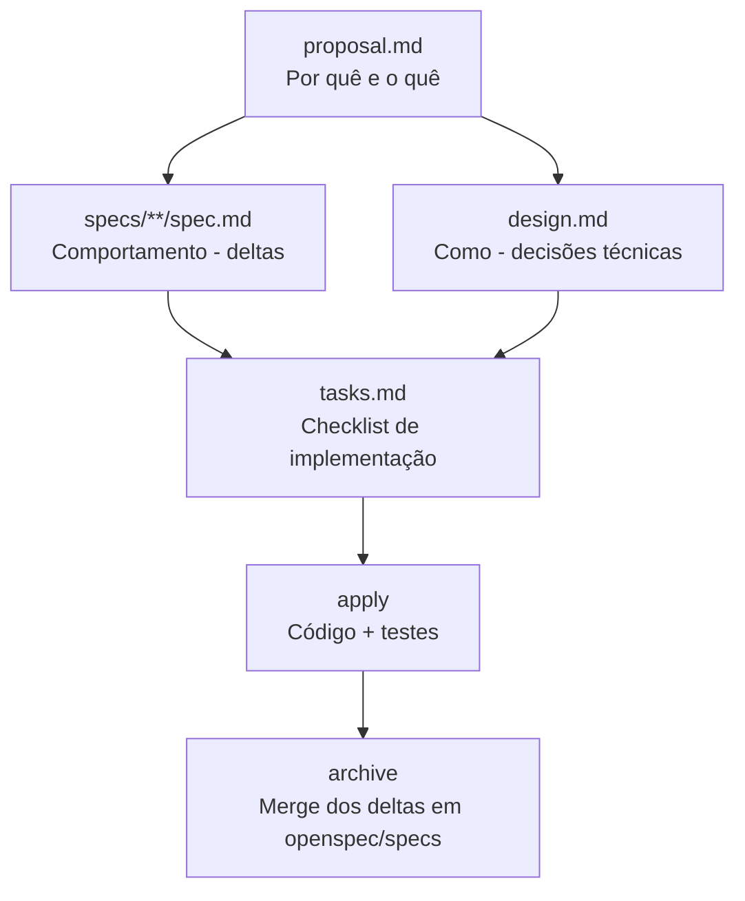
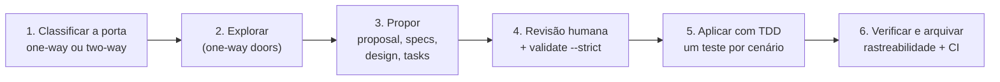
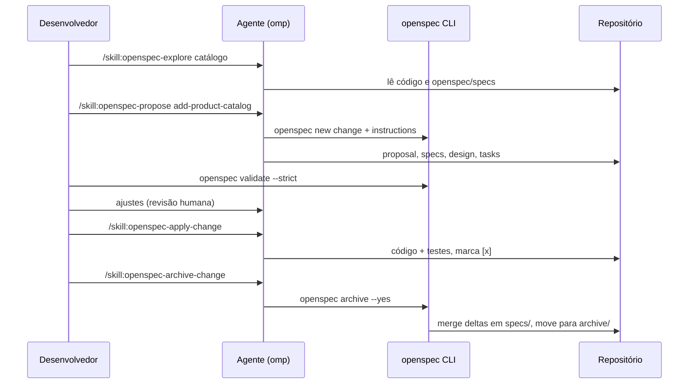
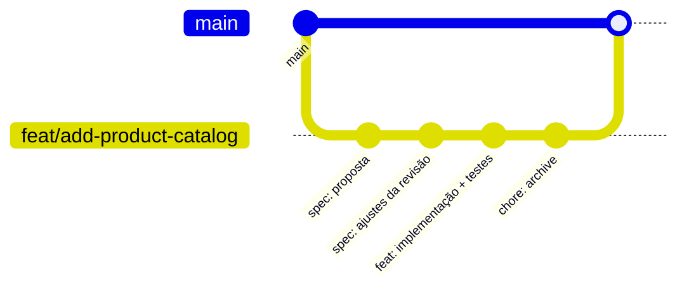

# Módulo 7 — OpenSpec: Spec-Driven Development na prática

[← Módulo 6 — Padrões de projeto](modulo-6-padroes-de-projeto.md) · [Índice do curso](README.md) · [Módulo 8 — Spec Kit →](modulo-8-spec-kit.md)

> **Pré-requisitos:** [Módulo 3](modulo-3-tdd-e-cobertura.md), [Módulo 4](modulo-4-solid.md), [Módulo 5](modulo-5-design-e-revisao.md), [Módulo 6](modulo-6-padroes-de-projeto.md). O ambiente (oh-my-pi, `.agents/`, skills, rules e segurança) é montado no [Módulo 1](modulo-1-ambiente.md).


> Tutorial para quem está começando. O OpenSpec (Fission-AI) organiza o Spec-Driven Development em **mudanças** revisáveis: você diz à IA **o que** construir, revisa por escrito, e só então ela implementa. O exemplo prático é o catálogo de produtos do projeto do curso (Spring Boot 3, Java 21).
>
> Parte I: teoria do SDD e do formato do OpenSpec. Parte II: OpenSpec e IA. Parte III: roteiro prático com `.agents/` e o **oh-my-pi (`omp`)**.
>
> Tudo o que aparece como "saída real" foi executado em 26/09/2026 com OpenSpec 1.13.2 (Node 22) e `omp` 18.3.2; algumas saídas foram capturadas com o alvo Claude Code (`.claude/`), e isso é indicado onde acontece. **Convenção de comandos:** na teoria e nas tabelas de referência, os passos do fluxo aparecem pelo nome canônico do OpenSpec (`/opsx:propose`); no `omp`, eles viram `/skill:openspec-propose` (tabela da seção 6.5), e é essa a forma usada no roteiro prático.

---

## Sumário

**Parte I — Teoria**

1. [Spec-Driven Development (SDD)](#1-spec-driven-development-sdd)
2. [O que é o OpenSpec](#2-o-que-é-o-openspec)
3. [Anatomia dos arquivos gerados](#3-anatomia-dos-arquivos-gerados)
4. [Formato técnico das specs e das deltas](#4-formato-técnico-das-specs-e-das-deltas)

**Parte II — OpenSpec e IA**

5. [O que muda quando uma IA escreve o código](#5-o-que-muda-quando-uma-ia-escreve-o-código)

**Parte III — Roteiro prático com `.agents` e oh-my-pi**

6. [Instalação e inicialização](#6-instalação-e-inicialização)
7. [Contexto do projeto: `AGENTS.md`](#7-contexto-do-projeto-agentsmd)
8. [Ciclo completo passo a passo (Spring Boot + oh-my-pi)](#8-ciclo-completo-passo-a-passo-spring-boot--oh-my-pi)
9. [Referência de comandos](#9-referência-de-comandos)
10. [Por dentro da CLI: saídas reais e algoritmo de merge](#10-por-dentro-da-cli-saídas-reais-e-algoritmo-de-merge)
11. [Implementação completa do exemplo](#11-implementação-completa-do-exemplo)
12. [Rastreabilidade cenário → teste](#12-rastreabilidade-cenário--teste)
13. [Mudanças paralelas, conflitos de delta e fluxo Git](#13-mudanças-paralelas-conflitos-de-delta-e-fluxo-git)
14. [Portões no CI](#14-portões-no-ci)
15. [Checklist, glossário e referências](#15-checklist-glossário-e-referências)

---

# Parte I — Teoria

## 1. Spec-Driven Development (SDD)

Spec-Driven Development é uma abordagem em que a **especificação de comportamento** vem antes do código e se torna a fonte da verdade do sistema. O código é uma consequência verificável da spec, e não o contrário.

### 1.1 Por que o SDD ganhou força com agentes de IA

Assistentes de IA escrevem código rápido, mas a partir de um prompt de chat. O prompt é efêmero, ambíguo e se perde entre sessões. O resultado típico é o chamado *vibe coding*: funciona na demonstração, mas ninguém sabe exatamente o que foi prometido.

O SDD resolve isso com três ideias:

1. **Acordo antes do código** — humano e IA concordam, por escrito, sobre *o que* será construído antes de qualquer linha de implementação.
2. **Artefatos persistentes** — a intenção fica em arquivos Markdown versionados no Git, legíveis por pessoas e por agentes.
3. **Rastreabilidade** — cada requisito tem cenários testáveis; cada tarefa aponta para um requisito; cada mudança fica arquivada com seu histórico.

### 1.2 Os três níveis de artefato

| Nível | Pergunta que responde | Artefato no OpenSpec |
| --- | --- | --- |
| Intenção | Por que mudar? O que entra e o que fica de fora? | `proposal.md` |
| Comportamento | O que o sistema DEVE fazer, observável de fora? | `spec.md` (specs e delta specs) |
| Implementação | Como construir? Em que ordem? | `design.md` e `tasks.md` |

A regra prática para separar os níveis: se a implementação pode mudar sem alterar o comportamento externo, aquilo **não** pertence à spec.

### 1.3 SDD comparado a TDD e BDD

| Aspecto | TDD | BDD | SDD (OpenSpec) |
| --- | --- | --- | --- |
| Artefato central | Teste unitário | Cenário Gherkin executável | Spec em Markdown + proposta + tarefas |
| Granularidade | Função/classe | Funcionalidade | Capacidade do sistema e a mudança sobre ela |
| Quem lê | Desenvolvedor | Dev, QA, negócio | Dev, negócio **e o agente de IA** |
| Momento | Durante a codificação | Antes/durante | Antes da codificação, com revisão humana |
| Histórico de decisões | Não registra | Parcial | Proposta, design e delta arquivados por data |

As práticas se complementam. No OpenSpec, cada `#### Scenario` com WHEN/THEN é um candidato natural a teste JUnit, e a IA pode escrever os testes (TDD) a partir desses cenários (BDD) durante o `/opsx:apply`.

### 1.4 Brownfield-first: specs como estado atual + deltas

O diferencial conceitual do OpenSpec é separar duas coisas:

- **`openspec/specs/`** — o comportamento *atual* do sistema, já implementado.
- **`openspec/changes/`** — mudanças *propostas*, descritas como **deltas** (ADDED, MODIFIED, REMOVED, RENAMED) sobre as specs atuais.

Isso permite adotar SDD em sistemas existentes (brownfield) sem documentar tudo de uma vez: você especifica apenas o que está mudando. Ao arquivar, o delta é mesclado nas specs principais, que crescem organicamente.

### 1.5 One-way door vs two-way door: quanto rigor cada mudança merece

**Decisões reversíveis merecem velocidade; decisões irreversíveis merecem rigor.** A metáfora vem da carta aos acionistas da Amazon de 2015 (decisões "Tipo 1" e "Tipo 2") e é o critério mais útil para dosar o SDD. Especificar tudo com o mesmo peso torna o processo burocrático; não especificar nada devolve o projeto ao vibe coding.

- **Two-way door (porta de duas mãos)** — dá para voltar atrás barato. Se errar, um `git revert` resolve e ninguém fora do time percebe. Exemplos: nome de classe interna, layout de uma tela, refatoração de um service, mensagem de log, escolha de biblioteca de testes.
- **One-way door (porta de mão única)** — voltar atrás é caro ou impossível. Depois de passar, o custo de reversão envolve dados, clientes ou terceiros. Exemplos: esquema do banco com dados em produção, contrato público da API (URL, campos, status HTTP), exclusão ou anonimização de dados, modelo de autenticação, formato de integração com sistema externo, dependência com licença restritiva.

| Critério | Two-way door | One-way door |
| --- | --- | --- |
| Custo de desfazer | Um commit | Migração de dados, versionamento de API, comunicação a clientes |
| Quem é afetado | Só o código interno | Usuários, outros sistemas, dados persistidos |
| Comportamento externo muda? | Normalmente não | Sim |
| Fluxo OpenSpec indicado | `/opsx:propose` direto, ou nem abrir mudança | `/opsx:explore` → `/opsx:new` → `/opsx:continue` artefato por artefato |
| `design.md` | Dispensável | Obrigatório, com alternativas e plano de rollback |
| Specs | `skip_specs: true` se o comportamento não muda | Delta completa, cenários de erro e de borda |
| Revisão humana | Leitura rápida do `tasks.md` | Revisão da proposta e da spec antes do apply; `/opsx:verify` antes do archive |
| Validação | `openspec validate` | `openspec validate --strict` + testes por cenário |

**Como aplicar no dia a dia:**

1. Antes de abrir uma mudança, pergunte: "se isso estiver errado daqui a um mês, quanto custa desfazer?"
2. Se a resposta for "um revert", trate como two-way door: use o caminho rápido e não crie `design.md`.
3. Se envolver dados persistidos, contrato público ou terceiros, trate como one-way door: vá devagar, gere um artefato por vez e revise cada um.
4. Na proposta, deixe explícito o que é irreversível. A regra de `config.yaml` para marcar quebras com **BREAKING** (seção 3.1) serve exatamente para sinalizar portas de mão única.
5. Uma mudança pode misturar os dois tipos. Separe: a parte irreversível (ex.: nova coluna no banco) vira uma mudança própria, revisada com rigor; o resto segue rápido.

No exemplo deste tutorial, criar a tabela `product` e definir os status HTTP da API são one-way doors, por isso a mudança `add-product-catalog` tem design completo. Já a escolha de nomes internos como `ProductService` é two-way door e fica fora da spec.

### 1.6 Tenets: princípios de decisão

**Tenets são princípios escritos que desempatam decisões antes que elas apareçam.** Quando duas opções são razoáveis, o tenet diz qual escolher, sem reunião nova. No SDD eles têm um papel extra: são lidos pelo agente de IA, que passa a propor e desenhar soluções alinhadas a eles.

Um conjunto de tenets típico para produto em fase de validação:

| Tenet | O que significa na prática | Onde aparece no OpenSpec |
| --- | --- | --- |
| Lançar o mais rápido possível | Mudanças pequenas e entregáveis; escopo mínimo que gera valor | `proposal.md`: seção What Changes enxuta; o que não é essencial vira Non-Goal no `design.md` |
| Feedback do usuário é ouro | Cada entrega deve permitir observar o uso real | `proposal.md`: Why cita o feedback que motivou; `tasks.md`: tarefa de métrica ou log de uso |
| Comprar/assinar antes de desenvolver | Preferir SaaS, biblioteca ou serviço gerenciado a construir do zero | `design.md`: Decisions lista a alternativa "comprar" e justifica se foi rejeitada |
| Velocidade e simplicidade superam o preço | Aceitar custo maior se reduzir tempo de entrega e complexidade | `design.md`: Risks / Trade-offs registra o custo aceito |
| Testes com usuários definem a direção | Resultados de teste com usuário geram novas mudanças | Nova mudança com MODIFIED/REMOVED a partir do que o teste revelou |

**Tenets e portas (seção 1.5) trabalham juntos.** "Lançar rápido" vale plenamente para two-way doors. Em one-way doors o rigor prevalece: lançar rápido um esquema de banco errado custa caro depois. Deixe essa precedência escrita para a IA não aplicar o tenet de velocidade onde ele não cabe.

**Como registrar os tenets para o agente.** Coloque-os no `context` do `openspec/config.yaml`, que é injetado em todos os artefatos, e transforme-os em regras verificáveis por artefato:

```yaml
context: |
  ...
  Tenets (em ordem de prioridade; o primeiro vence em caso de conflito):
  1. Decisões irreversíveis (esquema de dados, contrato público da API) exigem rigor,
     mesmo que atrasem a entrega.
  2. Lançar o mais rápido possível: escopo mínimo que gera valor.
  3. Feedback do usuário é ouro: toda entrega deve ser observável em uso.
  4. Comprar/assinar antes de desenvolver.
  5. Velocidade e simplicidade superam o preço.
  6. Testes com usuários definem a direção.

rules:
  proposal:
    - Citar no Why o feedback ou dado de uso que motivou a mudança
    - Classificar cada item de What Changes como reversível ou irreversível
  design:
    - Em cada decisão, avaliar a alternativa "comprar/assinar" antes de "construir"
    - Registrar em Risks / Trade-offs qualquer custo aceito em troca de velocidade
  tasks:
    - Incluir ao menos uma tarefa que torne o uso da funcionalidade mensurável
```

No exemplo do catálogo, o tenet "comprar antes de desenvolver" justifica usar o `ProblemDetail` nativo do Spring e o Flyway em vez de escrever tratamento de erro e versionamento de esquema próprios. Já "testes com usuários definem a direção" é o que origina a mudança `add-product-pagination` (seção 4.4): usuários reclamaram da lentidão da listagem completa.

### 1.7 Design docs: a herança do Google e o problema de "desenhar o resto da coruja"

**O SDD não nasceu com a IA: ele formaliza a cultura de design docs que o Google pratica há anos.** O artigo [Design Docs at Google](https://www.industrialempathy.com/posts/design-docs-at-google/), de Malte Ubl, descreve documentos informais escritos *antes* do código para registrar a estratégia de implementação e, principalmente, os trade-offs de cada decisão. A ideia central do texto é que o trabalho do engenheiro não é produzir código, e sim resolver problemas, e que no início de um projeto texto livre costuma ser uma ferramenta melhor que código.

**O meme da coruja ilustra o problema que o design doc resolve.** "Passo 1: desenhe alguns círculos. Passo 2: desenhe o resto da coruja." Entre um pedido vago e o sistema pronto há um salto enorme de decisões não ditas. Com agentes de IA o salto é ainda mais perigoso: a IA *sempre* desenha a coruja inteira, mas preenche cada decisão não especificada com um palpite. O OpenSpec quebra o salto em passos intermediários revisáveis: proposta, specs, design, tarefas.

**Mapeamento entre o design doc do Google e os artefatos do OpenSpec:**

| Seção do design doc (Google) | Artefato no OpenSpec |
| --- | --- |
| Context and Scope | `proposal.md` → Why; `design.md` → Context |
| Goals and Non-Goals | `design.md` → Goals / Non-Goals |
| The Actual Design (visão geral + detalhes) | `design.md` → Decisions |
| System-context diagram | Diagrama Mermaid dentro do `design.md` |
| APIs (esboço, sem copiar definições formais) | Comportamento externo nas delta specs; contratos detalhados no código |
| Data storage (conceitual, sem esquema completo) | `design.md` → Decisions; migrações nas tarefas |
| Degree of constraint (greenfield ou legado) | `design.md` → Context; specs atuais em `openspec/specs/` descrevem o legado |
| Alternatives considered | `design.md` → alternativas em cada decisão |
| Cross-cutting concerns (segurança, privacidade, observabilidade) | `design.md` → Risks / Trade-offs; regras em `config.yaml` |

O que o OpenSpec acrescenta ao modelo do Google: separa o comportamento (spec) da implementação (design), torna os requisitos verificáveis por cenários, e mantém o documento vivo ao mesclar os deltas nas specs a cada archive.

**Lições do artigo que valem para o seu `design.md`:**

1. **Foque nos trade-offs.** Um design doc que só descreve a solução é um manual de implementação. O valor está em explicar por que essa opção atende melhor aos objetivos que as alternativas.
2. **Detalhado o bastante, curto o bastante para ser lido.** Para projetos grandes o artigo cita de 10 a 20 páginas; para melhorias incrementais, "mini design docs". No OpenSpec, quase todo `design.md` deve ser um mini design doc.
3. **O ganho é descobrir problemas cedo, quando mudar ainda é barato.** É o mesmo argumento das one-way doors (seção 1.5): o design doc é obrigatório justamente onde voltar atrás custa caro.
4. **Nem toda mudança precisa de design doc.** O artigo recomenda não escrever quando a solução é óbvia e sem trade-offs relevantes. É exatamente a regra do schema `spec-driven`, que torna o `design.md` opcional.
5. **Atualize quando a realidade divergir.** O artigo recomenda emendar o documento original em vez de abandoná-lo. No OpenSpec isso é o `/opsx:update` durante o apply, e o archive preserva o design final como memória institucional.

**Ciclo de vida comparado:**

| Fase no Google | Fase no OpenSpec |
| --- | --- |
| Criação e iteração rápida com o time próximo | `/opsx:explore` e `/opsx:propose` (ou `/opsx:continue`) |
| Revisão por público mais amplo (comentários ou reunião) | Passo 3 do ciclo: revisão humana + `openspec validate --strict`, revisão no pull request |
| Implementação e iteração | `/opsx:apply` + `/opsx:update` quando algo muda |
| Manutenção e aprendizado | `openspec/specs/` como porta de entrada do sistema; `changes/archive/` como histórico de decisões |

## 2. O que é o OpenSpec

O OpenSpec é um framework open source (licença MIT) de SDD para assistentes de IA, distribuído como CLI Node.js (`@fission-ai/openspec`). Ele não exige API key nem servidor MCP: funciona gerando arquivos Markdown e instruções (skills e slash commands) que o seu assistente de IA lê e segue.

### 2.1 Os dois ambientes de trabalho

| Ambiente | O que você faz | Exemplos |
| --- | --- | --- |
| Terminal (CLI `openspec`) | Inicializa, lista, valida, mostra status, arquiva | `openspec init`, `openspec validate --strict`, `openspec archive` |
| Chat do assistente de IA | Explora, propõe, implementa, verifica | `/opsx:explore`, `/opsx:propose`, `/opsx:apply`, `/opsx:archive` |

A CLI é determinística (parse, validação, merge de deltas). O assistente de IA faz a parte criativa (escrever proposta, specs, design, código), guiado pelas instruções que a CLI fornece via `openspec instructions`.

### 2.2 Conceitos fundamentais

| Conceito | Definição técnica | Onde vive |
| --- | --- | --- |
| **Capability** (capacidade) | Uma área de comportamento do sistema, nomeada em kebab-case (ex.: `product-catalog`, `identity/user-auth`) | Diretório sob `specs/` |
| **Spec** | Contrato de comportamento de uma capability: `Purpose` + lista de `Requirement`, cada um com `Scenario`s | `openspec/specs/<capability>/spec.md` |
| **Requirement** | Afirmação normativa com SHALL/MUST sobre comportamento observável | `### Requirement: <nome>` |
| **Scenario** | Exemplo concreto e testável no formato WHEN/THEN (opcionalmente GIVEN) | `#### Scenario: <nome>` (exatamente 4 `#`) |
| **Change** (mudança) | Pasta autocontida com tudo que uma alteração precisa: proposta, deltas, design, tarefas | `openspec/changes/<change-name>/` |
| **Delta spec** | Diferença em relação à spec atual: ADDED, MODIFIED, REMOVED, RENAMED | `changes/<change>/specs/<capability>/spec.md` |
| **Archive** | Finalização da mudança: mescla deltas nas specs e move a pasta para o arquivo com prefixo de data | `openspec/changes/archive/AAAA-MM-DD-<change>/` |
| **Schema** | Definição do workflow: quais artefatos existem, templates e dependências. O padrão é `spec-driven` | `schemas/` (embutido) ou schema local do projeto |
| **Profile** | Conjunto de slash commands instalados: `core` (padrão) ou `custom` (expandido) | Config global do OpenSpec |

### 2.3 Grafo de dependência dos artefatos (schema `spec-driven`)



As dependências são **habilitadoras, não portões**: indicam o que já pode ser criado, não uma sequência rígida. O `design.md` é opcional e só deve existir quando a mudança for transversal, trouxer dependência nova, mudar modelo de dados, ou tiver risco de segurança, desempenho ou migração.

### 2.4 Ferramentas suportadas

O `openspec init` gera skills e comandos para mais de 20 assistentes, entre eles Claude Code, Cursor, GitHub Copilot, Codex, Windsurf, Gemini CLI, Amazon Q, Cline e Kilo Code. A sintaxe do comando varia por ferramenta: `/opsx:propose` (Claude Code), `/opsx-propose` (Cursor), `@opsx-propose` (Amazon Q), `$openspec-propose` (Codex).

> Nota de versão: até a série 0.x o OpenSpec gerava `openspec/project.md` e `openspec/AGENTS.md` e usava `/openspec:proposal`, `/openspec:apply`, `/openspec:archive`. A partir da versão 1.x (workflow **OPSX**), o contexto do projeto foi para `openspec/config.yaml` e as instruções viraram skills por ferramenta. Rodar `openspec init --force` num projeto antigo faz a limpeza dos arquivos legados. Este tutorial usa o formato atual e mostra os legados na seção 3 para referência.

## 3. Anatomia dos arquivos gerados

Cada arquivo tem um papel único. Os exemplos abaixo são da mudança `add-product-catalog`, que cria o CRUD de produtos da API.

| Arquivo | Nível | Quem cria | Obrigatório |
| --- | --- | --- | --- |
| `openspec/config.yaml` | Projeto | `openspec init` (você edita) | Sim |
| `changes/<c>/.openspec.yaml` | Mudança | CLI ao criar a mudança | Sim |
| `changes/<c>/proposal.md` | Mudança | IA via `/opsx:propose` | Sim |
| `changes/<c>/specs/<cap>/spec.md` | Mudança (delta) | IA | Sim, salvo `skip_specs: true` |
| `changes/<c>/design.md` | Mudança | IA | Não (só se houver decisão técnica relevante) |
| `changes/<c>/tasks.md` | Mudança | IA | Sim (o apply rastreia este arquivo) |
| `openspec/specs/<cap>/spec.md` | Projeto | `openspec archive` (merge) | Gerado ao arquivar |

### 3.1 `openspec/config.yaml` — contexto e regras do projeto

É o único arquivo que você deve personalizar logo após o `init`. O campo `context` é injetado em **todos** os artefatos que a IA gera; cada lista em `rules` só é injetada no artefato correspondente.

```yaml
schema: spec-driven

context: |
  Projeto: Catálogo de Produtos e Pedidos (curso de programação assistida por IA).
  Stack: Java 21, Spring Boot 3.x, Spring Web, Spring Data JPA, Bean Validation.
  Banco: H2 em dev/teste, PostgreSQL 16 em produção. Migrações com Flyway.
  Arquitetura: camadas controller -> service -> repository; DTOs como Java records.
  Pacote raiz: br.edu.fatec.catalogo
  Testes: JUnit 5, Mockito, @WebMvcTest para controllers, @DataJpaTest para repositórios.
  Erros: RFC 9457 (application/problem+json) via @RestControllerAdvice.
  Idioma: código em inglês; mensagens ao usuário e documentação em português.

rules:
  proposal:
    - Declarar impacto em endpoints públicos e no esquema do banco
    - Marcar quebras de contrato da API com **BREAKING**
  specs:
    - Descrever status HTTP e formato de erro em cada cenário de falha
    - Não citar classes Java nem anotações Spring nas specs
  design:
    - Justificar toda dependência Maven nova
  tasks:
    - Cada tarefa deve citar o teste que a comprova

operations:
  apply:
    guidance:
      - Rodar ./mvnw -q test -Dtest=<ClasseAfetada> antes da suíte completa
  archive:
    guidance:
      - Resumo de conclusão curto, com a lista de endpoints alterados
```

Como a CLI monta o prompt de cada artefato (exemplo para `specs`):

```xml
<context>
Projeto: API REST de catálogo de produtos ...
</context>

<rules>
- Descrever status HTTP e formato de erro em cada cenário de falha
- Não citar classes Java nem anotações Spring nas specs
</rules>

<template>
[template embutido do schema spec-driven para spec.md]
</template>
```

### 3.2 `changes/<c>/.openspec.yaml` — metadados da mudança

Criado automaticamente pela CLI. Define o schema daquela mudança e flags de comportamento.

```yaml
schema: spec-driven
created: 2026-09-26
skip_specs: false            # true = mudança sem alteração de comportamento (refactor, docs, tooling)
retire_capabilities: false   # true = REMOVED apaga a capability inteira no archive
```

Ordem de resolução do schema: flag `--schema` na CLI, depois `.openspec.yaml`, depois `config.yaml`, depois o padrão `spec-driven`.

### 3.3 `changes/<c>/proposal.md` — o PORQUÊ e o QUÊ

Seções exigidas pelo schema: **Why**, **What Changes**, **Capabilities** (New e Modified) e **Impact**. A seção Capabilities é o contrato entre a proposta e as specs: cada capability listada precisa de um arquivo de spec correspondente. Tamanho ideal: uma a duas páginas, sem detalhes de implementação.

```markdown
# Proposal: add-product-catalog

## Why
A disciplina precisa de uma API de referência para cadastro de produtos.
Hoje o projeto só tem o esqueleto do Spring Boot, sem nenhum endpoint.

## What Changes
- Novo recurso REST `/api/products` com criar, consultar, listar, atualizar e excluir
- Validação de entrada (nome obrigatório, preço positivo, SKU único)
- Respostas de erro padronizadas em `application/problem+json`
- Nova tabela `product` no banco

## Capabilities

### New Capabilities
- `product-catalog`: cadastro e consulta de produtos via API REST

### Modified Capabilities
- (nenhuma)

## Impact
- API: 5 endpoints novos sob `/api/products`
- Banco: migração Flyway `V1__create_product.sql`
- Dependências: adiciona `flyway-core` e `flyway-database-postgresql`
- Sem impacto em clientes existentes (primeira versão da API)
```

### 3.4 `changes/<c>/specs/<cap>/spec.md` — a delta spec (o QUÊ, em comportamento)

Descreve o comportamento observável: entradas, saídas, erros, restrições. Como `product-catalog` é capability **nova**, a delta começa com `## Purpose` (mínimo 50 caracteres para passar no `--strict`). Delta de capability existente **não** leva Purpose.

```markdown
## Purpose

Permite cadastrar, consultar, atualizar e excluir produtos do catálogo
por meio de uma API REST pública em JSON.

## ADDED Requirements

### Requirement: Cadastro de produto
O sistema SHALL criar um produto a partir de nome, SKU, preço e quantidade em estoque,
retornando o produto criado com um identificador gerado.

#### Scenario: Cadastro válido
- **GIVEN** que não existe produto com SKU "CAN-001"
- **WHEN** o cliente envia POST /api/products com nome "Caneta azul", SKU "CAN-001", preço 2.50 e estoque 100
- **THEN** o sistema responde 201 Created
- **AND** o cabeçalho Location aponta para /api/products/{id}
- **AND** o corpo contém o produto com o id gerado

#### Scenario: Preço inválido
- **WHEN** o cliente envia POST /api/products com preço 0 ou negativo
- **THEN** o sistema responde 400 Bad Request em application/problem+json
- **AND** o campo errors identifica "price" como inválido

#### Scenario: SKU duplicado
- **GIVEN** que já existe produto com SKU "CAN-001"
- **WHEN** o cliente envia POST /api/products com SKU "CAN-001"
- **THEN** o sistema responde 409 Conflict em application/problem+json

### Requirement: Consulta de produto por id
O sistema SHALL retornar os dados de um produto existente pelo seu identificador.

#### Scenario: Produto existente
- **WHEN** o cliente envia GET /api/products/{id} com id existente
- **THEN** o sistema responde 200 OK com o produto

#### Scenario: Produto inexistente
- **WHEN** o cliente envia GET /api/products/{id} com id inexistente
- **THEN** o sistema responde 404 Not Found em application/problem+json

### Requirement: Listagem de produtos
O sistema SHALL listar todos os produtos cadastrados ordenados por nome.

#### Scenario: Listagem com itens
- **WHEN** o cliente envia GET /api/products
- **THEN** o sistema responde 200 OK com um array de produtos ordenado por nome

### Requirement: Atualização de produto
O sistema SHALL substituir nome, preço e estoque de um produto existente, mantendo o SKU imutável.

#### Scenario: Atualização válida
- **WHEN** o cliente envia PUT /api/products/{id} com dados válidos
- **THEN** o sistema responde 200 OK com o produto atualizado

### Requirement: Exclusão de produto
O sistema SHALL excluir um produto existente pelo identificador.

#### Scenario: Exclusão de produto existente
- **WHEN** o cliente envia DELETE /api/products/{id} com id existente
- **THEN** o sistema responde 204 No Content
- **AND** um GET subsequente no mesmo id responde 404
```

Repare que a spec não menciona `@RestController`, JPA nem Flyway: isso é implementação e vai para o `design.md`.

### 3.5 `changes/<c>/design.md` — o COMO

Seções: **Context**, **Goals / Non-Goals**, **Decisions** (com alternativas consideradas), **Risks / Trade-offs** (formato `[Risco] → Mitigação`), **Migration Plan** e **Open Questions** (só dúvidas que podem ser resolvidas depois sem mudar specs nem tarefas). Neste exemplo o design se justifica porque há dependência nova (Flyway) e modelo de dados novo.

```markdown
# Design: add-product-catalog

## Context
Projeto novo, sem persistência configurada. Motivação: ver proposal.md - Why.

## Goals / Non-Goals
**Goals:** CRUD em camadas; esquema versionado; erros RFC 9457.
**Non-Goals:** autenticação, paginação, cache (mudanças futuras).

## Decisions

### D1. DTOs como Java records
`ProductRequest` e `ProductResponse` separados da entidade `Product`.
- Alternativa: expor a entidade JPA → rejeitada (acopla API ao esquema, risco de lazy loading).

### D2. Flyway para o esquema
`spring.jpa.hibernate.ddl-auto=validate` + `db/migration/V1__create_product.sql`.
- Alternativa: `ddl-auto=update` → rejeitada (não reprodutível em produção).

### D3. SKU único no banco e no serviço
`UNIQUE (sku)` na tabela; o serviço checa `existsBySku` e lança `DuplicateSkuException` → 409.

### D4. Tratamento global de erros
`@RestControllerAdvice` estendendo `ResponseEntityExceptionHandler`, retornando `ProblemDetail`.

## Risks / Trade-offs
- [Corrida em cadastros simultâneos com mesmo SKU] → constraint UNIQUE captura; traduzir `DataIntegrityViolationException` em 409.
- [BigDecimal serializado com notação científica] → `@JsonFormat(shape = STRING)` não é necessário; usar `scale 2` na coluna.

## Migration Plan
Primeira migração; rollback = dropar a tabela `product` (sem dados em produção).
```

### 3.6 `changes/<c>/tasks.md` — o checklist de implementação

O formato é rígido porque o `/opsx:apply` faz parse dos checkboxes. Regras: grupos com `## N. Título`; cada tarefa `- [ ] N.M descrição`; ordem por dependência; tarefas pequenas (uma sessão); cada tarefa diz **como verificar**.

```markdown
## 1. Infraestrutura

- [ ] 1.1 Adicionar flyway-core e flyway-database-postgresql ao pom.xml e verificar que ./mvnw -q compile passa
- [ ] 1.2 Configurar application.yml (H2 em dev, ddl-auto=validate) e verificar que a aplicação sobe
- [ ] 1.3 Criar db/migration/V1__create_product.sql com UNIQUE(sku) e verificar a migração no log de inicialização

## 2. Domínio e persistência

- [ ] 2.1 Criar entidade Product e ProductRepository com existsBySku; verificar com ProductRepositoryTest (@DataJpaTest)

## 3. Serviço

- [ ] 3.1 Implementar ProductService (create, findById, findAll, update, delete); verificar com ProductServiceTest (Mockito)
- [ ] 3.2 Lançar DuplicateSkuException e ProductNotFoundException; verificar cenários "SKU duplicado" e "Produto inexistente" nos testes

## 4. API

- [ ] 4.1 Criar records ProductRequest (com @NotBlank, @Positive) e ProductResponse; verificar validação em teste
- [ ] 4.2 Implementar ProductController com os 5 endpoints; verificar com ProductControllerTest (@WebMvcTest)
- [ ] 4.3 Implementar ApiExceptionHandler com ProblemDetail (400, 404, 409); verificar content-type application/problem+json

## 5. Verificação integrada

- [ ] 5.1 Rodar ./mvnw test e confirmar que todos os cenários da spec têm teste correspondente
```

Durante o apply, a IA troca `- [ ]` por `- [x]` conforme conclui. O `openspec status --change add-product-catalog` mostra o progresso.

### 3.7 `openspec/specs/<cap>/spec.md` — a spec principal (após o archive)

Não é escrita à mão no fluxo normal: o `archive` a gera a partir da delta. O formato da spec principal não tem cabeçalhos de operação (ADDED etc.), só `Purpose` e `Requirements`:

```markdown
# product-catalog Specification

## Purpose

Permite cadastrar, consultar, atualizar e excluir produtos do catálogo
por meio de uma API REST pública em JSON.

## Requirements

### Requirement: Cadastro de produto
O sistema SHALL criar um produto a partir de nome, SKU, preço e quantidade em estoque,
retornando o produto criado com um identificador gerado.

#### Scenario: Cadastro válido
- **GIVEN** que não existe produto com SKU "CAN-001"
- **WHEN** o cliente envia POST /api/products ...
- **THEN** o sistema responde 201 Created

(... demais requisitos e cenários ...)
```

### 3.8 Arquivos das ferramentas (`.agents/skills/openspec-*` e equivalentes)

No curso são as seis pastas `openspec-*` em `.agents/skills`; no Claude Code, `.claude/skills` e `.claude/commands/opsx`. São gerados e sobrescritos pelo `openspec init` e `openspec update`; **não edite à mão**. Cada skill contém as instruções de uma etapa e manda a IA consultar a CLI, por exemplo `openspec instructions specs --change add-product-catalog --json`, que devolve o template, as regras do `config.yaml` e o caminho raiz de planejamento. Para customizar o comportamento, use `config.yaml` (contexto e regras) ou um schema próprio (seção 9.3).

### 3.9 Arquivos legados (versões 0.x)

Se você encontrar projetos antigos, verá estes arquivos. O conteúdo de `project.md` equivale ao campo `context` do `config.yaml` atual.

```markdown
<!-- openspec/project.md (legado) -->
# Project Context

## Purpose
Catálogo de Produtos e Pedidos (curso de programação assistida por IA).

## Tech Stack
- Java 21, Spring Boot 3, Spring Data JPA, PostgreSQL

## Project Conventions
### Code Style
Camadas controller/service/repository; DTOs como records.
### Testing Strategy
JUnit 5 + Mockito; @WebMvcTest e @DataJpaTest.
### Git Workflow
Conventional Commits; uma branch por mudança OpenSpec.
```

```markdown
<!-- openspec/AGENTS.md (legado): instruções genéricas para qualquer agente -->
# OpenSpec Instructions
Always open `openspec/AGENTS.md` when the request mentions planning, proposals,
specs, or introduces new capabilities or breaking changes.

## Three-Stage Workflow
1. Creating Changes (proposal.md, tasks.md, design.md opcional, delta specs)
2. Implementing Changes (seguir tasks.md em ordem, marcar [x])
3. Archiving Changes (openspec archive <change-id> --yes)
```

Para migrar: `openspec init --force`, depois copie o conteúdo relevante de `project.md` para `context:` no `config.yaml`.

## 4. Formato técnico das specs e das deltas

O parser do OpenSpec é baseado em cabeçalhos Markdown. Errar o nível de um `#` faz o requisito ou cenário ser ignorado, às vezes sem erro. Esta é a gramática que a CLI espera.

### 4.1 Hierarquia de cabeçalhos

| Nível | Sintaxe | Uso |
| --- | --- | --- |
| `#` | `# <cap> Specification` | Título da spec principal |
| `##` | `## Purpose` | Descrição da capability (spec principal ou delta de capability nova) |
| `##` | `## Requirements` | Lista de requisitos (só na spec principal) |
| `##` | `## ADDED Requirements` (e MODIFIED, REMOVED, RENAMED) | Operação de delta (só em `changes/`) |
| `###` | `### Requirement: <nome>` | Um requisito; o nome é a chave usada no merge |
| `####` | `#### Scenario: <nome>` | Um cenário; **exatamente 4 `#`** |

### 4.2 Palavras normativas (RFC 2119)

Use **SHALL** ou **MUST** no texto de cada requisito. O schema pede para evitar SHOULD e MAY em requisitos, porque não são verificáveis. Cada requisito precisa de pelo menos um cenário.

### 4.3 Cenários

Formato em lista com marcadores em negrito: `**GIVEN**` (opcional, pré-condição), `**WHEN**` (ação), `**THEN**` (resultado), `**AND**` (continuação). Cubra o caminho feliz e os de erro. Cada cenário deve virar um teste.

### 4.4 As quatro operações de delta

| Operação | Quando usar | Conteúdo exigido | Efeito no archive |
| --- | --- | --- | --- |
| `ADDED` | Comportamento novo | Requisito completo com cenários | Acrescenta à spec principal |
| `MODIFIED` | Comportamento existente muda | O bloco **inteiro** atualizado, com o mesmo cabeçalho | Substitui o requisito de mesmo nome |
| `REMOVED` | Comportamento descontinuado | Cabeçalho + `**Reason**` + `**Migration**` | Remove o requisito |
| `RENAMED` | Só o nome muda | `FROM:` e `TO:` | Renomeia o cabeçalho |

Exemplo de uma segunda mudança, `add-product-pagination`, sobre a capability já arquivada (sem `## Purpose`, pois a capability existe):

```markdown
## MODIFIED Requirements

### Requirement: Listagem de produtos
O sistema SHALL listar os produtos cadastrados de forma paginada, ordenados por nome,
com tamanho de página padrão 20 e máximo 100.

#### Scenario: Primeira página padrão
- **WHEN** o cliente envia GET /api/products sem parâmetros
- **THEN** o sistema responde 200 OK com até 20 produtos
- **AND** o corpo informa page, size, totalElements e totalPages

#### Scenario: Tamanho acima do máximo
- **WHEN** o cliente envia GET /api/products?size=500
- **THEN** o sistema limita a página a 100 itens

## ADDED Requirements

### Requirement: Filtro por nome
O sistema SHALL filtrar a listagem por trecho do nome, sem diferenciar maiúsculas.

#### Scenario: Filtro parcial
- **WHEN** o cliente envia GET /api/products?name=cane
- **THEN** o sistema retorna apenas produtos cujo nome contém "cane"

## RENAMED Requirements

- FROM: `### Requirement: Consulta de produto por id`
- TO: `### Requirement: Consulta de produto`

## REMOVED Requirements

### Requirement: Exclusão de produto
**Reason**: Produtos passam a ser inativados, não excluídos, para preservar histórico de pedidos.
**Migration**: Use PATCH /api/products/{id} com {"active": false}.
```

Esta delta é um bom exemplo de one-way door: a listagem muda de array para objeto paginado e o DELETE deixa de existir. A proposta deve marcar ambos como **BREAKING**.

### 4.5 Armadilha clássica do MODIFIED

O merge **substitui** o bloco inteiro. Se você colar só o cenário novo sob MODIFIED, os cenários antigos sumiriam da spec principal. Na versão 1.13 o validate e o archive recusam a delta (seção 10.6), mas a correção continua sendo sua. O procedimento correto:

1. Abrir `openspec/specs/<cap>/spec.md` e localizar o requisito.
2. Copiar o bloco completo, de `### Requirement:` até o último cenário.
3. Colar sob `## MODIFIED Requirements` e editar.
4. Manter o texto do cabeçalho idêntico (a comparação ignora espaços).

Se você só está acrescentando algo sem mudar o comportamento existente, use ADDED.

### 4.6 Validação

```bash
openspec validate add-product-catalog            # uma mudança
openspec validate add-product-catalog --strict   # checagens extras (Purpose curto etc.)
openspec validate --all --json                   # tudo, saída para CI
openspec show add-product-catalog --json --deltas-only   # inspecionar como o parser leu a delta
```

O `validate` rejeita, entre outros: requisito sem cenário, mudança com zero deltas sem `skip_specs: true`, MODIFIED/REMOVED apontando para requisito inexistente, e REMOVED sem Reason/Migration.

---

# Parte II — OpenSpec e IA

## 5. O que muda quando uma IA escreve o código

### 5.1 A spec é o prompt que não se perde

Sem SDD, a intenção fica no chat: some quando a sessão termina e cada nova conversa recomeça do zero. Com o OpenSpec, a intenção vira arquivo versionado que a IA relê a cada passo. Compare:

```text
Vago:    "Faça um CRUD de produtos."
Preciso: "/opsx:propose add-product-catalog: API REST /api/products com CRUD, validação,
          SKU único e imutável, erros em problem+json, esquema com Flyway."
          → proposta, delta spec com cenários WHEN/THEN, design e tarefas,
            revisados por você antes de qualquer linha de código.
```

### 5.2 Os vícios da IA também aparecem no SDD

| Risco | Como aparece | Mitigação |
| --- | --- | --- |
| **Implementar durante o planejamento** | Pedido do tipo "proponha e já implemente" | A skill de propose tem uma fronteira de planejamento (seção 10.1); código só com o apply |
| **Requisito inventado** | A spec parece completa, mas traz decisões que ninguém tomou | Explorar antes de propor em one-way doors; revisão humana (seção 8, passo 3) |
| **Tecnologia vazando para a spec** | "O ProductController SHALL..." | Rule no `config.yaml`: não citar classes nem anotações (seção 3.1) |
| **MODIFIED parcial** | A IA cola só o cenário novo sob MODIFIED | `validate` e `archive` recusam (seções 4.5 e 10.6); peça o bloco inteiro |
| **Spec em português reprovada** | "O sistema DEVE..." gera WARNING e falha no `--strict` | Escrever SHALL/MUST e o resto em português (seção 10.4) |
| **Código diverge da spec** | No apply, a IA improvisa onde a spec não cobre | Pausar e atualizar a spec antes do código (seção 8, passo 4) |
| **Cenário sem teste** | Tarefas marcadas `[x]` sem nada que as comprove | `@DisplayName("Scenario: ...")` e script de rastreabilidade (seção 12) |
| **Burocracia** | Proposta, design e delta para trocar o nome de uma classe | Classificar a porta (seção 1.5): two-way door segue o caminho rápido |

### 5.3 O processo recomendado



O ponto central é o passo 4: **a IA escreve o plano, você o aprova.** Sem essa revisão, o OpenSpec vira só um gerador de Markdown.

---

# Parte III — Roteiro prático com `.agents` e oh-my-pi

## 6. Instalação e inicialização

Você precisa de Node.js 20.19.0 ou superior, Git, e um assistente de IA instalado. Para o exemplo, também Java 21 e Maven.

### 6.1 Instalar a CLI

```bash
# verificar pré-requisitos
node --version   # >= v20.19.0
java --version   # 21

# instalar globalmente (npm, pnpm, yarn ou bun)
npm install -g @fission-ai/openspec@latest

openspec --version

# opcional: desativar telemetria anônima
openspec config set telemetry.enabled false
# ou: export OPENSPEC_TELEMETRY=0
```

### 6.2 Partir do repositório do curso

O OpenSpec entra no mesmo repositório `catalogo` que cresce desde o [Módulo 1](modulo-1-ambiente.md#13-o-kit-inicial-do-curso-e-como-ele-cresce), com o `.agents/` já montado. Não crie um projeto novo: rode os comandos das próximas seções na raiz dele.

Se você está começando só por este módulo, gere um esqueleto com o Spring Initializr:

```bash
mkdir catalogo && cd catalogo

curl https://start.spring.io/starter.tgz \
  -d type=maven-project -d language=java -d javaVersion=21 \
  -d groupId=br.edu.fatec -d artifactId=catalogo -d name=catalogo \
  -d packageName=br.edu.fatec.catalogo \
  -d dependencies=web,data-jpa,validation,h2,postgresql \
  | tar -xzf -

git init && git add . && git commit -m "chore: esqueleto Spring Boot"
```

### 6.3 Inicializar o OpenSpec

```bash
# no curso (oh-my-pi + .agents): alvo neutro, ver seção 6.5
openspec init --tools agents --profile core --no-animation

# interativo: pergunta quais ferramentas configurar
openspec init

# outro assistente, sem perguntas (ex.: só Claude Code)
openspec init --tools claude --profile core --no-animation
```

Flags principais do `init`:

| Flag | Efeito |
| --- | --- |
| `--tools <lista>` | `all`, `none` ou lista separada por vírgula (`claude,cursor,codex`). `agents` grava em `.agents/skills` (alvo neutro); `oh-my-pi` grava em `.omp/` |
| `--profile <core\|custom>` | Conjunto de comandos instalados |
| `--force` | Remove arquivos legados (0.x) sem perguntar |
| `--no-animation` | Pula a animação de boas-vindas |

### 6.4 Estrutura gerada

```text
catalogo/
├── AGENTS.md                # contexto do projeto (Módulo 1)
├── pom.xml
├── src/
├── openspec/
│   ├── config.yaml          # schema + contexto do projeto + regras por artefato
│   ├── specs/               # FONTE DA VERDADE: comportamento atual (vazio no início)
│   └── changes/             # mudanças propostas (uma pasta por mudança)
│       └── archive/         # mudanças concluídas, com prefixo AAAA-MM-DD
└── .agents/
    ├── rules/               # rules dos módulos anteriores
    └── skills/              # skills dos módulos anteriores + openspec-* (alvo neutro)
```

Para outras ferramentas, o `init` cria os equivalentes: `.claude/skills/` e `.claude/commands/opsx/` (Claude Code), `.cursor/skills/` e `.cursor/commands/` (Cursor), e assim por diante.

Depois de mudar de versão da CLI, rode `openspec update` para regenerar skills e comandos. Faça commit de `openspec/` e das pastas da ferramenta: elas fazem parte do repositório.

```bash
git add openspec .agents && git commit -m "chore: inicializa OpenSpec"
```

### 6.5 No curso: OpenSpec com o oh-my-pi e `.agents`

O OpenSpec 1.13.2 oferece dois alvos que funcionam com o oh-my-pi. Os dois foram testados:

| Alvo | Comando | Onde grava | Como chamar no `omp` |
| --- | --- | --- | --- |
| **Neutro (recomendado no curso)** | `openspec init --tools agents` | `.agents/skills/openspec-*` (6 skills, sem comandos) | `/skill:openspec-propose` etc. |
| Nativo do oh-my-pi | `openspec init --tools oh-my-pi` | `.omp/skills/` + `.omp/commands/` (6 skills e 6 comandos) | `/opsx-propose` etc. |

O curso usa o alvo **neutro**, para manter tudo em `.agents/`, junto das outras skills e rules. Se a ferramenta que você usa não estiver na lista, a própria CLI sugere: *"Tool not listed? Use --tools agents: the vendor-neutral target that writes .agents/skills/ for any assistant."*

Saída real com o alvo neutro:

```text
$ openspec init --tools agents --profile core --no-animation
Created: Other / Universal (shared .agents skills)
6 skills in .agents/
  Start your first change: /openspec-propose "your idea"

$ find .agents openspec -type f | sort
.agents/skills/.openspec-target
.agents/skills/openspec-apply-change/SKILL.md
.agents/skills/openspec-archive-change/SKILL.md
.agents/skills/openspec-explore/SKILL.md
.agents/skills/openspec-propose/SKILL.md
.agents/skills/openspec-sync-specs/SKILL.md
.agents/skills/openspec-update-change/SKILL.md
openspec/changes/archive/.gitkeep
openspec/config.yaml
openspec/specs/.gitkeep

$ omp read skill://openspec-propose | sed -n 2p
name: openspec-propose
```

Saída real com o alvo nativo:

```text
$ openspec init --tools oh-my-pi --profile core --no-animation
Created: Oh My Pi
6 skills and 6 commands in .omp/
  Start your first change: /opsx-propose "your idea"
```

**Equivalência de comandos.** A teoria usa o nome canônico do OpenSpec, que é o mesmo do Claude Code. O roteiro prático (seção 8) usa a coluna `--tools agents`:

| Etapa | Claude Code | `omp` com `--tools agents` | `omp` com `--tools oh-my-pi` |
| --- | --- | --- | --- |
| Explorar | `/opsx:explore` | `/skill:openspec-explore` | `/opsx-explore` |
| Propor | `/opsx:propose` | `/skill:openspec-propose` | `/opsx-propose` |
| Aplicar | `/opsx:apply` | `/skill:openspec-apply-change` | `/opsx-apply` |
| Atualizar artefatos | `/opsx:update` | `/skill:openspec-update-change` | `/opsx-update` |
| Sincronizar specs | `/opsx:sync` | `/skill:openspec-sync-specs` | `/opsx-sync` |
| Arquivar | `/opsx:archive` | `/skill:openspec-archive-change` | `/opsx-archive` |

Os fluxos do perfil expandido (`new`, `continue`, `ff`, `verify`, `bulk-archive`, `onboard`) são acrescentados com `openspec config profile` seguido de `openspec update`, como indica a própria saída do `init`.

Como as skills geradas são do próprio OpenSpec, **não** passe por elas o `npx skills add`: o `openspec init` e o `openspec update` as mantêm. Versione `.agents/skills/openspec-*` e `openspec/` no Git.

## 7. Contexto do projeto: `AGENTS.md`

O `context` do `config.yaml` (seção 3.1) só chega à IA quando uma skill do OpenSpec está em uso. Para que o agente respeite as specs em **qualquer** sessão, acrescente ao `AGENTS.md` (modelo inicial no [Módulo 1, seção 13.2](modulo-1-ambiente.md#132-agentsmd-inicial)) uma seção curta. Mantenha um único arquivo de contexto: o `AGENTS.md` da raiz, que todos os agentes leem ([Módulo 1, seção 6.4](modulo-1-ambiente.md#64-independência-de-plataforma-o-curso-em-outros-agentes)).

```markdown
## Especificações (OpenSpec) neste projeto
- O comportamento vigente está em openspec/specs/. Leia a spec da capability
  antes de mudar código que a afeta.
- Mudança de comportamento externo (endpoint, status HTTP, esquema do banco) só começa
  com uma mudança OpenSpec aprovada: skill `openspec-propose`, revisão humana, depois
  skill `openspec-apply-change`. Refatoração sem mudança de comportamento dispensa spec.
- Nunca escreva código durante o propose. Se a spec não cobre um caso, pare e peça para
  atualizá-la (skill `openspec-update-change`) antes de implementar.
- Todo teste que comprova um cenário usa @DisplayName("Scenario: <nome do cenário>").
- Requisitos usam SHALL/MUST, mesmo com o resto da frase em português.
```

Este módulo não acrescenta rules: as regras de cada artefato ficam no `config.yaml`, onde a CLI as injeta no lugar certo, e os portões verificáveis ficam no CI (seção 14).

## 8. Ciclo completo passo a passo (Spring Boot + oh-my-pi)

> Os comandos abaixo usam o `omp` com o alvo `.agents` (seção 6.5). No Claude Code, troque `/skill:openspec-propose` por `/opsx:propose`, e assim por diante. Os comandos de terminal (`openspec ...`, `./mvnw ...`, `git ...`) são os mesmos nos dois.

O ciclo tem cinco etapas: explorar, propor, revisar, implementar e arquivar. Abaixo, a mudança `add-product-catalog` do início ao fim.



### Passo 0 — Branch e contexto

```bash
git switch -c feat/add-product-catalog
# conferir se openspec/config.yaml tem o contexto da seção 3.1
```

### Passo 1 — Explorar (opcional, recomendado em one-way doors)

No `omp`:

```text
/skill:openspec-explore Quero um CRUD de produtos. Dúvidas: usar Flyway ou ddl-auto?
Como padronizar erros? SKU deve ser imutável?
```

A IA investiga o código, compara opções e **não cria arquivos**. Use essa conversa para fechar as decisões irreversíveis antes de propor.

### Passo 2 — Propor

```text
/skill:openspec-propose add-product-catalog: API REST /api/products com CRUD, validação,
SKU único e imutável, erros em problem+json, esquema com Flyway.
```

Por trás, a skill executa algo como:

```bash
openspec new change add-product-catalog
openspec instructions proposal --change add-product-catalog --json
openspec instructions specs    --change add-product-catalog --json
openspec instructions design   --change add-product-catalog --json
openspec instructions tasks    --change add-product-catalog --json
openspec status --change add-product-catalog
```

Resultado:

```text
openspec/changes/add-product-catalog/
├── .openspec.yaml
├── proposal.md
├── design.md
├── tasks.md
└── specs/
    └── product-catalog/
        └── spec.md
```

No perfil expandido (ativado com `openspec config profile` e `openspec update`), o equivalente controlado é o fluxo `new` seguido de `continue` (um artefato por vez, revisando cada um) ou o `ff` (todos de uma vez); na documentação do OpenSpec eles aparecem como `/opsx:new`, `/opsx:continue` e `/opsx:ff`.

### Passo 3 — Revisar (o ponto mais importante do SDD)

Nenhum código foi escrito ainda. É aqui que o humano ganha controle.

```bash
openspec validate add-product-catalog --strict
openspec show add-product-catalog          # leitura formatada no terminal
openspec view                              # dashboard interativo
```

Checklist de revisão:

- [ ] A seção Capabilities da proposta bate com as pastas em `specs/`?
- [ ] Todo requisito tem cenário de sucesso **e** de erro, com status HTTP?
- [ ] A spec está livre de nomes de classes e anotações?
- [ ] O design lista alternativas e o plano de rollback para as one-way doors?
- [ ] Cada tarefa diz como será verificada?

Para corrigir, peça no chat ("adicione cenário de estoque negativo") ou use `/skill:openspec-update-change`, que ajusta o artefato e reconcilia os demais. Também pode editar os arquivos direto: são só Markdown. Faça commit do plano aprovado:

```bash
git add openspec/changes/add-product-catalog
git commit -m "spec: proposta add-product-catalog"
```

### Passo 4 — Implementar

```text
/skill:openspec-apply-change add-product-catalog
```

A IA lê proposta, specs, design e tasks, implementa na ordem e marca `- [x]`. Trecho típico do código gerado a partir dos cenários:

```java
// src/main/java/br/edu/fatec/catalogo/product/ProductController.java
@RestController
@RequestMapping("/api/products")
class ProductController {

    private final ProductService service;

    ProductController(ProductService service) { this.service = service; }

    @PostMapping
    ResponseEntity<ProductResponse> create(@Valid @RequestBody ProductRequest req,
                                           UriComponentsBuilder uri) {
        ProductResponse created = service.create(req);
        URI location = uri.path("/api/products/{id}").buildAndExpand(created.id()).toUri();
        return ResponseEntity.created(location).body(created);   // Cenário: Cadastro válido -> 201 + Location
    }

    @GetMapping("/{id}")
    ProductResponse findById(@PathVariable Long id) {
        return service.findById(id);                             // Cenário: Produto inexistente -> 404 via handler
    }
}
```

```java
// src/main/java/br/edu/fatec/catalogo/product/ProductRequest.java
public record ProductRequest(
        @NotBlank String name,
        @NotBlank String sku,
        @NotNull @Positive BigDecimal price,       // Cenário: Preço inválido -> 400
        @NotNull @PositiveOrZero Integer stock) {}
```

```java
// src/test/java/br/edu/fatec/catalogo/product/ProductControllerTest.java
@WebMvcTest(ProductController.class)
class ProductControllerTest {

    @Autowired MockMvc mvc;
    @MockitoBean ProductService service;

    @Test // Scenario: SKU duplicado
    void shouldReturn409WhenSkuAlreadyExists() throws Exception {
        when(service.create(any())).thenThrow(new DuplicateSkuException("CAN-001"));

        mvc.perform(post("/api/products")
                .contentType(APPLICATION_JSON)
                .content("""
                    {"name":"Caneta azul","sku":"CAN-001","price":2.50,"stock":100}
                    """))
           .andExpect(status().isConflict())
           .andExpect(content().contentType("application/problem+json"));
    }
}
```

Note a rastreabilidade: o nome do cenário na spec aparece como comentário no teste. Acompanhe o progresso com:

```bash
openspec status --change add-product-catalog
./mvnw test
```

Se a IA encontrar algo que a spec não cobre, ela deve pausar. A correção certa é atualizar a spec (`/skill:openspec-update-change`), não improvisar no código.

### Passo 5 — Verificar (perfil expandido)

```text
/opsx:verify add-product-catalog
```

No `omp`, o `verify` do perfil expandido chega como mais uma skill `openspec-*` depois do `openspec update`; confira o nome exato com `ls .agents/skills`.

Compara implementação e artefatos em três dimensões (completude, correção, coerência) e reporta itens como CRITICAL, WARNING ou SUGGESTION. Não altera arquivos.

### Passo 6 — Arquivar

```text
/skill:openspec-archive-change add-product-catalog
```

ou, no terminal:

```bash
openspec archive add-product-catalog --yes
```

O que acontece:

1. Valida a mudança (pule com `--no-validate`, não recomendado).
2. Mescla as deltas: ADDED acrescenta, MODIFIED substitui, REMOVED apaga, RENAMED renomeia.
3. Cria ou atualiza `openspec/specs/product-catalog/spec.md` (formato da seção 3.7).
4. Move a pasta para `openspec/changes/archive/2026-09-26-add-product-catalog/`, preservando proposta, design e tarefas como histórico de decisões.

```bash
openspec list --specs     # product-catalog agora aparece como spec vigente
git add -A && git commit -m "feat: catálogo de produtos (archive add-product-catalog)"
```

A próxima mudança (`add-product-pagination`, seção 5.4) já parte dessa spec como estado atual.

## 9. Referência de comandos

### 9.1 Slash commands (no chat do assistente)

| Comando | Perfil | O que faz | Arquivos |
| --- | --- | --- | --- |
| `/opsx:explore [tema]` | core | Investiga código e compara opções | Nenhum |
| `/opsx:propose [nome/descrição]` | core | Cria a mudança e gera todos os artefatos de planejamento | Cria `changes/<c>/*` |
| `/opsx:apply [nome]` | core | Implementa `tasks.md` em ordem | Código + marca `[x]` |
| `/opsx:update [nome]` | core | Revisa artefatos e reconcilia os demais | Artefatos de planejamento |
| `/opsx:sync [nome]` | core | Mescla deltas nas specs sem arquivar | `openspec/specs/` |
| `/opsx:archive [nome]` | core | Finaliza, mescla e move para `archive/` | Specs + move pasta |
| `/opsx:new [nome] [--schema s]` | expandido | Só cria a pasta e `.openspec.yaml` | `changes/<c>/` |
| `/opsx:continue [nome]` | expandido | Gera o próximo artefato pelo grafo de dependência | Um artefato |
| `/opsx:ff [nome]` | expandido | Gera todos os artefatos de uma vez | Todos |
| `/opsx:verify [nome]` | expandido | Confere implementação x artefatos | Nenhum |
| `/opsx:bulk-archive [nomes...]` | expandido | Arquiva várias mudanças resolvendo conflitos | Specs + move pastas |
| `/opsx:onboard` | expandido | Tutorial guiado com uma mudança real no seu código (15 a 30 min) | Mudança real |

No `omp` com o alvo `.agents`, os comandos do perfil core são chamados pelas skills da tabela da seção 6.5.

Para ativar o perfil expandido:

```bash
openspec config profile     # escolha os workflows desejados
openspec update             # regenera skills e comandos no projeto
```

### 9.2 CLI (terminal)

| Comando | Uso |
| --- | --- |
| `openspec init [path] --tools <l> --profile <p>` | Inicializa o projeto |
| `openspec update [--force]` | Regenera instruções após atualizar a CLI |
| `openspec list [--specs\|--changes] [--json]` | Lista mudanças (padrão) ou specs |
| `openspec show <item> [--type change\|spec] [--json] [--deltas-only]` | Mostra uma mudança ou spec |
| `openspec view` | Dashboard interativo no terminal |
| `openspec validate [item] [--all] [--strict] [--json]` | Valida estrutura e deltas |
| `openspec status --change <c> [--json]` | Progresso dos artefatos e tarefas |
| `openspec new change <c> [--schema s] [--description t]` | Cria a pasta da mudança |
| `openspec instructions <artefato\|apply\|archive> --change <c> [--json]` | Instruções enriquecidas que as skills entregam à IA |
| `openspec archive <c> [-y] [--skip-specs] [--no-validate]` | Finaliza a mudança |
| `openspec schemas` / `openspec schema init\|fork\|validate\|which` | Gerencia schemas de workflow |
| `openspec config list\|get\|set\|edit\|profile` | Configuração global |
| `openspec completion` | Autocompletar do shell |

### 9.3 Schema próprio (customização avançada)

Se o fluxo padrão não serve, crie um schema local. Exemplo que exige um documento de testes de aceitação antes das tarefas:

```bash
openspec schema fork spec-driven
```

```yaml
# schema local (trecho)
name: spec-driven-qa
version: 1
artifacts:
  - id: proposal
    generates: proposal.md
    template: proposal.md
    instruction: "Explique POR QUE a mudança é necessária."
    requires: []
  - id: specs
    generates: "specs/**/*.md"
    template: spec.md
    requires: [proposal]
  - id: acceptance
    generates: acceptance.md
    template: acceptance.md
    instruction: "Liste um teste de aceitação por cenário da spec."
    requires: [specs]
  - id: tasks
    generates: tasks.md
    template: tasks.md
    requires: [specs, acceptance]
apply:
  requires: [tasks]
  tracks: tasks.md
```

Depois, defina `schema: spec-driven-qa` no `config.yaml` e confira com `openspec schema which`.

## 10. Por dentro da CLI: saídas reais e algoritmo de merge

Todas as saídas desta seção foram capturadas executando o **OpenSpec 1.13.2** (Node 22) num projeto de teste com os arquivos do tutorial. Caminhos absolutos foram encurtados.

### 10.1 O que o `init` gera de fato

Esta captura usa o alvo Claude Code, que também gera os slash commands; a do alvo do curso (`--tools agents`) está na seção 6.5.

```text
$ openspec init --tools claude --profile core --no-animation
Created: Claude Code
6 skills and 6 commands in .claude/
Config: openspec/config.yaml (schema: spec-driven)
Note: 6 more workflows are available (new, continue, ff, bulk-archive, verify, onboard).
Add them with `openspec config profile`.
```

```text
.claude/commands/opsx/{apply,archive,explore,propose,sync,update}.md
.claude/skills/openspec-apply-change/SKILL.md
.claude/skills/openspec-archive-change/SKILL.md
.claude/skills/openspec-explore/SKILL.md
.claude/skills/openspec-propose/SKILL.md
.claude/skills/openspec-sync-specs/SKILL.md
.claude/skills/openspec-update-change/SKILL.md
openspec/config.yaml
openspec/specs/.gitkeep
openspec/changes/archive/.gitkeep
```

Cada slash command é um Markdown com frontmatter YAML. O campo `allowed-tools: Bash(openspec:*)` autoriza o agente a rodar só comandos `openspec` sem pedir permissão:

```yaml
---
name: "OPSX: Propose"
description: "Propose a new change - create it and generate all artifacts in one step"
allowed-tools: Bash(openspec:*)
category: "Workflow"
---
```

O texto da skill define uma **fronteira de planejamento** explícita: o `/opsx:propose` cria apenas artefatos e não pode editar código, mesmo que o pedido diga "implemente". A implementação só começa com um `/opsx:apply` separado. Isso garante tecnicamente o passo de revisão humana (seção 8, passo 3).

### 10.2 A máquina de estados dos artefatos (`status`)

O `status` calcula o estado de cada artefato pelo grafo de dependências do schema. Um artefato conta como pronto quando o arquivo existe no caminho declarado em `generates`.

```text
$ openspec new change add-product-catalog
Created change 'add-product-catalog' at openspec/changes/add-product-catalog/

$ openspec status --change add-product-catalog
Progress: 0/4 artifacts complete
[ ] proposal
[-] specs (blocked by: proposal)
[-] design (blocked by: proposal)
[-] tasks (blocked by: specs, design)
Next: openspec instructions proposal --change "add-product-catalog" --json
```

Depois de escrever proposta e specs:

```text
Progress: 2/4 artifacts complete
[x] proposal
[x] specs
[ ] design
[-] tasks (blocked by: design)
```

Legenda: `[ ]` pronto para criar, `[-]` bloqueado, `[x]` concluído. Com `--json`, a saída traz `artifactPaths`, `isPlanningComplete`, `applyRequires` e `nextSteps`, que o agente usa para decidir o próximo passo.

### 10.3 Como a IA recebe instruções (`instructions --json`)

As skills não trazem os templates embutidos: elas chamam a CLI, que monta a instrução na hora. Campos reais devolvidos por `openspec instructions specs --change add-product-catalog --json`:

| Campo | Conteúdo |
| --- | --- |
| `artifactId`, `schemaName` | `specs`, `spec-driven` |
| `outputPath` / `resolvedOutputPath` | `specs/**/*.md` e o caminho absoluto |
| `instruction` | Texto do schema (regras de delta, 4 `#`, Purpose etc.) |
| `context` | O campo `context` do `config.yaml` |
| `rules` | Só as regras de `rules.specs` do `config.yaml` |
| `template` | Esqueleto Markdown do arquivo |
| `dependencies` / `unlocks` | Artefatos que precisam existir antes / que este libera |
| `planningHome`, `root` | Raiz do projeto ou do store |

Exemplo com o `config.yaml` de teste:

```json
{
  "artifactId": "specs",
  "context": "Stack: Java 21, Spring Boot 3.x, Spring Data JPA.",
  "rules": ["Descrever status HTTP em cada cenario de falha"],
  "dependencies": ["proposal"],
  "unlocks": ["tasks"]
}
```

Isso confirma na prática: `context` vai para todos os artefatos, e cada `rules.<artefato>` só para o seu. Para `instructions apply`, a CLI devolve ainda `progress` (total, complete, remaining), a lista `tasks` e `state`. Se faltar artefato, `state` vem como `"blocked"` e `missingArtifacts` lista o que falta.

### 10.4 Mensagens reais do `validate`

Spec com três erros típicos (cenário com `###`, requisito sem cenário, requisito sem SHALL/MUST):

```text
$ openspec validate add-product-catalog
Change 'add-product-catalog' has issues
ℹ [INFO] product-catalog/spec.md: Header "### Scenario: Cadastro valido" in ADDED Requirements
  is not a "### Requirement:" header and is ignored by validation.
✗ [ERROR] product-catalog/spec.md: ADDED "Cadastro de produto" must include at least one scenario
⚠ [WARNING] product-catalog/spec.md: ADDED "Listagem de produtos" should contain SHALL or MUST
  (RFC 2119 best practice for English specs)
Next steps:
  - Debug parsed deltas: openspec show add-product-catalog --json --deltas-only
```

Níveis de severidade e efeito no código de saída:

| Nível | Modo normal | Com `--strict` |
| --- | --- | --- |
| ERROR | Falha (exit 1) | Falha |
| WARNING | Passa (exit 0) | **Falha** |
| INFO | Passa | Passa |

**Atenção para specs em português.** O validador procura as palavras em inglês. "O sistema DEVE criar um produto" gera WARNING, e em `--strict` a validação falha. Por isso os exemplos deste tutorial escrevem "O sistema **SHALL** ..." com o restante da frase em português. Resultado real:

```text
$ openspec validate add-product-catalog            # texto com "DEVE"
Change 'add-product-catalog' is valid
⚠ [WARNING] ... should contain SHALL or MUST
$ echo $?  → 0

$ openspec validate add-product-catalog --strict   # mesmo texto
Change 'add-product-catalog' has issues
$ echo $?  → 1
```

Com `--json`, cada problema vem como objeto (`level`, `path`, `line` quando disponível, `message`), mais um `summary.totals` com `passed`/`failed`, útil para CI:

```json
{ "level": "INFO", "path": "product-catalog/spec.md", "line": 10,
  "message": "Header \"### Scenario: Cadastro valido\" in ADDED Requirements is not a \"### Requirement:\" header..." }
```

A proposta também é checada: com uma seção Why curta, o archive exibe `⚠ Why section must be at least 50 characters` (aviso que não bloqueia).

### 10.5 Como o parser enxerga a delta (`show --json --deltas-only`)

```json
{
  "id": "add-product-catalog",
  "deltaCount": 4,
  "deltas": [
    {
      "spec": "product-catalog",
      "operation": "ADDED",
      "requirement": {
        "text": "O sistema SHALL criar um produto a partir de nome, SKU, preco e estoque.",
        "scenarios": [
          { "rawText": "- **WHEN** o cliente envia POST /api/products com dados validos\n- **THEN** o sistema responde 201 Created" },
          { "rawText": "- **WHEN** o cliente envia POST /api/products com SKU existente\n- **THEN** o sistema responde 409 Conflict" }
        ]
      }
    }
  ]
}
```

Use esse comando sempre que um cenário "sumir": se ele não está em `scenarios`, o parser não o reconheceu.

### 10.6 O algoritmo de merge do `archive`

Sequência observada no archive da segunda mudança (`add-product-pagination`, com as quatro operações):

```text
$ openspec archive add-product-pagination --yes
Task status: ✓ Complete
Specs to update:
  product-catalog: update
Applying changes to openspec/specs/product-catalog/spec.md:
  + 1 added
  ~ 1 modified
  - 1 removed
  → 1 renamed
Totals: + 1, ~ 1, - 1, → 1
Specs updated successfully.
Change 'add-product-pagination' archived as '2026-09-26-add-product-pagination'.
```

Regras de merge, confirmadas comparando a spec antes e depois:

1. **Transação tudo-ou-nada.** Se qualquer operação falha, nada é gravado (`Aborted. No files were changed.`).
2. **Casamento por cabeçalho.** MODIFIED, REMOVED e RENAMED localizam o requisito pelo texto exato de `### Requirement: <nome>` (espaços ignorados).
3. **RENAMED** troca o cabeçalho e mantém texto e cenários no lugar.
4. **MODIFIED** substitui o bloco inteiro **na mesma posição**.
5. **REMOVED** apaga o bloco.
6. **ADDED** acrescenta ao **final** de `## Requirements`.
7. **Capability nova** (`product-catalog: create`) gera `# <cap> Specification` + `## Purpose` (copiado da delta) + `## Requirements`.
8. A pasta da mudança vai para `changes/archive/AAAA-MM-DD-<nome>/`, com todos os artefatos.

**Proteção contra perda de cenários (versões recentes).** Se um MODIFIED omitir um cenário que a spec atual tem, o `validate` e o `archive` recusam:

```text
✗ [ERROR] product-catalog/spec.md: MODIFIED "Listagem de produtos" omits scenario(s) the current spec
  still has: "Listagem". The modified block has 2 scenarios; the current spec has 1 scenario.
  Copy the omitted scenarios into the MODIFIED block (a MODIFIED requirement replaces the whole
  block, so archive refuses to drop them).
```

A correção é manter o cenário `Listagem` no bloco MODIFIED, podendo reescrever o conteúdo dele (de "array ordenado" para "objeto paginado"), como foi feito no teste.

**Cabeçalho que não existe.** Um MODIFIED com nome errado passa no `validate` apenas com INFO, mas o archive recusa. Rode sempre `validate` e leia também as linhas INFO:

```text
$ openspec validate add-product-pagination
Change 'add-product-pagination' is valid
ℹ [INFO] product-catalog/spec.md: Archive would refuse this delta: product-catalog MODIFIED failed
  for header "### Requirement: Listagem paginada de produtos" - not found

$ openspec archive add-product-pagination --yes
product-catalog MODIFIED failed for header "### Requirement: Listagem paginada de produtos" - not found
Aborted. No files were changed.
```

**Tarefas pendentes não bloqueiam com `--yes`.** No teste, com 1 de 3 tarefas feitas, o archive avisou e continuou: `Warning: 2 incomplete task(s) found. Continuing due to --yes flag.` Em modo interativo ele pede confirmação. Em CI, use `openspec validate --archived` para detectar mudanças arquivadas com tarefas abertas.

## 11. Implementação completa do exemplo

Este é o código que o `/opsx:apply` deve produzir para `add-product-catalog`, arquivo por arquivo, com cada trecho ligado à tarefa e ao cenário que atende. Alvo: Spring Boot 3.5.x, Java 21. Saída real: montado a partir desta seção (com os imports que o texto omite e uma classe `CatalogoApplication` com `@SpringBootApplication`), o projeto compila com Spring Boot 3.5.6 e Java 21, e os testes da seção 11.10 passam: `ProductApiIT` 2, `ProductControllerTest` 2, `ProductRepositoryTest` 1, `ProductServiceTest` 2, total 7, sem falhas. Rode `./mvnw test` ao reproduzir.

O projeto completo está no repositório de referência [`catalogo-referencia`](../catalogo-referencia/README.md), com a mudança arquivada pela CLI, o script de rastreabilidade e um teste para **cada** cenário da spec (esta seção mostra uma amostra: com ela, o script da seção 12.3 acusa 5/8 cenários com teste; no repositório, 8/8).

### 11.1 Estrutura de pacotes

```text
src/main/java/br/edu/fatec/catalogo/
├── CatalogoApplication.java
├── common/
│   └── ApiExceptionHandler.java          # tarefa 4.3
└── product/
    ├── Product.java                      # tarefa 2.1
    ├── ProductRepository.java            # tarefa 2.1
    ├── ProductService.java               # tarefas 3.1, 3.2
    ├── ProductController.java            # tarefa 4.2
    ├── ProductRequest.java               # tarefa 4.1
    ├── ProductUpdateRequest.java         # tarefa 4.1 (SKU imutável)
    ├── ProductResponse.java              # tarefa 4.1
    ├── DuplicateSkuException.java        # tarefa 3.2
    └── ProductNotFoundException.java     # tarefa 3.2
src/main/resources/
├── application.yml                       # tarefa 1.2
└── db/migration/V1__create_product.sql   # tarefa 1.3
```

Organização por funcionalidade (`product/`), não por camada técnica. Cada capability do OpenSpec tende a virar um pacote, o que facilita achar o código de uma spec.

### 11.2 `pom.xml` (dependências) — tarefa 1.1

```xml
<parent>
  <groupId>org.springframework.boot</groupId>
  <artifactId>spring-boot-starter-parent</artifactId>
  <version>3.5.6</version>
</parent>

<properties>
  <java.version>21</java.version>
</properties>

<dependencies>
  <dependency><groupId>org.springframework.boot</groupId><artifactId>spring-boot-starter-web</artifactId></dependency>
  <dependency><groupId>org.springframework.boot</groupId><artifactId>spring-boot-starter-data-jpa</artifactId></dependency>
  <dependency><groupId>org.springframework.boot</groupId><artifactId>spring-boot-starter-validation</artifactId></dependency>

  <!-- design.md D2: esquema versionado -->
  <dependency><groupId>org.flywaydb</groupId><artifactId>flyway-core</artifactId></dependency>
  <dependency><groupId>org.flywaydb</groupId><artifactId>flyway-database-postgresql</artifactId></dependency>

  <dependency><groupId>com.h2database</groupId><artifactId>h2</artifactId><scope>runtime</scope></dependency>
  <dependency><groupId>org.postgresql</groupId><artifactId>postgresql</artifactId><scope>runtime</scope></dependency>

  <dependency><groupId>org.springframework.boot</groupId><artifactId>spring-boot-starter-test</artifactId><scope>test</scope></dependency>
</dependencies>
```

As versões do Flyway, H2 e driver PostgreSQL vêm do `spring-boot-starter-parent` (BOM). Desde o Flyway 10, o suporte a PostgreSQL fica no módulo separado `flyway-database-postgresql`.

### 11.3 `application.yml` — tarefa 1.2

```yaml
spring:
  application:
    name: catalogo
  jpa:
    hibernate:
      ddl-auto: validate        # design D2: o Hibernate só confere; quem cria é o Flyway
    open-in-view: false
  mvc:
    problemdetails:
      enabled: true             # erros do Spring MVC em application/problem+json
  datasource:
    url: jdbc:h2:mem:catalogo;DB_CLOSE_DELAY=-1
    username: sa
    password:

---
spring:
  config:
    activate:
      on-profile: prod
  datasource:
    url: ${DB_URL:jdbc:postgresql://localhost:5432/catalogo}
    username: ${DB_USER}
    password: ${DB_PASSWORD}
```

### 11.4 Migração `V1__create_product.sql` — tarefa 1.3

```sql
-- Compatível com H2 e PostgreSQL 16
CREATE TABLE product (
    id         BIGINT GENERATED BY DEFAULT AS IDENTITY PRIMARY KEY,
    name       VARCHAR(120)   NOT NULL,
    sku        VARCHAR(40)    NOT NULL,
    price      NUMERIC(12, 2) NOT NULL CHECK (price > 0),
    stock      INTEGER        NOT NULL CHECK (stock >= 0),
    created_at TIMESTAMP      NOT NULL DEFAULT CURRENT_TIMESTAMP,
    CONSTRAINT uk_product_sku UNIQUE (sku)       -- design D3
);

CREATE INDEX idx_product_name ON product (name);  -- listagem ordenada por nome
```

As constraints do banco repetem as regras da spec (preço positivo, estoque não negativo, SKU único). A validação na API dá a mensagem amigável; o banco garante a integridade mesmo com acesso concorrente.

### 11.5 Entidade e repositório — tarefa 2.1

```java
package br.edu.fatec.catalogo.product;

import jakarta.persistence.*;
import java.math.BigDecimal;

@Entity
@Table(name = "product")
public class Product {

    @Id
    @GeneratedValue(strategy = GenerationType.IDENTITY)
    private Long id;

    @Column(nullable = false, length = 120)
    private String name;

    @Column(nullable = false, length = 40, unique = true, updatable = false) // SKU imutável
    private String sku;

    @Column(nullable = false, precision = 12, scale = 2)
    private BigDecimal price;

    @Column(nullable = false)
    private Integer stock;

    protected Product() { }  // exigido pelo JPA

    public Product(String name, String sku, BigDecimal price, Integer stock) {
        this.name = name;
        this.sku = sku;
        this.price = price;
        this.stock = stock;
    }

    /** Requirement: Atualização de produto — substitui nome, preço e estoque; SKU não muda. */
    public void update(String name, BigDecimal price, Integer stock) {
        this.name = name;
        this.price = price;
        this.stock = stock;
    }

    public Long getId() { return id; }
    public String getName() { return name; }
    public String getSku() { return sku; }
    public BigDecimal getPrice() { return price; }
    public Integer getStock() { return stock; }
}
```

```java
package br.edu.fatec.catalogo.product;

import org.springframework.data.jpa.repository.JpaRepository;

public interface ProductRepository extends JpaRepository<Product, Long> {
    boolean existsBySku(String sku);   // query derivada: SELECT count(*) > 0 ... WHERE sku = ?
}
```

### 11.6 DTOs e exceções — tarefas 4.1 e 3.2

```java
public record ProductRequest(
        @NotBlank @Size(max = 120) String name,
        @NotBlank @Size(max = 40)  String sku,
        @NotNull @Positive @Digits(integer = 10, fraction = 2) BigDecimal price,  // Scenario: Preço inválido
        @NotNull @PositiveOrZero Integer stock) { }

public record ProductUpdateRequest(          // sem SKU: o contrato impede alterá-lo
        @NotBlank @Size(max = 120) String name,
        @NotNull @Positive @Digits(integer = 10, fraction = 2) BigDecimal price,
        @NotNull @PositiveOrZero Integer stock) { }

public record ProductResponse(Long id, String name, String sku, BigDecimal price, Integer stock) {
    static ProductResponse from(Product p) {
        return new ProductResponse(p.getId(), p.getName(), p.getSku(), p.getPrice(), p.getStock());
    }
}

public class DuplicateSkuException extends RuntimeException {
    public DuplicateSkuException(String sku) { super("Já existe produto com SKU " + sku); }
}

public class ProductNotFoundException extends RuntimeException {
    public ProductNotFoundException(Long id) { super("Produto " + id + " não encontrado"); }
}
```

(Imports de `jakarta.validation.constraints.*` e `java.math.BigDecimal` omitidos; cada tipo público fica no seu arquivo.)

### 11.7 Serviço — tarefas 3.1 e 3.2

```java
package br.edu.fatec.catalogo.product;

import org.springframework.dao.DataIntegrityViolationException;
import org.springframework.data.domain.Sort;
import org.springframework.stereotype.Service;
import org.springframework.transaction.annotation.Transactional;
import java.util.List;

@Service
@Transactional(readOnly = true)
public class ProductService {

    private final ProductRepository repository;

    public ProductService(ProductRepository repository) { this.repository = repository; }

    @Transactional
    public ProductResponse create(ProductRequest req) {
        if (repository.existsBySku(req.sku())) {                    // Scenario: SKU duplicado
            throw new DuplicateSkuException(req.sku());
        }
        try {
            Product saved = repository.saveAndFlush(
                    new Product(req.name(), req.sku(), req.price(), req.stock()));
            return ProductResponse.from(saved);
        } catch (DataIntegrityViolationException e) {                 // design: risco de corrida
            throw new DuplicateSkuException(req.sku());
        }
    }

    public ProductResponse findById(Long id) {
        return ProductResponse.from(load(id));                        // Scenario: Produto inexistente
    }

    public List<ProductResponse> findAll() {
        return repository.findAll(Sort.by("name")).stream()          // Requirement: Listagem ordenada por nome
                .map(ProductResponse::from).toList();
    }

    @Transactional
    public ProductResponse update(Long id, ProductUpdateRequest req) {
        Product p = load(id);
        p.update(req.name(), req.price(), req.stock());               // dirty checking grava no commit
        return ProductResponse.from(p);
    }

    @Transactional
    public void delete(Long id) {
        repository.delete(load(id));
    }

    private Product load(Long id) {
        return repository.findById(id).orElseThrow(() -> new ProductNotFoundException(id));
    }
}
```

O `saveAndFlush` força o INSERT dentro do `try`, para que a violação de UNIQUE (dois cadastros simultâneos que passaram pelo `existsBySku`) seja traduzida em 409 aqui, e não estoure como 500 no commit.

### 11.8 Controller — tarefa 4.2

```java
package br.edu.fatec.catalogo.product;

import jakarta.validation.Valid;
import org.springframework.http.ResponseEntity;
import org.springframework.web.bind.annotation.*;
import org.springframework.web.util.UriComponentsBuilder;
import java.util.List;

@RestController
@RequestMapping("/api/products")
class ProductController {

    private final ProductService service;

    ProductController(ProductService service) { this.service = service; }

    @PostMapping
    ResponseEntity<ProductResponse> create(@Valid @RequestBody ProductRequest req, UriComponentsBuilder uri) {
        ProductResponse created = service.create(req);
        return ResponseEntity
                .created(uri.path("/api/products/{id}").buildAndExpand(created.id()).toUri())  // 201 + Location
                .body(created);
    }

    @GetMapping("/{id}")
    ProductResponse findById(@PathVariable Long id) { return service.findById(id); }        // 200 / 404

    @GetMapping
    List<ProductResponse> findAll() { return service.findAll(); }                            // 200

    @PutMapping("/{id}")
    ProductResponse update(@PathVariable Long id, @Valid @RequestBody ProductUpdateRequest req) {
        return service.update(id, req);                                                      // 200 / 400 / 404
    }

    @DeleteMapping("/{id}")
    ResponseEntity<Void> delete(@PathVariable Long id) {
        service.delete(id);
        return ResponseEntity.noContent().build();                                           // 204
    }
}
```

### 11.9 Tratamento de erros RFC 9457 — tarefa 4.3

```java
package br.edu.fatec.catalogo.common;

import br.edu.fatec.catalogo.product.DuplicateSkuException;
import br.edu.fatec.catalogo.product.ProductNotFoundException;
import org.springframework.http.*;
import org.springframework.web.bind.MethodArgumentNotValidException;
import org.springframework.web.bind.annotation.ExceptionHandler;
import org.springframework.web.bind.annotation.RestControllerAdvice;
import org.springframework.web.context.request.WebRequest;
import org.springframework.web.servlet.mvc.method.annotation.ResponseEntityExceptionHandler;
import java.util.Map;
import java.util.stream.Collectors;

@RestControllerAdvice
public class ApiExceptionHandler extends ResponseEntityExceptionHandler {

    @ExceptionHandler(ProductNotFoundException.class)                         // 404
    ProblemDetail notFound(ProductNotFoundException ex) {
        ProblemDetail pd = ProblemDetail.forStatusAndDetail(HttpStatus.NOT_FOUND, ex.getMessage());
        pd.setTitle("Produto não encontrado");
        return pd;
    }

    @ExceptionHandler(DuplicateSkuException.class)                            // 409
    ProblemDetail conflict(DuplicateSkuException ex) {
        ProblemDetail pd = ProblemDetail.forStatusAndDetail(HttpStatus.CONFLICT, ex.getMessage());
        pd.setTitle("SKU duplicado");
        return pd;
    }

    @Override                                                                  // 400 com campo "errors"
    protected ResponseEntity<Object> handleMethodArgumentNotValid(
            MethodArgumentNotValidException ex, HttpHeaders headers,
            HttpStatusCode status, WebRequest request) {
        Map<String, String> errors = ex.getBindingResult().getFieldErrors().stream()
                .collect(Collectors.toMap(fe -> fe.getField(),
                                          fe -> String.valueOf(fe.getDefaultMessage()),
                                          (a, b) -> a));
        ProblemDetail pd = ex.getBody();
        pd.setTitle("Dados inválidos");
        pd.setProperty("errors", errors);                                     // Scenario: Preço inválido
        return handleExceptionInternal(ex, pd, headers, status, request);
    }
}
```

Resposta esperada para preço zero:

```http
HTTP/1.1 400 Bad Request
Content-Type: application/problem+json

{
  "type": "about:blank",
  "title": "Dados inválidos",
  "status": 400,
  "detail": "Invalid request content.",
  "instance": "/api/products",
  "errors": { "price": "must be greater than 0" }
}
```

### 11.10 Testes por camada

Cada cenário da spec vira ao menos um teste. O nome do cenário vai em `@DisplayName`, o que torna a rastreabilidade verificável por script (seção 12).

**Repositório (`@DataJpaTest`, roda Flyway + H2):**

```java
@DataJpaTest
class ProductRepositoryTest {

    @Autowired ProductRepository repository;

    @Test
    @DisplayName("Scenario: SKU duplicado (constraint no banco)")
    void uniqueSkuIsEnforcedByDatabase() {
        repository.saveAndFlush(new Product("Caneta", "CAN-001", new BigDecimal("2.50"), 10));
        assertThatThrownBy(() ->
                repository.saveAndFlush(new Product("Outra", "CAN-001", new BigDecimal("3.00"), 1)))
            .isInstanceOf(DataIntegrityViolationException.class);
    }
}
```

**Serviço (unitário com Mockito, sem Spring):**

```java
@ExtendWith(MockitoExtension.class)
class ProductServiceTest {

    @Mock ProductRepository repository;
    @InjectMocks ProductService service;

    @Test
    @DisplayName("Scenario: SKU duplicado")
    void rejectsDuplicateSku() {
        when(repository.existsBySku("CAN-001")).thenReturn(true);
        var req = new ProductRequest("Caneta", "CAN-001", new BigDecimal("2.50"), 10);

        assertThatThrownBy(() -> service.create(req)).isInstanceOf(DuplicateSkuException.class);
        verify(repository, never()).saveAndFlush(any());
    }

    @Test
    @DisplayName("Scenario: Produto inexistente")
    void notFound() {
        when(repository.findById(99L)).thenReturn(Optional.empty());
        assertThatThrownBy(() -> service.findById(99L)).isInstanceOf(ProductNotFoundException.class);
    }
}
```

**Controller (`@WebMvcTest`, só a camada web; serviço mockado):**

```java
@WebMvcTest(ProductController.class)
@Import(ApiExceptionHandler.class)
class ProductControllerTest {

    @Autowired MockMvc mvc;
    @MockitoBean ProductService service;   // org.springframework.test.context.bean.override.mockito (Boot 3.4+)

    @Test
    @DisplayName("Scenario: Preço inválido")
    void invalidPriceReturns400() throws Exception {
        mvc.perform(post("/api/products").contentType(MediaType.APPLICATION_JSON)
                .content("""
                    {"name":"Caneta","sku":"CAN-001","price":0,"stock":10}
                    """))
           .andExpect(status().isBadRequest())
           .andExpect(content().contentType(MediaType.APPLICATION_PROBLEM_JSON))
           .andExpect(jsonPath("$.errors.price").exists());
        verifyNoInteractions(service);
    }

    @Test
    @DisplayName("Scenario: Produto inexistente")
    void unknownIdReturns404() throws Exception {
        when(service.findById(99L)).thenThrow(new ProductNotFoundException(99L));
        mvc.perform(get("/api/products/99"))
           .andExpect(status().isNotFound())
           .andExpect(content().contentType(MediaType.APPLICATION_PROBLEM_JSON));
    }
}
```

**Integração ponta a ponta (tarefa 5.1):**

```java
@SpringBootTest
@AutoConfigureMockMvc
@Transactional   // desfaz os dados após cada teste
class ProductApiIT {

    @Autowired MockMvc mvc;

    @Test
    @DisplayName("Scenario: Cadastro válido")
    void createReturns201WithLocation() throws Exception {
        mvc.perform(post("/api/products").contentType(MediaType.APPLICATION_JSON)
                .content("""
                    {"name":"Caneta azul","sku":"CAN-001","price":2.50,"stock":100}
                    """))
           .andExpect(status().isCreated())
           .andExpect(header().string("Location", matchesPattern(".*/api/products/\\d+")))
           .andExpect(jsonPath("$.id").isNumber());
    }

    @Test
    @DisplayName("Scenario: Exclusão de produto existente")
    void deleteThenGetReturns404() throws Exception {
        String location = mvc.perform(post("/api/products").contentType(MediaType.APPLICATION_JSON)
                .content("""
                    {"name":"Lápis","sku":"LAP-001","price":1.20,"stock":5}
                    """))
            .andReturn().getResponse().getHeader("Location");

        mvc.perform(delete(location)).andExpect(status().isNoContent());
        mvc.perform(get(location)).andExpect(status().isNotFound());
    }
}
```

Para o Maven executar classes `*IT` só na fase de integração, adicione o `maven-failsafe-plugin`; sem ele, renomeie para `ProductApiTest` e o Surefire as executa junto com os unitários.

| Tipo de teste | Anotação | Sobe | Tempo típico | Cenários cobertos |
| --- | --- | --- | --- | --- |
| Unitário de serviço | `@ExtendWith(MockitoExtension.class)` | Nada do Spring | Milissegundos | Regras de negócio (SKU duplicado, inexistente) |
| Fatia JPA | `@DataJpaTest` | JPA + Flyway + H2 | Poucos segundos | Constraints e queries |
| Fatia web | `@WebMvcTest` | MVC + validação + advice | Poucos segundos | Status HTTP, formato de erro |
| Integração | `@SpringBootTest` + MockMvc | Contexto completo | Mais lento | Fluxos ponta a ponta |

## 12. Rastreabilidade cenário → teste

A promessa do SDD só se cumpre se cada cenário da spec vigente tiver um teste que o comprove. O OpenSpec não faz essa checagem sozinho; esta seção mostra uma convenção simples e um script que a verifica.

### 12.1 Convenção

- Todo teste que comprova um cenário leva `@DisplayName("Scenario: <nome exato do cenário>")`.
- Complementos entre parênteses são permitidos: `"Scenario: SKU duplicado (constraint no banco)"`.
- Acentos e maiúsculas são ignorados na comparação ("Cadastro válido" casa com "Cadastro valido").
- Um cenário pode ter vários testes (por exemplo, serviço e integração).

### 12.2 Matriz de rastreabilidade (spec → tarefa → código → teste)

| Requisito | Cenário | Tarefa | Código | Teste |
| --- | --- | --- | --- | --- |
| Cadastro de produto | Cadastro válido | 4.2 | `ProductController.create` | `ProductApiIT` |
| Cadastro de produto | Preço inválido | 4.1, 4.3 | `ProductRequest` + `ApiExceptionHandler` | `ProductControllerTest` |
| Cadastro de produto | SKU duplicado | 3.2 | `ProductService.create` + `uk_product_sku` | `ProductServiceTest`, `ProductRepositoryTest` |
| Consulta de produto por id | Produto inexistente | 3.2, 4.3 | `ProductService.load` + handler 404 | `ProductServiceTest`, `ProductControllerTest` |
| Exclusão de produto | Exclusão de produto existente | 4.2 | `ProductController.delete` | `ProductApiIT` |

### 12.3 Script de verificação

Salve como `scripts/check_traceability.py`. Ele lê todos os `openspec/specs/**/spec.md`, extrai requisitos e cenários, procura os `@DisplayName` em `src/test` e sai com código 1 se algum cenário estiver sem teste.

```python
#!/usr/bin/env python3
"""Confere se cada '#### Scenario:' das specs vigentes tem um teste com
@DisplayName("Scenario: <nome>"). Sai com codigo 1 se faltar algum."""
import re, sys, unicodedata
from pathlib import Path

SPECS = Path("openspec/specs")
TESTS = Path("src/test")

def norm(s: str) -> str:
    s = unicodedata.normalize("NFKD", s).encode("ascii", "ignore").decode()
    return re.sub(r"\s+", " ", s).strip().lower()

scenarios = []  # (capability, requisito, cenario)
for spec in sorted(SPECS.glob("**/spec.md")):
    cap = spec.parent.relative_to(SPECS).as_posix()
    req = None
    for line in spec.read_text(encoding="utf-8").splitlines():
        if m := re.match(r"^### Requirement:\s*(.+)$", line):
            req = m.group(1).strip()
        elif m := re.match(r"^#### Scenario:\s*(.+)$", line):
            scenarios.append((cap, req, m.group(1).strip()))

pattern = re.compile(r'@DisplayName\(\s*"Scenario:\s*([^"(]+?)\s*(?:\([^"]*\))?"\s*\)')
covered = {}
for f in TESTS.glob("**/*.java"):
    for m in pattern.finditer(f.read_text(encoding="utf-8")):
        covered.setdefault(norm(m.group(1)), []).append(f.name)

missing = 0
print(f"{'Capability':<18} {'Requisito':<28} {'Cenario':<28} Testes")
for cap, req, sc in scenarios:
    tests = covered.get(norm(sc))
    missing += not tests
    print(f"{cap:<18} {req[:27]:<28} {sc[:27]:<28} "
          f"{', '.join(sorted(set(tests))) if tests else 'FALTANDO'}")
print(f"\n{len(scenarios) - missing}/{len(scenarios)} cenarios com teste")
sys.exit(1 if missing else 0)
```

Saída real, executada sobre a spec de `product-catalog` depois das duas mudanças arquivadas (seção 10.6), com alguns testes de exemplo:

```text
$ python3 scripts/check_traceability.py
Capability         Requisito                    Cenario                      Testes
product-catalog    Criacao de produto           Cadastro valido              ProductApiIT.java
product-catalog    Criacao de produto           SKU duplicado                ProductApiIT.java, ProductServiceTest.java
product-catalog    Consulta de produto          Produto inexistente          ProductServiceTest.java
product-catalog    Listagem de produtos         Listagem                     ProductApiIT.java
product-catalog    Listagem de produtos         Pagina padrao                FALTANDO
product-catalog    Listagem de produtos         Tamanho acima do maximo      FALTANDO
product-catalog    Filtro por nome              Filtro parcial               FALTANDO

4/7 cenarios com teste
$ echo $?
1
```

O relatório mostra exatamente o que a mudança de paginação prometeu e ainda não tem prova: três cenários novos sem teste.

### 12.4 Onde encaixar a verificação

1. **No `tasks.md`**, como última tarefa de toda mudança: `- [ ] 5.2 Rodar python3 scripts/check_traceability.py e verificar saída 0`.
2. **No `config.yaml`**, para a IA lembrar sozinha: em `rules.tasks`, "Toda mudança termina com a verificação de rastreabilidade"; em `operations.apply.guidance`, "Todo teste de cenário usa @DisplayName("Scenario: \<nome>")".
3. **No CI**, depois do `openspec validate` (workflow completo na seção 14):

```yaml
      - run: openspec validate --all --strict
      - run: python3 scripts/check_traceability.py
      - run: ./mvnw -B verify
```

Observação: o script confere as specs *vigentes* (`openspec/specs/`). Se quiser cobrar os testes antes do archive, aponte `SPECS` também para `openspec/changes/<mudança>/specs/` e trate os cenários de blocos REMOVED.

## 13. Mudanças paralelas, conflitos de delta e fluxo Git

Várias mudanças podem ficar abertas ao mesmo tempo em `openspec/changes/`, cada uma numa branch. Como as deltas são aplicadas só no archive, duas mudanças que tocam o mesmo requisito passam na validação isoladamente e colidem depois.

### 13.1 Conflito real reproduzido

Duas mudanças abertas sobre `product-catalog`:

- `change-a`: MODIFIED em `### Requirement: Cadastro de produto` (acrescenta categoria).
- `change-b`: RENAMED de `Cadastro de produto` para `Criacao de produto`.

```text
$ openspec validate --changes
✓ change/change-a
✓ change/change-b
Totals: 2 passed, 0 failed (2 items)

$ openspec archive change-b --yes
  → 1 renamed
Change 'change-b' archived as '2026-09-26-change-b'.

$ openspec validate change-a
Change 'change-a' is valid
ℹ [INFO] product-catalog/spec.md: Archive would refuse this delta: product-catalog MODIFIED failed
  for header "### Requirement: Cadastro de produto" - not found

$ openspec archive change-a --yes
product-catalog MODIFIED failed for header "### Requirement: Cadastro de produto" - not found
Aborted. No files were changed.
```

O archive é atômico, então nada se corrompe, mas a segunda mudança fica bloqueada até ser rebaseada sobre a spec nova.

### 13.2 Tipos de conflito e resolução

| Mudança já arquivada | Mudança pendente | Sintoma no archive | Resolução |
| --- | --- | --- | --- |
| RENAMED X → Y | MODIFIED X | `MODIFIED failed ... not found` | Trocar o cabeçalho da delta para Y |
| REMOVED X | MODIFIED X | `not found` | Decidir com o time: recriar como ADDED ou abandonar |
| MODIFIED X (novo cenário) | MODIFIED X | `omits scenario(s) the current spec still has` | Copiar de novo o bloco atual de X e reaplicar a alteração |
| ADDED X | ADDED X | ADDED failed ... already exists | Transformar a segunda em MODIFIED |

Passo a passo para rebasear uma delta:

```bash
git switch feat/change-a
git rebase main                                   # traz a spec já atualizada pelo archive de change-b
openspec validate change-a                        # leia as linhas INFO "Archive would refuse"
# no omp: /skill:openspec-update-change change-a  → peça para realinhar a delta com openspec/specs atual
openspec validate change-a --strict
openspec archive change-a --yes
```

### 13.3 `/opsx:sync` e `/opsx:bulk-archive`

- **`/opsx:sync`** mescla as deltas nas specs principais **sem** arquivar a mudança. Use em mudanças longas quando outras equipes precisam enxergar o comportamento novo antes do fim. Depois do sync, o archive só move a pasta.
- **`/opsx:bulk-archive`** (perfil expandido) arquiva várias mudanças de uma vez. Quando duas tocam o mesmo requisito, o agente inspeciona o código para decidir a ordem e a versão final. Revise o diff das specs antes de commitar.

Para diminuir conflitos: mudanças pequenas, arquivadas logo após o merge, e uma capability por equipe sempre que possível.

### 13.4 Fluxo Git recomendado



| Commit | Conteúdo | Quem revisa |
| --- | --- | --- |
| `spec: proposta <mudança>` | Só `openspec/changes/<mudança>/` | Produto/professor + tech lead |
| `feat: <mudança>` | Código, testes, `tasks.md` marcado | Revisor de código |
| `chore: archive <mudança>` | `openspec/specs/` atualizado + pasta movida para `archive/` | Conferência do diff da spec |

Arquivar **na branch, antes do merge**, faz o diff da spec principal aparecer no pull request. Assim o revisor vê no mesmo PR o contrato que muda e o código que o implementa.

### 13.5 Template de pull request

```markdown
<!-- .github/pull_request_template.md -->
## Mudança OpenSpec
`openspec/changes/archive/AAAA-MM-DD-<nome>/` — proposta, design e tarefas

## Tipo de porta
- [ ] Two-way door (reversível)
- [ ] One-way door (esquema, contrato público, dados) — design.md revisado

## Checklist
- [ ] `openspec validate --all --strict` sem erros
- [ ] `python3 scripts/check_traceability.py` sem cenários faltando
- [ ] Todas as tarefas marcadas em tasks.md
- [ ] Diff de `openspec/specs/` conferido (MODIFIED sem perda de cenários)
- [ ] Itens **BREAKING** comunicados aos consumidores da API
```

## 14. Portões no CI

Três verificações determinísticas, nesta ordem: estrutura das specs, rastreabilidade cenário → teste (seção 12) e build com testes e cobertura ([Módulo 3](modulo-3-tdd-e-cobertura.md)). Se o repositório já tem o `quality.yml` dos módulos anteriores, acrescente os passos a ele em vez de criar outro workflow.

```yaml
# .github/workflows/openspec.yml
name: openspec
on: [pull_request]
permissions: {}
concurrency:
  group: openspec-${{ github.ref }}
  cancel-in-progress: true
jobs:
  validate:
    name: Specs, rastreabilidade e build
    runs-on: ubuntu-latest
    timeout-minutes: 20
    permissions:
      contents: read            # ler o código
    steps:
      - uses: actions/checkout@3d3c42e5aac5ba805825da76410c181273ba90b1 # v7.0.1
        with:
          persist-credentials: false
      - uses: actions/setup-node@820762786026740c76f36085b0efc47a31fe5020 # v7.0.0
        with: { node-version: 22 }
      - uses: actions/setup-java@de7274f081f381c8f8158605e0321c36c376e2e6 # v6.0.1
        with: { distribution: temurin, java-version: 21 }
      - run: npm install -g @fission-ai/openspec@1.13.2
      - run: openspec validate --all --strict --json
        env: { OPENSPEC_TELEMETRY: "0" }
      - run: python3 scripts/check_traceability.py
      - run: ./mvnw -B verify
```

- **Fixe a versão da CLI**, como no [Módulo 8](modulo-8-spec-kit.md): todos validam com as mesmas regras.
- Para pegar mudanças arquivadas com tarefas abertas, acrescente `openspec validate --archived` (seção 10.6).
- Proteja `.agents/` e `openspec/specs/` com CODEOWNERS: mudança no contrato do sistema pede revisão de quem responde por ele.

Este workflow não foi executado num CI real ao preparar o material; os comandos dele foram executados localmente (seções 10 e 12).

## 15. Checklist, glossário e referências

### 15.1 Boas práticas

- **Uma mudança, um objetivo.** Nomes em kebab-case com verbo: `add-`, `update-`, `remove-`, `refactor-`. Mudanças pequenas são revisadas melhor e arquivadas sem conflito.
- **Uma branch por mudança**, com o commit do plano separado do commit do código. O PR mostra primeiro o que foi acordado, depois o que foi feito.
- **Specs descrevem comportamento, não código.** Teste rápido: se trocar Spring por Quarkus não muda a frase, ela está no lugar certo.
- **Invista no `config.yaml`.** Contexto e tenets bem escritos reduzem correções em todas as mudanças seguintes.
- **Revise antes do apply, sempre.** O valor do SDD está no passo 3; pulá-lo transforma o OpenSpec em gerador de Markdown.
- **Cenário = teste.** Peça à IA um teste por `#### Scenario` e cite o nome do cenário no teste.
- **Mudou de ideia no meio?** Atualize a spec (`/skill:openspec-update-change`) antes do código. Spec e código divergentes anulam a fonte da verdade.
- **Arquive logo.** Mudanças antigas abertas geram conflitos de delta com as novas.
- **Use `skip_specs: true` com honestidade**, só quando o comportamento externo não muda. Nunca invente requisito para passar na validação.

### 15.2 Erros comuns

| Sintoma | Causa | Correção |
| --- | --- | --- |
| Cenário não aparece no `openspec show` | Usou `###` ou lista em vez de `#### Scenario:` | Exatamente 4 `#` |
| Cenários antigos sumiram após o archive | MODIFIED com conteúdo parcial | Copiar o bloco inteiro do requisito (seção 4.5) |
| `validate` falha com "no deltas" | Mudança sem spec e sem `skip_specs` | Declarar a capability na proposta ou marcar `skip_specs: true` |
| MODIFIED "requirement not found" | Cabeçalho diferente do da spec principal | Copiar o título exato de `openspec/specs/` |
| Spec principal com Purpose "TBD" | Delta de capability nova sem `## Purpose` | Incluir Purpose na delta ou editar a spec principal |
| Purpose "too brief" no `--strict` | Menos de 50 caracteres | Uma ou duas frases completas |
| Slash commands não aparecem | CLI atualizada sem regenerar arquivos | `openspec update` e reiniciar o assistente |
| Arquivos `project.md`/`AGENTS.md` duplicando instruções | Projeto migrado da 0.x | `openspec init --force` e mover o contexto para `config.yaml` |
| IA implementa algo fora da spec | Spec ambígua ou revisão pulada | Adicionar cenários; pedir que a IA pause em lacunas |

### 15.3 Checklist por mudança

- [ ] Classifiquei a mudança como one-way ou two-way door e escolhi o fluxo adequado
- [ ] A proposta tem Why, What Changes, Capabilities e Impact, com **BREAKING** marcado
- [ ] Cada capability listada tem uma delta em `specs/`
- [ ] Todo requisito usa SHALL/MUST e tem cenários de sucesso e de erro
- [ ] O design (se houver) lista alternativas, riscos e rollback
- [ ] Cada tarefa diz como será verificada
- [ ] `openspec validate <c> --strict` passou
- [ ] Plano revisado e commitado antes do `/skill:openspec-apply-change`
- [ ] Todas as tarefas marcadas `[x]` e `./mvnw test` verde
- [ ] `verify` sem itens CRITICAL (perfil expandido)
- [ ] Mudança arquivada e spec principal conferida em `openspec/specs/`

### 15.4 Checklist do ambiente

- [ ] `openspec --version` mostra 1.13.2
- [ ] `openspec init --tools agents` feito; seis skills `openspec-*` em `.agents/skills`
- [ ] `omp read skill://openspec-propose` funciona
- [ ] `openspec/config.yaml` com contexto, tenets e rules do projeto
- [ ] Seção de especificações no `AGENTS.md`
- [ ] `scripts/check_traceability.py` no repositório
- [ ] CI com `openspec validate`, rastreabilidade e `./mvnw verify`

### 15.5 Glossário

| Termo | Significado |
| --- | --- |
| **Archive** | Finalização de uma mudança: mescla as deltas nas specs e move a pasta para `changes/archive/` |
| **Capability** | Área de comportamento do sistema, com uma spec própria em `openspec/specs/<capability>/` |
| **Change (mudança)** | Pasta com proposta, deltas, design e tarefas de uma alteração |
| **Delta spec** | Diferença em relação à spec vigente: ADDED, MODIFIED, REMOVED, RENAMED |
| **Design doc** | Documento escrito antes do código com a estratégia e os trade-offs; no OpenSpec, o `design.md` |
| **One-way / two-way door** | Decisão cara ou barata de desfazer; define quanto rigor a mudança merece |
| **Profile** | Conjunto de fluxos instalados: `core` ou expandido |
| **Scenario** | Exemplo testável no formato GIVEN/WHEN/THEN; cada um deve virar um teste |
| **Schema** | Definição do workflow: artefatos, templates e dependências (padrão: `spec-driven`) |
| **SDD** | *Spec-Driven Development*: a especificação vem antes do código e é a fonte da verdade |
| **Tenet** | Princípio escrito que desempata decisões antes que elas apareçam |

### 15.6 Referências

- [Repositório OpenSpec (Fission-AI)](https://github.com/Fission-AI/OpenSpec)
- [Getting Started](https://github.com/Fission-AI/OpenSpec/blob/main/docs/getting-started.md)
- [Conceitos](https://github.com/Fission-AI/OpenSpec/blob/main/docs/concepts.md)
- [Referência da CLI](https://github.com/Fission-AI/OpenSpec/blob/main/docs/cli.md)
- [Slash commands](https://github.com/Fission-AI/OpenSpec/blob/main/docs/commands.md)
- [Customização (config.yaml e schemas)](https://github.com/Fission-AI/OpenSpec/blob/main/docs/customization.md)
- [Schema spec-driven](https://github.com/Fission-AI/OpenSpec/blob/main/schemas/spec-driven/schema.yaml)
- Malte Ubl. [Design Docs at Google](https://www.industrialempathy.com/posts/design-docs-at-google/)
- [oh-my-pi](https://github.com/can1357/oh-my-pi): [skills](https://github.com/can1357/oh-my-pi/blob/main/docs/skills.md), [context files](https://github.com/can1357/oh-my-pi/blob/main/docs/context-files.md)

---

[← Módulo 6 — Padrões de projeto](modulo-6-padroes-de-projeto.md) · [Índice do curso](README.md) · [Módulo 8 — Spec Kit →](modulo-8-spec-kit.md)
