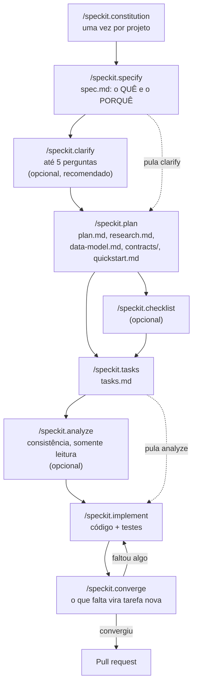
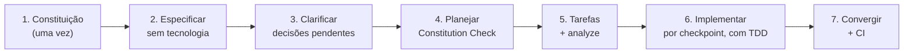

# Módulo 8 — Spec Kit: Spec-Driven Development com o GitHub Spec Kit

[← Módulo 7 — OpenSpec](modulo-7-openspec.md) · [Índice do curso](README.md) · [Módulo 9 — Context Engineering →](modulo-9-context-engineering.md)

> **Pré-requisitos:** [Módulo 7](modulo-7-openspec.md). O ambiente (oh-my-pi, `.agents/`, skills, rules e segurança) é montado no [Módulo 1](modulo-1-ambiente.md).


> Tutorial para quem está começando. O Spec Kit, do GitHub, é a segunda abordagem de Spec-Driven Development do curso: constituição, especificação, plano e tarefas, com portões entre as fases. O exemplo prático é a mesma API de catálogo de produtos do [Módulo 7 — OpenSpec](modulo-7-openspec.md), para facilitar a comparação.
>
> Parte I: teoria do Spec Kit e comparação com o OpenSpec. Parte II: Spec Kit e IA. Parte III: roteiro prático com `.agents/` e o **oh-my-pi (`omp`)**.
>
> Tudo o que aparece como "saída real" foi executado em 26/09/2026 com o **Spec Kit 1.0.12** (`specify-cli`), com as integrações `omp` e Claude Code; quando a integração faz diferença, o texto indica qual foi usada. Caminhos absolutos foram encurtados. Os comandos aparecem com ponto (`/speckit.specify`), a forma do `omp`; no Claude Code, o separador é hífen (seção 8.1).

---

## Sumário

**Parte I — Teoria**

1. [O que é o Spec Kit](#1-o-que-é-o-spec-kit)
2. [O fluxo de trabalho e os comandos](#2-o-fluxo-de-trabalho-e-os-comandos)
3. [Anatomia dos artefatos, com exemplos completos](#3-anatomia-dos-artefatos-com-exemplos-completos)
4. [Portões de qualidade: clarify, checklist, analyze e converge](#4-portões-de-qualidade-clarify-checklist-analyze-e-converge)
5. [Spec Kit x OpenSpec](#5-spec-kit-x-openspec)

**Parte II — Spec Kit e IA**

6. [O que muda quando uma IA escreve o código](#6-o-que-muda-quando-uma-ia-escreve-o-código)

**Parte III — Roteiro prático com `.agents` e oh-my-pi**

7. [Instalação](#7-instalação)
8. [Inicialização e estrutura gerada](#8-inicialização-e-estrutura-gerada)
9. [Constituição e contexto do projeto: `AGENTS.md`](#9-constituição-e-contexto-do-projeto-agentsmd)
10. [Ciclo completo passo a passo](#10-ciclo-completo-passo-a-passo)
11. [Por dentro: scripts, estado e hooks](#11-por-dentro-scripts-estado-e-hooks)
12. [Customização: overrides, presets, extensões](#12-customização-overrides-presets-extensões)
13. [Evoluindo o sistema: a segunda feature](#13-evoluindo-o-sistema-a-segunda-feature)
14. [Portões no CI](#14-portões-no-ci)
15. [Checklist, glossário e referências](#15-checklist-glossário-e-referências)

---

# Parte I — Teoria

## 1. O que é o Spec Kit

O Spec Kit é o toolkit open source do GitHub para Spec-Driven Development (SDD). Ele é formado por uma CLI em Python chamada `specify` e por um conjunto de templates, scripts e comandos (ou *skills*) que o seu assistente de IA executa.

A proposta do projeto é "inverter o roteiro" do desenvolvimento tradicional: a especificação deixa de ser um documento descartável e passa a gerar diretamente a implementação. O código é a última etapa de uma cadeia de artefatos revisáveis.

### 1.1 As ideias centrais

| Ideia | O que significa | Onde aparece |
| --- | --- | --- |
| **Constituição** | Princípios inegociáveis do projeto (testes primeiro, simplicidade, padrões de API). Todo plano é checado contra ela. | `.specify/memory/constitution.md` |
| **Separação o quê / como** | A spec descreve o que o usuário precisa, sem tecnologia. A stack só aparece no plano. | `spec.md` x `plan.md` |
| **Histórias independentes** | Cada história de usuário (P1, P2, P3) é um incremento testável e entregável sozinho. A P1 é o MVP. | `spec.md`, `tasks.md` |
| **Ambiguidade explícita** | O que não foi dito vira `[NEEDS CLARIFICATION: ...]` em vez de palpite da IA. | `spec.md`, `/speckit.clarify` |
| **Portões (gates)** | Pontos de parada: checagem da constituição, clarificações pendentes, checklists abertos. | `plan.md`, `/speckit.implement` |
| **Uma pasta por feature** | Cada funcionalidade tem seu diretório numerado com todos os artefatos. | `specs/001-.../` |

### 1.2 Onde o Spec Kit se encaixa no SDD

O SDD tem três níveis de artefato: intenção, comportamento e implementação. O Spec Kit mapeia assim:

| Nível | Pergunta | Artefato |
| --- | --- | --- |
| Princípios | Quais regras valem para qualquer feature? | `constitution.md` |
| Intenção e comportamento | O que o usuário precisa? Como saber que funciona? | `spec.md` |
| Decisões técnicas | Com que stack? Que modelo de dados? Que contrato? | `plan.md`, `research.md`, `data-model.md`, `contracts/` |
| Execução | Em que ordem, o que pode ser paralelo? | `tasks.md` |
| Verificação | Como provar que funciona? | `quickstart.md`, testes |

## 2. O fluxo de trabalho e os comandos

### 2.1 Visão geral



### 2.2 Referência dos comandos

| Comando | Quando | O que produz | Escreve arquivos? |
| --- | --- | --- | --- |
| `/speckit.constitution` | Uma vez, e em emendas | `.specify/memory/constitution.md` versionada | Sim |
| `/speckit.specify <descrição>` | Início de cada feature | `specs/NNN-nome/spec.md` + `checklists/requirements.md` | Sim |
| `/speckit.clarify` | Antes do plano | Seção `## Clarifications` na spec, com as respostas | Sim (só a spec) |
| `/speckit.plan <stack>` | Depois da spec | `plan.md`, `research.md`, `data-model.md`, `contracts/`, `quickstart.md` | Sim |
| `/speckit.checklist <domínio>` | Depois do plano | `checklists/<domínio>.md` | Sim |
| `/speckit.tasks` | Depois do plano | `tasks.md` | Sim |
| `/speckit.analyze` | Depois das tarefas | Relatório de inconsistências | **Não** |
| `/speckit.implement` | Depois das tarefas | Código, testes, tarefas marcadas `[X]` | Sim |
| `/speckit.converge` | Depois de implementar | Nova seção `## Phase N: Convergence` em `tasks.md` | Só acrescenta em `tasks.md` |
| `/speckit.taskstoissues` | Opcional | Issues no GitHub a partir de `tasks.md` | No GitHub |

No Claude Code, troque o ponto por hífen: `/speckit-specify` (seção 8.1).

## 3. Anatomia dos artefatos, com exemplos completos

### 3.1 `constitution.md`: a lei do projeto

A constituição vem como template com placeholders (`[PROJECT_NAME]`, `[PRINCIPLE_1_NAME]`...). O `/speckit.constitution` preenche esses campos a partir do que você pedir e do contexto do repositório.

Regras técnicas da skill:

- A constituição tem **versão semântica**: MAJOR quando um princípio é removido ou redefinido de forma incompatível; MINOR quando um princípio ou seção é acrescentado; PATCH para ajustes de redação.
- Cada atualização grava um **Sync Impact Report** como comentário HTML no topo do arquivo: versão antiga e nova, princípios alterados, templates que precisam ser revistos.
- Dados que faltam viram `TODO(<CAMPO>): explicação` e aparecem no relatório como pendências.
- O `/speckit.analyze` trata a constituição como **inegociável**: qualquer conflito com ela é classificado como CRITICAL.

Prompt:

```text
/speckit.constitution Projeto: Catálogo de Produtos e Pedidos (curso de programação assistida por IA).
Princípios: testes antes do código; API REST com erros RFC 9457; esquema versionado com Flyway;
simplicidade (sem microsserviços, sem cache até haver medição); decisões irreversíveis exigem
plano de rollback. Stack obrigatória: Java 21 e Spring Boot 3.
```

Resultado esperado em `.specify/memory/constitution.md`:

```markdown
<!--
Sync Impact Report
- Version change: (template) → 1.0.0
- Added principles: I. Test-First; II. Contrato de API; III. Esquema Versionado;
  IV. Simplicidade; V. Decisões Irreversíveis
- Added sections: Restrições Técnicas; Fluxo de Desenvolvimento
- Templates requiring updates: plan-template.md ✅ (Constitution Check usa os 5 princípios)
- Deferred items: nenhum
-->
# Catálogo de Produtos e Pedidos Constitution

## Core Principles

### I. Test-First (NON-NEGOTIABLE)
Todo comportamento novo começa por um teste que falha. Cada cenário de aceitação da spec
MUST ter ao menos um teste automatizado. O ciclo Red-Green-Refactor é obrigatório.

### II. Contrato de API
Endpoints seguem REST sobre JSON. Erros MUST usar application/problem+json (RFC 9457).
Mudanças incompatíveis no contrato MUST ser marcadas como BREAKING na spec e versionadas.

### III. Esquema Versionado
Toda mudança de banco MUST ser uma migração Flyway. `ddl-auto` MUST ser `validate`.

### IV. Simplicidade
Um único serviço Spring Boot. Sem cache, fila ou microsserviço sem medição que justifique.
Toda complexidade extra MUST ser registrada em Complexity Tracking no plano.

### V. Decisões Irreversíveis
Esquema de dados, contrato público e exclusão de dados são decisões de mão única:
o plano MUST trazer alternativas consideradas e estratégia de rollback.

## Restrições Técnicas
Java 21, Spring Boot 3.x, Spring Data JPA, PostgreSQL 16 em produção, H2 em testes.

## Fluxo de Desenvolvimento
Uma branch por feature (`NNN-nome`). PR só com testes verdes e `/speckit.analyze` sem CRITICAL.

## Governance
Esta constituição prevalece sobre outras práticas. Emendas exigem PR próprio, justificativa
e atualização de versão conforme SemVer. Todo PR deve verificar conformidade.

**Version**: 1.0.0 | **Ratified**: 2026-09-26 | **Last Amended**: 2026-09-26
```

> **Importante:** no template de tarefas do Spec Kit, testes são *opcionais* ("Tests are OPTIONAL - only include them if explicitly requested"). Se você quer testes sempre, o lugar certo para exigir é a constituição (princípio I acima) ou a própria spec.

### 3.2 `spec.md`: o quê e o porquê

O template (`.specify/templates/spec-template.md`) tem seções obrigatórias:

| Seção | Conteúdo | Regras |
| --- | --- | --- |
| Cabeçalho | Branch, data, status (`Draft`), descrição original em `Input` | Preenchido pela skill |
| **User Scenarios & Testing** *(obrigatória)* | Histórias com prioridade P1, P2, P3... | Cada história deve ser **testável e entregável sozinha** |
| Por história | *Why this priority*, *Independent Test*, *Acceptance Scenarios* (Given/When/Then) | A P1 sozinha deve ser um MVP |
| Edge Cases | Condições de borda e erro | |
| **Requirements** *(obrigatória)* | `FR-001`, `FR-002`... com MUST | Ambiguidades como `[NEEDS CLARIFICATION: ...]` |
| Key Entities | Entidades e atributos, sem tecnologia | Só se houver dados |
| **Success Criteria** *(obrigatória)* | `SC-001`... mensuráveis e agnósticos de tecnologia | |
| Assumptions | Padrões assumidos quando a descrição não disse | |

Prompt (repare: nenhuma palavra sobre Spring, JPA ou banco):

```text
/speckit.specify Preciso de um catálogo de produtos acessível por API. O atendente cadastra
produtos com nome, código SKU, preço e quantidade em estoque. Precisa consultar um produto,
listar todos, corrigir dados e remover produtos que saíram de linha.
```

Resultado em `specs/001-product-catalog/spec.md`:

```markdown
# Feature Specification: Catálogo de Produtos

**Feature Branch**: `001-product-catalog`

**Created**: 2026-09-26

**Status**: Draft

**Input**: User description: "Preciso de um catálogo de produtos acessível por API..."

## User Scenarios & Testing *(mandatory)*

### User Story 1 - Cadastrar produto (Priority: P1)

O atendente cadastra um produto informando nome, SKU, preço e estoque, e recebe o produto
criado com um identificador.

**Why this priority**: Sem cadastro não existe catálogo; é o menor incremento com valor.

**Independent Test**: Cadastrar um produto e consultá-lo pelo identificador retornado.

**Acceptance Scenarios**:

1. **Given** que não existe produto com SKU "CAN-001", **When** o atendente cadastra
   "Caneta azul", SKU "CAN-001", preço 2,50 e estoque 100, **Then** o produto é criado
   e seu identificador é informado.
2. **Given** que já existe produto com SKU "CAN-001", **When** o atendente tenta cadastrar
   outro com o mesmo SKU, **Then** o cadastro é recusado informando conflito.
3. **Given** qualquer estado, **When** o atendente informa preço zero ou negativo,
   **Then** o cadastro é recusado indicando o campo inválido.

---

### User Story 2 - Consultar e listar produtos (Priority: P2)

O atendente consulta um produto pelo identificador ou lista todos em ordem alfabética.

**Why this priority**: Consulta é o uso mais frequente depois que há dados.

**Independent Test**: Com produtos cadastrados, listar e conferir a ordem por nome.

**Acceptance Scenarios**:

1. **Given** produtos cadastrados, **When** o atendente lista o catálogo,
   **Then** recebe todos os produtos ordenados por nome.
2. **Given** um identificador inexistente, **When** o atendente consulta,
   **Then** é informado de que o produto não foi encontrado.

---

### User Story 3 - Corrigir e remover produtos (Priority: P3)

O atendente corrige nome, preço e estoque, e remove produtos fora de linha.

**Why this priority**: Manutenção do catálogo; pode vir depois do MVP.

**Independent Test**: Alterar o preço de um produto e depois removê-lo.

**Acceptance Scenarios**:

1. **Given** um produto existente, **When** o atendente altera preço e estoque,
   **Then** os novos valores passam a valer e o SKU permanece o mesmo.
2. **Given** um produto existente, **When** o atendente o remove,
   **Then** consultas posteriores informam que não existe.

### Edge Cases

- O que acontece quando dois atendentes cadastram o mesmo SKU ao mesmo tempo?
- Como o sistema trata nome com mais de 120 caracteres?
- Remoção de produto que já possui pedidos: [NEEDS CLARIFICATION: remover de fato ou inativar?]

## Requirements *(mandatory)*

### Functional Requirements

- **FR-001**: System MUST criar produtos com nome, SKU, preço e estoque.
- **FR-002**: System MUST recusar SKU duplicado.
- **FR-003**: System MUST recusar preço menor ou igual a zero e estoque negativo.
- **FR-004**: System MUST permitir consulta por identificador.
- **FR-005**: System MUST listar produtos ordenados por nome.
- **FR-006**: System MUST permitir alterar nome, preço e estoque, mantendo o SKU imutável.
- **FR-007**: System MUST permitir remover produtos.
- **FR-008**: System MUST informar erros em formato padronizado e legível por máquina.

### Key Entities

- **Produto**: item vendável; nome, SKU único e imutável, preço, quantidade em estoque.

## Success Criteria *(mandatory)*

### Measurable Outcomes

- **SC-001**: Um atendente cadastra um produto em uma única requisição, sem etapas extras.
- **SC-002**: 100% das recusas informam qual campo ou regra causou o erro.
- **SC-003**: A listagem de até 1.000 produtos responde em menos de 1 segundo.

## Assumptions

- Não há autenticação nesta versão (ambiente de laboratório).
- Preços em reais, com duas casas decimais.
```

### 3.3 `## Clarifications`: o registro das decisões

O `/speckit.clarify` varre a spec por uma taxonomia de categorias (escopo, modelo de dados, fluxos, requisitos não funcionais, integrações, casos de borda etc.), marca cada uma como *Clear*, *Partial* ou *Missing* e faz **no máximo 5 perguntas**, uma por vez. Cada pergunta é de múltipla escolha (2 a 5 opções) ou de resposta curta (até 5 palavras), e só entra se a resposta mudar arquitetura, dados, tarefas, testes ou operação.

As respostas são gravadas na própria spec:

```markdown
## Clarifications

### Session 2026-09-26

- Q: Remoção de produto que já possui pedidos: remover de fato ou inativar? → A: Remover de fato nesta versão; inativação fica para uma feature futura
- Q: Formato de erro padronizado? → A: application/problem+json (RFC 9457)
```

E o requisito ambíguo é reescrito sem o marcador `[NEEDS CLARIFICATION]`.

### 3.4 `checklists/requirements.md`: "testes unitários para a escrita"

O `/speckit.specify` cria um checklist de qualidade da spec. O `/speckit.checklist` gera outros, por domínio. A skill define o conceito assim: checklists são **"unit tests for English"**, ou seja, testam se os *requisitos* estão bem escritos, e não se o código funciona.

| Certo (testa o requisito) | Errado (testa a implementação) |
| --- | --- |
| "Os códigos de erro estão definidos para todos os cenários de falha?" | "O endpoint retorna 404?" |
| "O formato de preço (casas decimais, moeda) está especificado?" | "O BigDecimal está com scale 2?" |
| "O comportamento em cadastro concorrente do mesmo SKU está definido?" | "Existe constraint UNIQUE?" |

Exemplo de `checklists/api.md` gerado por `/speckit.checklist api`:

```markdown
# API Requirements Quality Checklist: Catálogo de Produtos

**Purpose**: Validar completude e clareza dos requisitos de API antes da implementação
**Created**: 2026-09-26

## Completeness
- [ ] CHK001 Todos os cenários de falha têm resposta de erro definida? [Spec §FR-008]
- [ ] CHK002 O formato de listagem (array ou objeto) está especificado? [Gap]

## Clarity
- [ ] CHK003 "Ordenados por nome" define sensibilidade a maiúsculas e acentos? [Ambiguity, Spec §FR-005]

## Consistency
- [ ] CHK004 A imutabilidade do SKU aparece igual na história 3 e no FR-006? [Consistency]
```

O `/speckit.implement` usa os checklists como **portão**: se algum item estiver desmarcado, ele mostra uma tabela e pergunta se deve continuar mesmo assim.

```text
| Checklist        | Total | Checked | Unchecked | Status |
|------------------|-------|---------|-----------|--------|
| requirements.md  | 12    | 12      | 0         | ✓ PASS |
| api.md           | 4     | 2       | 2         | ✗ FAIL |
```

### 3.5 `plan.md`: o como

Agora sim entra a tecnologia. O plano tem:

| Seção | Conteúdo |
| --- | --- |
| Summary | Requisito principal + abordagem técnica |
| **Technical Context** | Linguagem, dependências, armazenamento, testes, plataforma, tipo de projeto, metas de desempenho, restrições, escala. O que não se sabe vira `NEEDS CLARIFICATION`. |
| **Constitution Check** | *GATE*: precisa passar antes da Fase 0 e de novo depois da Fase 1 |
| Project Structure | Árvore da documentação e do código-fonte real |
| **Complexity Tracking** | Só se houver violação da constituição: o que viola, por quê, e por que a alternativa simples foi rejeitada |

Fases que o `/speckit.plan` executa:

1. Roda `setup-plan.sh --json` (copia o template para `plan.md`).
2. Preenche Technical Context e avalia os portões da constituição. Violação sem justificativa = **ERROR**.
3. **Fase 0**: gera `research.md`, resolvendo todos os `NEEDS CLARIFICATION`.
4. **Fase 1**: gera `data-model.md`, `contracts/` e `quickstart.md`.
5. Reavalia a constituição e para. `tasks.md` **não** é criado pelo plano.

Prompt:

```text
/speckit.plan Java 21, Spring Boot 3.5, Spring Web, Spring Data JPA, Bean Validation,
Flyway, H2 em testes e PostgreSQL 16 em produção. Camadas controller/service/repository,
DTOs como records. Testes com JUnit 5, Mockito, @WebMvcTest e @DataJpaTest.
```

Resultado em `specs/001-product-catalog/plan.md`:

````markdown
# Implementation Plan: Catálogo de Produtos

**Branch**: `001-product-catalog` | **Date**: 2026-09-26 | **Spec**: [spec.md](./spec.md)

**Input**: Feature specification from `/specs/001-product-catalog/spec.md`

## Summary

API REST de CRUD de produtos (FR-001 a FR-008) em um único serviço Spring Boot,
com persistência JPA, esquema versionado por Flyway e erros RFC 9457.

## Technical Context

**Language/Version**: Java 21

**Primary Dependencies**: Spring Boot 3.5 (Web, Data JPA, Validation), Flyway

**Storage**: PostgreSQL 16 (produção), H2 em memória (dev/testes)

**Testing**: JUnit 5, Mockito, Spring Boot Test (@WebMvcTest, @DataJpaTest, @SpringBootTest)

**Target Platform**: Linux server (JVM 21)

**Project Type**: web-service

**Performance Goals**: listagem de 1.000 produtos < 1 s (SC-003)

**Constraints**: SKU único mesmo com cadastros concorrentes

**Scale/Scope**: laboratório acadêmico; até 10 mil produtos

## Constitution Check

*GATE: Must pass before Phase 0 research. Re-check after Phase 1 design.*

| Princípio | Status | Evidência |
| --- | --- | --- |
| I. Test-First | ✅ | Tarefas de teste precedem implementação em cada história |
| II. Contrato de API | ✅ | contracts/products-api.yaml; erros problem+json |
| III. Esquema Versionado | ✅ | V1__create_product.sql; ddl-auto=validate |
| IV. Simplicidade | ✅ | Um serviço, sem cache |
| V. Decisões Irreversíveis | ✅ | research.md traz alternativas e rollback da tabela |

## Project Structure

### Documentation (this feature)

```text
specs/001-product-catalog/
├── plan.md
├── research.md
├── data-model.md
├── quickstart.md
├── contracts/products-api.yaml
└── tasks.md
```

### Source Code (repository root)

```text
src/main/java/br/edu/fatec/catalogo/
├── common/ApiExceptionHandler.java
└── product/
    ├── Product.java
    ├── ProductRepository.java
    ├── ProductService.java
    ├── ProductController.java
    └── dto/ (ProductRequest, ProductUpdateRequest, ProductResponse)
src/main/resources/db/migration/V1__create_product.sql
src/test/java/br/edu/fatec/catalogo/product/
├── ProductRepositoryTest.java
├── ProductServiceTest.java
├── ProductControllerTest.java
└── ProductApiIT.java
```

**Structure Decision**: projeto único Maven, pacotes por funcionalidade.

## Complexity Tracking

Sem violações da constituição.
````

### 3.6 `research.md`: decisões com alternativas

Formato pedido pela skill: para cada incógnita, **Decision**, **Rationale** e **Alternatives considered**.

```markdown
# Research: Catálogo de Produtos

## R1. Versionamento de esquema
- **Decision**: Flyway com migrações SQL em `db/migration`.
- **Rationale**: exigido pelo princípio III; reprodutível entre H2 e PostgreSQL.
- **Alternatives considered**: `ddl-auto=update` (não reprodutível, viola III); Liquibase
  (mais recursos do que o necessário, viola IV).

## R2. Garantia de SKU único sob concorrência
- **Decision**: constraint UNIQUE no banco + checagem prévia no serviço; violação de
  integridade traduzida em 409.
- **Rationale**: a checagem prévia dá mensagem clara; a constraint cobre a corrida.
- **Alternatives considered**: lock pessimista (custo desnecessário para o volume).

## R3. Formato de erro
- **Decision**: `ProblemDetail` nativo do Spring 6 (RFC 9457).
- **Rationale**: princípio II; zero dependência extra.
- **Alternatives considered**: DTO de erro próprio (reinventa padrão existente).

## R4. Rollback da decisão irreversível (tabela product)
- **Decision**: primeira migração sem dados em produção; rollback = `DROP TABLE product`.
```

### 3.7 `data-model.md`: entidades, regras e estados

```markdown
# Data Model: Catálogo de Produtos

## Entity: Product

| Campo | Tipo lógico | Regras | Origem |
| --- | --- | --- | --- |
| id | inteiro longo | gerado pelo sistema | FR-001 |
| name | texto (1..120) | obrigatório | FR-001 |
| sku | texto (1..40) | obrigatório, único, imutável | FR-001, FR-002, FR-006 |
| price | decimal (12,2) | > 0 | FR-003 |
| stock | inteiro | >= 0 | FR-003 |
| createdAt | data/hora | gerado pelo sistema | — |

**Invariantes**: SKU nunca muda após o cadastro; preço sempre positivo.
**Índices**: único em `sku`; índice em `name` (listagem ordenada, SC-003).
```

### 3.8 `contracts/products-api.yaml`: o contrato da API

Para web services, a Fase 1 gera contratos a partir dos requisitos funcionais. Um OpenAPI é a forma natural:

```yaml
openapi: 3.0.3
info:
  title: Catálogo de Produtos
  version: 1.0.0
paths:
  /api/products:
    get:
      summary: Lista produtos ordenados por nome (FR-005)
      responses:
        "200":
          description: OK
          content:
            application/json:
              schema: { type: array, items: { $ref: "#/components/schemas/Product" } }
    post:
      summary: Cadastra produto (FR-001, FR-002, FR-003)
      requestBody:
        required: true
        content:
          application/json:
            schema: { $ref: "#/components/schemas/ProductRequest" }
      responses:
        "201":
          description: Criado
          headers:
            Location: { schema: { type: string } }
          content:
            application/json:
              schema: { $ref: "#/components/schemas/Product" }
        "400": { $ref: "#/components/responses/Problem" }
        "409": { $ref: "#/components/responses/Problem" }
  /api/products/{id}:
    parameters:
      - { name: id, in: path, required: true, schema: { type: integer, format: int64 } }
    get:
      summary: Consulta por id (FR-004)
      responses:
        "200": { description: OK, content: { application/json: { schema: { $ref: "#/components/schemas/Product" } } } }
        "404": { $ref: "#/components/responses/Problem" }
    put:
      summary: Altera nome, preço e estoque; SKU imutável (FR-006)
      requestBody:
        required: true
        content:
          application/json:
            schema: { $ref: "#/components/schemas/ProductUpdateRequest" }
      responses:
        "200": { description: OK, content: { application/json: { schema: { $ref: "#/components/schemas/Product" } } } }
        "400": { $ref: "#/components/responses/Problem" }
        "404": { $ref: "#/components/responses/Problem" }
    delete:
      summary: Remove produto (FR-007)
      responses:
        "204": { description: Removido }
        "404": { $ref: "#/components/responses/Problem" }
components:
  schemas:
    Product:
      type: object
      properties:
        id: { type: integer, format: int64 }
        name: { type: string }
        sku: { type: string }
        price: { type: number, format: decimal }
        stock: { type: integer }
    ProductRequest:
      type: object
      required: [name, sku, price, stock]
      properties:
        name: { type: string, maxLength: 120 }
        sku: { type: string, maxLength: 40 }
        price: { type: number, exclusiveMinimum: true, minimum: 0 }
        stock: { type: integer, minimum: 0 }
    ProductUpdateRequest:
      type: object
      required: [name, price, stock]
      properties:
        name: { type: string, maxLength: 120 }
        price: { type: number, exclusiveMinimum: true, minimum: 0 }
        stock: { type: integer, minimum: 0 }
  responses:
    Problem:
      description: Erro RFC 9457 (FR-008)
      content:
        application/problem+json:
          schema:
            type: object
            properties:
              type: { type: string }
              title: { type: string }
              status: { type: integer }
              detail: { type: string }
              errors: { type: object, additionalProperties: { type: string } }
```

O contrato também serve para testes de contrato: cada operação vira uma tarefa de teste em `tasks.md`.

### 3.9 `quickstart.md`: o roteiro de validação

O quickstart é o guia para provar que a feature funciona, referenciando contrato e modelo em vez de repeti-los:

```markdown
# Quickstart: Catálogo de Produtos

## Subir a aplicação
./mvnw spring-boot:run

## Validar a História 1 (P1 - MVP)
curl -i -X POST localhost:8080/api/products -H 'Content-Type: application/json' \
  -d '{"name":"Caneta azul","sku":"CAN-001","price":2.50,"stock":100}'
# Esperado: 201 Created + header Location (spec US1, cenário 1)

curl -i -X POST localhost:8080/api/products -H 'Content-Type: application/json' \
  -d '{"name":"Outra","sku":"CAN-001","price":3.00,"stock":1}'
# Esperado: 409 application/problem+json (US1, cenário 2)

## Validar a História 2
curl -s localhost:8080/api/products | jq '.[].name'
# Esperado: nomes em ordem alfabética (US2, cenário 1)

## Rodar os testes
./mvnw test
```

### 3.10 `tasks.md`: execução organizada por história

Formato de cada linha: `- [ ] T### [P] [US#] Descrição com caminho exato do arquivo`.

| Marcador | Significado |
| --- | --- |
| `T001`, `T002`... | ID sequencial, na ordem de execução |
| `[P]` | Pode rodar em paralelo: arquivos diferentes, sem dependência de tarefa incompleta |
| `[US1]` | História de usuário atendida (só nas fases de história) |
| Caminho do arquivo | Obrigatório na descrição |

Estrutura de fases do template:

1. **Setup**: estrutura do projeto e dependências.
2. **Foundational**: pré-requisitos que bloqueiam todas as histórias (banco, migração, tratamento de erros). Nenhuma história começa antes.
3. **Uma fase por história**, na ordem de prioridade (a P1 é marcada como MVP 🎯), com *Checkpoint* ao final: a história deve funcionar sozinha.
4. **Polish & Cross-Cutting Concerns**.

```markdown
# Tasks: Catálogo de Produtos

**Input**: Design documents from `/specs/001-product-catalog/`

**Prerequisites**: plan.md, spec.md, research.md, data-model.md, contracts/

**Tests**: incluídos (princípio I da constituição: Test-First)

## Phase 1: Setup

- [ ] T001 Adicionar flyway-core e flyway-database-postgresql ao pom.xml
- [ ] T002 [P] Configurar src/main/resources/application.yml (H2 dev, ddl-auto=validate, problemdetails)

## Phase 2: Foundational (Blocking Prerequisites)

**⚠️ CRITICAL**: nenhuma história começa antes desta fase

- [ ] T003 Criar src/main/resources/db/migration/V1__create_product.sql (UNIQUE sku, CHECK price>0, stock>=0)
- [ ] T004 Criar entidade src/main/java/br/edu/fatec/catalogo/product/Product.java
- [ ] T005 Criar src/main/java/br/edu/fatec/catalogo/product/ProductRepository.java com existsBySku
- [ ] T006 Criar src/main/java/br/edu/fatec/catalogo/common/ApiExceptionHandler.java (ProblemDetail 400/404/409)

**Checkpoint**: fundação pronta

## Phase 3: User Story 1 - Cadastrar produto (Priority: P1) 🎯 MVP

**Goal**: cadastro com validação e SKU único
**Independent Test**: POST válido retorna 201; SKU repetido retorna 409

### Tests for User Story 1 ⚠️ (escrever antes e ver falhar)

- [ ] T007 [P] [US1] Teste de contrato POST /api/products em src/test/java/.../product/ProductControllerTest.java
- [ ] T008 [P] [US1] Teste de SKU duplicado em src/test/java/.../product/ProductServiceTest.java
- [ ] T009 [P] [US1] Teste da constraint UNIQUE em src/test/java/.../product/ProductRepositoryTest.java

### Implementation for User Story 1

- [ ] T010 [P] [US1] Criar records ProductRequest e ProductResponse em src/main/java/.../product/dto/
- [ ] T011 [US1] Implementar ProductService.create em src/main/java/.../product/ProductService.java (depende de T005, T010)
- [ ] T012 [US1] Implementar POST em src/main/java/.../product/ProductController.java (depende de T011)

**Checkpoint**: história 1 funcional e testável sozinha

## Phase 4: User Story 2 - Consultar e listar (Priority: P2)

- [ ] T013 [P] [US2] Testes GET por id e listagem em ProductControllerTest.java
- [ ] T014 [US2] Implementar findById e findAll (Sort.by("name")) em ProductService.java
- [ ] T015 [US2] Implementar GET /api/products e GET /api/products/{id} em ProductController.java

## Phase 5: User Story 3 - Corrigir e remover (Priority: P3)

- [ ] T016 [P] [US3] Testes PUT e DELETE em src/test/java/.../product/ProductApiIT.java
- [ ] T017 [P] [US3] Criar record ProductUpdateRequest (sem SKU) em src/main/java/.../product/dto/
- [ ] T018 [US3] Implementar update e delete em ProductService.java e ProductController.java

## Phase 6: Polish & Cross-Cutting Concerns

- [ ] T019 [P] Executar os passos de quickstart.md e conferir as respostas esperadas
- [ ] T020 Rodar ./mvnw verify e confirmar todos os testes verdes

## Dependencies & Execution Order

- Setup → Foundational → US1 → (US2 e US3 podem seguir em paralelo) → Polish
- Tarefas [P] dentro da mesma fase podem ser feitas ao mesmo tempo (arquivos diferentes)
```

Por que organizar por história? Porque você pode **parar depois da Fase 3** e entregar um MVP funcional, testado, com valor para o usuário. Esse é o mesmo espírito do tenet "lançar o mais rápido possível".

## 4. Portões de qualidade: clarify, checklist, analyze e converge

| Comando | Momento | Pergunta que responde | Escreve? |
| --- | --- | --- | --- |
| `/speckit.clarify` | spec → plano | "O que ainda está ambíguo e muda o projeto?" | Só a spec |
| `/speckit.checklist` | plano → tarefas | "Os requisitos deste domínio estão completos e claros?" | `checklists/` |
| `/speckit.analyze` | tarefas → código | "Spec, plano e tarefas são coerentes entre si e com a constituição?" | Não |
| `/speckit.converge` | código → PR | "O código entrega tudo o que foi prometido?" | Só acrescenta em `tasks.md` |

### 4.1 Clarify

Detalhado na seção 3.3. Regra prática: rode sempre que a spec tiver `[NEEDS CLARIFICATION]` ou quando o domínio envolver decisões irreversíveis (dados, contrato, segurança).

### 4.2 Checklist

Detalhado na seção 3.4. Gere checklists para os domínios de risco do projeto: `api`, `security`, `performance`, `ux`, `data-migration`.

### 4.3 Analyze

É **estritamente somente leitura**: não altera nada e oferece um plano de correção que você precisa aprovar. Ele monta um inventário de requisitos (`FR-###`, `SC-###`), mapeia cada tarefa aos requisitos e procura seis tipos de problema: duplicação, ambiguidade, subespecificação, conflito com a constituição, lacunas de cobertura e inconsistência de terminologia.

Severidades:

| Severidade | Critério |
| --- | --- |
| **CRITICAL** | Viola um MUST da constituição, falta artefato central, ou requisito sem nenhuma tarefa que bloqueia o básico |
| **HIGH** | Requisito duplicado ou conflitante, atributo de segurança/desempenho ambíguo, critério de aceitação não testável |
| **MEDIUM** | Deriva de terminologia, falta de tarefa não funcional, caso de borda subespecificado |
| **LOW** | Redação, redundância menor |

Limite de 50 achados; o excedente vai para um resumo. Formato do relatório:

```markdown
| ID | Category | Severity | Location(s) | Summary | Recommendation |
|----|----------|----------|-------------|---------|----------------|
| C1 | Coverage | CRITICAL | spec.md FR-008 | Nenhuma tarefa cobre o formato de erro padronizado | Adicionar tarefa para ApiExceptionHandler |
| A1 | Ambiguity | HIGH | spec.md SC-003 | "responde em menos de 1 s" sem ambiente definido | Definir hardware/volume de referência |
| T1 | Terminology | MEDIUM | spec.md / plan.md | "remover" na spec, "inativar" no plano | Unificar termo |

**Coverage Summary**
| Requirement Key | Has Task? | Task IDs | Notes |
| FR-001 | ✅ | T004, T010-T012 | |
| FR-008 | ❌ | — | ver C1 |

Metrics: Total Requirements: 8 · Coverage: 87,5% · Ambiguity Count: 1 · Critical Issues: 1
```

### 4.4 Converge

Compara o código real com spec, plano e tarefas. Regras da skill:

- **Só acrescenta, nunca reescreve**: a única escrita permitida é uma nova seção `## Phase N: Convergence` no fim de `tasks.md`.
- Não altera código nem tarefas existentes, e não apaga nada.
- "Marcado como feito" não é evidência: ele verifica o comportamento atual.
- Se nada falta, informa que convergiu e não escreve.

Exemplo do que ele acrescenta:

```markdown
## Phase 7: Convergence

- [ ] T021 [US1] FR-003 exige estoque >= 0, mas ProductRequest aceita negativo: adicionar @PositiveOrZero em src/main/java/.../dto/ProductRequest.java
- [ ] T022 [US2] SC-003 sem índice em name: criar V2__index_product_name.sql
```

## 5. Spec Kit x OpenSpec

| Aspecto | Spec Kit 1.0.12 | OpenSpec 1.13 |
| --- | --- | --- |
| Linguagem da CLI | Python (`uv tool install specify-cli`) | Node.js (`npm i -g @fission-ai/openspec`) |
| Unidade de trabalho | Feature: `specs/NNN-nome/` | Mudança: `openspec/changes/<nome>/` |
| Princípios do projeto | `constitution.md` versionada (SemVer), checada como portão | `config.yaml` (`context` e `rules`) |
| Spec | Histórias priorizadas + FR/SC + Given/When/Then | Requisitos `### Requirement` + `#### Scenario` |
| Estado atual do sistema | Não consolidado: uma spec por feature | `openspec/specs/` consolidado via merge de deltas |
| Mudança em sistema existente | Nova feature que referencia a anterior | Delta ADDED/MODIFIED/REMOVED/RENAMED |
| Artefatos técnicos | `plan.md`, `research.md`, `data-model.md`, `contracts/`, `quickstart.md` | `design.md` (opcional) |
| Tarefas | `T001 [P] [US1]`, por história, com marcação de paralelismo | `1.1`, por grupo, com verificação por tarefa |
| Validação estrutural | Scripts de pré-requisito + `/speckit.analyze` (feita pela IA) | `openspec validate --strict` (determinística, CLI) |
| Ambiguidade | `[NEEDS CLARIFICATION]` + `/speckit.clarify` | `/opsx:explore` + revisão |
| Pós-implementação | `/speckit.converge` | `/opsx:verify` + `archive` |
| Ponto forte | Greenfield, features grandes, rastreio FR → tarefa | Brownfield, mudanças incrementais, spec viva do sistema |

Uma regra prática para escolher: projeto novo, com features grandes e bem delimitadas, favorece o Spec Kit. Sistema existente que muda aos poucos, e em que você quer uma spec única sempre atualizada, favorece o OpenSpec.

---

# Parte II — Spec Kit e IA

## 6. O que muda quando uma IA escreve o código

### 6.1 Onde o Spec Kit segura a IA

O Spec Kit obriga o agente a parar em pontos definidos: o que não foi dito vira `[NEEDS CLARIFICATION]` em vez de palpite, o plano passa pelo Constitution Check, os checklists abertos travam o implement e o converge compara o código com o que foi prometido. A diferença para o [Módulo 7](modulo-7-openspec.md) está em **quem verifica**: no OpenSpec, a estrutura é validada por uma CLI determinística (`openspec validate`); no Spec Kit, a análise de consistência (`/speckit.analyze`) é feita pela própria IA. Por isso a revisão humana e os testes pesam ainda mais aqui.

### 6.2 Os vícios da IA também aparecem aqui

| Risco | Como aparece | Mitigação |
| --- | --- | --- |
| **Palpite no lugar de pergunta** | Spec sem nenhum `[NEEDS CLARIFICATION]` num domínio cheio de decisões | Rodar `/speckit.clarify` e revisar as Assumptions (seção 3.2) |
| **Tecnologia vazando para a spec** | "FR-001: usar JPA para gravar o produto" | Stack só no `/speckit.plan` (seções 3.2 e 3.5) |
| **Testes esquecidos** | `tasks.md` sem tarefas de teste, que são opcionais no template | Exigir testes na constituição (seção 3.1) |
| **Complexidade sem justificativa** | Cache, fila ou microsserviço surgindo no plano | Constitution Check e Complexity Tracking (seção 3.5) |
| **"Feito" sem estar feito** | Tarefas marcadas `[X]` sem o comportamento no código | `/speckit.converge` compara com o código real (seção 4.4) |
| **Relatório da IA tratado como prova** | `/speckit.analyze` sem CRITICAL visto como garantia | Complementar com testes e CI (seção 14) |
| **Feature grande demais** | P1 que não entrega valor sozinha | Histórias independentes; implementar por checkpoint (seção 3.10) |

### 6.3 O processo recomendado



O ponto central é o mesmo do Módulo 7: **a IA propõe, você decide.** No Spec Kit, as decisões ficam registradas na constituição, nas respostas do clarify e no `research.md`.

---

# Parte III — Roteiro prático com `.agents` e oh-my-pi

## 7. Instalação

### 7.1 Pré-requisitos

- Python 3.11+ e o gerenciador [`uv`](https://docs.astral.sh/uv/)
- Git
- Um assistente de IA suportado (Claude Code, GitHub Copilot, Cursor, Gemini CLI, Codex, Windsurf e mais de 30 outros)
- Para o exemplo: Java 21 e Maven

### 7.2 Instalar a CLI

Fixe a versão com a tag do release. Isso garante que todos os alunos tenham os mesmos templates.

```bash
# instalação persistente, versão fixada (recomendado)
uv tool install specify-cli --from git+https://github.com/github/spec-kit.git@v1.0.12

# alternativa: pelo PyPI
uv tool install specify-cli

specify --version
# specify 1.0.12
```

Gerenciamento da própria CLI:

```bash
specify self check              # verifica se há versão nova (somente leitura)
specify self upgrade --dry-run  # mostra o que mudaria
specify self upgrade            # atualiza para o último estável
specify self upgrade --tag v1.0.12
```

### 7.3 Verificar o ambiente

```bash
specify check
```

O comando lista cada integração e se a ferramenta foi encontrada no `PATH`. Trecho real:

```text
├── ○ Kilo Code (IDE-based, no CLI check)
├── ● opencode (not found)
├── ○ Zed (IDE-based, no CLI check)
└── ● Visual Studio Code (not found)

Specify CLI is ready to use!
Tip: Run 'specify self check' to verify you have the latest CLI version
```

Para ver todas as integrações disponíveis: `specify integration list`.

## 8. Inicialização e estrutura gerada

### 8.1 O comando `init`

```bash
# no curso: integração com o oh-my-pi, na raiz do repositório catalogo (seção 8.5)
cd ~/curso_spring/catalogo
specify init --here --force --integration omp --non-interactive --script sh

# outro assistente (ex.: Claude Code), criando a pasta catalogo/
specify init catalogo --integration claude --script sh

# Claude Code dentro de um projeto que já existe
specify init --here --integration claude --script sh
```

Flags do `init` (saída de `specify init --help`):

| Flag | Efeito |
| --- | --- |
| `--integration <agente>` | Agente de IA: `claude`, `copilot`, `cursor-agent`, `gemini` etc. |
| `--script sh\|ps\|py` | Linguagem dos scripts auxiliares: bash, PowerShell ou Python |
| `--here` | Inicializa no diretório atual |
| `--force` | Mescla/sobrescreve com `--here` sem confirmar |
| `--non-interactive` | Nunca pergunta; falha em vez de travar quando não há padrão seguro |
| `--ignore-agent-tools` | Pula a checagem de que o agente está instalado |
| `--preset <id>` | Instala um preset de templates na inicialização |
| `--extension <nome\|caminho\|URL>` | Instala extensões na inicialização (repetível) |
| `--integration-options "<opts>"` | Opções da integração, ex.: `--commands-dir .myagent/cmds` |

Saída real do final do `init` com a integração Claude Code (a da integração `omp` está na seção 8.5):

```text
Project ready.

╭──────────────────────── Agent Folder Security ────────────────────────╮
│  Some agents may store credentials, auth tokens, or other identifying │
│  and private artifacts in the agent folder within your project.       │
│  Consider adding .claude/ (or parts of it) to .gitignore ...          │
╰───────────────────────────────────────────────────────────────────────╯
╭───────────────────────────── Next Steps ──────────────────────────────╮
│  2. Start Claude in this project directory; spec-kit skills were      │
│  installed to .claude/skills                                          │
│  3. Start using skills with your coding agent:                        │
│     3.1 /speckit-constitution - Establish project principles          │
│     3.2 /speckit-specify - Create baseline specification              │
│     3.3 /speckit-plan - Create implementation plan                    │
│     3.4 /speckit-tasks - Generate actionable tasks                    │
│     3.5 /speckit-implement - Execute implementation                   │
│     3.6 /speckit-converge - Assess the codebase and append remaining  │
│  work as tasks                                                        │
╰───────────────────────────────────────────────────────────────────────╯
```

> **Nome dos comandos.** A documentação do Spec Kit escreve `/speckit.specify`, e é assim que os comandos se chamam no `omp` (`"invoke_separator": "."`). Com a integração Claude Code, o Spec Kit instala *skills* e o separador vira hífen: `/speckit-specify` (`"invoke_separator": "-"` em `.specify/integration.json`). Este módulo usa a forma com ponto.

### 8.2 Estrutura gerada (listagem real)

Listagem feita com a integração Claude Code. Com `--integration omp`, a pasta `.claude/skills/` dá lugar a `.omp/commands/` (a seção 8.5 mostra a diferença).

```text
catalogo/
├── .claude/
│   └── skills/
│       ├── speckit-analyze/SKILL.md
│       ├── speckit-checklist/SKILL.md
│       ├── speckit-clarify/SKILL.md
│       ├── speckit-constitution/SKILL.md
│       ├── speckit-converge/SKILL.md
│       ├── speckit-implement/SKILL.md
│       ├── speckit-plan/SKILL.md
│       ├── speckit-specify/SKILL.md
│       ├── speckit-tasks/SKILL.md
│       └── speckit-taskstoissues/SKILL.md
└── .specify/
    ├── .gitignore                         # ignora estado local (feature.json etc.)
    ├── init-options.json                  # opções usadas no init
    ├── integration.json                   # integração ativa e separador de comando
    ├── integrations/
    │   ├── claude.manifest.json           # arquivos que a integração instalou
    │   └── speckit.manifest.json
    ├── memory/
    │   ├── constitution.md                # A CONSTITUIÇÃO (começa como template)
    │   └── .constitution-template.json
    ├── scripts/bash/
    │   ├── check-prerequisites.sh         # valida pré-requisitos de cada fase
    │   ├── common.sh
    │   ├── create-new-feature.sh          # cria specs/NNN-nome/spec.md
    │   ├── resolve-template.sh            # resolve template (override > preset > core)
    │   ├── setup-plan.sh                  # copia o template de plano
    │   └── setup-tasks.sh
    ├── templates/
    │   ├── checklist-template.md
    │   ├── constitution-template.md
    │   ├── plan-template.md
    │   ├── spec-template.md
    │   └── tasks-template.md
    └── workflows/
        ├── speckit/workflow.yml
        └── workflow-registry.json
```

Depois da primeira feature aparece a pasta `specs/`:

```text
specs/
└── 001-product-catalog/
    ├── spec.md              # /speckit.specify
    ├── checklists/
    │   └── requirements.md  # checklist de qualidade da spec (/speckit.specify e /speckit.clarify)
    ├── plan.md              # /speckit.plan
    ├── research.md          # /speckit.plan - Fase 0
    ├── data-model.md        # /speckit.plan - Fase 1
    ├── quickstart.md        # /speckit.plan - Fase 1
    ├── contracts/           # /speckit.plan - Fase 1
    │   └── products-api.yaml
    └── tasks.md             # /speckit.tasks
```

### 8.3 Arquivos de estado

`.specify/init-options.json` (real):

```json
{
  "ai": "claude",
  "ai_skills": true,
  "feature_numbering": "sequential",
  "here": false,
  "integration": "claude",
  "script": "sh",
  "speckit_version": "1.0.12"
}
```

`feature_numbering` pode ser `sequential` (001, 002...) ou `timestamp` (`20260926-143000`). Equipes grandes com muitas branches paralelas preferem timestamp para evitar colisão de números.

`.specify/feature.json` aponta para a feature atual. Ele é reescrito a cada troca de feature e está no `.gitignore`, porque é estado da sua cópia local:

```json
{"feature_directory":"specs/001-product-catalog"}
```

### 8.4 O que versionar no Git

| Caminho | Versionar? | Motivo |
| --- | --- | --- |
| `.specify/memory/constitution.md` | Sim | Princípios do time |
| `.specify/templates/`, `scripts/`, `workflows/` | Sim | Todos usam os mesmos templates |
| `.specify/feature.json` | Não (já ignorado) | Estado local |
| `specs/` | Sim | Os artefatos são a documentação viva |
| `.omp/commands/` (curso) ou `.claude/skills/` | Sim | Comandos do time |
| `.claude/settings.local.json` e credenciais | Não | O próprio `init` alerta sobre isso |

### 8.5 No curso: integração com o oh-my-pi

O Spec Kit 1.0.12 tem uma integração própria para o oh-my-pi, chamada `omp` (a lista completa aparece quando se passa um nome inválido em `--integration`). Diferente do OpenSpec, ela gera **comandos**, não skills, na pasta nativa do `omp`:

```bash
cd ~/curso_spring/catalogo
specify init --here --force --integration omp --non-interactive --script sh
```

> **Por que `--force`:** com `--non-interactive`, o `specify init --here` recusa qualquer pasta que não esteja vazia, mesmo que só contenha o `.git`. Saída real sem o `--force`:
>
> ```text
> Warning: Current directory is not empty (2 items)
> Error: Current directory is not empty and --non-interactive was set. Re-run with
> --force to merge into it.
> ```

Resultado real:

```text
$ find .omp -type f | sort
.omp/commands/speckit.analyze.md
.omp/commands/speckit.checklist.md
.omp/commands/speckit.clarify.md
.omp/commands/speckit.constitution.md
.omp/commands/speckit.converge.md
.omp/commands/speckit.implement.md
.omp/commands/speckit.plan.md
.omp/commands/speckit.specify.md
.omp/commands/speckit.tasks.md
.omp/commands/speckit.taskstoissues.md

$ cat .specify/integration.json
{ ... "integration_settings": { "omp": { "script": "sh", "invoke_separator": "." } }, "integration": "omp", ... }
```

Consequências práticas:

| Ponto | No Claude Code | No oh-my-pi (curso) |
| --- | --- | --- |
| Forma | Skills em `.claude/skills/` | Comandos em `.omp/commands/` |
| Nome dos comandos | `/speckit-specify` (hífen) | `/speckit.specify` (ponto, `invoke_separator: "."`) |
| Verificar com `omp read skill://` | — | Não se aplica: `omp read skill://speckit-specify` responde `Unknown skill`, porque são comandos, não skills |
| O que versionar | `.claude/skills/` | `.omp/commands/` (o aviso de segurança do `init` sugere ignorar `.omp/`; ignore apenas arquivos de credenciais, não os comandos) |

As skills do curso continuam em `.agents/skills`; os comandos do Spec Kit ficam em `.omp/commands`. Os dois convivem sem conflito.

## 9. Constituição e contexto do projeto: `AGENTS.md`

A constituição (seção 3.1) só é lida pelos comandos do Spec Kit. Para que o agente respeite o fluxo em **qualquer** sessão, acrescente ao `AGENTS.md` (modelo inicial no [Módulo 1, seção 13.2](modulo-1-ambiente.md#132-agentsmd-inicial)) uma seção curta que aponte para ela, sem repetir o conteúdo:

```markdown
## Especificações (Spec Kit) neste projeto
- Os princípios do projeto estão em .specify/memory/constitution.md. Em conflito, a constituição vence.
- Feature nova começa pelo comando `speckit.specify`, sem tecnologia; a stack entra só no `speckit.plan`.
- Não implemente antes de existir specs/NNN-nome/tasks.md revisado.
- Se o código precisar de algo que a spec não diz, pare e pergunte; não preencha com palpite.
```

Se o repositório também usa o OpenSpec (Módulo 7), escolha **uma** das duas ferramentas para cada feature e registre a escolha no `AGENTS.md`: duas fontes de verdade para o mesmo comportamento acabam se contradizendo.

Este módulo não acrescenta skills nem rules em `.agents/`: os comandos do Spec Kit ficam em `.omp/commands` (seção 8.5).

## 10. Ciclo completo passo a passo

### Passo 0 — Projeto e Git

```bash
cd ~/curso_spring/catalogo            # o repositório do curso
specify init --here --force --integration omp --non-interactive --script sh
specify extension add git              # cria branches NNN-nome automaticamente (seção 11.4)
git add .specify .omp/commands && git commit -m "chore: inicializa Spec Kit"
omp                                    # abre o oh-my-pi na pasta
```

> **No Claude Code:** `specify init --here --integration claude --script sh`, versione `.claude/skills`, abra o agente com `claude` e use os comandos com hífen (`/speckit-specify`).

### Passo 1 — Constituição (uma vez)

```text
/speckit.constitution <princípios do projeto, como na seção 3.1>
```

Revise o `constitution.md` e faça commit: `git commit -m "docs: constituição v1.0.0"`.

### Passo 2 — Especificar

```text
/speckit.specify <o que o usuário precisa, sem tecnologia>
```

Por trás, o comando:

1. Executa o hook `before_specify` (com a extensão git: cria a branch `001-product-catalog`).
2. Roda `.specify/scripts/bash/create-new-feature.sh --json "<descrição>"`, que cria `specs/001-.../spec.md` e grava `.specify/feature.json`.
3. Preenche a spec a partir do template e gera `checklists/requirements.md`.

**Revise antes de seguir:** as histórias são independentes? A P1 sozinha é um MVP? Há tecnologia vazando para a spec? Os `[NEEDS CLARIFICATION]` fazem sentido?

### Passo 3 — Clarificar

```text
/speckit.clarify
```

Responda às perguntas (no máximo 5). A spec ganha a seção `## Clarifications`.

### Passo 4 — Planejar

```text
/speckit.plan <stack e restrições técnicas>
```

Confira o **Constitution Check** e leia o `research.md`: é ali que as decisões irreversíveis (esquema, contrato) aparecem com alternativas.

### Passo 5 — Checklists (opcional)

```text
/speckit.checklist api
/speckit.checklist security
```

Marque os itens à medida que a spec e o plano forem corrigidos.

### Passo 6 — Tarefas

```text
/speckit.tasks
```

### Passo 7 — Analisar (opcional, recomendado)

```text
/speckit.analyze
```

Corrija todos os achados **CRITICAL** antes de implementar (seção 4.3).

### Passo 8 — Implementar

```text
/speckit.implement
```

O comando checa os checklists (portão), lê `tasks.md`, `plan.md`, `data-model.md`, `contracts/`, `research.md` e `quickstart.md`, executa fase por fase respeitando dependências e `[P]`, e marca cada tarefa como `[X]`.

Para entregar só o MVP, peça explicitamente: `/speckit.implement somente até o checkpoint da User Story 1`.

### Passo 9 — Convergir

```text
/speckit.converge
```

Se algo prometido na spec ou no plano não estiver no código, o comando acrescenta uma fase `## Phase N: Convergence` ao `tasks.md`. Rode `/speckit.implement` de novo e repita até não sobrar nada.

### Passo 10 — Pull request

```bash
./mvnw verify
git add -A && git commit -m "feat(001): catálogo de produtos"
git push -u origin 001-product-catalog
```

## 11. Por dentro: scripts, estado e hooks

As skills não fazem mágica: elas chamam scripts versionados em `.specify/scripts/`, que devolvem JSON para o agente. Você pode rodar os mesmos scripts à mão para depurar.

### 11.1 `create-new-feature.sh`

```text
$ .specify/scripts/bash/create-new-feature.sh --help
Usage: create-new-feature.sh [--json] [--dry-run] [--allow-existing-branch] [--short-name <name>]
                             [--number N] [--timestamp] <feature_description>

Options:
  --json              Output in JSON format
  --dry-run           Compute feature name and paths without creating directories or files
  --allow-existing-branch  Reuse an existing feature directory if it already exists
  --short-name <name> Provide a custom short name (2-4 words) for the feature
  --number N          Prefer a feature number (auto-corrected if its specs prefix exists)
  --timestamp         Use timestamp prefix (YYYYMMDD-HHMMSS) instead of sequential numbering
```

Execução real:

```text
$ .specify/scripts/bash/create-new-feature.sh --json "API REST de catalogo de produtos com CRUD"
# To persist: export SPECIFY_FEATURE=001-api-rest-catalogo
#              export SPECIFY_FEATURE_DIRECTORY=.../specs/001-api-rest-catalogo
{"BRANCH_NAME":"001-api-rest-catalogo","SPEC_FILE":".../specs/001-api-rest-catalogo/spec.md","FEATURE_NUM":"001"}
```

O nome curto foi derivado da descrição (`api-rest-catalogo`). Use `--short-name product-catalog` para controlar o nome. Sem a extensão git, **nenhuma branch é criada**: o script cria só a pasta e o arquivo (no teste, o repositório continuou em `master`).

As variáveis `SPECIFY_FEATURE` e `SPECIFY_FEATURE_DIRECTORY` permitem fixar a feature ativa na sessão do terminal, útil quando você trabalha em duas features sem trocar de branch.

### 11.2 `setup-plan.sh`

```text
$ .specify/scripts/bash/setup-plan.sh --json
Copied plan template to .../specs/001-api-rest-catalogo/plan.md
{"FEATURE_SPEC":".../spec.md","IMPL_PLAN":".../plan.md","FEATURE_DIR":".../specs/001-api-rest-catalogo","BRANCH":"001-api-rest-catalogo"}
```

### 11.3 `check-prerequisites.sh`: os portões entre fases

```text
Usage: check-prerequisites.sh [OPTIONS]
  --json              Output in JSON format
  --require-spec      Require spec.md to exist (for analysis phase)
  --require-tasks     Require tasks.md to exist (for implementation phase)
  --include-tasks     Include tasks.md in AVAILABLE_DOCS list
  --paths-only        Only output path variables (no prerequisite validation)
  --template NAME     Include composed template content in JSON output
```

É por esse script que o `/speckit.implement` se recusa a rodar antes das tarefas existirem:

```text
$ .specify/scripts/bash/check-prerequisites.sh --json --require-tasks --include-tasks
ERROR: tasks.md not found in .../specs/001-api-rest-catalogo
Run /speckit-tasks first to create the task list.
$ echo $?
1
```

### 11.4 Hooks e a extensão git

Na versão 1.0.12, a criação de branch não fica no núcleo: ela foi para a **extensão git**, ligada ao fluxo por *hooks*.

```text
$ specify extension add git
  • speckit.git.validate - Validate current branch follows feature branch naming conventions
  • speckit.git.remote - Detect Git remote URL for GitHub integration
  • speckit.git.initialize - Initialize a Git repository with an initial commit
  • speckit.git.commit - Auto-commit changes after a Spec Kit command completes
```

A instalação registra os hooks em `.specify/extensions.yml` (trecho real):

```yaml
installed:
- git
settings:
  auto_execute_hooks: true
hooks:
  before_constitution:
  - extension: git
    command: speckit.git.initialize
    enabled: true
    optional: false
    description: Initialize Git repository before constitution setup
  before_specify:
  - extension: git
    command: speckit.git.feature
    enabled: true
    optional: false
    description: Create feature branch before specification
  before_clarify:
  - extension: git
    command: speckit.git.commit
    enabled: true
    optional: true
    prompt: Commit outstanding changes before clarification?
```

- `optional: false` = hook obrigatório: a skill executa antes de continuar.
- `optional: true` = a skill pergunta (campo `prompt`).

Configuração em `.specify/extensions/git/git-config.yml` (valores padrão reais):

```yaml
branch_numbering: sequential
branch_template: ""
branch_prefix: ""
init_commit_message: "[Spec Kit] Initial commit"
commit_style: fixed
auto_commit:
  default: false
  before_clarify:
    enabled: false
    message: "[Spec Kit] Save progress before clarification"
  before_plan:
    enabled: false
    message: "[Spec Kit] Save progress before planning"
```

Criação de branch testada:

```text
$ .specify/extensions/git/scripts/bash/create-new-feature-branch.sh --json \
    --short-name product-pagination "Paginacao da listagem de produtos"
# To persist: export SPECIFY_FEATURE=002-product-pagination
{"BRANCH_NAME":"002-product-pagination","FEATURE_NUM":"002"}

$ git branch
* 002-product-pagination
  master
```

Para usar prefixo de time (ex.: `feat/002-...`), ajuste `branch_prefix`. Para commits automáticos entre fases, ligue `auto_commit.<hook>.enabled`.

## 12. Customização: overrides, presets, extensões

Os templates são resolvidos em tempo de execução, nesta ordem de prioridade (o script `resolve-template.sh` faz isso):

| Prioridade | Camada | Pasta | Uso |
| --- | --- | --- | --- |
| 1 (maior) | Override do projeto | `.specify/templates/overrides/` | Ajuste pontual do seu repositório |
| 2 | Presets | `.specify/presets/templates/` | Pacote de templates de uma organização |
| 3 | Extensões | `.specify/extensions/templates/` | Templates trazidos por extensões |
| 4 | Núcleo | `.specify/templates/` | Padrão do Spec Kit |

Exemplo: sempre exigir a seção "Testes" nas tarefas e um campo "Tipo de porta" na spec.

```bash
mkdir -p .specify/templates/overrides
cp .specify/templates/spec-template.md .specify/templates/overrides/spec-template.md
# edite o arquivo copiado: acrescente, logo após o cabeçalho,
#   **Door Type**: [one-way | two-way] — [justificativa]
```

Nunca edite `.specify/templates/` direto: um `specify init --here --force` ou atualização pode sobrescrever. O override sobrevive.

Comandos de extensões, presets e bundles:

```bash
specify extension search              # 179 extensões no catálogo no dia do teste
specify extension add git
specify preset search
specify preset add <preset-id>
specify bundle search <termo>
specify bundle install <bundle-id>
```

## 13. Evoluindo o sistema: a segunda feature

No Spec Kit, **cada feature é uma pasta nova**. O núcleo não tem uma etapa de "archive" que mescle a spec da feature numa especificação única do sistema (diferença importante para o OpenSpec, seção 11). A spec de `001` continua descrevendo o que foi entregue naquela feature.

Para a paginação:

```text
/speckit.specify A listagem de produtos ficou lenta com muitos itens. Quero paginação
(20 por página, máximo 100) e filtro por parte do nome. BREAKING: a listagem deixa de
ser um array simples.
```

Resultado: branch `002-product-pagination` e `specs/002-product-pagination/spec.md`. Boas práticas nessa situação:

1. **Referencie a feature anterior** na spec nova: "Altera FR-005 de `specs/001-product-catalog`".
2. **Marque a quebra de contrato** (o princípio II da constituição exige).
3. **Atualize o contrato**: o `/speckit.plan` da 002 deve gerar `contracts/products-api.yaml` com a nova versão (2.0.0) e explicar a migração em `research.md`.
4. Deixe o `/speckit.analyze` checar conflitos com a constituição.
5. Se o time quiser uma visão consolidada do sistema, mantenha um documento vivo fora das pastas de feature (ex.: `docs/api.md` ou o OpenAPI consolidado) e inclua a atualização dele como tarefa em cada feature.

## 14. Portões no CI

O Spec Kit não tem um validador determinístico como o `openspec validate`: seus portões são comandos executados pela IA. No CI, fique com o que uma máquina consegue conferir sozinha.

```yaml
# trecho de .github/workflows/quality.yml
      - run: ./mvnw -B verify
      - name: Spec Kit sem pendências
        run: |
          if grep -rn "NEEDS CLARIFICATION" specs/; then exit 1; fi
          if grep -rn --include=tasks.md -e '- \[ \]' specs/; then exit 1; fi
```

- O primeiro `grep` barra spec com ambiguidade não resolvida; o segundo, feature com tarefa aberta. Os dois usam `if ... then exit 1`, porque um `! grep` não interrompe o passo no meio do script.
- Proteja `.specify/memory/constitution.md` e `.agents/` com CODEOWNERS: emenda na constituição pede PR próprio (seção 3.1).
- Rode `/speckit.analyze` e `/speckit.converge` antes de abrir o PR; o resultado deles é da IA e fica para a revisão humana, não para o CI.

Este trecho não foi executado num CI real ao preparar o material.

## 15. Checklist, glossário e referências

### 15.1 Boas práticas

- **Escreva a constituição com cuidado.** Ela é o único artefato que vale para todas as features, e o `analyze` a trata como lei.
- **Nada de tecnologia no `/speckit.specify`.** Stack vai no `/speckit.plan`.
- **P1 é o MVP.** Se a História 1 sozinha não entrega valor, reorganize as histórias.
- **Rode `/speckit.clarify` antes do plano** sempre que houver `[NEEDS CLARIFICATION]`.
- **Exija testes na constituição**, porque no template de tarefas eles são opcionais.
- **Leia o `research.md`**: é onde ficam as decisões irreversíveis e suas alternativas.
- **Corrija todo CRITICAL do `/speckit.analyze`** antes de implementar.
- **Implemente por checkpoint** e valide cada história com o `quickstart.md`.
- **Use overrides**, nunca edite os templates do núcleo.
- **Fixe a versão da CLI** (`@v1.0.12`) em turmas e equipes.

### 15.2 Erros comuns

| Sintoma | Causa | Correção |
| --- | --- | --- |
| Nenhuma branch criada no `/speckit.specify` | Extensão git não instalada | `specify extension add git` |
| `ERROR: tasks.md not found` no implement | Pulou o `/speckit.tasks` | Rodar `/speckit.tasks` |
| Comando `/speckit.specify` não existe no Claude Code | Integração usa skills com hífen | Usar `/speckit-specify` |
| `tasks.md` sem tarefas de teste | Testes são opcionais no template | Exigir na constituição ou na spec |
| Plano falha no Constitution Check | Violação sem justificativa | Simplificar ou justificar em Complexity Tracking |
| Implement para perguntando sobre checklists | Itens desmarcados em `checklists/` | Resolver os itens ou confirmar conscientemente |
| IA usa a feature errada | `feature.json` aponta para outra pasta | Trocar de branch ou `export SPECIFY_FEATURE=NNN-nome` |
| Templates personalizados sumiram após atualização | Editou `.specify/templates/` | Mover para `.specify/templates/overrides/` |

### 15.3 Checklist por feature

- [ ] Constituição revisada e versionada
- [ ] `spec.md` sem tecnologia, com histórias P1..Pn independentes
- [ ] Nenhum `[NEEDS CLARIFICATION]` restante (clarify executado)
- [ ] `plan.md` com Constitution Check aprovado
- [ ] `research.md` com alternativas para cada decisão irreversível
- [ ] `contracts/` coerente com os FR
- [ ] `tasks.md` com testes, caminhos de arquivo e `[P]` corretos
- [ ] `/speckit.analyze` sem CRITICAL
- [ ] Todas as tarefas `[X]` e `./mvnw verify` verde
- [ ] `/speckit.converge` sem novas tarefas
- [ ] Quickstart executado com as respostas esperadas

### 15.4 Checklist do ambiente

- [ ] `specify --version` mostra 1.0.12 (versão fixada)
- [ ] `specify init --here --integration omp` feito; dez comandos em `.omp/commands`
- [ ] Extensão git instalada (`specify extension add git`)
- [ ] Constituição revisada, versionada e protegida por CODEOWNERS
- [ ] Seção do Spec Kit no `AGENTS.md`
- [ ] CI com `./mvnw verify` e checagem de pendências em `specs/`

### 15.5 Glossário

| Termo | Significado |
| --- | --- |
| **Checklist** | "Teste unitário para a escrita": confere se os requisitos estão completos e claros, não se o código funciona |
| **Complexity Tracking** | Seção do plano que justifica cada violação da constituição |
| **Constituição** | Princípios inegociáveis do projeto, versionados com SemVer |
| **Constitution Check** | Portão do plano: precisa passar antes da pesquisa e de novo depois do design |
| **Converge** | Comparação do código real com spec, plano e tarefas; o que falta vira tarefa nova |
| **FR / SC** | *Functional Requirement* e *Success Criterion*: requisitos numerados da spec |
| **Hook** | Comando de extensão executado antes ou depois de uma fase (ex.: criar a branch) |
| **NEEDS CLARIFICATION** | Marcador de ambiguidade que a IA deixa em vez de adivinhar |
| **Override / preset / extensão** | Camadas de customização dos templates, da mais local à mais geral |
| **User Story (P1, P2...)** | História de usuário priorizada, testável e entregável sozinha; a P1 é o MVP |
| **`[P]`** | Marca de tarefa que pode rodar em paralelo com outras da mesma fase |

### 15.6 Referências

- [Repositório github/spec-kit](https://github.com/github/spec-kit)
- [Documentação do Spec Kit](https://github.github.io/spec-kit/)
- [Guia de integrações](https://github.github.io/spec-kit/reference/integrations.html)
- Templates, skills e scripts do Spec Kit 1.0.12, inspecionados após `specify init --integration claude --script sh` e `--integration omp`
- [oh-my-pi](https://github.com/can1357/oh-my-pi): [context files](https://github.com/can1357/oh-my-pi/blob/main/docs/context-files.md)

---

[← Módulo 7 — OpenSpec](modulo-7-openspec.md) · [Índice do curso](README.md) · [Módulo 9 — Context Engineering →](modulo-9-context-engineering.md)
