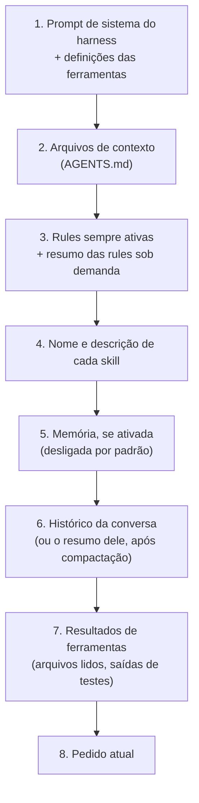
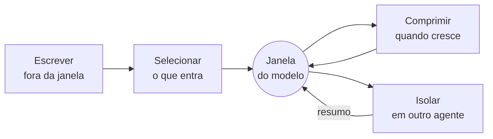
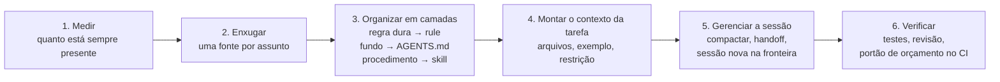
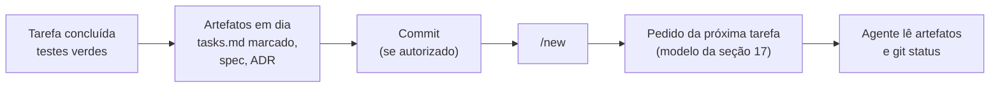

# Módulo 9 — Context Engineering: o que a IA vê, quando vê e por quê

[← Módulo 8 — Spec Kit](modulo-8-spec-kit.md) · [Índice do curso](README.md) · [Módulo 10 — Loop Engineering →](modulo-10-loop-engineering.md)

> **Pré-requisitos:** [Módulo 1](modulo-1-ambiente.md) e [Módulo 7](modulo-7-openspec.md). O [Módulo 0](modulo-0-fundamentos-de-ia.md) (atenção e janela de contexto) é recomendado. O ambiente (oh-my-pi, `.agents/`, skills, rules e segurança) é montado no [Módulo 1](modulo-1-ambiente.md).


> Tutorial para quem está começando. Nos módulos anteriores você encheu o `.agents/` de contexto, rules e skills. Este módulo pergunta: **quanto disso o modelo realmente vê, em que momento, e o que acontece quando é demais ou de menos?** Engenharia de contexto é a disciplina de decidir o que entra na janela do modelo, em que ordem e quando.
>
> Parte I: teoria (anatomia do contexto, limites da atenção, as quatro estratégias, memória, sessões longas, subagentes). Parte II: como o contexto falha e o processo recomendado. Parte III: roteiro prático com a skill escolhida no [skills.sh](https://www.skills.sh), usando `.agents/` e o **oh-my-pi (`omp`)**, com medições do próprio kit do curso.
>
> Tudo o que aparece como "saída real" foi executado em 27/09/2026 com `omp` 18.3.2 e o instalador `skills`, num projeto de teste montado com o `AGENTS.md`, as 16 rules e as 12 skills dos Módulos 1 a 7. Números de instalação e auditorias são os exibidos no skills.sh nessa data. Contagens de tokens usam o tokenizador `o200k_base` (família GPT-4o/GPT-5), salvo indicação; a seção 13 mostra por que o número muda de modelo para modelo.

---

## Sumário

**Parte I — Teoria**

1. [O que é engenharia de contexto](#1-o-que-é-engenharia-de-contexto)
2. [Anatomia do contexto de um agente](#2-anatomia-do-contexto-de-um-agente)
3. [Por que "mais" não é "melhor": o orçamento de atenção](#3-por-que-mais-não-é-melhor-o-orçamento-de-atenção)
4. [As quatro estratégias: escrever, selecionar, comprimir, isolar](#4-as-quatro-estratégias-escrever-selecionar-comprimir-isolar)
5. [Carregar na hora certa: progressive disclosure e just-in-time](#5-carregar-na-hora-certa-progressive-disclosure-e-just-in-time)
6. [Memória: o que sobrevive à janela](#6-memória-o-que-sobrevive-à-janela)
7. [Sessões longas: compactação, handoff e sessão nova](#7-sessões-longas-compactação-handoff-e-sessão-nova)
8. [Subagentes: isolar para não poluir](#8-subagentes-isolar-para-não-poluir)
9. [Estabilidade e cache: a ordem importa](#9-estabilidade-e-cache-a-ordem-importa)

**Parte II — Context engineering e IA: como o contexto falha**

10. [Os modos de falha do contexto](#10-os-modos-de-falha-do-contexto)
11. [O processo recomendado](#11-o-processo-recomendado)

**Parte III — Roteiro prático com `.agents` e oh-my-pi**

12. [Escolha da skill no skills.sh](#12-escolha-da-skill-no-skillssh)
13. [Instalação e verificação](#13-instalação-e-verificação)
14. [Medindo o orçamento de contexto do projeto](#14-medindo-o-orçamento-de-contexto-do-projeto)
15. [Enxugando o `AGENTS.md`](#15-enxugando-o-agentsmd)
16. [Rule para conflitos de contexto em `.agents/rules`](#16-rule-para-conflitos-de-contexto-em-agentsrules)
17. [Contexto por tarefa: o pedido bem montado](#17-contexto-por-tarefa-o-pedido-bem-montado)
18. [Sessões longas no oh-my-pi](#18-sessões-longas-no-oh-my-pi)
19. [Roteiro prático: quatro missões](#19-roteiro-prático-quatro-missões)
20. [Portões no CI](#20-portões-no-ci)
21. [Checklist, glossário e referências](#21-checklist-glossário-e-referências)

---

# Parte I — Teoria

## 1. O que é engenharia de contexto

### 1.1 Do prompt ao contexto

No [Módulo 0](modulo-0-fundamentos-de-ia.md#14-técnicas-de-uso-prompt-contexto-rag-e-raciocínio), **engenharia de contexto** apareceu numa linha de tabela: "escolher o que entra no contexto, em que ordem e quando". Este módulo abre essa linha.

A expressão se popularizou em 2025, quando agentes passaram a trabalhar por dezenas de passos seguidos. Andrej Karpathy a descreveu como a arte e a ciência de encher a janela de contexto com a informação certa para o próximo passo. A Anthropic, em setembro de 2025, tratou o contexto como **recurso finito**, que precisa ser curado como qualquer outro orçamento.

A diferença para *prompt engineering* é de escala e de tempo:

| Aspecto | Prompt engineering | Context engineering |
| --- | --- | --- |
| Unidade | Uma instrução bem escrita | Tudo o que o modelo vê num passo: instruções, ferramentas, arquivos, histórico, resultados |
| Momento | Antes de uma chamada | A cada passo de um agente que roda por muitos passos |
| Pergunta central | "Como pedir?" | "O que precisa estar na janela **agora**, e o que pode sair?" |
| Quem escreve | Você, no chat | Você (arquivos de contexto, rules, skills), o harness (compactação, resumo de leituras) e o próprio agente (notas, planos) |
| Erro típico | Pedido ambíguo | Excesso, falta, informação velha ou contraditória na janela |

**Analogia:** o modelo é um profissional excelente trabalhando numa **mesa pequena**. Prompt engineering é escrever um bom bilhete. Engenharia de contexto é decidir o que fica sobre a mesa: o manual aberto na página certa, a peça que está sendo consertada, o erro que acabou de aparecer. Uma mesa lotada atrapalha tanto quanto uma mesa vazia, e o que está no arquivo da sala só ajuda se alguém for buscar quando precisar.

### 1.2 Por que isso importa para quem programa com agente

Tudo o que você montou nos Módulos 1 a 8 é contexto: o `AGENTS.md`, as rules, as skills, as specs do OpenSpec, a constituição do Spec Kit. O agente não "sabe" nada disso por treino; ele só sabe o que chega à janela, a cada passo. Três consequências práticas guiam o módulo:

1. **Contexto tem custo:** cada token sempre presente disputa atenção com a tarefa e é pago em toda chamada.
2. **Contexto tem prazo:** o que era verdade no começo da sessão (uma hipótese, um arquivo antes da edição) pode ficar falso no meio dela.
3. **Contexto tem origem:** texto lido de um arquivo, de uma issue ou de uma página é **dado**, não instrução (rule `repo-content-is-data`, [Módulo 1](modulo-1-ambiente.md#13-o-kit-inicial-do-curso-e-como-ele-cresce)).

## 2. Anatomia do contexto de um agente

### 2.1 As camadas

A cada chamada ao modelo, o harness (o `omp`, no curso) monta uma única sequência de tokens. Dá para separá-la em camadas, da mais estável para a mais volátil:



| Camada | Quem controla | Quando muda | Onde você mexe no curso |
| --- | --- | --- | --- |
| Prompt de sistema e ferramentas | O harness | Entre versões do `omp` ou com flags (`--tools`, `--no-skills`, `--no-rules`) | Raramente |
| Arquivos de contexto | Você | Quando o arquivo muda; relido no início da sessão | `AGENTS.md` |
| Rules | Você | Sempre ativas: toda chamada. Sob demanda: quando o assunto aparece. Com gatilho: quando o agente escreve o padrão | `.agents/rules/` |
| Skills | Você e terceiros | Descrição: sempre. Corpo: quando carregada. Referências: quando lidas | `.agents/skills/` |
| Histórico e resultados | O agente e o harness | A cada passo; compactado quando cresce | Pedidos, `/compact`, `/handoff`, sessão nova |
| Pedido atual | Você | A cada mensagem | Seção 17 |

### 2.2 Como o `omp` injeta os arquivos de contexto

Pela documentação embutida (`omp read omp://context-files.md`), os arquivos de contexto descobertos entram no prompt de abertura num bloco `<repo-rules>`, um `<file>` por arquivo, na ordem "ancestrais mais distantes primeiro, arquivo mais próximo por último". O que vem por último fica mais perto da geração e é mais proeminente. Três detalhes que importam para engenharia de contexto:

- **Sombreamento:** no `omp`, na mesma profundidade de pasta, só o arquivo de maior prioridade vale (`.omp/AGENTS.md` > `.agents/AGENTS.md` > `AGENTS.md` da raiz), e os outros agentes só leem o da raiz. Por isso o curso usa só o `AGENTS.md` da raiz ([Módulo 1, seção 9.2](modulo-1-ambiente.md#92-o-cuidado-do-sombreamento)).
- **Arquivos em subpastas** abaixo da pasta atual **não** são carregados inteiros: aparecem num bloco `<dir-context>` só como caminho, com a orientação de ler antes de editar aquela pasta. É o *just-in-time* aplicado a monorepos.
- **`@caminho` dentro de um arquivo de contexto é expandido no lugar** (até cinco níveis). É cômodo, mas o conteúdo importado passa a pesar em toda sessão, exatamente como se estivesse escrito ali. Para documentação longa, prefira um **ponteiro em texto** ("leia `docs/adr/` antes de mudar a arquitetura"), que custa uma linha.

### 2.3 Rules sempre ativas resistem a conversas longas

O [Módulo 1, seção 10](modulo-1-ambiente.md#10-rules) mostrou os três tipos de rule. Do ponto de vista de contexto, a diferença decisiva é **onde** cada um vive:

| Tipo | O que o modelo vê o tempo todo | Resistência a conversa longa |
| --- | --- | --- |
| Sempre ativa (`alwaysApply: true`) | O texto inteiro, em toda chamada | Alta: continua visível mesmo quando a conversa empurra o início para longe |
| Sob demanda (`description`) | Nome, `globs` e descrição | O corpo só entra quando lido |
| Com gatilho (TTSR) | Nada, até disparar | Não ocupa espaço; interrompe o agente no momento exato |

O `AGENTS.md` fica no prompt de abertura. Em conversas longas, ele continua lá, mas cada vez mais "longe" da geração. Por isso **regras duras** (segurança, limites do projeto) moram em rules sempre ativas curtas, e **conhecimento de fundo** mora no `AGENTS.md`.

## 3. Por que "mais" não é "melhor": o orçamento de atenção

### 3.1 O tamanho da janela não é o tamanho da atenção

Janelas de centenas de milhares de tokens criam a ilusão de que "cabe tudo". Caber não é ser bem usado:

- **Custo quadrático.** Na atenção, cada token se compara com todos os outros: dobrar o contexto quadruplica esse custo ([Módulo 0, seção 9](modulo-0-fundamentos-de-ia.md#9-atenção-a-ideia-central)).
- **Perdido no meio.** Liu et al. (2024) mostraram que modelos aproveitam pior a informação posta no **meio** de contextos longos do que no início ou no fim.
- **Context rot.** O relatório da Chroma (Hong, Troynikov e Huber, julho de 2025) testou 18 modelos e observou desempenho cada vez menos confiável à medida que a entrada cresce, **mesmo em tarefas simples**. Os modelos não tratam a janela inteira de forma uniforme.
- **Instruções competem entre si.** Cada regra sempre presente disputa atenção com as outras e com a tarefa. Vinte regras medianas diluem as três que realmente importam.

A consequência é a frase que resume o módulo: **o objetivo não é encher a janela, é encher com o menor conjunto de tokens de alto sinal que resolva o próximo passo.**

### 3.2 Três orçamentos diferentes

| Orçamento | Pergunta | Unidade | Onde medir no curso |
| --- | --- | --- | --- |
| **Janela** | Cabe? | Tokens do modelo em uso | Linha de status do `omp` (`context_pct`) |
| **Atenção** | Vai ser usado bem? | Não se mede direto; cresce com foco, cai com ruído | Revisão do resultado, seção 10 |
| **Custo** | Quanto custa por chamada? | Tokens × preço, a cada passo | `omp stats`, `omp usage` |

O contexto **sempre presente** pesa nos três ao mesmo tempo, em **todas** as chamadas de uma sessão. Um agente que dá 60 passos numa tarefa relê o `AGENTS.md` 60 vezes (o cache de prompt reduz o preço, seção 9, mas não a disputa por atenção).

### 3.3 Tokens mudam de modelo para modelo

O mesmo arquivo "custa" diferente para cada tokenizador. Saída real de `omp toks` sobre o `SKILL.md` da skill escolhida neste módulo (353 linhas):

```text
$ omp toks .agents/skills/context-engineering/SKILL.md
size   15.1KB · 14,936 chars · 353 lines

encoding          models                    tokens  chars/tok  vs o200k
o200k_base        GPT-4o · o1 · GPT-5+       3,218       4.64         —
cl100k_base       GPT-3.5 · GPT-4            3,254       4.59     +1.1%
claude-v3         Claude 3 … Opus 4.6        3,637       4.11    +13.0%
claude-v5         Opus 5+                    5,126       2.91    +59.3%
qwen3             Qwen 3.5+                  3,401       4.39     +5.7%
```

(Trecho; o comando lista mais famílias.) Até 59% de diferença entre tokenizadores. Por isso orçamentos neste módulo são **relativos** ("caiu 62%"), e os limites de CI são definidos para o tokenizador que você escolher (seção 20).

## 4. As quatro estratégias: escrever, selecionar, comprimir, isolar

A equipe do LangChain (julho de 2025) organizou as técnicas em quatro famílias. Elas servem como checklist mental sempre que o contexto "não está dando certo":

| Estratégia | Ideia | Exemplos gerais | No curso |
| --- | --- | --- | --- |
| **Escrever** (*write*) | Guardar informação **fora** da janela para buscar depois | Rascunhos, notas, planos, memória | `tasks.md` do OpenSpec, ADRs, handoff, specs |
| **Selecionar** (*select*) | Trazer para a janela **só** o relevante, na hora certa | Busca, RAG, skills sob demanda | Descrições de skills, rules sob demanda, `read` com resumo, ponteiros no `AGENTS.md` |
| **Comprimir** (*compress*) | Manter o essencial com menos tokens | Resumo, poda de resultados antigos | Compactação automática, `/compact`, `/handoff`, resumo de leituras |
| **Isolar** (*isolate*) | Separar contextos para um não poluir o outro | Subagentes, sandboxes | Ferramenta `task` do `omp`, sessão nova por tarefa |



## 5. Carregar na hora certa: progressive disclosure e just-in-time

### 5.1 Progressive disclosure: o desenho das skills

O [Módulo 1, seção 8.2](modulo-1-ambiente.md#82-carregamento-sob-demanda-progressive-disclosure) apresentou a ideia: o agente vê só **nome e descrição** de cada skill; lê o `SKILL.md` quando a tarefa pede; abre os arquivos de apoio só se precisar. A medição real das 12 skills do curso mostra o tamanho do ganho:

| Skill | Nome + descrição (sempre) | `SKILL.md` (ao carregar) | Pasta inteira | Arquivos |
| --- | ---: | ---: | ---: | ---: |
| `clean-code` | 45 | 1.206 | 1.206 | 1 |
| `code-review` | 100 | 1.510 | 1.533 | 2 |
| `code-simplifier` | 90 | 831 | 3.966 | 3 |
| `codebase-design` | 61 | 1.349 | 2.509 | 4 |
| `design-pattern-review` | 38 | 1.936 | 10.338 | 8 |
| `domain-modeling` | 38 | 766 | 1.939 | 4 |
| `find-skills` | 70 | 1.303 | 1.303 | 1 |
| `gof-patterns` | 63 | 1.156 | **171.775** | 25 |
| `grilling` | 40 | 420 | 446 | 2 |
| `improve-codebase-architecture` | 35 | 1.342 | 2.972 | 3 |
| `solid` | 60 | 2.433 | 20.799 | 10 |
| `tdd` | 37 | 756 | 1.626 | 4 |
| **Total** | **677** | **15.008** | **220.412** | **67** |

Tokens `o200k_base`, medidos com `omp toks` (arquivos `.md`, `.txt`, `.yaml` e `.json` de cada pasta). Três lições:

1. **As 12 skills custam cerca de 680 tokens sempre presentes.** Se o agente lesse todos os `SKILL.md` de uma vez, seriam 15 mil; se lesse as pastas inteiras, 220 mil, mais do que a janela de muitos modelos.
2. **A `gof-patterns` sozinha tem 172 mil tokens de referências** (um arquivo por padrão). Ela só é viável porque o agente abre um padrão por vez. Nunca peça ao agente para "ler a skill inteira".
3. **A descrição é o que decide se a skill entra.** Uma descrição vaga faz a skill nunca ser chamada; uma descrição longa demais pesa em toda chamada. `code-review`, com 100 tokens, é a mais cara do conjunto.

### 5.2 Just-in-time: ponteiros em vez de conteúdo

A mesma ideia vale para o código. Em vez de colar arquivos na conversa, o agente guarda **referências leves** (caminhos, nomes de classe, trechos de linha) e lê quando precisa. O `omp` faz parte disso sozinho: a ferramenta `read` **resume arquivos longos** e devolve um ponteiro para reler o trecho necessário. Saída real, num teste de integração de 339 linhas do projeto `suporteos2025`:

```text
$ omp read suporteos2025/src/test/java/com/curso/resources/ProdutoResourceIntegrationTest.java
 1:package com.curso.resources;
 ...
42:@SpringBootTest(classes = Suporteos2025Application.class)
43:@AutoConfigureMockMvc
44:@Transactional
45-339:class ProdutoResourceIntegrationTest { … }

[…293ln elided; re-read needed ranges with .../ProdutoResourceIntegrationTest.java:45-339]
```

| Leitura | Tokens (`o200k_base`) |
| --- | ---: |
| Arquivo inteiro (`omp toks` no arquivo) | 3.739 |
| O que o `read` entregou | 530 |

Uma redução de 86% na primeira leitura, sem perder nada: o agente relê `:45-339` (ou só o método que interessa) quando precisar. Os limiares vêm da configuração (saída real de `omp config list`):

```text
  read.summarize.enabled = true (boolean)
  read.summarize.prose = false (boolean)
  read.summarize.minTotalLines = 100 (number)
```

Arquivos com menos de 100 linhas e texto em prosa (Markdown) são entregues inteiros.

## 6. Memória: o que sobrevive à janela

A janela é memória de trabalho: some no fim da sessão (ou na compactação). O que precisa durar tem de ser **escrito** em algum lugar:

| Tipo de memória | Onde vive | Durabilidade | Confiabilidade | No curso |
| --- | --- | --- | --- | --- |
| Janela | Conversa atual | Até compactar ou encerrar | Alta enquanto está lá | — |
| Notas de trabalho | Arquivo que o agente mantém (plano, lista de tarefas) | A sessão ou a tarefa | Média: escrita pelo próprio agente | `tasks.md` (OpenSpec), handoff |
| Artefatos versionados | Git | Permanente, com histórico e revisão | **Alta**: revisada por pessoas | Specs, ADRs, `CONTEXT.md`, `AGENTS.md` |
| Memória automática do agente | Pasta do harness | Entre sessões | Heurística: extraída por um modelo | Desligada por padrão no `omp` |

O Manus (Ji, julho de 2025) usa uma técnica que o curso já pratica sem nome: **recitação**. O agente reescreve a lista de tarefas conforme avança, o que mantém o objetivo perto do fim da janela, onde a atenção é melhor. O `tasks.md` marcado com `[x]` no apply do OpenSpec faz exatamente isso.

**Sobre a memória automática do `omp`.** Ela vem desligada (`memory.backend = off`). Com `backend: local`, um modelo lê as sessões passadas, extrai decisões e lições e injeta um resumo no início das próximas. A própria documentação (`omp read omp://memory.md`) diz que essa memória é **heurística**, útil para processo e decisões anteriores, mas **não autoritativa** sobre o estado atual do repositório, e que em conflito valem o repositório e o pedido. No curso, a regra é: **o que importa vira artefato versionado** (spec, ADR, `AGENTS.md`), revisado por uma pessoa. Deixe a memória automática desligada até entender bem o fluxo.

## 7. Sessões longas: compactação, handoff e sessão nova

### 7.1 O problema

Numa tarefa longa, a conversa acumula tentativas que falharam, saídas enormes de testes, versões antigas de arquivos já editados. Isso ocupa janela e, pior, **confunde**: o agente pode se apoiar numa versão do arquivo que não existe mais.

### 7.2 Três saídas

| Saída | O que faz | Custo | Quando usar |
| --- | --- | --- | --- |
| **Compactar** | Resume o histórico antigo e mantém o recente | Perde detalhes; o resumo é escrito por um modelo | Tarefa ainda em andamento, janela enchendo |
| **Handoff** | Gera um documento estruturado de passagem (estado, decisões, próximos passos) | Um passo a mais; exige revisão | Pausa longa, troca de pessoa ou de agente |
| **Sessão nova** | Começa do zero, lendo só os artefatos | Recarrega o contexto do projeto | **Fronteira de tarefa concluída** |

A skill escolhida neste módulo (seção 12) resume bem o critério: sessão nova é segura **numa fronteira de tarefa concluída, não num número arbitrário de tokens**. Antes de sair, deixe registrado: escopo e decisões (na spec ou no plano), estado da tarefa e o próximo passo, arquivos alterados e o estado do Git, comandos de verificação e seus resultados, e perguntas em aberto. Na sessão nova, o agente lê esses artefatos **e confere o `git status` real** antes de agir.

### 7.3 O que proteger e o que cortar

| Corte primeiro | Proteja até o fim |
| --- | --- |
| Tentativas que falharam (guarde a conclusão, não o caminho) | A definição da tarefa e as restrições |
| Saídas longas de ferramentas já aproveitadas | O erro ou teste que está sendo depurado agora |
| Idas e vindas de conversa já decididas | A versão atual do arquivo em edição |
| Rascunhos de código já substituídos | As regras duras (segurança, limites do projeto) |

"Resumir é melhor do que apagar": oito mensagens de depuração viram uma frase com a causa e a correção. Se o detalhe voltar a importar, a frase é a pista para investigar de novo.

**Um contraponto útil.** O Manus recomenda **não** apagar erros recentes: ver a tentativa que falhou ajuda o modelo a não repeti-la. As duas ideias se conciliam assim: mantenha o **último** erro relevante e a conclusão de cada tentativa; descarte os logs completos das antigas.

## 8. Subagentes: isolar para não poluir

Um subagente é outro agente, com **janela própria**, que recebe uma tarefa, trabalha e devolve só o resultado. A principal utilidade não é "simular uma equipe", e sim **isolar contexto**: uma exploração que lê 40 arquivos acontece na janela do subagente, e a janela principal recebe um resumo de meia página.

Como o `omp` faz isso (documentação `omp read omp://tools/task.md`, confirmada no [Módulo 5, seção 18](modulo-5-design-e-revisao.md#18-subagentes-no-oh-my-pi)):

- O subagente **não herda a conversa**. Ele recebe a árvore do projeto, as skills, os arquivos de contexto e o texto de contexto que a chamada passar. **Tudo o que ele precisa saber da conversa tem de ser escrito no pedido.**
- Em lote, um campo `context` obrigatório é injetado no prompt de sistema de cada subagente.
- Subagentes rodam **sem interface**, com aprovação forçada em `yolo`. Por isso as rules de segurança do Módulo 1 importam ainda mais aqui: elas valem também dentro do subagente.

| Bom uso de subagente | Mau uso |
| --- | --- |
| Explorar uma área grande do código e devolver um mapa | Tarefa pequena que caberia na janela principal |
| Revisões independentes em paralelo (os dois eixos da `code-review`) | Subagente que precisa de metade da conversa para entender o pedido |
| Comparar alternativas (*Design It Twice*, Módulo 5) | Subagentes editando os mesmos arquivos ao mesmo tempo |

## 9. Estabilidade e cache: a ordem importa

Provedores de modelo guardam em cache o **prefixo** da sequência de tokens: se o começo da chamada for idêntico ao da anterior, ele é reaproveitado, ficando mais rápido e mais barato. O Manus aponta a taxa de acerto do cache como uma das métricas mais importantes de um agente em produção.

Consequências para o seu `.agents/`:

1. **Estável primeiro, volátil por último.** Rules, `AGENTS.md` e descrições de skills no começo (quase nunca mudam); a tarefa atual e o erro atual no fim, onde também recebem mais atenção.
2. **Não edite o `AGENTS.md` no meio de uma sessão longa esperando efeito imediato.** Ele é lido no início; a mudança vale na próxima sessão (ou após `/clear` e `/new`), e cada mudança no prefixo invalida o cache.
3. **Datas, contadores e textos que mudam a cada chamada não pertencem ao contexto fixo.** Um "hoje é 27/09, 14h32" no topo do prompt quebra o cache em toda chamada.

---

# Parte II — Context engineering e IA: como o contexto falha

## 10. Os modos de falha do contexto

Drew Breunig (junho de 2025) nomeou quatro formas de contextos longos falharem: **envenenamento**, **distração**, **confusão** e **conflito**. A tabela acrescenta três que aparecem o tempo todo em programação com agentes: **fome**, **contexto velho** e **injeção**.

| Modo de falha | Como aparece no código | Causa | Mitigação |
| --- | --- | --- | --- |
| **Fome** (*starvation*) | Agente inventa API, ignora a convenção do projeto, recria um utilitário que já existe | Nada sobre o projeto na janela | `AGENTS.md` com stack, comandos e ponteiros; pedir que leia o arquivo e um exemplo do padrão antes de editar (seção 17) |
| **Inundação / distração** (*distraction*) | Agente repete ações antigas, perde o foco, piora no meio da tarefa | Histórico longo domina a tarefa atual | Compactar ou abrir sessão nova na fronteira de tarefa (seção 7) |
| **Confusão** (*confusion*) | Usa a ferramenta ou a skill errada; aplica regra de outro contexto | Conteúdo supérfluo na janela: skills demais, descrições parecidas, arquivos irrelevantes | Menos skills e descrições distintas; ler só o necessário (seção 14) |
| **Envenenamento** (*poisoning*) | Um erro (um nome de método alucinado, uma hipótese falsa) volta a ser usado passo após passo | O erro entrou na janela e passou a ser tratado como fato | Verificar com ferramenta (compilar, testar); na dúvida, sessão nova sem o histórico contaminado |
| **Conflito** (*clash*) | Resultado oscila; uma hora segue uma regra, outra hora a oposta | Duas fontes dizem coisas diferentes | Uma fonte por assunto; rule `context-conflicts` manda parar e perguntar (seção 16) |
| **Contexto velho** (*stale*) | Agente edita com base na versão anterior de um arquivo; cita código apagado | Leitura antiga continua na janela depois da edição | Reler antes de editar; o `omp` descarta leituras superadas do mesmo arquivo (`compaction.supersedeReads = true`) |
| **Injeção** (*injection*) | Agente segue uma "instrução" escrita num comentário, issue ou página | Texto lido tratado como ordem | Rule `repo-content-is-data`; aprovação humana para ações sensíveis (Módulo 1) |

### 10.1 O caso do próprio curso

Os Módulos 1 a 7 seguem a regra do Módulo 1: cada um acrescenta ao `AGENTS.md` só uma seção curta com o que é novo, sem repetir o arquivo nem as rules sempre ativas. O Módulo 6, por exemplo, deixa a política de padrões na rule `design-patterns-policy` e põe no `AGENTS.md` só os sinais de problema, o ponteiro para a rule de idiomas e o ADR.

Mesmo assim, somando as seis seções, o arquivo chega a **63 linhas** e **789 tokens**, 37% de tudo o que fica sempre presente (seção 14.2). Não há um erro grave: há **acréscimo**. São seis seções escritas em momentos diferentes, cada uma com cabeçalho próprio, frases de contexto e explicações que faziam sentido no seu módulo. Dois sintomas típicos:

- **Fragmentação:** instruções sobre o mesmo tema (quando pedir aprovação, quando refatorar) espalhadas em seções diferentes, o que dificulta ver o conjunto e aumenta o risco de uma contradizer a outra no futuro.
- **Conteúdo em vez de ponteiro:** o bloco do Módulo 5 explica o rastreador de issues e os documentos de domínio, que já têm arquivo próprio em `docs/agents/`.

A seção 15 condensa o arquivo, troca conteúdo por ponteiros e mede o resultado. A Missão 2 (seção 19) mostra o outro caso clássico, a repetição de uma rule, com um antiexemplo.

### 10.2 Diagnóstico rápido

Quando a qualidade cair, pergunte nesta ordem:

1. **Falta alguma coisa?** O agente tinha como saber? (fome)
2. **Sobra alguma coisa?** Há histórico, skills ou arquivos que não têm a ver com a tarefa? (distração, confusão)
3. **Algo na janela é falso ou velho?** (envenenamento, contexto velho)
4. **Duas fontes discordam?** (conflito)
5. **Alguma "instrução" veio de um arquivo lido?** (injeção)

## 11. O processo recomendado



O ponto central é o passo 1: **o que não é medido cresce sem ninguém perceber.** Cada módulo do curso acrescentou "só mais uma seção" ao `AGENTS.md`; somadas, viraram 63 linhas. O portão da seção 20 impede que isso volte a acontecer.

---

# Parte III — Roteiro prático com `.agents` e oh-my-pi

## 12. Escolha da skill no skills.sh

Pesquisei o [skills.sh](https://www.skills.sh) com `npx skills find` ("context engineering", "context window", "context compression", "context fundamentals"), instalei as candidatas num projeto de teste e li o `SKILL.md` de cada uma.

### 12.1 Candidatas

| Skill | Origem | Instalações | Auditorias (Trust Hub / Socket / Snyk) | Licença do repositório | O que faz |
| --- | --- | ---: | --- | --- | --- |
| [`context-engineering`](https://skills.sh/addyosmani/agent-skills/context-engineering) | addyosmani/agent-skills | 41,5 mil | Aprovada / Aprovada / **Aviso** | MIT | Hierarquia de contexto, estratégias de empacotamento, orçamento, fronteiras de sessão, gestão de ambiguidade |
| [`context-engineering-collection`](https://skills.sh/muratcankoylan/agent-skills-for-context-engineering/context-engineering-collection) | muratcankoylan/agent-skills-for-context-engineering | 3,9 mil | **Aviso / Aviso / Aviso** | MIT | Coleção de 17 skills sobre sistemas de agentes (fundamentos, degradação, compressão, memória, multiagentes, avaliação) |
| [`session-handoff`](https://skills.sh/softaworks/agent-toolkit/session-handoff) | softaworks/agent-toolkit | 4,1 mil | Aprovada / Aprovada / Aprovada | MIT | Documento de passagem de sessão com scripts de criação e validação |
| [`context-budget`](https://skills.sh/affaan-m/ecc/context-budget) | affaan-m/ecc | 3,6 mil | Aprovada / Aprovada / Aprovada | MIT | Auditoria de quanto contexto agentes, skills, MCP e rules consomem |

### 12.2 Análise

**`context-engineering` (escolhida).** 353 linhas, sem scripts, sem URLs nem comandos a executar: é texto de orientação. Cobre o que este módulo precisa: a hierarquia de contexto do mais persistente ao mais volátil, o "empacotamento seletivo" de uma tarefa, o que cortar e o que proteger numa sessão longa, fronteiras seguras para sessão nova e um procedimento para **explicitar conflitos e lacunas** em vez de escolher em silêncio. A descrição é objetiva ("use when starting a new session, when agent output quality degrades, when switching between tasks..."), o que ajuda o agente a carregá-la na hora certa.

**`context-engineering-collection` (rejeitada).** Apesar do nome de skill, a instalação copia **o repositório inteiro** para dentro de `.agents/skills`. Saída real:

```text
$ find .agents/skills/context-engineering-collection -type f | wc -l
     506
$ du -sh .agents/skills/context-engineering-collection
 12M	.agents/skills/context-engineering-collection
```

Entre esses arquivos estão um `AGENTS.md` e um `CLAUDE.md` do próprio repositório, workflows de CI, esquemas e pastas de pesquisa. As 17 skills internas **não** são descobertas pelo `omp` como skills: `omp read skill://context-compression` responde com a lista de skills disponíveis, sem ela (só o `SKILL.md` da raiz é registrado). As três auditorias mostram aviso. O conteúdo é bom como **leitura** (vale consultar no GitHub), mas instalá-la contradiz tudo o que este módulo ensina sobre contexto.

**`session-handoff` (referência, não instalada no curso).** Aprovada nas três auditorias e com uma boa ideia: um script cria o esqueleto do documento com data, branch e commits recentes, e outro valida o preenchimento e procura segredos. Saída real do validador sobre um esqueleto recém-criado:

```text
Quality Score: 28/100 - Poor - Significant work needed
[FAIL] 18 TODO placeholders found:
[FAIL] Missing/incomplete required sections:
       - Current State Summary (incomplete)
       - Important Context (missing)
       - Immediate Next Steps (missing)
[PASS] No potential secrets detected
Verdict: NEEDS WORK - Complete required sections
```

Dois motivos para não instalá-la: os scripts gravam em `.claude/handoffs/` (pasta de outro agente, fixada no código), e o `omp` já tem `/handoff` nativo (seção 18). Use o modelo dela (`references/handoff-template.md`) como inspiração para o que um handoff deve conter.

**`context-budget` (rejeitada).** Aprovada nas auditorias, mas foi escrita para a estrutura do Claude Code (`agents/*.md`, `CLAUDE.md`, `.mcp.json`) e estima tokens por "palavras × 1,3". O curso usa `.agents/` e tem contagem exata offline (`omp toks`). A seção 14 faz a mesma auditoria com um script de 60 linhas, determinístico e utilizável no CI.

### 12.3 Pontos de atenção

| Ponto | Detalhe | Recomendação |
| --- | --- | --- |
| **Aviso do Snyk** | A página da `context-engineering` mostra aviso no Snyk, sem detalhe no resumo | Leia o `SKILL.md` antes de instalar (não há scripts nem comandos); mantenha as rules de segurança do Módulo 1 |
| **Exemplos para outro agente** | Os exemplos usam `CLAUDE.md`, `.cursorrules` e servidores MCP | No curso, o equivalente é `AGENTS.md` e `.agents/rules/`; a rule `context-conflicts` (seção 16) fixa a ordem de precedência |
| **Números de referência** | A skill sugere começar a enxugar com 75% da janela e manter menos de 2.000 linhas de contexto focado por tarefa | São heurísticas. No `omp`, a compactação automática já tem limiares próprios (seção 18); use os números da skill para o que **você** traz para a conversa |
| **Coleções disfarçadas de skill** | Algumas "skills" instalam repositórios inteiros | Confira `find .agents/skills/<nome> -type f \| wc -l` depois de instalar; mais de uma dezena de arquivos pede leitura cuidadosa |

## 13. Instalação e verificação

```text
$ npx skills@latest add https://github.com/addyosmani/agent-skills --skill context-engineering --agent universal --copy -y
◇  Found 25 skills
●  Selected 1 skill: context-engineering
◇  Installed 1 skill
│  ✓ context-engineering (copied)
│    → ./.agents/skills/context-engineering
```

Verificação sem chamar o modelo:

```text
$ omp read skill://context-engineering | sed -n 2p
name: context-engineering
```

Trecho real do `skills-lock.json` gerado:

```json
"context-engineering": {
  "source": "addyosmani/agent-skills",
  "sourceType": "github",
  "skillPath": "skills/context-engineering/SKILL.md",
  "computedHash": "807434a4b178635a5539a1da241815ba7228f00b71f8e3ccd529472ce3bcaf80"
}
```

Custo da skill: 47 tokens de nome e descrição sempre presentes e 3.218 tokens (`o200k_base`) quando carregada (seção 3.3).

## 14. Medindo o orçamento de contexto do projeto

### 14.1 O script

Salve como `scripts/context_budget.py`. Ele mede, com `omp toks --json`, o que o `.agents/` coloca diante do agente em **toda** chamada (o `AGENTS.md`, as rules sempre ativas, o resumo das rules sob demanda e a descrição de cada skill) e o que só entra **sob demanda** (os corpos). Rules com gatilho ficam de fora do total: dormem até disparar.

```python
#!/usr/bin/env python3
"""Mede, em tokens, o contexto que o .agents/ do projeto coloca diante do agente.
Usa `omp toks --json` (tokenizadores offline). Sai com código 1 se passar dos limites."""
import argparse, json, re, subprocess, sys, tempfile
from pathlib import Path

ap = argparse.ArgumentParser()
ap.add_argument("--encoding", default="o200k_base")
ap.add_argument("--max-sempre", type=int, default=0, help="limite de tokens sempre presentes (0 = sem limite)")
ap.add_argument("--max-agents-linhas", type=int, default=0)
args = ap.parse_args()


def toks(text):
    with tempfile.NamedTemporaryFile("w", suffix=".txt", delete=False) as f:
        f.write(text)
    out = subprocess.run(["omp", "toks", f.name, "--json"], capture_output=True, text=True, check=True).stdout
    return next(e["tokens"] for e in json.loads(out)["encodings"] if e["name"] == args.encoding)


def frontmatter(text):
    m = re.match(r"^---\n(.*?)\n---\n", text, re.S)
    return m.group(1) if m else ""


def resumo(fm):  # o que o agente vê de uma skill ou rule antes de abri-la
    return "\n".join(l for l in fm.splitlines() if re.match(r"^\s*(name|description|globs)\s*:|^\s+\S", l))


linhas, sempre, sob_demanda, falhou = [], 0, 0, False
ctx = Path("AGENTS.md")
if ctx.exists():
    t = ctx.read_text(); n = toks(t); sempre += n
    linhas.append(("contexto", "AGENTS.md", n, "sempre"))
    if args.max_agents_linhas and len(t.splitlines()) > args.max_agents_linhas:
        print(f"ERRO: AGENTS.md tem {len(t.splitlines())} linhas (limite {args.max_agents_linhas})")
        falhou = True

for r in sorted(Path(".agents/rules").glob("*.md")):
    t = r.read_text(); fm = frontmatter(t)
    if "alwaysApply: true" in fm:
        n = toks(t); sempre += n; linhas.append(("rule", r.stem, n, "sempre"))
    elif re.search(r"^(condition|astCondition|question):", fm, re.M):
        linhas.append(("rule", r.stem, toks(t), "gatilho"))
    else:
        n = toks(resumo(fm)); sempre += n; sob_demanda += toks(t) - n
        linhas.append(("rule", r.stem, n, "resumo"))

for s in sorted(Path(".agents/skills").glob("*/SKILL.md")):
    t = s.read_text(); n = toks(resumo(frontmatter(t))); sempre += n; sob_demanda += toks(t)
    linhas.append(("skill", s.parent.name, n, "descrição"))

for tipo, nome, n, quando in linhas:
    print(f"{tipo:<9}{nome:<32}{n:>6}  {quando}")
print(f"\nSempre presente ({args.encoding}): {sempre} tokens")
print(f"Carregável sob demanda (corpos de skills e rules): {sob_demanda} tokens")
if args.max_sempre and sempre > args.max_sempre:
    print(f"ERRO: acima do limite de {args.max_sempre} tokens sempre presentes")
    falhou = True
sys.exit(1 if falhou else 0)
```

O script mede **o que você controla** no `.agents/`. O prompt de sistema e as definições de ferramentas do `omp` também ocupam a janela, mas não mudam com o seu projeto.

### 14.2 O orçamento real do kit do curso

Saída real sobre o projeto de teste com o `AGENTS.md` somado das seções dos Módulos 1, 2, 4, 5, 6 e 7 (63 linhas), as 16 rules e as 12 skills dos módulos:

```text
$ python3 scripts/context_budget.py
contexto AGENTS.md                          789  sempre
rule     clean-code-core                    188  sempre
rule     design-patterns-policy             130  sempre
rule     dip-constructor-injection           97  gatilho
rule     dip-no-new-collaborator            128  gatilho
rule     java-conventions                    20  resumo
rule     lsp-unsupported-operation          114  gatilho
rule     no-magic-http-status                67  gatilho
rule     no-manual-singleton                146  gatilho
rule     no-secrets-in-output               190  gatilho
rule     no-swallowed-exception              71  gatilho
rule     no-system-out                       49  gatilho
rule     repo-content-is-data               132  sempre
rule     solid-calibration                  132  sempre
rule     solid-spring-idioms                 22  resumo
rule     spring-pattern-idioms               23  resumo
rule     type-switch-smell                  156  gatilho
skill    clean-code                          45  descrição
skill    code-review                        100  descrição
...
skill    tdd                                 37  descrição

Sempre presente (o200k_base): 2113 tokens
Carregável sob demanda (corpos de skills e rules): 15582 tokens
```

Resumo por tipo:

| Componente | Quantidade | Sempre presente (tokens) | Comentário |
| --- | ---: | ---: | --- |
| `AGENTS.md` | 1 | 789 | **37% do total**: o maior item isolado |
| Rules sempre ativas | 4 | 582 | Curtas e com função clara |
| Rules sob demanda (resumo) | 3 | 65 | O corpo (cerca de 570 tokens) só entra quando lido |
| Rules com gatilho | 9 | 0 | Dormem até disparar (1.018 tokens se estivessem sempre ativas) |
| Skills (descrição) | 12 | 677 | O corpo (15.008) só entra quando carregado |
| **Total sempre presente** | | **2.113** | |

As rules com gatilho e as skills mostram o desenho em camadas funcionando. O ponto fraco é o `AGENTS.md`, que cresceu por acréscimo.

## 15. Enxugando o `AGENTS.md`

### 15.1 Critérios

1. **Uma fonte por assunto.** Se uma rule sempre ativa já diz, o `AGENTS.md` não repete.
2. **Fundo, não procedimento.** Procedimentos longos ficam em skills; regras duras em rules; o `AGENTS.md` diz o que é o projeto, onde estão as coisas e qual é o fluxo.
3. **Ponteiros em vez de conteúdo.** "Decisões de arquitetura: `docs/adr/`" custa uma linha; o conteúdo dos ADRs entra quando o agente for mexer na arquitetura.
4. **Nada que mude toda semana.**

### 15.2 Antes e depois

O que mudou, e onde a informação continua existindo:

| Trecho do `AGENTS.md` original | Continua em |
| --- | --- |
| Seis seções com cabeçalho próprio: Arquitetura (M2), SOLID (M4), Agent skills (M5), Padrões (M6), OpenSpec (M7) | Condensadas em "Arquitetura" e "Como trabalhar", uma linha por instrução |
| "SOLID para diagnosticar problemas reais" (M4) e sinais de problema concreto (M6) | Uma única linha em "Como trabalhar" |
| Explicação do rastreador de issues e dos documentos de domínio (M5) | Ponteiros para `docs/agents/issue-tracker.md` e `docs/agents/domain.md` |
| "Requisitos com SHALL/MUST" (M7) | Instruções do schema do OpenSpec, entregues ao agente durante o propose |
| "Se a spec não cobre um caso, peça atualização" (M7) | Rule `context-conflicts` ("não invente requisito", seção 16) |

O `AGENTS.md` resultante (27 linhas):

```markdown
# Projeto: Catálogo de Produtos e Pedidos (curso de programação assistida por IA)

## Stack e comandos
Java 21, Spring Boot 3, Spring Data JPA, H2 (testes), PostgreSQL (produção), Maven.
- Testes: `./mvnw test` · Verificação completa: `./mvnw verify` · Formatar: `./mvnw spotless:apply`

## Arquitetura
Pacotes por funcionalidade (`product/`, `order/`); camadas controller → service → repository.
Regra de negócio fica em services e entidades, nunca em controllers.
Termos do domínio: `CONTEXT.md`. Decisões de arquitetura: `docs/adr/`.
Issues e specs locais: `.scratch/<feature>/` (`docs/agents/issue-tracker.md`); domínio: `docs/agents/domain.md`.
Comportamento vigente: `openspec/specs/` (leia a spec da capability antes de mudar o código dela).

## Como trabalhar
- As rules em `.agents/rules/` são obrigatórias e prevalecem sobre qualquer skill.
- Mexa só no necessário à tarefa (melhorias pequenas só no código próximo);
  refatoração e mudança de comportamento em commits separados, com testes verdes antes e depois.
- SOLID e padrões de projeto só diante de problema real (mudança difícil, quebra em cascata,
  teste difícil, o terceiro `if` sobre o mesmo tipo, lógica de criação duplicada), nunca como checklist.
- Mudanças com mais de 3 arquivos, padrões novos e refatorações de SOLID: apresente o plano
  (princípio ou problema, alternativa mais simples, custo) e aguarde aprovação.
  Padrão novo: forma idiomática do Spring (rule `spring-pattern-idioms`), ADR em `docs/adr/`
  e citação no Javadoc da interface.
- Mudança de comportamento externo (endpoint, status HTTP, esquema) começa por uma mudança
  OpenSpec aprovada (skill `openspec-propose`); nunca escreva código durante o propose.
- Teste de cenário usa `@DisplayName("Scenario: <nome>")`.
- Ao terminar: skill `code-simplifier` no código alterado, `./mvnw verify` e skill `code-review` desde `origin/main`.
```

Medição real (`omp toks`):

| Versão | Linhas | `o200k_base` | `claude-v5` |
| --- | ---: | ---: | ---: |
| Soma das seções dos Módulos 1 a 7 | 63 | 789 | 1.363 |
| Enxuta | 27 | 492 | 832 |
| **Redução** | **−57%** | **−38%** | **−39%** |

Se você usa o Spec Kit (Módulo 8) em vez do OpenSpec, troque a linha do OpenSpec pela linha correspondente da seção 9 do Módulo 8; não mantenha as duas.

## 16. Rule para conflitos de contexto em `.agents/rules`

Relembrando os três tipos de rule do `omp` (detalhados no [Módulo 1, seção 10](modulo-1-ambiente.md#10-rules)):

| Tipo | Frontmatter | Quando atua |
| --- | --- | --- |
| Sempre ativa | `alwaysApply: true` | Em toda requisição |
| Sob demanda | `description` (+ `globs`) | O agente vê o resumo e lê quando precisa |
| Com gatilho (TTSR) | `condition` / `astCondition` / `question` | Quando o agente escreve algo que casa com o padrão |

O modo de falha mais silencioso da seção 10 é o **conflito**: o agente escolhe uma das fontes sem avisar. A skill `context-engineering` ensina a responder com um bloco de confusão explícito; uma rule sempre ativa curta transforma isso em regra do projeto e fixa a precedência.

`.agents/rules/context-conflicts.md`:

```markdown
---
description: Explicita conflitos e lacunas de contexto em vez de escolher em silêncio
alwaysApply: true
---
Se duas fontes de contexto se contradizem (rule, AGENTS.md, spec, skill, código existente, pedido),
ou se falta informação para decidir, NÃO escolha em silêncio. Pare e responda com um bloco CONFLITO:
as fontes (arquivo e linha), o que cada uma diz, duas ou três opções e a sua recomendação.
Ordem de precedência quando o pedido não diz outra coisa: pedido atual > rules > spec vigente
> AGENTS.md > skills > código existente. Não invente requisito para preencher lacuna.
```

Custo real: 135 tokens (`o200k_base`), sempre presentes. Não é uma rule com gatilho porque conflito não tem padrão de texto: é julgamento, e julgamento precisa estar sempre visível ([Módulo 1, seção 10.4](modulo-1-ambiente.md#104-onde-cada-tipo-de-regra-deve-morar)).

Exemplo do comportamento esperado, quando a spec diz uma coisa e o código faz outra:

```text
CONFLITO
- openspec/specs/product-catalog/spec.md:14 — a listagem SHALL ser paginada (20 por página).
- src/main/java/.../ProductController.java:41 — GET /api/products devolve a lista inteira.
Opções:
A) Implementar a paginação (a spec vigente vence o código).
B) Abrir uma mudança OpenSpec para remover a paginação da spec.
Recomendação: A, porque a spec foi arquivada depois deste código.
```

## 17. Contexto por tarefa: o pedido bem montado

O `AGENTS.md` dá o fundo; o **pedido** traz o contexto da tarefa. Um modelo de pedido, adaptado da estratégia de "inclusão seletiva" da skill:

```text
TAREFA: validar que o SKU tenha o formato AAA-000 no cadastro de produto.

ARQUIVOS:
- src/main/java/br/edu/fatec/catalogo/product/ProductRequest.java (onde validar)
- src/test/java/br/edu/fatec/catalogo/product/ProductControllerTest.java (testes a estender)

PADRÃO A SEGUIR:
- a validação de preço em ProductRequest (@Positive + mensagem em português)

RESTRIÇÕES:
- erro em application/problem+json, como os demais (ApiExceptionHandler)
- não mudar o contrato de ProductUpdateRequest (SKU é imutável)

VERIFICAÇÃO:
- ./mvnw test -Dtest=ProductControllerTest
```

Por que funciona:

| Parte | Modo de falha que previne |
| --- | --- |
| Arquivos com caminho e papel | Fome (o agente sabe onde mexer) e distração (não sai lendo o projeto inteiro) |
| Um exemplo do padrão | O agente não inventa um estilo novo |
| Restrições explícitas | Conflito entre o "jeito mais curto" e a regra do projeto |
| Comando de verificação | Envenenamento: a saída do teste corrige hipóteses erradas |

Dois hábitos completam o pedido:

- **Cole o erro exato, não o log inteiro.** "Falhou `ProductControllerTest.invalidSku`: expected 400 but was 201" vale mais do que 500 linhas de Maven.
- **Deixe o agente ler.** Caminhos e números de linha são melhores do que conteúdo colado: o `read` resume arquivos longos e relê só o trecho necessário (seção 5.2).

## 18. Sessões longas no oh-my-pi

### 18.1 Compactação automática

A compactação vem ligada. Configuração real (`omp config list`, trechos):

```text
  compaction.enabled = true (boolean)
  compaction.midTurnEnabled = true (boolean)
  compaction.methodOrder = ["remote","snapcompact","handoff","shake","soft"] (array)
  compaction.thresholdPercent = -1 (number)
  compaction.keepRecentTokens = 20000 (number)
  compaction.supersedeReads = true (boolean)
  compaction.dropUseless = true (boolean)
  statusLine.rightSegments = ["session_name","token_total","cost","context_pct"] (array)
```

Pela documentação embutida (`omp read omp://compaction.md`):

- **Quando dispara:** ao passar do limiar depois de um turno, antes da próxima chamada num turno longo de ferramentas (`midTurnEnabled`), ou para se recuperar de um estouro da janela. Por padrão, a reserva é de pelo menos 16.384 tokens e 15% da janela.
- **O que mantém:** cerca de 20 mil tokens mais recentes (`keepRecentTokens`) ficam intactos; o que vem antes vira resumo.
- **Como resume:** tenta os métodos na ordem de `methodOrder`. `remote` usa a compactação do próprio provedor quando existe; `handoff` gera um documento de passagem; `shake` troca resultados grandes de ferramentas por referências recuperáveis, sem chamar modelo; `soft` é o resumo tradicional por modelo. O que falha passa para o próximo.
- **O resumo leva a lista de arquivos tocados**, marcados como lidos, escritos ou ambos, o que ajuda a sessão compactada a não perder o fio.

Acompanhe o segmento `context_pct` na linha de status. Ele mostra quanto da janela está em uso.

### 18.2 Comandos de sessão

| Comando | O que faz | Quando usar |
| --- | --- | --- |
| `/compact [instruções]` | Compacta agora; as instruções dizem o que preservar | Antes de uma etapa crítica, ou quando você sabe o que importa ("preserve a decisão sobre o SKU e o erro atual") |
| `/handoff` | Gera um documento de passagem e o grava como compactação na mesma sessão | Pausa longa; mudança de rumo dentro da mesma tarefa |
| `/clear` | Limpa a conversa da janela; o histórico continua no disco | Mesma sessão, assunto novo |
| `/new` | Sessão nova, com identidade e transcrição novas | **Tarefa concluída**; relê `AGENTS.md` e rules |
| `/fork` | Cria uma sessão nova a partir da atual | Testar um caminho alternativo sem poluir o principal |
| `omp -c` / `omp -r` | Continua ou retoma uma sessão salva | Voltar a um trabalho interrompido |

### 18.3 Fronteira de tarefa no curso

O fluxo recomendado combina os módulos anteriores:



Com o OpenSpec, a pasta da mudança (`proposal.md`, `design.md`, `tasks.md`) **é** o handoff: uma sessão nova com "continue a mudança add-product-pagination a partir da próxima tarefa aberta" recupera tudo o que importa, sem depender do histórico da conversa.

### 18.4 Recursos experimentais e memória

O `omp` 18.3.2 traz recursos desligados por padrão: **janelas com caderno de notas** (`compaction.experimentalContextManagement`, com as ferramentas `context_notes` e `new_context`), **checkpoint e rewind** (`checkpoint.enabled`) e **memória entre sessões** (`memory.backend`). Eles aplicam as ideias das seções 6 e 7 dentro do próprio harness. Deixe-os desligados até dominar o fluxo manual deste módulo; ligue um de cada vez e compare o resultado.

## 19. Roteiro prático: quatro missões

**Missão 1 — Medir.** Copie o `scripts/context_budget.py` para o seu repositório e rode-o. Anote o total sempre presente e o tamanho do `AGENTS.md`. Compare com a tabela da seção 14.2: onde o seu projeto está mais pesado?

**Missão 2 — Enxugar.** Comece por um diagnóstico sem agente. Abaixo está uma versão "ingênua" da seção de padrões, como muita gente a escreveria antes de separar rule e contexto (159 tokens; a versão do [Módulo 6, seção 16](modulo-6-padroes-de-projeto.md#16-contexto-do-projeto-agentsmd) tem 93):

```markdown
## Padrões de projeto neste projeto
- Padrão só entra quando há um problema concreto no código (o terceiro if sobre o mesmo tipo,
  a segunda implementação real de uma interface, duplicação de lógica de criação).
- Antes de implementar um padrão, consulte a skill gof-patterns: apresente o problema,
  dois padrões candidatos, a seção "When NOT to Use" de cada um e a alternativa mais simples.
  Espere a minha decisão.
- Use sempre a forma idiomática do Spring (rule spring-pattern-idioms).
- Classes são nomeadas pelo domínio (FreteSedex), não pelo padrão (FreteStrategyImpl).
  Cite o padrão no Javadoc da interface.
- Todo padrão novo ganha um ADR curto em docs/adr/.
```

Compare com a rule `design-patterns-policy` ([Módulo 6, seção 17.1](modulo-6-padroes-de-projeto.md#171-política-de-padrões-sempre-ativa)) e marque o que ela já cobre.

<details>
<summary>Resposta</summary>

- Item 1: "padrão só com problema concreto" já está na rule; os **exemplos de sinais** (terceiro `if`, segunda implementação, criação duplicada) não estão, e ficam.
- Item 2: coberto por inteiro (dois candidatos, "When NOT to Use", alternativa mais simples, aguardar aprovação).
- Item 3: fica; é um ponteiro para uma rule **sob demanda**, que o agente só lê se souber que existe.
- Item 4: "nomes pelo domínio" está na rule; "cite o padrão no Javadoc" não está, e fica.
- Item 5: fica (ADR).

O que sobra é exatamente a seção do Módulo 6: regra dura na rule, apoio no `AGENTS.md`.

</details>

Depois, aplique o mesmo raciocínio ao seu `AGENTS.md` com o agente, usando a skill:

```text
/skill:context-engineering Revise o AGENTS.md: liste cada instrução repetida no próprio
arquivo ou já coberta por uma rule em .agents/rules/, e proponha uma versão com uma fonte por
assunto e ponteiros em vez de conteúdo. Não edite nada ainda; mostre a tabela
"trecho → onde continua".
```

Revise a tabela (quem decide o que sai é você), aplique, rode o script de novo e registre a redução. Rode `./mvnw verify` e uma tarefa pequena para confirmar que o comportamento do agente não piorou.

**Missão 3 — Tarefa com contexto selecionado e fronteira de sessão.** Escolha uma tarefa pequena do projeto (por exemplo, a validação de SKU da seção 17). Escreva o pedido no modelo da seção 17, execute, confirme os testes, atualize os artefatos, faça commit se autorizado e abra `/new`. Na sessão nova, peça a próxima tarefa e observe: o agente reencontrou o que precisava só pelos artefatos?

**Missão 4 — Diagnóstico.** Para cada sintoma, diga o modo de falha (seção 10) e a correção:

| Sintoma | Modo de falha | Correção |
| --- | --- | --- |
| Depois de duas horas de sessão, o agente volta a propor uma solução que você já tinha rejeitado | | |
| O agente usa `@Autowired` em atributo, embora o projeto exija injeção por construtor | | |
| O agente cita um método `ProductService.findBySku` que não existe e continua usando-o nos passos seguintes | | |
| Com 30 skills instaladas, o agente chama `design-pattern-review` para corrigir um teste | | |
| O agente segue uma instrução escrita num comentário de um arquivo de teste | | |

(Respostas esperadas: distração, fome ou conflito com uma skill, envenenamento, confusão, injeção.)

Ao fim das missões:

```bash
python3 scripts/context_budget.py --max-sempre 2000 --max-agents-linhas 40
./mvnw verify
```

## 20. Portões no CI

O orçamento de contexto vira portão como a cobertura do Módulo 3: um limite escolhido pelo time, verificado a cada pull request. Saídas reais do script com limites de 2.000 tokens sempre presentes e 40 linhas no `AGENTS.md`:

```text
$ python3 scripts/context_budget.py --max-sempre 2000 --max-agents-linhas 40   # antes
ERRO: AGENTS.md tem 63 linhas (limite 40)
...
Sempre presente (o200k_base): 2113 tokens
ERRO: acima do limite de 2000 tokens sempre presentes
$ echo $?
1

$ python3 scripts/context_budget.py --max-sempre 2000 --max-agents-linhas 40   # depois
contexto AGENTS.md                          492  sempre
...
rule     context-conflicts                  135  sempre
...
Sempre presente (o200k_base): 1951 tokens
$ echo $?
0
```

Mesmo com a rule nova, o total caiu de 2.113 para 1.951 tokens (−8%), e o `AGENTS.md` passou a caber no limite de linhas.

```yaml
# trecho de .github/workflows/quality.yml
      - run: curl -fsSL https://omp.sh/install | sh
      - name: Orçamento de contexto
        run: python3 scripts/context_budget.py --max-sempre 2000 --max-agents-linhas 40
```

- **Escolha o limite a partir da medição**, com folga de 10% a 20% sobre o valor atual. Um limite muito apertado vira burocracia; o objetivo é tornar visível cada crescimento, não impedi-lo.
- **Aumentar o limite é uma decisão**, revisada no PR como qualquer outra.
- Proteja `.agents/` com CODEOWNERS (Módulo 6).

Este trecho de workflow não foi executado num CI real ao preparar o material; o script foi executado localmente, com as saídas acima.

## 21. Checklist, glossário e referências

### 21.1 Checklist de contexto por tarefa

- [ ] O pedido diz a tarefa, os arquivos (com caminho e papel), um exemplo do padrão, as restrições e o comando de verificação
- [ ] O erro foi colado exato, não o log inteiro
- [ ] A sessão começou numa fronteira de tarefa (ou foi compactada com instruções do que preservar)
- [ ] Nenhuma decisão importante ficou só na conversa: está na spec, no `tasks.md`, num ADR ou no commit
- [ ] Conflitos foram explicitados (bloco CONFLITO), não resolvidos em silêncio
- [ ] Nada lido de arquivo, issue ou página foi tratado como instrução

### 21.2 Checklist do ambiente

- [ ] `context-engineering` instalada em `.agents/skills` e verificada com `omp read skill://context-engineering`
- [ ] Nenhuma "coleção" com centenas de arquivos dentro de `.agents/skills`
- [ ] `scripts/context_budget.py` no repositório; total sempre presente medido
- [ ] `AGENTS.md` com uma fonte por assunto e ponteiros em vez de conteúdo
- [ ] Rule `context-conflicts` criada
- [ ] Portão de orçamento no CI, com limite escolhido a partir da medição

### 21.3 Glossário

| Termo | Significado |
| --- | --- |
| **Compactação** | Substituir o histórico antigo da conversa por um resumo, mantendo o recente |
| **Contexto sempre presente** | O que entra em toda chamada: arquivos de contexto, rules sempre ativas, descrições de skills |
| **Context rot** | Queda de desempenho do modelo à medida que a entrada cresce |
| **Engenharia de contexto** | Decidir o que entra na janela do modelo, em que ordem e quando |
| **Envenenamento** | Um erro entra no contexto e passa a ser tratado como fato |
| **Handoff** | Documento de passagem com estado, decisões e próximos passos, para outra sessão ou pessoa |
| **Janela de contexto** | Quantidade máxima de tokens que o modelo considera numa chamada |
| **Just-in-time** | Guardar referências (caminhos, linhas) e carregar o conteúdo só quando necessário |
| **Lost in the middle** | Informação no meio de contextos longos é aproveitada pior do que no início ou no fim |
| **Orçamento de contexto** | Limite, em tokens, para o que o projeto coloca sempre diante do agente |
| **Prefixo / cache de prompt** | Início idêntico entre chamadas, reaproveitado pelo provedor para reduzir custo e latência |
| **Progressive disclosure** | Mostrar primeiro o resumo (nome, descrição) e o conteúdo só quando a tarefa pede |
| **Recitação** | Reescrever o plano ou a lista de tarefas para manter o objetivo perto do fim da janela |
| **Subagente** | Agente com janela própria, usado para isolar uma parte da tarefa |

### 21.4 Referências

**Artigos e relatórios**

- Anthropic. [Effective context engineering for AI agents](https://www.anthropic.com/engineering/effective-context-engineering-for-ai-agents). 29/09/2025.
- LangChain. [Context Engineering](https://www.langchain.com/blog/context-engineering-for-agents). 02/07/2025 (as estratégias escrever, selecionar, comprimir e isolar).
- Yichao "Peak" Ji. [Context Engineering for AI Agents: Lessons from Building Manus](https://manus.im/blog/Context-Engineering-for-AI-Agents-Lessons-from-Building-Manus). 18/07/2025.
- Drew Breunig. [How Long Contexts Fail](https://www.dbreunig.com/2025/06/22/how-contexts-fail-and-how-to-fix-them.html). 22/06/2025.
- Kelly Hong, Anton Troynikov e Jeff Huber. [Context Rot: How Increasing Input Tokens Impacts LLM Performance](https://www.trychroma.com/research/context-rot). Chroma, 14/07/2025.
- Nelson F. Liu et al. "Lost in the Middle: How Language Models Use Long Contexts". *Transactions of the ACL*, 2024.
- Patrick Lewis et al. "Retrieval-Augmented Generation for Knowledge-Intensive NLP Tasks". NeurIPS 2020.

**Skills e ferramentas**

- [context-engineering (addyosmani/agent-skills)](https://skills.sh/addyosmani/agent-skills/context-engineering) e [repositório](https://github.com/addyosmani/agent-skills)
- [Agent Skills for Context Engineering (muratcankoylan)](https://github.com/muratcankoylan/agent-skills-for-context-engineering): leitura recomendada, não instalação
- [session-handoff (softaworks/agent-toolkit)](https://skills.sh/softaworks/agent-toolkit/session-handoff), [context-budget (affaan-m/ecc)](https://skills.sh/affaan-m/ecc/context-budget)
- [oh-my-pi](https://github.com/can1357/oh-my-pi). Documentação embutida: `omp read omp://context-files.md`, `omp://compaction.md`, `omp://memory.md`, `omp://tools/task.md`, `omp://skills.md`

---

[← Módulo 8 — Spec Kit](modulo-8-spec-kit.md) · [Índice do curso](README.md) · [Módulo 10 — Loop Engineering →](modulo-10-loop-engineering.md)
